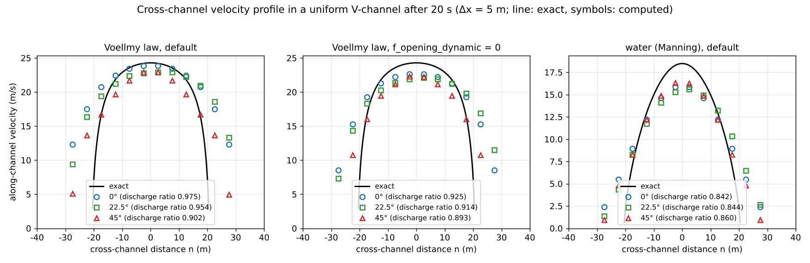

# test/vchannel — cross-channel distribution of the flow in a uniform V-channel against the exact solution (flow directions 0°, 22.5° and 45°)

> English mirror of test/vchannel/README.md. The Japanese file is the master copy.

[日本語](../README.md)

This case checks whether the **cross-channel velocity distribution and the discharge** of a flow in a V-shaped
valley resolved by the grid (snow avalanches, debris flows, steep torrents) come out correctly whatever the
direction of the valley relative to the grid. In a V-channel on a uniformly inclined slope, the velocity of each
column in a stretch that is uniform along the flow is set by its own flow depth alone. The computation on the
8-neighbour ENC grid is compared with this exact solution for flow directions of 0°, 22.5° and 45°. Both water
(Manning's law) and the Voellmy law of the sediment-flow model (the avalanche setting pattern) are covered.

It is the case that revealed the defect in which the blockage ratio of the dynamic reassignment of blocked
openings (`f_opening_dynamic`; [passage-width adjustment](../../../docs/en/users_guide/passage_width.md))
was measured with the water depth instead of the flow depth in sediment-flow computations (developer.md §130),
and it also guards against its return.

## Configuration

| Item | Value |
|---|---|
| Terrain | A V-channel with a wall slope of 0.6 (rounded bottom) on a uniform slope S = 0.4. Bed elevation z = 1000 − S s + z_c(n), z_c(n) = 0.6 (√(n² + 21²) − 21); s is the distance along the channel, n the cross-channel distance (m) |
| Flow | Over a 600 m long stretch, snow (or water) of thickness max(5 − z_c, 0) (4.91 m at the bottom, 40 m wide), whose surface is level across the channel, is set in motion at t = 0 |
| Grid | 1400 m × 1400 m, Δx = 5 m (280 × 280), dt = 0.025 s, 20 s. The flow is 8 cells wide |
| Direction | The channel is rotated by 0°, 22.5° and 45° from the x axis of the grid (`data_r0`, `data_r22p5`, `data_r45`) |
| Voellmy law | μ = 0.25, ξ = 1750 m/s², no entrainment or stopping, the carrier is one tenth of the snow thickness (`param_voellmy.txt`) |
| Water | Manning's roughness n = 0.1 (`param_water.txt`) |
| Steep-slope correction | None (`f_gravity_correction = 0`, so that the exact solution is written with the horizontal velocity and the vertical depth) |

The middle of the stretch (where the rarefaction waves from both ends have not arrived; s = −150 to 100 m after
20 s) is uniform along the flow: the flow depth h(n) does not change and there is no cross-channel flow. With a
resistance law that has no cross-channel stress, the (horizontal) velocity u of each column follows

```text
Voellmy law     du/dt = g (S − μ) − g u² / (ξ h)    →  u = u_t tanh(g (S − μ) t / u_t),  u_t = √(ξ h (S − μ))
Manning's law   du/dt = g S − g n² u² / h^(4/3)      →  u = u_n tanh(g S t / u_n),        u_n = h^(2/3) S^(1/2) / n
```

(our own arrangement). The measure is the ratio to the exact solution of the discharge in the middle of the
stretch, Q = Σ h u_s Δn (u_s is the along-channel component of the velocity).

| Configuration | Content | Directions |
|---|---|---|
| `vo` | Voellmy law, default numerical settings | 0°, 22.5°, 45° |
| `vo0` | Voellmy law, `f_opening_dynamic = 0` (the setting used by the example snow_avalanche, an avalanche in a V-shaped gully) | 0°, 22.5°, 45° |
| `vo4` | Voellmy law, 4 neighbours (`p_diagratio = 0`) | 0° |
| `fr` | No friction (μ = 1e-4, ξ = 1e9), 1 s | 0°, 22.5°, 45° |
| `w` | Water, default numerical settings | 0°, 22.5°, 45° |
| `w4` | Water, 4 neighbours | 0° |

| File | Content |
|---|---|
| `make_init.py` | Writes the inputs `data_<direction>/` and the settings of each configuration `p_<configuration>_<direction>.txt` (from the two templates `param_voellmy.txt` and `param_water.txt`, replacing only the direction and the differences in the table above) |
| `Check_vchannel.py` | (1) no friction: along-channel velocity after 1 s ÷ g S t within 0.96–1.01; (2) 4 neighbours, 0°: discharge within ±2 % of the exact solution; (3) Voellmy law, default: discharge ratio within 0.86–1.02 and the spread over the directions (max − min)/mean within 10 %; (4) Voellmy law, `f_opening_dynamic = 0`: 0.86–1.00, spread within 5 %; (5) water, default: 0.80–1.00, spread within 4 % |
| `Fig.py` | The figure below, `figs/vchannel.png` |

## Running

```bash
make
./Run.sh          # generate the inputs → run (14 runs) → Check (about 1 minute on 4 threads)
./Run_MPI.sh 4    # MPI. The distributed outputs match the serial run byte for byte
python3 Fig.py    # figs/vchannel.png (with the argument en, the English version in en/figs/)
```

## Figure



Cross-channel distribution of the along-channel velocity after 20 s (means over 5 m widths weighted by the flow
depth). The line is the exact solution and the symbols are the computation (three directions). Left: Voellmy
law, default. Middle: Voellmy law, `f_opening_dynamic = 0`. Right: water, default. The exact solution has flow
only within the 40 m width, whereas in the computation the flow spreads one or two cells up the banks and the
velocity in the middle comes out lower by that much.

## Findings

Values for Δx = 5 m (gfortran 13.3, -Ofast).

| Measure | 0° | 22.5° | 45° |
|---|---:|---:|---:|
| (1) No friction: velocity ÷ g S t (after 1 s) | 0.995 | 0.994 | 0.990 |
| (3) Voellmy law, default: discharge ÷ exact | 0.975 | 0.954 | 0.902 |
| (4) Voellmy law, `f_opening_dynamic = 0`: discharge ÷ exact | 0.925 | 0.914 | 0.893 |
| (5) Water, default: discharge ÷ exact | 0.842 | 0.844 | 0.860 |

- **4 neighbours along the grid** (2) agrees with the exact solution: 0.990 for the Voellmy law and 0.995 for
  water. A computation with the fluxes of an orthogonal grid only has no cross-channel coupling, so this confirms
  the exact solution and the way the check is set up.
- **The acceleration without friction** (1) is within 1 % of g S in every direction (0.975 is the value of the
  one-step lag). Computations up to 2026-11-25, which measured the blockage ratio with the water depth, gave
  1.118 at 0°, exceeding the acceleration that gravity provides by 15 %.
- **The Voellmy law** gives a discharge of 0.90 to 0.98 times the exact solution with the default (3) and 0.89 to
  0.93 times with `f_opening_dynamic = 0` (4). The spread over the directions is 8 % with the default and stays
  within 3 % with `f_opening_dynamic = 0`. The default dynamic reassignment widens only the passage along the
  axis in the bottom rows (the rise of the valley floor is 14 % of the flow depth), so the discharge at 0° comes
  out 5 % larger. The thinner the flow, the larger this difference.
- **Water** (5) gives a discharge of 0.84 to 0.86 times the exact solution, with a spread of 2 % over the
  directions. The discharge is low because the default that caps the edge depth of edges oblique to the flow by
  the upstream depth (`f_hcap_upwind = 1`) spreads the flow up the banks (the flow width grows from 40 m to
  60 m); it approaches the exact solution as the grid is refined.

**Limits of accuracy**: in this channel, where the flow is 8 cells wide, the discharge of the 8-neighbour
computation is 2 to 16 % below the exact solution. The error shrinks roughly in proportion to the grid spacing
(at Δx = 2.5 m, 0.95 and 0.91 (0°, 45°) for the Voellmy law with `f_opening_dynamic = 0` and 0.91 and 0.93 for
water; developer.md §130.2 and §130.6). For a flow advancing in a V-shaped gully, use
`f_opening_dynamic = 0`, which has the smaller spread over the directions, when the dependence on the direction
of the valley is to be reduced (example [snow_avalanche](../../../examples/snow_avalanche/en/README.md)). In a
valley with a flat floor and steep walls, keep the default 3, because with 0 the passage width of the rows
touching the valley walls is not handed back
([passage-width adjustment](../../../docs/en/users_guide/passage_width.md) §7; the comparison for the debris
flow of the example debris_fan is in developer.md §130.11).

## Related documents

- [Passage-width adjustment](../../../docs/en/users_guide/passage_width.md) (dynamic reassignment of blocked openings and the blockage ratio)
- [Debris flow, slope failure and moving bed layer](../../../docs/en/users_guide/massflow.md) (Voellmy law)
- developer.md §130 (the cause of the dependence on the gully direction and the form of this check), §68.14 and §68.41 (dynamic reassignment)
- [test/vshaped](../../vshaped/en/README.md) (rainfall runoff of a V-shaped catchment at 0° and 45° against the theoretical solution)
- [test/volcano](../../volcano/en/README.md) (uniform flow of the Voellmy law on a uniform slope)
