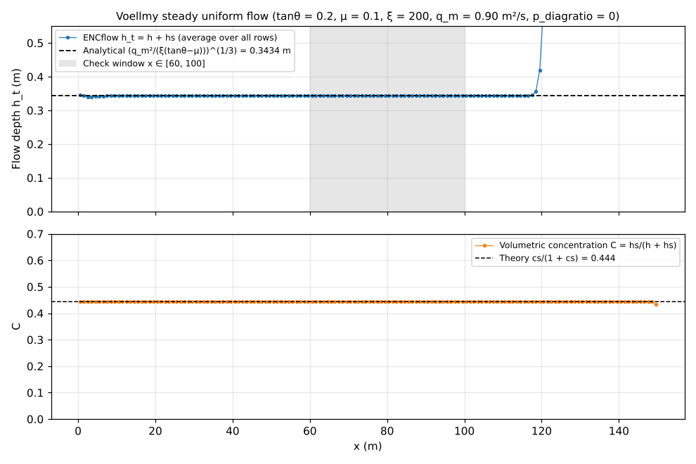
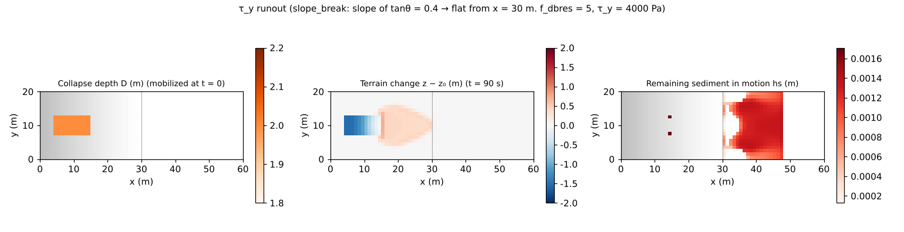

# test/volcano — equivalent-fluid mode for volcanic flows: analytical solution of Voellmy steady uniform flow and τ_y runout

> English mirror of test/volcano/README.md. The Japanese file is the master copy.

[日本語](../README.md)

This verification case runs gravity flows resembling pyroclastic flows, lahars
and lava as an **equivalent fluid** without sediment exchange with the bed
(`f_debris = 1`, `f_dbed = 0`; developer.md §28.8). It consists of two
configurations.

1. **Voellmy steady uniform flow** (`param.txt`): a mixture is fed at a
   constant rate onto a slope of uniform gradient and compared with the
   analytical uniform-flow depth of the Voellmy resistance law (`f_dbres = 4`:
   μ + g V²/(ξ h)) as a quantitative benchmark. The default steep-slope gravity
   correction 2 evaluates Voellmy along the slope (developer.md §101), so uniform
   flow follows the along-slope equation V_s² = ξ h_t cosθ (sinθ − μ cosθ), which
   with the horizontal velocity and the vertical depth reads
   h_t = (q_m²/(ξ cos⁴θ (tanθ − μ)))^{1/3}. The water and solid ledgers (budgets)
   are also checked.
2. **τ_y runout** (`param_ty.txt`): with a constant retarding stress τ_y plus
   Manning combined (`f_dbres = 5`), the sequence instantaneous mobilization of
   a soil mass on the slope → descent → deposition on the flat → stopping and
   bed fixation, together with the solid ledger, is checked.

Pass or fail is decided by the self-check of `Check_volcano.py`, not by a
reference comparison. The same equivalent-fluid setup is also used for flowing
snow avalanches ([test/avalanche](../../avalanche/en/README.md)).

## Configuration

| Item | Configuration 1: Voellmy uniform flow | Configuration 2: τ_y runout |
|---|---|---|
| Terrain | Slope of uniform gradient tanθ = 0.2, 150 m × 8 m (Δx = 1 m; `make_init.py z`) | slope_break: slope of tanθ = 0.4 → flat from x = 30 m. 60 m × 20 m |
| Supply | 4 m³/s from the 8 cells at the west end, sediment concentration cs = 0.8 → q_m = 0.9 m²/s per unit width | Collapse depth D = 2 m given on the slope at i ∈ [5, 15], j ∈ [8, 13], mobilized instantaneously at t = 0 (`f_release`) |
| Resistance law | Voellmy μ = 0.1, ξ = 200 m/s² | τ_y = 4000 Pa + Manning n = 0.03 |
| ENC | `p_diagratio = 0` (4-neighbour reduction; see the note below) | Default (8 directions) |
| Time | dt = 0.02 s, 120 s (steady state reached) | dt = 0.02 s, 90 s (complete stop) |
| Porosity | λ = 0.4 (C* = 0.6; used for the (1 − λ) of the ledger) | Same as left |

**Note (4-neighbour reduction in configuration 1)**: the comparison with the
analytical solution is made with `p_diagratio = 0`. With the 8-direction
distribution, the nonlinearity "gradient reduction × yield μ" on the diagonal
edges lowers the effective conveyance, and the result departs from the
one-dimensional analytical solution by 24%. This is a property of the scheme,
not a bug, and real-terrain computations keep the default 8 directions (§28.8).
Also, ny = 8 because the band decomposition needs at least 2 rows per rank.

| File | Contents |
|---|---|
| `param.txt` / `param_ty.txt` | Configurations 1 / 2 |
| `make_init.py z` / `db` | `zinit.txt` (slope of uniform gradient) / `dbinit.txt` (collapse-depth distribution) |
| `Check_volcano.py <save> voellmy\|tauy` | Configuration 1: (1) water ledger, (2) solid ledger, (3) <h_t> in the check window x ∈ [60, 100] versus the analytical solution, uniformity and concentration. Configuration 2: (1) solid ledger, (2) activity (lowering of the release area and deposition on the flat), (3) stopping (fraction of remaining hs) |
| `Fig.py` | The figures `en/figs/*.png` below (`python3 Fig.py en`; `figs/*.png` are the Japanese versions) |

## Running

```bash
make
./Run.sh          # generate inputs → configuration 1 → Check → configuration 2 → Check. PASS when all pass
./Run_MPI.sh 4    # MPI. The rule is that save/state.dat is byte-identical to the serial run
python3 Fig.py en # en/figs/voellmy.png, en/figs/tauy.png
```

## Figures



Top: the flow depth h_t = h + hs in the steady state (average over all rows).
The uniform-flow depth is reached within a few metres of the inflow, and in the
check window (grey) it agrees with the analytical solution 0.3525 m to
**0.00%** (coefficient of variation 0.0001). The rise at the downstream end is
backwater because the east side is a wall (no outflow boundary); it does not
reach the check window within the 120 s.
Bottom: the volumetric concentration of the mixture C = hs/(h + hs) keeps
cs/(1 + cs) = 0.444, determined by the inflow concentration, over the whole
domain (without exchange the concentration is a conserved quantity).



Left: the release area with collapse depth D = 2 m. Centre: the terrain change
after 90 s. The release area is lowered by up to 1.55 m, and a fan-shaped deposit
lies on the slope from directly below it to the slope break (with a retarding
stress of 4000 Pa the flow stops on the slope). Right: the remaining sediment
in motion hs is only a thin fringe of about a mm beyond the slope break, 0.4% of the
released amount (99.6% has been fixed to the bed).

## Findings

| Check | Computed value | Verdict |
|---|---|---|
| Configuration 1 (1) water ledger Σh − Q tt | about 1e-11 m·cell or less (round-off) | PASS (machine precision) |
| Configuration 1 (2) solid ledger Σhs + (1 − λ)Σdz − cs Q tt | about 1e-11 m·cell or less (round-off) | PASS |
| Configuration 1 (3) <h_t> versus the analytical solution | 0.3525 / 0.3525 m (0.0%), CV 0.000, C 0.444 (theory 0.444) | PASS |
| Configuration 2 (1) solid ledger | about 1e-10 m·cell or less (round-off) | PASS |
| Configuration 2 (2) activity | release area min dz = −1.55 m, flat max dz = 0.044 m | PASS |
| Configuration 2 (3) stopping | remaining Σhs / released solids = 0.004 (< 0.3) | PASS |

- The Voellmy uniform flow agrees with the analytical solution to 4 digits, and
  the water and solid ledgers close at machine precision. These are the
  baseline values of the equivalent-fluid mode for volcanic flows and
  avalanches.
- With stopping and bed fixation (`f_dbstop = 1`: low-speed consolidation),
  almost the entire flowing body stops in the τ_y case.
- The transverse uniformity of the Voellmy uniform flow was secured by the fix
  of §28.11 (the yield-stop judgement is made with the edge speed).
  [test/curvature](../../curvature/en/README.md) is a check that adds the
  curvature term to the same uniform flow.

- With the default 2 of 2026-10-18 to 31 the deposit of configuration 2 crossed the
  slope break and reached 0.646 m on the flat; with the default 3 since 2026-10-31
  it is 0.185 m, close to the former default 1 (2 sped up the flow on steep slopes;
  §68.41). The deposit crossing the slope break with 2 was due to the change
  of the default on 2026-10-18 (f_opening_dynamic = 2; developer.md §68.38).
  With the former default 1 written explicitly, the values of 10-12 (release
  area −1.56 m, flat part 0.06 m, remaining 0.005 = stops on the slope) are
  reproduced (confirmed 2026-10-24). With the code just before the fix of the
  steep-slope gravity correction of 2026-11-04 (§91) the flat part was 0.200 m; after
  the fix it is 0.053 m (release area −1.55 m, remaining 0.004), close to the values
  of 10-12 (the effective gravity, which came out too large on edges oblique to the
  slope, is now right, and the flow held by the constant yield stress τ_y stops on the
  slope). On 2026-11-05 the steep-slope gravity correction was set to the default 2
  (friction along the slope; developer.md §93), giving 0.028 m (release area −1.55 m,
  remaining 0.004). 2 evaluates the Manning term combined with τ_y with the speed
  along the slope and the depth normal to the ground, so the friction on the slope is
  stronger and less material reaches the flat (with 1 written explicitly it stays
  0.053 m). Configuration 1 does not change with 2 (the turbulent term of Voellmy
  replaces the Manning term). The difference of the ledger values of configuration 1
  from the former values (−2.4e-12, −3.0e-12) is a machine-precision rounding
  difference from earlier changes of the flow computation (§94, §95 and others).
  Recomputed on 2026-11-06 after the change by which 2 also evaluates the resistance
  laws of mixture flows along the slope (developer.md §101). The uniform flow of
  configuration 1 now follows the along-slope equation, and its depth changed
  0.3434 → 0.3525 m (+2.65 % = (1 + tan²θ)^{2/3}; the turbulent term of Voellmy is
  1/cos⁴θ times larger). The analytical solution was also changed to the along-slope
  equation, and the tolerance was narrowed from 3 % to 1 % (a width that tells apart the
  2.65 % difference from the horizontal equation of 1). In configuration 2 the deposit on
  the flat part changed 0.028 → 0.031 m and the remaining fraction 0.004 → 0.005 (the
  yield factor is 1 in the direction of steepest descent but grows for flow spreading
  obliquely across the slope). The differences of the ledger values are machine-precision
  rounding. Rerun on 2026-11-10 with the current defaults, the deposit on the flat part of
  configuration 2 is 0.044 m (remaining fraction 0.005; not separated out). After the default of
  the edge-depth cap became f_dry_head_cap = 2 on 2026-11-13, the deposit on the flat part stays
  at 0.044 m and the remaining fraction is 0.004 (developer.md §108). The values of
  the table and the text and the figures are from this computation.

## Related documents

- [docs/users_guide/geomorph.md](../../../docs/en/users_guide/geomorph.md) — resistance laws of mixture flow (`f_dbres` 1–5), equivalent-fluid mode, application to avalanches
- developer.md §28.8 (design and verification of the equivalent-fluid mode), §28.10–11 (curvature term and transverse uniformity)
