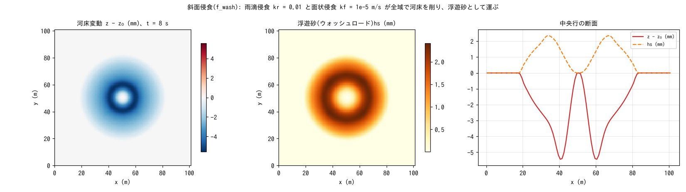

# test/wash — hillslope erosion (f_wash: raindrop + sheet erosion): basic operation and conservation laws

> English mirror of test/wash/README.md. The Japanese file is the master copy.

[日本語](../README.md)

A check of the basic operation and conservation laws of the rainfall-driven
hillslope erosion module (`f_wash = 1`; raindrop erosion `wash_kr` and sheet
erosion `wash_kf` erode the bed, and suspended sediment `f_suspend` carries
the transport; developer.md §19). A uniform rainfall of 50 mm/h is superposed
on a closed-domain dam break (wave_hump), and the conservation of total solid,
the co-moving update and the activity are checked with `Check_suspend.py`
(shared).

## Configuration

| Item | Value |
|---|---|
| Domain and grid | 101 m × 101 m, 101 × 101 cells (Δx = 1 m), flat, walls on all four sides |
| Initial condition | Still water h₀ = 0.5 m + cosine-shaped mound (+1 m) |
| Rainfall | 50 mm/h uniform |
| Erosion | `wash_kr = 0.01` (raindrop), `wash_kf = 1e-5 m/s` (sheet). Transport by `f_suspend = 1` |
| Soil layer | sd₀ = 10 m, porosity 0.4. dt = 0.1 s, 8 s |

| File | Contents |
|---|---|
| `Run.sh` | Runs and checks with `../suspend/Check_suspend.py save` |
| `Fig.py` | The figure `figs/wash.png` below |

## Running

```bash
make
./Run.sh          # run → checks of total solid, co-moving update and activity (1 s)
./Run_MPI.sh 4    # MPI; state.dat byte-identical to the serial run
python3 Fig.py    # figs/wash.png
```

## Figures



Left: bed change. Sheet erosion concentrates in the ring of the collapsed
mound (maximum 5.6 mm), and raindrop erosion lies thinly over the whole
domain. Center: suspended sediment hs. The eroded sediment is carried in the
water column (maximum 2.2 mm). Right: the section along the central row. The
change is an order of magnitude larger than in [test/suspend](../../suspend/en/README.md),
with sheet erosion in the fast-flowing ring dominant.

## Findings

| Check | Computed | Result |
|---|---|---|
| Total solid Σhs + (1 − λ)Σ(z − z₀) | 0.0 (machine precision) | PASS |
| Co-moving update max\|(sd − sd₀) − (z − z₀)\| | 1.9e-14 m | PASS |
| Activity max hs / max\|z − z₀\| | 2.24 mm / 5.58 mm | PASS |

- wash is a one-pass landform process that does not read its neighbours, so
  it is safe under OpenMP as well, and the state.dat of np = 1, 2, 4 is
  byte-identical to the serial run (§19).
- The erosion coefficients are empirical and assume calibration (§62: the
  defaults of `wash_kr` / `wash_kf` are the values of this case). Building
  coefficients by land use and rill / gully erosion remain as future work.
- Dry-slope erosion without flowing water (raindrop and subgrid rill) is in
  [test/splash](../../splash/en/README.md).

## Related documents

- [docs/users_guide/geomorph.md](../../../docs/en/users_guide/geomorph.md) — `f_wash`, `wash_kr`, `wash_kf`
- developer.md §19 (implementation and verification record)
