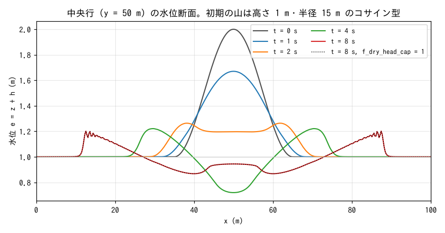
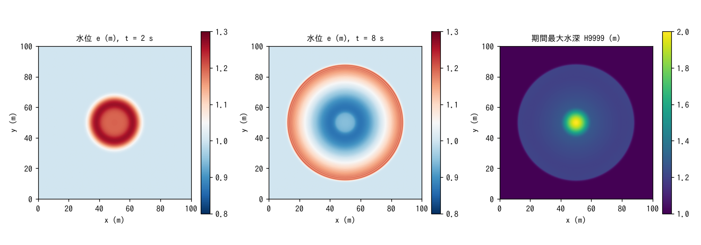
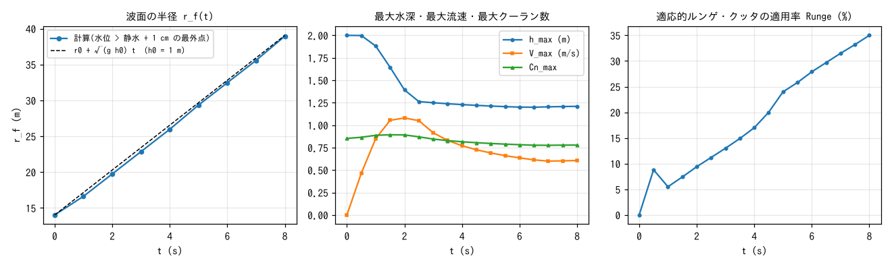

# test/wave — a water mound spreading over still water (minimal shallow-water example and baseline regression case)

[日本語正本](../README.md)

> English mirror of `test/wave/README.md`. The Japanese version is authoritative.

This baseline case checks ENCflow's minimal configuration. A cosine-shaped water
mound, 1 m high and 15 m in radius, is placed at the center of a flat,
frictionless, closed square basin with still-water depth h₀ = 1 m. The initial
condition is `wave_hump` in `user_initial`: η = 0.5 (1 + cos(2πr/30)) m for
r < 15 m. Its spreading is computed for 8 seconds. With no terrain, boundary,
rainfall or friction features activated, only the pressure and advection terms
of the shallow-water equations and the ENC grid's eight-direction exchanges
operate, so changes to the numerical scheme appear directly in the results.
[tutorials/wave](../../../tutorials/wave/en/README.md) develops this case into
teaching material, explaining the screen output, parameter-file structure and
wave-front oscillations (grid refinement and physical dispersion).

## Configuration

| Item | Value |
|---|---|
| Domain and grid | 100 m × 100 m; 385 × 385 cells (Δx ≈ 0.26 m) |
| Terrain and roughness | z = 0; Manning n = 0 (frictionless) |
| Initial condition | h₀ = 1 m plus a cosine mound (height 1 m, radius 15 m); zero velocity |
| Boundaries | Default impermeable walls on all four sides (`&list_bound` is empty) |
| Time step | dt = 0.05 s; 8 s (Cn_max ≈ 0.89); water level E and depth H output every 1 s |
| ENC settings | Explicit `&list_enc` settings: gravity correction, excess-outflow reduction and hcap are 0; upwind coefficient 1.0; p_diagratio 0.578; adaptive RK threshold 1.2 |

`&list_enc` is explicit so changes to defaults do not destabilize the comparison
with the reference. This is its role as a regression test. These settings differ
from general examples using ENCflow's current defaults, including momentum-conservative
MUSCL advection scheme 3 and hcap = 1.

| File | Contents |
|---|---|
| `param.txt` | Baseline case described above, with a reference |
| `en/param.txt` | English comments for `param.txt`; regression scripts still use the authoritative `param.txt` |
| `param_cap.txt` | Same settings with `f_dry_head_cap = 1` (energy-head cap on edge depth toward dry cells; developer.md §68.16). The domain is entirely wet, so the cap never acts; this checks bit identity with the reference |
| `Plot_wave.plt` | Interactive gnuplot display of water level, maximum depth and velocity distributions |
| `Fig.py` | Produces the `figs/*.png` figures below |

## Execution

Run everything below from `test/wave`. Do not move into `en/` when reading this
English version. To use the input with English comments directly, run
`./encflow en/param.txt`; this does not replace the regression tests with
reference comparison below. The output location is the same as for the source
input, so use separate working copies when retaining separate comparison results.

```bash
make                      # Link the executables from bin/
./Run.sh                  # Serial; compare Log.txt with the reference (ULP = 1; exclude Runge)
./Run_MPI.sh 4            # MPI with 4 ranks; the Log must match the serial run
./encflow param_cap.txt   # f_dry_head_cap = 1 (result_cap/); the Log matches the reference
python3 Fig.py            # figs/profile.png, map.png, log.png
```

Run.sh calls the shared engine [Run_case.sh](../../Scripts/Run_case.sh) and compares
the columns of the output log (Log.txt) with tolerance 1 in the last printed digit
(`ULP=1`). Column 4, the adaptive Runge–Kutta application percentage (Runge), is
excluded because it may depend on the thread count (`SKIPCOLS=4`).

## Figures



These profiles show water level e = z + h along the central row (y = 50 m).
The mound collapses into an outward-moving ring: the top flattens at t = 2 s,
and the center falls 0.27 m below still water at t = 4 s. By t = 8 s, the ring
has spread to radius 39 m. The center is recovering from its t = 4 s depression
(0.94 m). Fine oscillations at the ring's outer edge are grid-scale numerical
dispersion; they shrink with grid refinement (see the supplementary discussion
in tutorials/wave). The dotted t = 8 s line for `param_cap.txt`
(f_dry_head_cap = 1) lies exactly over the solid line.



Left and center: water-level distributions at t = 2 and 8 s. The ring remains
circular independently of the grid orientation, reflecting the isotropy of the
ENC grid's eight-direction exchanges. Right: maximum depth during the run, H9999.
Outside the initial 2 m mound, values are around 1.2 m where the ring passed;
the corners not reached by the wave remain at 1 m.



Left: the outermost radius r_f(t) where the water level exceeds still water by
1 cm. The mean propagation speed is 3.19 m/s, consistent with the long-wave
speed at the still-water depth, √(g h₀) = 3.13 m/s; the +2% reflects propagation
over the raised surface at the front. Center: h_max decreases from 2.0 to
1.20 m and settles at the ring height; V_max peaks at 1.08 m/s at t = 2 s and
then decreases. Cn_max remains within the stability condition at 0.85–0.89.
Right: the adaptive Runge–Kutta application percentage increases from 0 to 35%
as the front spreads.

## Findings

| Quantity | Value |
|---|---|
| Mean depth S | Constant at 1.02101897412350 m at all times (15 printed digits; mass conservation in the closed basin) |
| h_max | 2.000 → 1.200 m (ring height 1.20–1.21 m after t = 6.5 s) |
| Peak V_max | 1.080 m/s (t = 2.0 s) |
| Peak Cn_max | 0.893 (dt = 0.05 s) |
| Wave-front speed (1–8 s) | 3.19 m/s (√(g h₀) = 3.13 m/s) |
| ex_flux | 0 (excess-outflow reduction remains disabled and is never needed) |

- Mass is conserved to all printed digits, the ring spreads isotropically, and
  the wave-front speed agrees with the long-wave speed. These are the three
  properties to verify in this baseline case.
- `param_cap.txt` (f_dry_head_cap = 1) produces bit-identical logs and distributions.
  Since the entire domain is wet, the cap never activates. This checks that the
  protection does not change an existing wet-domain calculation (developer.md §68.16).
- Regression discipline: the serial and MPI (np = 1, 2, 4) logs must agree.
  Update a reference (`./Run.sh -u`) only after a person has visually confirmed
  the validity of the results, following the absolute rules in CLAUDE.md.

## Related documentation

- [Tutorial version](../../../tutorials/wave/en/README.md): coarse and fine time
  steps, adaptive Runge–Kutta, transmissive boundaries, diagonal walls and the
  origin of wave-front oscillations.
- [Shallow-water flow guide](../../../docs/en/users_guide/swflow.md): `&list_enc`
  settings and current defaults.
- developer.md §68.16 (f_dry_head_cap; Japanese only).
