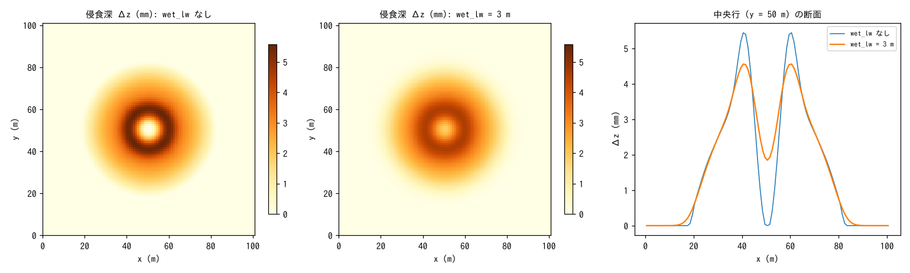

# test/wetlw — 湿潤侵食の剥離深の横方向拡散 wet_lw

表面流の面状侵食(`f_wash`)と巻き上げ(`f_suspend`)はセル値の τ* に
比例し、流れが 1 セル幅に集まるとそのセルだけが削れてさらに水を集めます。
この正帰還に長さスケールがないため、ガリーの幅と間隔が格子幅で決まり、
格子を細かくしても収束しません(examples/badland_storm 結果 4)。
`wet_lw = ℓ_w` は、各セルで評価した剥離深を標準偏差 ℓ_w のガウス核で
隣接セルに配ってから `z`・`sd` から引くオプションです(浮遊砂 `hs` は源セルに
入る。developer.md §84.15)。核は対称で領域外・海セルへの分は自セルに戻すので、
固体の総量は保存されます。

このテストは test/wash と同じ構成(平坦床、閉領域ダムブレイク + 一様降雨
50 mm/h、8 s)を `wet_lw` なし(構成 0)と `wet_lw = 3 m`(構成 l)で走らせ、

| 検定 | 内容 |
|---|---|
| 保存則(両構成) | `../suspend/Check_suspend.py`: 固体総量 Σhs + (1−λ)Σ(z−z0) = 0、共動更新 sd − sd0 = z − z0、活性 |
| 平滑(`Check_spread.py`) | (1) 侵食深 Δz の格子規模の凹凸(5 点ラプラシアンの 2 乗和)が構成 l で半分以下、(2) 最大侵食深が構成 l で小さい、(3) 総侵食量の比が 0.5〜2(配り直すだけで量は変えない) |
| MPI | np = 2, 4 の `state.dat` が逐次とバイト一致(平滑化の各パスでハロを交換) |

を検定します。

## 実行

```bash
make
./Run.sh          # 構成 0 → l → 検定(数秒)
./Run_MPI.sh 4    # MPI。state.dat が逐次とバイト一致
python3 Fig.py    # figs/wetlw.png
```

## 図



左: 構成 0 の侵食深 Δz = z0 − z、中: 構成 l、右: 中央行の断面。ダムブレイクの
前縁が刻むリング状の侵食が、ℓ_w = 3 m では幅 ≈ ℓ_w に配られて峰が低く裾が広がり、
中心の未侵食の穴も埋まります(総量は同じ)。

## 所見

| 量 | 構成 0(wet_lw なし) | 構成 l(ℓ_w = 3 m) |
|---|---|---|
| 固体総量 Σhs + (1−λ)Σ(z−z0) | 0.000e+00 | 0.000e+00 |
| 侵食深の格子規模の凹凸(ラプラシアンの 2 乗和, m²) | 4.19e−05 | 7.47e−06(0.18 倍) |
| 最大侵食深 (m) | 5.58e−03 | 4.61e−03 |
| 総侵食量の比 | 1 | 1.002 |

## 関連文書

- [test/wash](../wash/)(同じ構成の疎通・保存則)、[test/suspend](../suspend/)
- [examples/badland_storm](../../examples/badland_storm/) 結果 4・5(ガリー間隔の格子収束)
- [docs/users_guide/geomorph.md](../../docs/users_guide/geomorph.md) — `wet_lw`
- developer.md §84.15、docs/splash_plan.md §6.9
