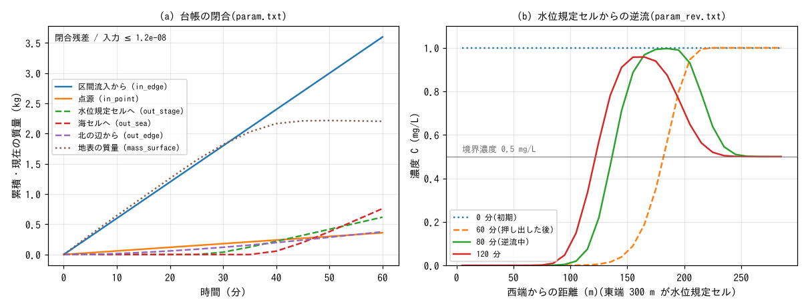

# test/wqbound — 水質の台帳の系外との出入りと、水位規定セル

[English](en/README.md)

水質(fn_wq)の物質が系外とやり取りする経路 — 海域マスクの海セル・開いた辺・
水位規定セル — を台帳 `result/wq.csv` が数え切ること(閉合)と、水位規定セルが
物質にとって「系外の水」として働くこと(developer.md §30.9)の検定です。

- **param.txt(回帰の reference と比較)**: 東へ下る幅 80 m の平らな水路
  (40 × 8 セル、dx = 10 m、勾配 1/667、北の行が 0.07 m 高い横勾配)に、西の辺の
  区間流入 0.5 m³/s(境界流入濃度 2 mg/L)と点源 0.1 g/s を 1 時間入れ、東端
  3 列の海セル、北の辺の自由流出、南の行の水位規定セル 1 個(η = −999 の
  排水口)から系外へ出す。台帳の閉合
  「入力の累積(in_point_g + in_edge_g)− 系外への流出(out_sea_g + out_edge_g +
  out_stage_g)= 地表の現在質量」が全時刻で成り立つことと、各経路が働いて
  いることを確かめる。
- **param_rev.txt**: 水深 1 m・濃度 1 mg/L の水を満たした平らな水路
  (30 × 1 セル)の西端から清水を 1 時間流して東端の水位規定セル(水位 0 m)へ
  押し出し、1〜1.5 時間に規定水位を 0.5 m まで上げて逆流させる。規定セルから
  入る水の濃度は境界濃度 `wq_stage_conc(1) = 0.5` mg/L。濃度が初期値の 1 mg/L を
  超えないこと(規定セルへ流れ込んだ物質が溜まって戻らないこと)、規定セルに
  接するセルの濃度が逆流後に 0.5 mg/L になること、台帳が閉じることを確かめる。

## 構成

| 項目 | param.txt | param_rev.txt |
|---|---|---|
| 領域・格子 | 40 × 8 セル、dx = 10 m(`data_wqbound/z.txt`、海域マスク `sw.txt`) | 30 × 1 セル、dx = 10 m、地盤高 −1 m |
| 初期 | 乾いた水路(初期質量 0) | 水深 1 m、濃度 1 mg/L(3000 g) |
| 入力 | 区間流入 0.5 m³/s × 2 mg/L、点源 0.1 g/s | 西端の湧き出し 0.5 m³/s(清水、1 時間) |
| 出口 | 海セル(東端 3 列)、北の辺の自由流出、水位規定セル (30, 8) | 水位規定セル (30, 1)(水位 0 m → 0.5 m)、境界濃度 0.5 mg/L |
| 時間 | dt = 0.5 s、1 時間 | dt = 0.1 s、2 時間 |

| ファイル | 内容 |
|---|---|
| `Run.sh` | param.txt の Log.txt・wq.csv を reference と比較(ULP = 0。Log の Runge 列は除外)→ `Check_wqbound.py closure`・`paths` → param_rev.txt を実行して `closure`・`reverse` |
| `Check_wqbound.py closure\|paths\|reverse` | 台帳の閉合(全行、相対 1e-6)/ 各経路の活性 / 逆流の濃度の上限と境界濃度 |
| `Fig.py` | 下の図 `figs/wqbound.png` |

## 実行

```bash
make
./Run.sh
./Run_MPI.sh 4
python3 Fig.py    # figs/wqbound.png(引数 en で英語版を en/figs/ に)
```

## 図



(a) param.txt の台帳。西の辺から入る物質(区間流入の濃度)と点源の累積に対し、
25 分ごろから水位規定セルと北の辺、40 分ごろから海セルへの流出が始まり、地表の
質量は 45 分以降ほぼ一定になる。閉合残差は入力の 1e-8 程度(出力の桁の範囲)。
(b) param_rev.txt の濃度の縦断。60 分までに清水が元の水(1 mg/L)を東へ押し出し、
逆流が始まると規定セルから 0.5 mg/L の水が入る。元の水は西へ戻るが、濃度は
1 mg/L を超えない。

## 所見

| 検定 | 計算値 | 期待 | 判定 |
|---|---|---|---|
| param.txt の閉合残差(全行、入力比) | 2.9e-8 | ≤ 1e-6 | PASS |
| 区間流入から入った量 in_edge_g | 3599.5 g | 0.5 m³/s × 2 g/m³ × 3600 s = 3600 g | 一致(下記) |
| 点源 in_point_g | 360.00 g | 0.1 g/s × 3600 s | 一致 |
| 系外への流出 out_sea / out_edge / out_stage | 760.5 / 376.6 / 618.3 g | いずれも正 | PASS |
| param_rev.txt の閉合残差 | 2.4e-8 | ≤ 1e-6 | PASS |
| 全時刻の最大濃度 | 1.0000 mg/L | ≤ 初期値 1 mg/L | PASS |
| 規定セルに接するセルの最終濃度 | 0.5000 mg/L | 境界濃度 0.5 mg/L | PASS |

- in_edge_g が 3600 g に 0.5 g 足りないのは、境界流入濃度のテーブルを m_wq が
  ステップの最後に更新し、最初の 1 ステップ(dt = 0.5 s)は清水として入るため
  (既存の仕様)。
- 修正前(2026-11-03 より前)は、水位規定セルへ流れ込んだ物質がセルに溜まり
  続け(見かけの濃度が 1 時間で元の水の 19 倍)、逆流でその物質が戻って 1 mg/L を
  超える濃度(1.63 mg/L)が現れた。台帳でも、規定セルから出た物質が地表の質量に
  残っていた。

## 関連文書

- [docs/users_guide/wq.md](../../docs/users_guide/wq.md)(出力・確認の台帳の列と閉合)、
  [docs/users_guide/boundary.md](../../docs/users_guide/boundary.md)(水位規定セル)
- developer.md §30.9(系外との出入りの台帳と水位規定セルの扱い)
