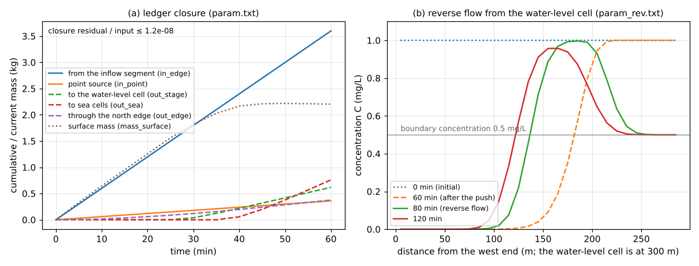

# test/wqbound — Exchange of water-quality mass with the outside of the system, and water-level cells

> English mirror of test/wqbound/README.md. The Japanese file is the master copy.

[日本語](../README.md)

This test checks that the water-quality ledger `result/wq.csv` accounts for
every path by which the substance (fn_wq) is exchanged with the outside of the
system — sea cells of the sea mask, open edges and water-level (stage) cells —
so that the ledger closes, and that water-level cells act on the substance as
"outside water" (developer.md §30.9).

- **param.txt (compared with the regression reference)**: a flat-bottomed
  channel 80 m wide that slopes down to the east (40 × 8 cells, dx = 10 m,
  slope 1/667, with a cross slope that makes the north row 0.07 m higher)
  receives, for one hour, an inflow segment of 0.5 m³/s on the west edge
  (boundary inflow concentration 2 mg/L) and a point source of 0.1 g/s. Mass
  leaves through the three easternmost columns of sea cells, the free-outflow
  north edge and one water-level cell in the south row (a drain with
  η = −999). The test checks that the ledger closure "cumulative inputs
  (in_point_g + in_edge_g) − outflows from the system (out_sea_g + out_edge_g
  + out_stage_g) = current surface mass" holds at every record time and that
  every path is active.
- **param_rev.txt**: a flat channel (30 × 1 cells) filled with water 1 m deep
  at 1 mg/L is pushed by clean water from the west end for one hour towards
  the water-level cell at the east end (level 0 m); between 1 and 1.5 hours
  the prescribed level rises to 0.5 m and the flow reverses. Water entering
  from the water-level cell carries the boundary concentration
  `wq_stage_conc(1) = 0.5` mg/L. The test checks that the concentration never
  exceeds the initial 1 mg/L (the substance that flowed into the water-level
  cell does not accumulate there and come back), that the cell next to the
  water-level cell reaches 0.5 mg/L after the reversal, and that the ledger
  closes.

## Setup

| Item | param.txt | param_rev.txt |
|---|---|---|
| Domain and grid | 40 × 8 cells, dx = 10 m (`data_wqbound/z.txt`, sea mask `sw.txt`) | 30 × 1 cells, dx = 10 m, ground level −1 m |
| Initial state | dry channel (initial mass 0) | water depth 1 m, concentration 1 mg/L (3000 g) |
| Inputs | inflow segment 0.5 m³/s × 2 mg/L, point source 0.1 g/s | source at the west end 0.5 m³/s (clean water, one hour) |
| Exits | sea cells (three easternmost columns), free outflow on the north edge, water-level cell (30, 8) | water-level cell (30, 1) (level 0 m → 0.5 m), boundary concentration 0.5 mg/L |
| Time | dt = 0.5 s, one hour | dt = 0.1 s, two hours |

| File | Contents |
|---|---|
| `Run.sh` | compares Log.txt and wq.csv of param.txt with the reference (ULP = 0; the Runge column of the log is excluded) → `Check_wqbound.py closure` and `paths` → runs param_rev.txt and checks `closure` and `reverse` |
| `Check_wqbound.py closure\|paths\|reverse` | ledger closure (all rows, relative 1e-6) / activity of every path / upper bound of the concentration and the boundary concentration in the reverse flow |
| `Fig.py` | the figure `figs/wqbound.png` below |

## Running

```bash
make
./Run.sh
./Run_MPI.sh 4
python3 Fig.py    # figs/wqbound.png (with the argument en, the English version in en/figs/)
```

## Figure



(a) The ledger of param.txt. Against the cumulative inputs from the west edge
(the inflow concentration) and the point source, the outflows to the
water-level cell and through the north edge start around 25 minutes and the
outflow to the sea cells around 40 minutes, and the surface mass is almost
constant after 45 minutes. The closure residual is of order 1e-8 of the input
(within the output precision).
(b) Concentration profiles of param_rev.txt. By 60 minutes the clean water has
pushed the original water (1 mg/L) to the east; when the flow reverses, water
at 0.5 mg/L enters from the water-level cell. The original water moves back
west, but the concentration never exceeds 1 mg/L.

## Findings

| Check | Computed | Expected | Result |
|---|---|---|---|
| Closure residual of param.txt (all rows, relative to the input) | 2.9e-8 | ≤ 1e-6 | PASS |
| Mass entering from the inflow segment, in_edge_g | 3599.5 g | 0.5 m³/s × 2 g/m³ × 3600 s = 3600 g | agrees (see below) |
| Point source, in_point_g | 360.00 g | 0.1 g/s × 3600 s | agrees |
| Outflows out_sea / out_edge / out_stage | 760.5 / 376.6 / 618.3 g | all positive | PASS |
| Closure residual of param_rev.txt | 2.4e-8 | ≤ 1e-6 | PASS |
| Maximum concentration over all times | 1.0000 mg/L | ≤ the initial 1 mg/L | PASS |
| Final concentration next to the water-level cell | 0.5000 mg/L | boundary concentration 0.5 mg/L | PASS |

- in_edge_g is 0.5 g short of 3600 g because m_wq updates the table of
  boundary inflow concentrations at the end of each step, so the first step
  (dt = 0.5 s) enters as clean water (existing behaviour).
- Before the fix (before 2026-11-03), the substance that flowed into a
  water-level cell kept accumulating there (the apparent concentration reached
  19 times that of the original water in one hour), and the reverse flow
  brought it back, producing concentrations above 1 mg/L (1.63 mg/L). In the
  ledger, the substance that had left through the water-level cell also
  remained in the surface mass.

## Related documents

- [docs/en/users_guide/wq.md](../../../docs/en/users_guide/wq.md) (ledger columns and closure in "Output and monitoring"),
  [docs/en/users_guide/boundary.md](../../../docs/en/users_guide/boundary.md) (water-level cells)
- developer.md §30.9 (ledger of the exchange with the outside and the treatment of water-level cells; in Japanese)
