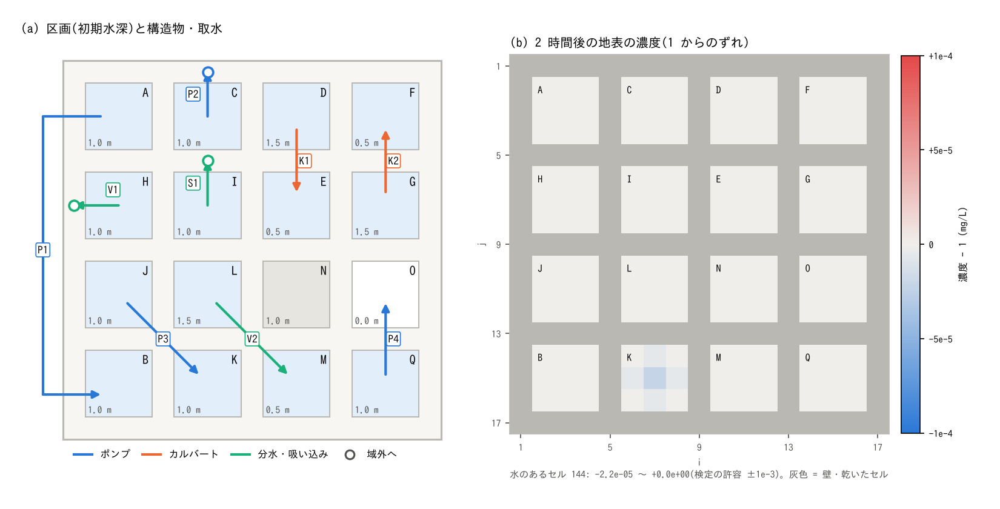

# test/wqstruct — 構造物・取水が水と一緒に運ぶ水質の物質

[English](en/README.md)

[構造物](../../docs/users_guide/structure.md)のポンプ・カルバート・分水と、
[境界条件](../../docs/users_guide/boundary.md)の内部ソースの吸い込み(負の流量)、
[地下水](../../docs/users_guide/gwflow.md)の井戸揚水は、汲んだ水と同じ割合の
[水質](../../docs/users_guide/wq.md)の物質を取水セルの濃度で運びます(Kd 分配が
有効なら溶存分だけ。浮遊砂などの土砂は運びません)。系外へ持ち出した分は台帳
`wq.csv` の `out_intake_g` 列に入ります(developer.md §30.10。2026-11-04 から。
それまでは水だけが動き、物質は取水側に残っていました)。その検定です。

どの区画の水も濃度 1 mg/L から始めるので、物質が水と同じ割合で運ばれれば、
水がどこへ移っても濃度は 1 のままです。

- **param.txt(回帰の reference と比較)**: 17 × 17 セル(dx = 10 m)を高さ 10 m の
  壁で 4 × 4 = 16 の閉じた区画(内部 3 × 3 セル)に分け、区画を構造物と取水で
  結ぶ(下の表)。2 時間。
- **param_gw.txt**: 同じ区画で地表水が Green-Ampt で土層へ浸透し(土層 0.5 m ×
  有効間隙率 0.2 = 0.1 m で飽和。浸透は濃度を同伴するので地下の水も 1 mg/L)、
  井戸が地下水を域外へ汲み、管路(初期に満管)から汲むポンプが区画へ送る。2 時間。



(a) 区画の名前と初期水深、構造物・取水の向き(矢印。白丸は域外へ)です。P1 は
見やすさのために格子の外側を回して描いていますが、域内の圧送(A → B)です。灰色の
区画 N は構造物のない対照、白い区画 O は初期に乾いた区画です。(b) 2 時間後の地表の
濃度の 1 mg/L からのずれ(±1e-4 の発散色。灰色は壁)。どこも 1 のままで、ため池から
汲んだ水の送り先 K だけがわずかに低くなります(−2.2e-5。下の所見)。

## 構成

区画 (r, c) は北から r = 0..3、西から c = 0..3。内部のセルは
i = 4c+2..4c+4、j = 4r+2..4r+4(`make_data.py`)。

| 構造物 | 取水側 | 送り先 | 流量 | 確かめること |
|---|---|---|---|---|
| P1 ポンプ(域内) | A (0,0) の 2 セル | B (3,0) の 3 セル(空隙率 0.5、1 セルは河道幅 2 m) | 0.05 m³/s | 送り先の基底 gv·wfrac、取水と送り先が別のランク |
| P2 ポンプ(域外) | C (0,1) の河道幅のセル | 域外 | 0.03 m³/s | 取水セルの基底 wfrac、out_intake_g |
| P3 ポンプ(ため池から) | J (2,0) の中央のため池(限界貯留高 0.5 m) | K (3,1) | 0.01 m³/s | ため池プールからの同伴 |
| P4 ポンプ(空の区画へ) | Q (3,3) の空隙率 0.7 のセル | O (2,3) の 3 セル(初期は乾いている) | 0.02 m³/s | 取水セルの基底 gv、乾いたセルへの配分 |
| K1 カルバート(順流) | D (0,2) 水深 1.5 m | E (1,2) 0.5 m | 断面 0.3 × 0.3 m | 上流 → 下流 |
| K2 カルバート(逆流) | 上流側 F (0,3) 0.5 m | 下流側 G (1,3) 1.5 m | 断面 0.3 × 0.3 m | 下流 → 上流(送り先は上流側) |
| V1 分水(域外) | H (1,0) | 域外 | 0.02 m³/s | out_intake_g |
| V2 分水(域内) | L (2,1) 1.5 m | M (3,2) 0.5 m | 0.03 m³/s | 送水先のある分水 |
| S1 内部ソースの吸い込み | I (1,1) の 2 セル | 域外 | −0.02 m³/s | out_intake_g |
| (param_gw.txt)W1 井戸 | A (0,0) の 2 セルの土層 | 域外 | 0.004 m³/s | 地下の質量の同伴、out_intake_g |
| (param_gw.txt)P1 ポンプ(管路から) | C (0,1) の 1 セルの管路(容量 0.5 m) | B (3,0) の 3 セル | 0.005 m³/s | 管路の水の固定濃度 wq_gwc_conc = 1(in_gwc_g) |

param_gw.txt では空隙率(fn_gv)を使いません。空隙率 gv < 1 のセルの浸透は地下の
基底が未整理で、総水量が 1/gv 倍に見える既存の近似があるためです
(developer.md §26.1)。空隙率の基底は param.txt の地表の取水で確かめます。

| ファイル | 内容 |
|---|---|
| `make_data.py` | 入力 `data_wqstruct/`(地盤高・初期水深・空隙率・河道マスクと河道幅・ため池・管路の容量)を作る(コミット済み。再生成用) |
| `Run.sh` | param.txt の Log.txt・wq.csv を reference と比較(ULP = 0。Log の Runge 列は除外)→ `Check_wqstruct.py` の検定 → param_gw.txt を実行して検定 |
| `Run_MPI.sh N` | N ランクで param.txt を実行し、逐次の reference と ULP = 0 で比較して検定 |
| `Check_wqstruct.py conc\|gwconc\|tank\|ledger\|intake\|gwc\|active` | 水深 1 mm を超える全セルの濃度が 1 ± 1e-3 mg/L / 地下の濃度 Cg/Hg が 1 ± 1e-3 / ため池の濃度 mass_rs_g ÷ (Hrs × A) が 1 ± 1e-3 / 台帳の閉合(相対 1e-6)/ out_intake_g = 系外へ出た水の体積(S_total の減少 × 面積)× 1 g/m³(地表の構成は相対 1e-6、井戸は 1e-3)/ in_gwc_g = 管路の貯留の減少 × 1 g/m³(相対 1e-6)/ 構造物が水を動かした(区画の平均水深が 5 cm 以上動き、対照 N は動かない) |
| `Fig.py` | 区画の配置の図 `figs/layout.png`(英語版は `en/figs/layout.png`) |

## 実行

```bash
make
./Run.sh
./Run_MPI.sh 4
```

## 所見

| 量 | 修正後 | 修正前(2026-11-03 の実行ファイル) |
|---|---|---|
| param.txt の地表の濃度 (mg/L。2 時間後) | 0.99998〜1.00000 | 0.00〜9.58(取水側が濃く、送り先が薄い) |
| 主な区画の濃度 (mg/L。2 時間後) | どこも 1.0000(K だけ 0.99998) | C の取水セル 9.58、A 4.05、D 2.74、E 0.29、B 0.08、O 0(清水) |
| ため池の濃度 (mg/L) | 1.00010 | 2.44(水だけ汲まれて濃縮) |
| param.txt の out_intake_g (g) | 504.000(系外へ出た水 504.000 m³ × 1 g/m³) | 列なし(物質は取水側に残った) |
| param_gw.txt の地下の濃度 Cg/Hg (mg/L) | 0.99996〜1.00031 | 0.83〜2.44(井戸のセルで 2.44) |
| param_gw.txt の送り先 B の濃度 (mg/L) | 1.00000〜1.00001 | 0.58〜1.00(管路の水が清水で入った) |
| param_gw.txt の out_intake_g / in_gwc_g (g) | 28.796 / 36.000(井戸の揚水 28.8 m³・管路から汲んだ 36.0 m³) | 列なし / 0 |

- 水の場(水深・ため池の貯留・Log の S)は修正の前後でビット一致します(変更は
  水質だけに効く)。
- ため池から汲んだ水の送り先 K の濃度がわずかに 1 を下回り(0.99998)、ため池が
  わずかに上回る(1.00010)のは、同じステップにため池が吸収した水の物質がステップの
  後でため池プールへ移るための 1 ステップ遅れです(相対で「1 ステップの吸収量 /
  ため池の貯留量」= 1e-4。質量は保存されます。
  [水質の章](../../docs/users_guide/wq.md#構造物取水による移動)の「できないこと」)。
- param_gw.txt の地下の濃度の 1 からのずれ(3e-4 まで)と、out_intake_g の井戸の
  揚水からのずれ(相対 1.4e-4)は、浸透の同率移動をステップの終わりの水深で評価する
  既存のずれです(test/gwwidth と同じ。検定の許容 1e-3 はこれを許す幅)。
- 2 ランク以上では、P1 の取水(区画 A)と送り先(区画 B)が別のランクの帯に載ります
  (水と物質の総和が帯をまたぐ)。np = 4 ではカルバートの上流側と下流側も別のランクです。
