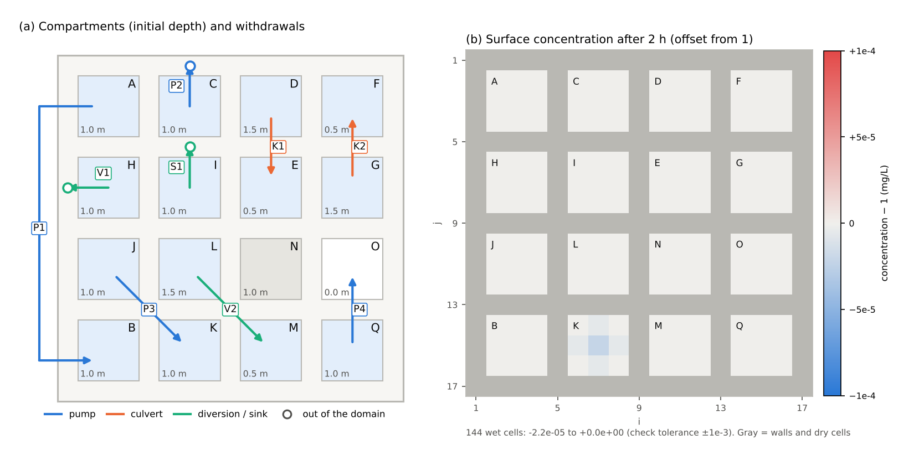

# test/wqstruct — Water-quality substance carried with the water by structures and withdrawals

> English mirror of test/wqstruct/README.md. The Japanese file is the master copy.

[日本語](../README.md)

Pumps, culverts and diversions of [structures](../../../docs/en/users_guide/structure.md),
sinks (negative rates) of internal sources in
[boundary conditions](../../../docs/en/users_guide/boundary.md) and well pumping in
[groundwater](../../../docs/en/users_guide/gwflow.md) carry the same fraction of the
[water-quality](../../../docs/en/users_guide/wq.md) substance as of the water they take,
at the concentration of the intake cell (only the dissolved part with Kd
partitioning; sediment such as suspended load is not carried). What is taken out of
the system goes into the `out_intake_g` column of the ledger `wq.csv` (developer.md
§30.10; since 2026-11-04 - before that only the water moved and the substance stayed
on the intake side). This test checks it.

The water of every compartment starts at a concentration of 1 mg/L, so if the
substance is carried in the same fraction as the water, the concentration stays at 1
wherever the water moves.

- **param.txt (compared with the regression reference)**: 17 × 17 cells (dx = 10 m)
  divided by walls 10 m high into 4 × 4 = 16 closed compartments (3 × 3 interior
  cells each), joined by structures and withdrawals (table below). 2 hours.
- **param_gw.txt**: in the same compartments the surface water infiltrates into the
  soil layer with Green-Ampt (saturated at soil depth 0.5 m × effective porosity
  0.2 = 0.1 m; infiltration carries the concentration, so the groundwater is also at
  1 mg/L), a well pumps groundwater out of the domain, and a pump drawing from the
  conduit layer (full at the start) sends water to a compartment. 2 hours.



(a) Name and initial depth of each compartment and the direction of the structures
and withdrawals (arrows; an open circle means out of the domain). P1 is drawn around
the outside of the grid for legibility, but it is a pumped transfer inside the domain
(A → B). The gray compartment N is the control without structures, and the white
compartment O is dry at the start. (b) Offset of the surface concentration from
1 mg/L after 2 hours (diverging colors over ±1e-4; gray = walls). It stays at 1
everywhere; only K, the destination of the water pumped from the pond, is slightly
lower (−2.2e-5; see the findings below).

## Configuration

Compartment (r, c) has r = 0..3 from the north and c = 0..3 from the west. Its
interior cells are i = 4c+2..4c+4, j = 4r+2..4r+4 (`make_data.py`).

| Structure | Intake side | Destination | Rate | What it checks |
|---|---|---|---|---|
| P1 pump (inside the domain) | 2 cells of A (0,0) | 3 cells of B (3,0) (void fraction 0.5; one cell with a channel width of 2 m) | 0.05 m³/s | the basis gv·wfrac at the destination; intake and destination on different ranks |
| P2 pump (out of the domain) | the channel-width cell of C (0,1) | out of the domain | 0.03 m³/s | the basis wfrac at the intake cell; out_intake_g |
| P3 pump (from a pond) | the pond in the centre of J (2,0) (storage limit 0.5 m) | K (3,1) | 0.01 m³/s | carrying from the pond pool |
| P4 pump (into an empty compartment) | the cell of Q (3,3) with void fraction 0.7 | 3 cells of O (2,3) (dry at the start) | 0.02 m³/s | the basis gv at the intake cell; delivery to dry cells |
| K1 culvert (forward flow) | D (0,2), depth 1.5 m | E (1,2), 0.5 m | section 0.3 × 0.3 m | upstream → downstream |
| K2 culvert (reverse flow) | upstream side F (0,3), 0.5 m | downstream side G (1,3), 1.5 m | section 0.3 × 0.3 m | downstream → upstream (the destination is the upstream side) |
| V1 diversion (out of the domain) | H (1,0) | out of the domain | 0.02 m³/s | out_intake_g |
| V2 diversion (inside the domain) | L (2,1), 1.5 m | M (3,2), 0.5 m | 0.03 m³/s | a diversion with a delivery side |
| S1 sink of an internal source | 2 cells of I (1,1) | out of the domain | −0.02 m³/s | out_intake_g |
| (param_gw.txt) W1 well | the soil layer of 2 cells of A (0,0) | out of the domain | 0.004 m³/s | carrying the subsurface mass; out_intake_g |
| (param_gw.txt) P1 pump (from the conduit layer) | the conduit of 1 cell of C (0,1) (capacity 0.5 m) | 3 cells of B (3,0) | 0.005 m³/s | fixed concentration of the conduit water wq_gwc_conc = 1 (in_gwc_g) |

param_gw.txt does not use the void fraction (fn_gv). For cells with a void fraction
gv < 1 the subsurface basis of infiltration has not been sorted out, and an existing
approximation makes the total storage look 1/gv times larger (developer.md §26.1).
The gv basis is checked with the surface withdrawals of param.txt.

| File | Content |
|---|---|
| `make_data.py` | writes the input `data_wqstruct/` (ground elevation, initial depth, void fraction, channel mask and channel width, pond, conduit capacity) (committed; for regeneration) |
| `Run.sh` | compares Log.txt and wq.csv of param.txt with the reference (ULP = 0; the Runge column of the Log is excluded) → checks with `Check_wqstruct.py` → runs param_gw.txt and checks it |
| `Run_MPI.sh N` | runs param.txt on N ranks, compares with the serial reference at ULP = 0 and checks it |
| `Check_wqstruct.py conc\|gwconc\|tank\|ledger\|intake\|gwc\|active` | concentration 1 ± 1e-3 mg/L in every cell deeper than 1 mm / subsurface concentration Cg/Hg 1 ± 1e-3 / pond concentration mass_rs_g ÷ (Hrs × A) 1 ± 1e-3 / closure of the ledger (relative 1e-6) / out_intake_g = volume of water leaving the system (decrease of S_total × area) × 1 g/m³ (relative 1e-6 for the surface configuration, 1e-3 for the well) / in_gwc_g = decrease of the conduit storage × 1 g/m³ (relative 1e-6) / the structures moved water (the mean depth of each compartment moved by 5 cm or more, and the control N did not move) |
| `Fig.py` | the layout figure `figs/layout.png` (English version `en/figs/layout.png`) |

## Running

```bash
make
./Run.sh
./Run_MPI.sh 4
```

## Findings

| Quantity | After the fix | Before the fix (executable of 2026-11-03) |
|---|---|---|
| surface concentration in param.txt (mg/L; after 2 hours) | 0.99998–1.00000 | 0.00–9.58 (concentrated on the intake side, diluted at the destination) |
| concentration of the main compartments (mg/L; after 2 hours) | 1.0000 everywhere (K only 0.99998) | intake cell of C 9.58, A 4.05, D 2.74, E 0.29, B 0.08, O 0 (clean water) |
| concentration of the pond (mg/L) | 1.00010 | 2.44 (only the water was pumped, so it concentrated) |
| out_intake_g of param.txt (g) | 504.000 (water leaving the system 504.000 m³ × 1 g/m³) | no column (the substance stayed on the intake side) |
| subsurface concentration Cg/Hg in param_gw.txt (mg/L) | 0.99996–1.00031 | 0.83–2.44 (2.44 in the well cells) |
| concentration at the destination B in param_gw.txt (mg/L) | 1.00000–1.00001 | 0.58–1.00 (the conduit water entered as clean water) |
| out_intake_g / in_gwc_g of param_gw.txt (g) | 28.796 / 36.000 (well pumping 28.8 m³; pumped from the conduit 36.0 m³) | no column / 0 |

- The water fields (depth, pond storage, S of the Log) are bit-identical before and
  after the fix (the change acts on water quality only).
- The concentration at K, the destination of the water pumped from the pond, is
  slightly below 1 (0.99998) and that of the pond slightly above (1.00010) because the
  substance of the water the pond absorbed in the same step moves into the pond pool
  after the step - a lag of one step (relative "absorption in one step / storage of
  the pond" = 1e-4; mass is conserved; "What it cannot do" in the
  [water-quality chapter](../../../docs/en/users_guide/wq.md#transfer-by-structures-and-withdrawals)).
- The departure of the subsurface concentration in param_gw.txt from 1 (up to 3e-4)
  and that of out_intake_g from the well pumping (relative 1.4e-4) are the existing
  offset from evaluating the proportional transfer of infiltration with the depth at
  the end of the step (the same as test/gwwidth; the tolerance 1e-3 of the checks
  allows for it).
- On 2 or more ranks, the intake of P1 (compartment A) and its destination
  (compartment B) lie in the bands of different ranks (the sums of water and
  substance cross bands). On 4 ranks the upstream and downstream sides of the
  culverts are on different ranks as well.
