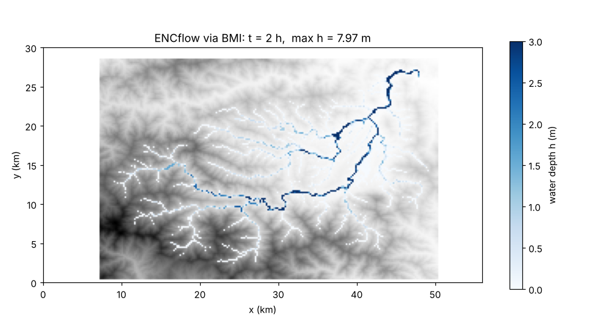
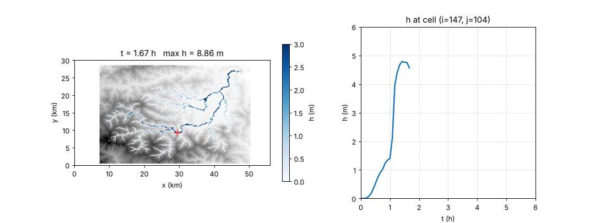

> English mirror of tutorials/bmi/README.md. The Japanese file is the master copy.

[日本語](../README.md)

# Tutorial 3: bmi -- driving ENCflow from Python

Start ENCflow **from inside a Python program**, stop it wherever you like,
pull out the water depth, feed rain in from outside -- the doorway for all
of this is the **BMI (CSDMS Basic Model Interface)**. It is a standard that
handles any model through the same handful of operations (initialize /
update / get / set / finalize), and the whole of ENCflow becomes one BMI
component.

This tutorial aims at letting **people who are not Python users "just try
it"**, running one very short script at a time. The subject is the same
Chichibu catchment as the chichibu tutorial (200 m grid, 200 mm/h x 30 min
of rain). Each step's computation takes about 20--30 seconds on a 4-core PC.

- **Step 0**: Preparation -- building the library and setting up Python (uv and others)
- **Step 1**: Start and finish, nothing else (initialize / finalize)
- **Step 2**: Advance time (update / update_until)
- **Step 3**: Read the state (get and the array orientation)
- **Step 4**: Plot the depth you read (one figure with Matplotlib)
- **Step 5**: Plot while computing (live display)
- **Step 6**: Supply from outside (set: rain)
- **Step 7**: Override a parameter (set: roughness coefficient)

We assume you have finished the [wave tutorial](../../wave/en/README.md)
(how to run ENCflow and how to read the screen output). Doing the
[chichibu tutorial](../../chichibu/en/README.md) first makes the terrain,
rain and outlet settings easier to follow, but it is not required (the input
data are shared with chichibu). All work below is done inside this directory
(`tutorials/bmi`).

> The complete picture of the BMI (the list of exposed variables, nested
> grids, MPI, the conformance test) is in [bmi/README.en.md](../../../bmi/README.en.md).
> This tutorial is its entrance.

## Step 0: Preparation

### Building the library

The BMI loads a **shared library** of ENCflow (`libencflow_bmi.so`) from
Python. Build it once, separately from the usual `encflow` (the build of
`src/` runs automatically if needed; gfortran alone suffices, no extra
library is required):

```bash
cd tutorials/bmi      # make a habit of checking with pwd (see the wave tutorial)
make
```

Once `../../bmi/libencflow_bmi.so` exists you are ready. The Python wrapper
(`bmi/python/encflow.py`) finds this location automatically.

### Python environment

The scripts use only **NumPy** (arrays) and **Matplotlib** (plotting, from
Step 4 on). There are many ways to manage Python packages, so **choose one
that fits your environment**. If unsure, take A.

**A. uv (recommended; works even if Python is not installed)**

[uv](https://docs.astral.sh/uv/) is a tool that fetches Python itself and
the required packages automatically. It installs with one line (Linux, WSL,
macOS):

```bash
curl -LsSf https://astral.sh/uv/install.sh | sh
```

Reopen the terminal; if `uv --version` prints something, you are set. After
that, just run each script with `uv run`:

```bash
uv run step1_hello.py
```

The first run downloads Python and NumPy / Matplotlib (about 100 MB). From
the second time on it starts instantly. The comment at the top of each
script,

```python
# /// script
# dependencies = ["numpy"]
# ///
```

is the declaration "this script needs these packages" that uv reads
(PEP 723). Without uv it is just a comment; there is no need to remove it.

**B. venv + pip (using the standard Python)**

If Python 3.9 or later is installed, create a virtual environment and
install the packages:

```bash
python3 -m venv .venv                 # create the virtual environment .venv in this directory
source .venv/bin/activate             # activate it (the prompt gets a (.venv) prefix)
pip install -r requirements.txt       # install numpy and matplotlib
python3 step1_hello.py
```

If Ubuntu / WSL complains that `venv` is missing, run
`sudo apt install python3-venv` first. When you continue in another
terminal, run `source .venv/bin/activate` again.

**C. conda / mamba**

```bash
conda create -n encflow python numpy matplotlib
conda activate encflow
python3 step1_hello.py
```

**D. OS packages (Ubuntu / Debian / WSL)**

```bash
sudo apt install -y python3-numpy python3-matplotlib
python3 step1_hello.py
```

The explanations below are written in the form of A,
`uv run step1_hello.py`. Readers using B--D replace `uv run` with
`python3` (the scripts are the same).

> **Windows users**: as with ENCflow itself, we assume you work inside WSL
> (Ubuntu) ([Using ENCflow on Windows](../../../docs/en/windows.md)). In WSL
> the live-display window of Step 5 also shows up as is (thanks to WSLg).
> Where no display is available, `--save` writes PNG files instead.

### The parameter file of this tutorial

`param.txt` is Step 2 of the chichibu tutorial (GeoTIFF input, channel
mask and roughness) plus only the catchment-outlet drain of Step 6
(`&list_bound_stage`). The input data are shared with chichibu through
`dir_data = "../chichibu/data_chichibu"`. Even through the BMI, **the input
files, the result output and the screen display are exactly the same as in
a standalone run**. You can also run it the usual way (instead of `make`
creating a link to `encflow`, do `ln -s ../../bin/encflow .` and then
`./encflow param.txt`).

## Step 1: Start and finish, nothing else

The first script, `step1_hello.py`, starts (initializes) ENCflow, prints
some information and finishes without advancing time. Here is the whole
file (apart from the uv comment and the docstring at the top):

```python
import sys
from pathlib import Path

# tell Python where the wrapper (bmi/python/encflow.py) lives
sys.path.insert(0, str(Path(__file__).resolve().parents[2] / "bmi" / "python"))
from encflow import ENCflow

model = ENCflow("param.txt")        # initialize: read the input and prepare the computation
print("component :", model.name)
print("grid      :", model.grid_shape, "(ny, nx)")
print("time      :", model.time, "->", model.end_time, "s   dt =", model.time_step, "s")
model.finalize()                    # finalize: clean up and close the computation
print("finished without advancing time")
```

```bash
uv run step1_hello.py
```

```
reading list_sysparam in param.txt
reading list_geoinfo in param.txt
 ...
main: number of valid cells: 17885
time, progress, S(m), Runge, ex_flux, Cn_max, h_max(m), V_max(m/s)
  0:00:00.00   0.0%    0.0001   0.0%      0    0.1097    1.3650    0.0000
component : ENCflow
grid      : (150, 280) (ny, nx)
time      : 0.0 -> 21600.0 s   dt = 6.0 s
main: program terminated normally
finished without advancing time
```

- `ENCflow("param.txt")` is the BMI **initialize**. It reads the parameter
  file, reads the terrain and builds the initial state. The lines from
  `reading ...` on are ENCflow's own messages, exactly as in a standalone
  run (only the entrance differs; the program running is the same).
- `model.name`, `model.grid_shape`, `model.time` and so on are BMI
  **queries**. The grid shape is in the order `(ny, nx)` = (rows, columns).
  The end time 21600 s = 6 hours and the time step 6 s are the values of
  `tt_c` and `dt` in `param.txt`.
- `model.finalize()` is **finalize**. It writes the final output and closes
  the computation. `result/` contains only `H0000.*` (the initial depth)
  and `Log.txt`, since time was not advanced.
- The `sys.path.insert(...)` line at the top tells Python where the wrapper
  `encflow.py` lives (`bmi/python/` in the repository). The wrapper loads
  the shared library and presents the BMI functions as ordinary Python
  methods.

That is "start ENCflow from Python and finish". The remaining steps only
add one operation at a time to this skeleton.

## Step 2: Advance time

`step2_time.py` uses the BMI **update** (advance one step) and
**update_until** (advance to a given time):

```python
with ENCflow("param.txt") as model:         # finalize is called automatically when leaving the with block
    dt = model.time_step

    model.update()                          # advance by one step (dt seconds)
    print(f"after update():       t = {model.time:g} s")

    model.update_until(600.0)               # advance to the given time (a multiple of dt)
    print(f"after update_until(): t = {model.time:g} s")

    interval = 1800.0                       # from here, advance 30 min at a time and report progress
    while model.time < model.end_time:
        target = min(model.time + interval, model.end_time)
        model.update_until(target)
        print(f"t = {model.time:7.0f} s  ({model.time / model.end_time:5.1%})")

print("finished")
```

```bash
uv run step2_time.py
```

```
  0:00:00.00   0.0%    0.0001   0.0%      0    0.1097    1.3650    0.0000
after update():       t = 6 s
after update_until(): t = 600 s
  0:30:00.00   8.3%    0.0488  97.6%      8    0.3493    2.0851    9.0955
t =    2400 s  (11.1%)
  1:00:00.00  16.7%    0.0999   0.9%      0    0.6065    8.3520   16.2870
t =    4200 s  (19.4%)
  ...
  6:00:00.00 100.0%    0.0274   0.3%     82    0.3577    4.2847    7.5987
t =   21600 s  (100.0%)
main: program terminated normally
finished
```

- One call of `update()` advances the time by `dt` = 6 s.
  `update_until(600.0)` advances to 600 s (the remaining 99 steps). **The
  target time must be an integer multiple of `dt` ahead of the current
  time and within the end time** (anything else is an error). The
  `min(..., end_time)` in the loop is the idiom that keeps the last
  interval from overshooting the end time.
- **Python has full control** of the progress. ENCflow advances exactly as
  far as it is asked and returns. Meanwhile the screen display (one line
  every `dt_disp_c`) and the result files (every `dt_file_c`) are written
  just as in a standalone run, so Python's lines and ENCflow's lines appear
  interleaved (to quieten ENCflow, increase `dt_disp_c` in `param.txt`).
- Writing `with ENCflow(...) as model:` calls `finalize()` automatically
  when the block is left (even after an error). We use this form from here
  on.

After the run, `result/` holds the same `H0000`--`H0012` and `Log.txt` as a
standalone run.

## Step 3: Read the state

`step3_state.py` stops the computation every 30 minutes and **reads the
depth array** (the BMI **get**). It also prints the grid information and
the list of variables you can read:

```python
with ENCflow("param.txt") as model:
    ny, nx = model.grid_shape                 # grid shape (rows ny, columns nx)
    dy, dx = model.grid_spacing               # cell size (m)
    print("grid:", nx, "x", ny, "cells of", dx, "m")
    print("variables you can get:")
    for name in model.output_var_names:
        print("   ", name)

    z = model.get2d(VAR_ELEVATION)            # elevation (ny, nx); row 0 = south edge
    print(f"elevation: {np.nanmin(z[z > 0]):.0f} .. {z.max():.0f} m")

    # ENCflow's internal cell address (i, j) (1-based, j = 1 is north) -> array indices
    ip, jp = 147, 104                         # probe 3 of chichibu tutorial Step 3 (middle main stem)
    row, col = ny - jp, ip - 1
    print(f"probe cell (i={ip}, j={jp}) -> h[{row}, {col}],  z = {z[row, col]:.1f} m")

    print(" time(s)   h_probe(m)   h_max(m)   wet cells")
    while model.time < model.end_time:
        model.update_until(min(model.time + 1800.0, model.end_time))
        h = model.get2d(VAR_DEPTH)            # a copy of the depth (ny, nx)
        wet = int(np.count_nonzero(h > 0.01))
        print(f"{model.time:8.0f}   {h[row, col]:9.3f}   {h.max():8.3f}   {wet:9d}")
```

```bash
uv run step3_state.py
```

```
grid: 280 x 150 cells of 200.0 m
variables you can get:
    surface_water__depth
    land_surface__elevation
    atmosphere_water__precipitation_leq-volume_flux
    surface_water__elevation
    surface_water_flow__speed
    surface_water_flow__unit_width_volume_flow_rate
    surface_water__x_component_of_velocity
    surface_water__y_component_of_velocity
    surface_water__time_max_of_depth
    surface_water_flow__time_max_of_speed
    surface_water_flow__time_max_of_unit_width_volume_flow_rate
    land_surface_water_flow__manning_n_parameter
elevation: 92 .. 2449 m
probe cell (i=147, j=104) -> h[46, 146],  z = 400.7 m
 time(s)   h_probe(m)   h_max(m)   wet cells
    1800       0.517      1.618       15861
    3600       1.403      8.352        8255
    5400       4.759      8.141        3373
    7200       4.048      7.966        2387
    9000       3.561      8.361        1943
   10800       2.210      8.883        1696
   12600       1.843      8.927        1527
   14400       1.596      8.305        1412
   16200       1.396      6.685        1328
   18000       1.224      4.956        1245
   19800       1.108      4.287        1182
   21600       1.017      3.809        1137
```
(ENCflow's own lines every 30 minutes are omitted)

During the rain (up to 3600 s) the number of wet cells reaches 15,861
(nearly every cell of the catchment); once the rain stops it drops quickly
and the water gathers in the channels (about 1,100 cells). At the cell in
the middle main stem the depth peaks at 4.8 m 30 minutes after the rain
stops (5400 s) and then recedes slowly.

- `model.get2d(name)` returns a **copy of a field** such as the depth as a
  2-D NumPy array `(ny, nx)`. Variable names are CSDMS standard names
  (`surface_water__depth` etc.), and `encflow.py` provides them as constants
  such as `VAR_DEPTH`. The list comes from `model.output_var_names`; these
  12 can be read in any case (the ones that can also be `set` are in
  `model.input_var_names`).
- **Array orientation**: by the BMI convention, row 0 is the **south edge**
  (the first element of the array is the south-west corner). ENCflow's
  internal cell address `(i, j)` (1-based, `j = 1` is north; the same
  convention as `pbxy` in chichibu) corresponds to `h[ny - j, i - 1]` in
  the array. Here we read the cell `(147, 104)` in the middle main stem.
- The array you get is a **copy**. Modifying it does not reach ENCflow (to
  do that, use `set` in Steps 6 and 7).
- Cells outside the catchment (outside the mask) come back with elevation
  and depth 0.

## Step 4: Plot the depth you read

Once you have the array, the rest is ordinary Python. `step4_plot.py`
advances to one hour after the rain stops (t = 2 h) and draws the depth
distribution over the terrain as one figure:

```python
T_PLOT = 2.0 * 3600.0                         # time to plot (s): one hour after the rain stops

with ENCflow("param.txt") as model:
    ny, nx = model.grid_shape
    dy, dx = model.grid_spacing
    z = model.get2d(VAR_ELEVATION)
    model.update_until(T_PLOT)
    h = model.get2d(VAR_DEPTH)

# from here on it is plain Matplotlib; row 0 is south, so origin="lower" puts north at the top
extent = (0.0, nx * dx / 1000.0, 0.0, ny * dy / 1000.0)      # km
land = np.where(z > 0, z, np.nan)                            # do not draw outside the catchment (elevation 0)
wet = np.where(h >= 0.01, h, np.nan)                         # less than 1 cm counts as "no water"

fig, ax = plt.subplots(figsize=(9, 5))
ax.imshow(land, cmap="Greys", origin="lower", extent=extent)
im = ax.imshow(wet, cmap="Blues", origin="lower", extent=extent, vmin=0.0, vmax=3.0)
fig.colorbar(im, ax=ax, shrink=0.8, label="water depth h (m)")
...
fig.savefig("figs/step4_depth.png", dpi=110)
plt.show()                                   # does nothing and returns where there is no display
```

```bash
uv run step4_plot.py
```



- `imshow(..., origin="lower")` puts row 0 (south) at the bottom of the
  figure. That alone makes a map with north at the top (`extent` only
  turns the axis ticks into km).
- Cells outside the catchment or without water are set to `np.nan` and
  drawn transparent. Note that, unlike the gnuplot figures of chichibu, no
  result file is read back -- the array in memory during the computation
  is drawn directly.
- The computation is left stopped at t = 2 h. `finalize()` is called when
  the `with` block is left, and ENCflow terminates normally in the state
  at 2 h (Log.txt also ends there). "Stop halfway and finish" is an
  ordinary operation with the BMI.

## Step 5: Plot while computing

If you update the plot of Step 4 inside the "advance and read" loop of
Step 3, you can **watch the computation progress live**. The skeleton of
`step5_live.py` is as follows (the part that sets up the figure is
omitted):

```python
INTERVAL = 300.0                              # display interval (s); a multiple of dt (6 s)
IP, JP = 147, 104                             # the cell whose time series is drawn (internal address i, j)
...
def draw():
    """Read the current depth and update the two panels."""
    h = model.get2d(VAR_DEPTH)
    im.set_data(np.where(h >= 0.01, h, np.nan))
    ax_map.set_title(f"t = {model.time / 3600:4.2f} h   max h = {h.max():.2f} m")
    times.append(model.time / 3600.0)
    series.append(h[row, col])
    line.set_data(times, series)
    fig.canvas.draw_idle()
    plt.pause(0.01)                           # refresh the window (this is where the picture moves)

draw()                                        # initial state
while model.time < model.end_time:            # compute -> draw -> compute -> draw ...
    model.update_until(min(model.time + INTERVAL, model.end_time))
    draw()
model.finalize()
```

```bash
uv run step5_live.py                 # display on screen (close the window at the end to exit)
uv run step5_live.py --save frames   # no display: save a PNG sequence in frames/
```



On the left is the depth distribution, on the right the depth time series
at the cell `(147, 104)` in the middle main stem. Every 5 minutes
(`INTERVAL`) the computation pauses and the picture is refreshed. You can
see the slopes get wet all at once during the 30 minutes of rain, then the
slopes drain and the water gathers in the channels after the rain stops,
and the time series passes its peak (about 1.5 h) and recedes.

- `plt.ion()` (interactive mode) and `plt.pause()` are the Matplotlib
  idiom for "draw without stopping the script". With `--save` the script
  switches to a display-less backend (`Agg`) and saves each frame as a
  PNG (you can make a movie with e.g.
  `ffmpeg -i frames/frame_%04d.png step5.mp4`).
- A finer display interval makes the motion smoother, but the drawing then
  takes longer than the computing. The computation alone takes about 15 s
  for the 6 hours; with a display every 5 minutes it is 73 frames and about
  a minute.
- The same idea, implemented with more options (automatic display
  interval, color scale, any cell), is
  [bmi/python/live_view.py](../../../bmi/python/live_view.py). It can be used
  on the case in this directory as is, e.g.
  `uv run --with numpy,matplotlib ../../bmi/python/live_view.py param.txt --probe 147 104`.

## Step 6: Supply from outside (rain)

So far we have only "read" from ENCflow. With the BMI **set** you can
**give ENCflow a field made in Python**. In ENCflow the precipitation
intensity, depth, elevation, roughness coefficient and others can be set
(the list is in [bmi/README.en.md](../../../bmi/README.en.md)).
`step6_rain.py` supplies the rain from Python:

```python
MMH = 1.0e-3 / 3600.0                       # mm/h -> m/s


PRVAL = [(0.0, 0.0), (1800.0, 200.0), (3600.0, 0.0)]   # prval of param.txt (times converted to s)


def rain_rate(t):
    """Rain intensity (mm/h) at time t (s): straight lines between the prval points, as in ENCflow."""
    ...                                     # (linear interpolation; see the script for the full code)


def run(param, pattern=None):
    """With pattern None the rain is left to the parameter file.
    With an array, rain_rate(t) x pattern is set before every step."""
    with ENCflow(param) as model:
        if pattern is None:
            try:
                model.set(VAR_PRECIP, np.zeros(model.grid_shape))
            except BmiError as e:
                print("   set(VAR_PRECIP) refused as expected:", e)
        dt = model.time_step
        while model.time < model.end_time:
            t_next = model.time + dt                        # end time of the coming step
            if pattern is not None and round(t_next) % 60 == 0:
                # &list_precip of ENCflow evaluates the intensity once a minute (dt_prupdate)
                # at the end time of the step; set the same value at the same time and the results agree
                rate = rain_rate(t_next) * MMH              # (m/s)
                field = np.full(model.grid_shape, rate) * pattern   # make it an (ny, nx) distribution
                model.set(VAR_PRECIP, field)                # applied at the start of the next update, persists until the next set
            model.update()
        return model.get2d(VAR_DEPTH)


print("run A: rain from param.txt")
h_a = run("param.txt")

print("run B: rain supplied from Python (uniform)")
h_b = run("param_norain.txt", pattern=1.0)
print(f"   max |h_B - h_A| = {np.abs(h_b - h_a).max():.3e} m")

print("run C: rain only on the western half")
ny, nx = h_a.shape
west = np.zeros((ny, nx))
west[:, : nx // 2] = 1.0
h_c = run("param_norain.txt", pattern=west)
print(f"   max h: A = {h_a.max():.2f} m,  C = {h_c.max():.2f} m")
```

```bash
uv run step6_rain.py
```

```
run A: rain from param.txt
   set(VAR_PRECIP) refused as expected: BMI set_value(atmosphere_water__precipitation_leq-volume_flux) failed (status=1)
run B: rain supplied from Python (uniform)
   max |h_B - h_A| = 5.329e-15 m
run C: rain only on the western half
   max h: A = 3.81 m,  C = 3.20 m
```

Three runs are executed in sequence (ENCflow holds one model per process,
so the next one is `initialize`d after `finalize`):

- **Run A** is the same as Step 2 (the rain comes from `&list_precip` in
  `param.txt`). Trying to `set` precipitation in this case gives an
  **error (`BmiError`)**. ENCflow applies the rule "one way of giving each
  quantity" (no mixing of file forcing and external supply) to prevent
  mix-ups.
- **Run B** gives the same rain from Python to `param_norain.txt`
  (`param.txt` with `fn_precip` and `&list_precip` removed and the output
  directory changed to `result_norain`). A `set` value is **applied at the
  start of the next `update` and persists until the next `set`**. ENCflow
  evaluates the intensity obtained by joining the `prval` points with
  straight lines (a triangle 0 -> 200 mm/h -> 0, 100 mm in total) once a
  minute (the default `dt_prupdate`) at the end time of that step, so the
  Python side sets the same value at the same times. The difference in the
  depth at the end is **5 x 10^-15 m, the rounding level of double
  precision**, so run B effectively matches run A -- a check that the
  computation is the same whichever way the rain is given (the last-digit
  difference comes from the different order of floating-point operations in
  Python and Fortran; if the times or values were evaluated differently, the
  difference would be of the order of centimetres to metres. That setting
  back a field obtained by `get` reproduces the run bit for bit is verified
  by [bmi/python/test_set_value.py](../../../bmi/python/test_set_value.py)).
- **Run C** is an example only the BMI makes easy: rain falling only on the
  western half of the catchment. Since `pattern` is an `(ny, nx)` array, a
  distribution interpolated from radar rainfall or a weather model can be
  supplied, replaced at every time. The maximum depth drops to nearly half.

Mind the units. The BMI precipitation intensity is in **m/s** (CSDMS
standard name `atmosphere_water__precipitation_leq-volume_flux`), so the
mm/h values are multiplied by `MMH`. The array passed to `set` has the same
orientation as `get2d` (row 0 = south) and shape `(ny, nx)`.

## Step 7: Override a parameter (roughness coefficient)

What can be `set` is not limited to states and forcings. Manning's
roughness coefficient n is a **parameter**, but ENCflow accepts overriding
it through the BMI (so that calibration, or rules that change the
roughness with discharge or terrain change, can be built on the user's
side). `step7_roughness.py` multiplies the input roughness by 1, 1.5 and 2
and compares the peak depth and its time at the cell in the middle main
stem:

```python
def run(factor):
    with ENCflow("param.txt") as model:
        ny, nx = model.grid_shape
        row, col = ny - JP, IP - 1
        rn = model.get2d(VAR_MANNING_N)       # the input values (rn0 and rn0_rw applied)
        model.set(VAR_MANNING_N, rn * factor)  # overwrite all cells at once; effective from the next update
        peak, t_peak = 0.0, 0.0
        while model.time < model.end_time:
            model.update_until(min(model.time + 60.0, model.end_time))
            h = model.get2d(VAR_DEPTH)[row, col]
            if h > peak:
                peak, t_peak = h, model.time
        return peak, t_peak
```

```bash
uv run step7_roughness.py
```

```
probe cell (i=147, j=104)
 n factor   peak h (m)   time of peak
    1.0        4.791         86 min
    1.5        5.019         95 min
    2.0        5.275        106 min
```

- `get2d(VAR_MANNING_N)` returns the roughness field currently in effect
  (after `rn0` and the channel `rn0_rw` have been applied). "get -> modify
  -> set" is the basic form for handling parameters. Here a factor is
  applied to everything at once, but since it is an array you can change
  only the channels or only a certain reach.
- A larger roughness slows the flow, so a greater depth is needed to pass
  the same discharge, while the peak comes later and flatter. The numbers
  in the table show both (with twice the roughness the depth peak is higher
  and later).
- Halving the roughness makes the flow faster and, with `dt` = 6 s, breaks
  the Courant condition (`Courant number exceeds 1.0`; ENCflow stops and
  Python receives a `BmiError`). The BMI changes nothing about the
  stability conditions: reduce `dt` in `param.txt` for such experiments.
- The roughness `set` is not included in the save files. In a restarted run,
  `set` it again if needed.

## Closing

With seven scripts we have used the whole set of BMI operations:

| Operation | Python | Learned in |
|---|---|---|
| initialize / finalize | `ENCflow("param.txt")` / `model.finalize()` (`with` statement) | 1, 2 |
| update / update_until | `model.update()` / `model.update_until(t)` | 2 |
| queries | `model.time`, `end_time`, `time_step`, `grid_shape`, `grid_spacing`, `output_var_names` | 1, 3 |
| get | `model.get2d(VAR_DEPTH)` etc. (row 0 = south) | 3, 4, 5 |
| set | `model.set(VAR_PRECIP, field)`, `model.set(VAR_MANNING_N, rn)` | 6, 7 |

From here:

- **The full list of exposed variables and the acceptance conditions of
  set** (replacing depth, elevation, subsurface storage and snow; the
  feature-dependent variables), **nested grids** and use with **MPI**:
  [bmi/README.en.md](../../../bmi/README.en.md).
- **The BMI standard itself** (the same operations with other models): the
  CSDMS [BMI documentation](https://bmi.csdms.io/). ENCflow passes the
  official conformance test (bmi-tester) and can be coupled in the same
  manner as other BMI models and frameworks (pymt, Landlab and others).
- To use this with your own case, just swap `param.txt` (replace
  `"param.txt"` in the scripts with your file name; a case that receives
  rain through `set` must not have `&list_precip`).

## Notes for developers

- The scripts are shared between Japanese and English (comments in
  Japanese); `param*.txt` have `en/` mirrors with the comments translated.
  Figure labels are in English and the same files are referenced from both
  languages.
- Regenerating the figures: `uv run step4_plot.py` (`figs/step4_depth.png`),
  and copy `frames/frame_0020.png` from `uv run step5_live.py --save frames`
  to `figs/step5_frame.png`.
- While this tutorial was written, a real bug was found and fixed: a case
  with GeoTIFF input could not be initialized through the shared library
  (file units were never closed; developer.md §55.2).
