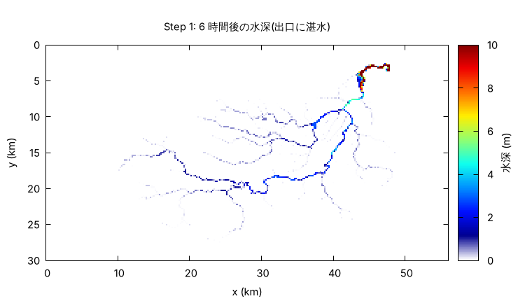
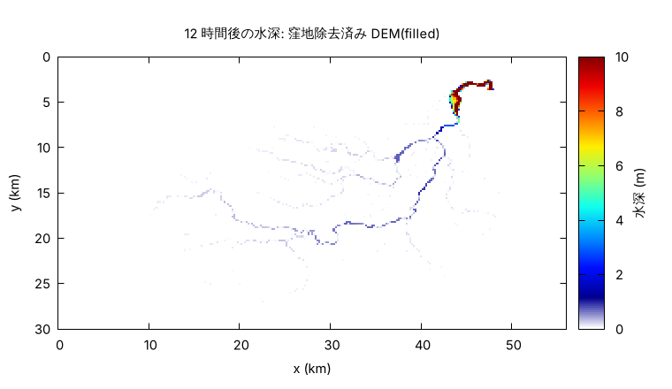
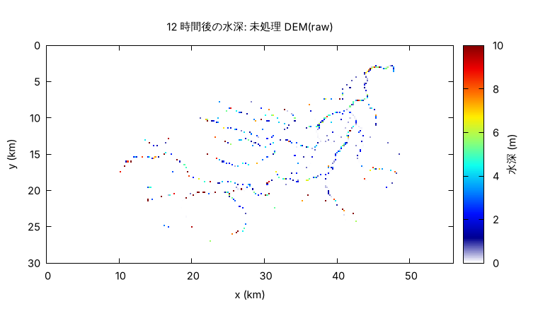
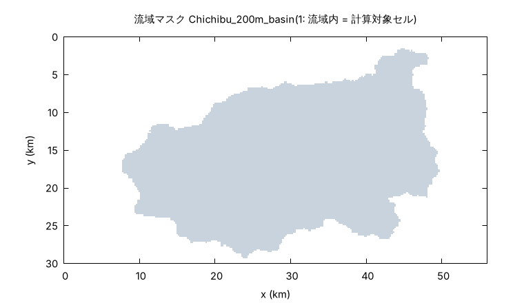
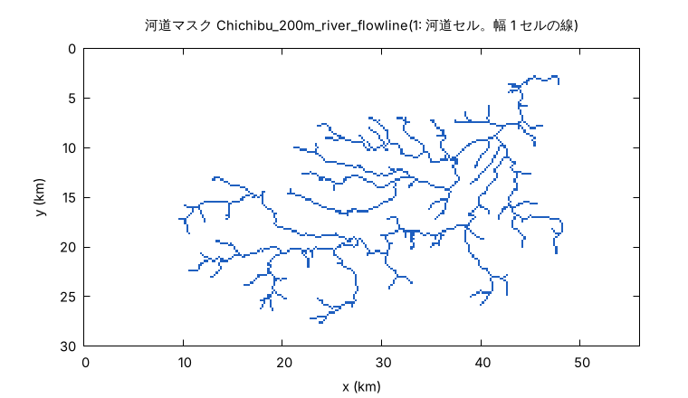
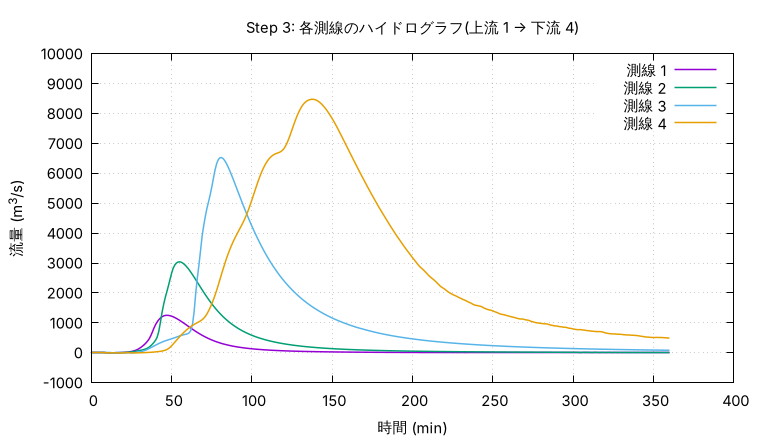
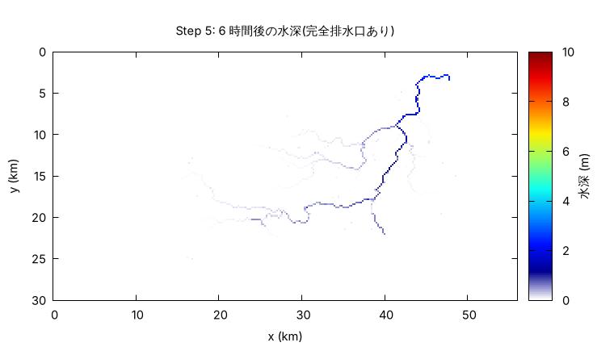
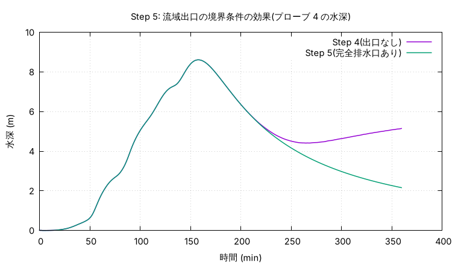
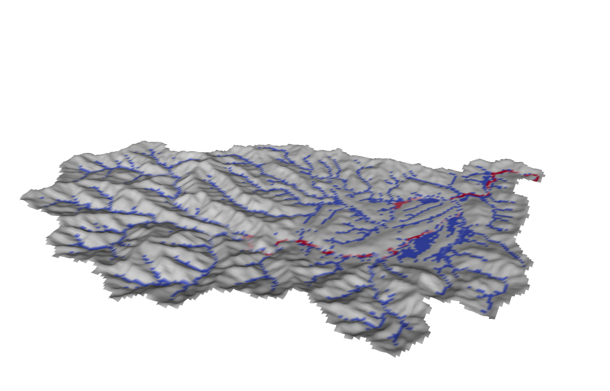
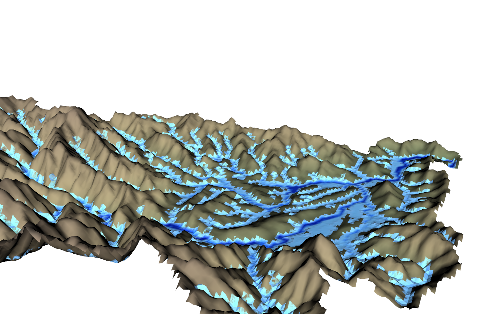

# チュートリアル 2: chichibu — 実地形の流域に降る雨

荒川上流の秩父の山地に、1 時間の豪雨を降らせます。降った雨が斜面から川に集まり、洪水となって
流れ下っていく様子を計算しながら、実際の地形データを使う計算の基本の流れを、次の順で学びます。

- **Step 1**: 実地形データで、いちばん簡単な計算をする。窪地除去がなぜ必要かを知る
- **Step 2**: 入出力を GeoTIFF にする。川を計算に加える
- **Step 3**: 川の流量と水深を記録し、結果を眺める
- **Step 4**: 木の葉に止まる雨と、地面にしみこむ雨を考える
- **Step 5**: 流域の出口から水を流し出す
- **Step 6**: ParaView で 3D のアニメーションにする

[wave チュートリアル](../wave/README.md)を先に済ませていることを前提とします。実行のしかた、
画面に表示される各列の意味、パラメータファイルの書き方は、そちらで説明しています。以降の作業は、
すべてこのディレクトリ `tutorials/chichibu` の中で行います。

## データを眺める

`data_chichibu/` に、次のデータが入っています。どれも、地図を小さな正方形のマス目(セル)に分けて、
セルごとに値を持たせたデータです。

| データ | 内容 |
|---|---|
| `Chichibu_200m_filled.*` | 地盤の高さ (m)。窪地をなくす処理(窪地除去)をしたもの |
| `Chichibu_200m_cond.*` | 地盤の高さ (m)。窪地除去をしたうえで、川のセルの高さを整えたもの。Step 2 から使う |
| `Chichibu_200m_raw.tif` | 地盤の高さ (m)。窪地除去をしていない元のデータ。比べるために使う |
| `Chichibu_200m_basin.*` | 流域マスク。流域の中のセルが 1、外が 0 |
| `Chichibu_200m_river_flowline.*` | 河道マスク。川のセルが 1 |

流域マスクと河道マスクは、計算する範囲と川の位置を、1 と 0 で示したデータです。どのデータも、
東西に 280 個、南北に 150 個のセルが並ぶ同じ格子に載っていて、1 つのセルは 200 m 四方です。
同じ内容が、テキスト(`.txt`)、bil(`.bil` と `.hdr`)、GeoTIFF(`.tif`)の 3 つの形式で用意して
あり、入出力の形式の練習に使います。標高は国土地理院の数値標高モデル、川の位置は国土数値情報の
河川データから作られた河道位数データ([DOI:10.3178/jjshwr.36.1812](https://doi.org/10.3178/jjshwr.36.1812))
をもとにしています。


北東の隅が流域の出口で、南西には 2,500 m 級の山々が並びます。流域のほとんどは険しい山地です。

## Step 1: 実地形データでの最小構成

### 実行

wave と同じように、`make` で実行ファイルへのリンクを作り、`param_step1.txt` を実行します。

```bash
make
./encflow param_step1.txt
```

```
reading list_sysparam in param_step1.txt
reading list_geoinfo in param_step1.txt
 reading data_chichibu/Chichibu_200m_basin.txt
 reading data_chichibu/Chichibu_200m_filled.txt
reading list_precip in param_step1.txt
main: number of processes: 1
main: number of threads: 4
main: real precision: 64 bit
main: number of valid cells: 17885
time, progress, S(m), Runge, ex_flux, Cn_max, h_max(m), V_max(m/s)
  0:00:00.00   0.0%    0.0000   0.0%      0    0.0000    0.0000    0.0000
  0:30:00.00   8.3%    0.0487  97.7%      0    0.1910    1.2871    4.0483
  1:00:00.00  16.7%    0.1000   6.2%      0    0.3464    4.7535    8.4467
  1:30:00.00  25.0%    0.1000   3.4%      0    0.4357    6.9561    9.5765
  2:00:00.00  33.3%    0.1000   0.9%      0    0.4130    6.9710    9.4047
  ...
  6:00:00.00 100.0%    0.1000   0.6%      0    0.5155   29.9470    4.1028
main: program terminated normally
```

`param_step1.txt` の中身は次のとおりです。先頭の表題のコメントは省いています。構成は wave の
Step 1 とほとんど同じで、違うのは、`&list_geoinfo` で地形と流域マスクをファイルから読み、粗度係数
`rn0` を与えることと、`&list_precip` で雨を降らせることだけです。`&list_sysparam` の `dir_data` は
入力データのあるディレクトリで、ファイル名は、このディレクトリから見た場所で書きます。

```
!======================================================================
! システムパラメータ設定
!======================================================================
&list_sysparam
  dt = 6.0                       ! 時間刻み (s)
  tt_c = "6 hour"                ! 計算終了時刻
  dt_disp_c = "30 min"           ! 画面表示時間刻み
  dt_file_c = "30 min"           ! ファイル出力時間刻み

  fn_geoinfo = "-"               ! 地理情報設定ファイル
  fn_precip  = "-"               ! 降水条件設定ファイル

  dir_data   = "data_chichibu"   ! 入力データディレクトリ
/

!======================================================================
! 地理情報設定
!======================================================================
&list_geoinfo
  nx = 280
  ny = 150
  dx = 200.0
  dy = 200.0

  f_ztype = 1          ! 地盤高タイプ (0:デフォルト固定値, 1:ファイル)
  f_masktype = 1       ! 領域マスクの有無 (0:なし, 1:流域マスク)
  rn0 = 0.05           ! 粗度係数固定値(山地斜面の目安。既定 0.015 は水路向け)

  fn_z = "Chichibu_200m_filled.txt"        ! 地盤高ファイル名
  fn_mask = "Chichibu_200m_basin.txt"      ! 領域マスクファイル名
/

!======================================================================
! 降水条件設定
!======================================================================
&list_precip
  ! 降水データのタイプ (1:一様分布の時系列、2:分布 × 倍率、3:分布の時系列。降水なしは fn_precip を書かない)
  prtype = 1
  ! 降水の時系列 (時刻(min) 雨量強度(mm/h))
  prval(:,1) =   0,   0
  prval(:,2) =  30, 200
  prval(:,3) =  60,   0
/
```

`&list_precip` の `prval` は、雨の強さの時間変化です。0 分に 0、30 分に 200 mm/h、60 分に 0 で、
その間は直線でつなぎます。1 時間で 100 mm の雨になります。

画面の表示から、次のことが読み取れます。

- `number of valid cells: 17885` — 格子全体は 280 × 150 = 42,000 セルですが、計算するのは
  流域マスクの中の 17,885 セルだけです。マスクの外のセルは、メモリも計算時間も使いません。
- `rn0 = 0.05` は Manning の粗度係数と呼ばれる値で、地表の流れにくさを表します。既定値の 0.015 は
  なめらかな水路の値で、山の斜面全体に使うと流れが速くなりすぎ、計算が不安定になることもあります。
  ここでは山の斜面の目安の 0.05 を与え、Step 2 で川のセルだけ別の値にします。
- S 列は、流域にある水の量を、流域全体に平らにならしたときの水の深さで表したものです。雨とともに
  増え、雨が止む t = 1:00 に **0.1000** m、つまり降った雨の 100 mm と同じになり、その後は変わりません。
  計算領域のまわりは、既定では水を通さない壁です。この流域は水の出口のない器なので、S が変わらない
  ことは、水が消えも増えもしていないことの確かめになります。
- 最大水深を表す h_max 列は、7 m から 30 m 近くまで増え続けます。出ていけない水が、どこかに
  溜まり続けているということです。
- ex_flux 列は、セルから出ていく水が、セルにある水より多くなりかけたので抑えた回数です。水の量を
  保つための安全装置で、ふだんは 0 です。何度も続けて出るときは、計算が荒れているサインです。

最後の時刻の水深の分布 `result/H9998.txt` を見ると、水が溜まっている場所がわかります。水深の
分布図は、水深 0 を白、深いほど濃い色で描きます。水が流れ去った場所は白く抜け、溜まった場所だけに
色が付きます。同梱の gnuplot のスクリプトで、4 つの時刻の水深の分布を 1 つの画面に並べて表示
できます。gnuplot が必要で、表示した後はターミナルで Enter を押すと終わります。

```bash
gnuplot Plot_step1.plt
```

t = 0:30 と 1:00 の図では、雨の間に斜面から川へ水が集まっていきます。雨が止んだ後の t = 3:00 では
川の水が下流へ流れ去り、最後は北東の隅の手前に水が溜まっていきます。



流域の出口の手前に、水が深く溜まっています。出口が壁でふさがれているので、流れてきた水が
ここに溜まるのです。この水は、Step 5 で出口から流し出す設定をして解消します。それまでの Step では、
出口に水が溜まることを承知のうえで進めます。溜まった水は、時間とともに川をさかのぼって広がり、
Step 3 で計測する一番下流の地点の結果にも影響します。

### 窪地除去はなぜ必要か

`&list_geoinfo` の `fn_z` を `Chichibu_200m_raw.tif` に替えると、窪地除去をしていない元のデータで
計算できます。GeoTIFF を読むには入力の形式の設定も要るので、Step 2 の `param_step2.txt` を使うのが
手軽です。その `fn_z` を、窪地除去をした `Chichibu_200m_filled.tif` と、元の `Chichibu_200m_raw.tif` に
替えて試します。川の水が出口にほぼ集まりきるように、計算時間を 12 時間に延ばして
`tt_c = "12 hour"` とし、12 時間後の水深の分布を比べると、次のようになります。

| 窪地除去をした標高(filled) | 元のデータ(raw) |
|---|---|
|  |  |

窪地除去をした標高では、流域がほぼ真っ白です。降った水が斜面から川へ、川から下流へと流れ下りきって、
出口の手前の 1 か所に集まっています。元のデータでは、流域のあちこちに色が散らばっています。水が途中の
窪地に捕まって、出口までたどり着けないのです。画面の V_max 列の最大流速も、終わりには 1 m/s を
下回っていて、流域全体で流れが止まりかけていることがわかります。

地形の勾配が急で、セルが大きいほど、標高データの階段状の段差は大きくなります。段差が水深より
大きいと、水の流れは止まってしまいます。**流出の計算には、前もって窪地除去をしておくことが
欠かせません。**

窪地は、計算の安定性の面でも危険です。出口のない窪地では、水深が増え続けます。浅水方程式の波は、
水が深いほど速く伝わるので、クーラン数 Cn が大きくなり、計算が安定する条件の Cn ≲ 1 が破れやすく
なります。クーラン数は、1 ステップの間に波が何セル分進むかを表す数です。詳しくは
[時間刻みの章](../../docs/users_guide/time.md)と、[クーラン数と時間刻みの決め方](../../docs/users_guide/courant.md#wave-speed)
にあります。この連鎖は、窪地に限らず、計算がうまくいかないときの原因探しの定石でもあります。
**計算が破綻したときは、まず「どこかで水深が増える → 波が速くなる → 安定の条件が破れる」を
疑ってください。** 画面の Cn_max 列が増え続けていないかを確かめ、最大水深の分布 H9999 で、水が
異常に溜まっている場所を探すのが第一歩です。

一般的な GIS ソフトの窪地除去は D8 法と呼ばれ、水が 8 方向、つまり上下左右と斜めに流れることを前提に
しています。斜めに水を流せない格子のモデルでは、こうして窪地除去した標高でも、斜めの流れ道で水が
引っかかり、追加の処理が必要になることがあります。ENC 格子は 8 方向に水をやり取りできるので、
**D8 法で窪地除去した標高をそのまま使えます。**

このことは実験で確かめられます。`fn_enc = "-"` を書き、`&list_enc` で `p_diagratio = 0.0` を指定すると、
ENC 格子の斜めのやり取りを閉じた「4 近傍」の計算になります。同じ窪地除去をした標高でも、水は斜めの
流れ道で引っかかり、12 時間後の水深は、元のデータのときと同じように流域中に散らばって、出口に
届きません。終わりの最大流速も小さく、流れが止まっています。


ただし、窪地除去が保証するのは「水が出口まで流れ下れること」だけで、川の形までは整えません。窪地を
埋めた跡は、同じ高さのセルが続く**平らな区間**と、その下流の端の段差として残ります。平らな区間には
水が溜まって流れが遅くなり、段差では急に速くなるので、洪水の波が遅れたり、流量のグラフに不自然な
揺れが出たりします。Step 2 では、川の高さを整えた標高に替えます。

## Step 2: GeoTIFF 入出力と河道の表現

計算の中の川を、河道と呼びます。`param_step2.txt` では、入出力を GeoTIFF に切り替え、河道を表す 3 つの
情報 — 河道マスク・河道の粗度・河床(川底)の高さ — を加えます。

```
&list_sysparam
  ...
  f_input_mode = 4           ! matrix入力形式(1:text, 2:bil, 4:geotiff)
  f_output_mode = 5          ! matrix出力形式(1:text, 2:bil, 4:geotiff)
/

&list_geoinfo
  ...
  f_rntype = 0         ! 粗度係数タイプ (0:デフォルト固定値, 1:ファイル)
  rn0 = 0.05           ! 粗度係数固定値
  rn0_rw = 0.04        ! 河道マスク部の固定粗度係数

  fn_z = "Chichibu_200m_cond.tif"            ! 地盤高ファイル名(河床を整えた標高)
  fn_mask = "Chichibu_200m_basin.tif"        ! 領域マスクファイル名
  fn_rw = "Chichibu_200m_river_flowline.tif" ! 河道マスクファイル名
/
```

- `f_input_mode = 4` と `f_output_mode = 5` で、分布データの読み書きが GeoTIFF になります。出力の 5 は、
  テキストと GeoTIFF の両方を書き出す指定です。出力された `.tif` は地図の座標の情報を引き継ぐので、
  **QGIS などの GIS ソフトにドラッグするだけで、地図に重なります**。
- 粗度は 2 段構えです。全体には `rn0 = 0.05` を与え、河道マスクで 1 のセルだけを `rn0_rw = 0.04` で
  上書きします。0.04 は、山地の川の粗度の目安の範囲の、小さい方の端の値です。目安は、ユーザーガイドの
  河道の章の[パターン別の推奨値](../../docs/users_guide/channel.md#パターン別の推奨値)にあります。
- 河床の高さは、地盤の高さのデータ `fn_z` の方で整えてあります。次の「河床の高さを整える」で説明します。
- 河道マスクは、ここでは粗度を上書きする場所を示すためだけに使っています。川の幅や深さまで与える
  方法もあり、[ユーザーガイド](../../docs/users_guide.md)で順に学べます。

2 つのマスクを図にすると、次のようになります。値が 1 のセルだけを塗っています。

| 流域マスク `Chichibu_200m_basin` | 河道マスク `Chichibu_200m_river_flowline` |
|---|---|
|  |  |

流域マスクで塗られたセルが、計算するセルです。Step 1 の画面に出た `number of valid cells: 17885` は、
このセルの数です。河道マスクは、川の流れる道筋を**幅 1 セルの線**として与えていて、このセルだけ粗度が
`rn0_rw` に置き換わります。どちらも 1 か 0 かだけのデータで、GIS ソフトで作ったものです。実際の山の
川は 200 m のセルよりずっと細いのですが、ここでは「どのセルが川か」と、その粗度と河床の高さだけを
与えます。

### 河床の高さを整える

Step 1 の標高 `Chichibu_200m_filled` の値は、セルの中の平均的な高さです。山地の川は 200 m のセルより
ずっと細い谷底を流れているので、川のセルの標高は、実際の河床より高くなります。そのうえ、Step 1 の
終わりに見たとおり、窪地除去の跡が、川に沿った平らな区間と段差になって残ります。

`Chichibu_200m_cond` は、川のセルの標高だけを作り直したものです。同じ範囲のもっと細かい標高データから、
セルごとに谷底の高さを読み取って川のセルの高さにし、下流へ向かって必ず同じか低くなるように整えました。
川以外のセルは `Chichibu_200m_filled` と同じです。本川に沿って 2 つの標高を比べると、次のようになります。


- 灰色が窪地除去をした標高です。同じ高さが続く平らな区間と段差が、階段のように並んでいます。
- 青が整えた河床です。川のセルはどれも低くなり、平らな区間は、貯水池などの水面とみられる所を除いて
  なくなります。
- 河床が、セルの平均の高さではなく谷底の高さになるので、川のセルは両脇のセルより深く切れ込みます。

自分の流域で計算するときは、細かい標高データから谷底の高さを読み取るか、測量した河床の高さを使って、
同じように川のセルの高さを与えます。作り方の詳細は、[データの README](../../test/chichibu/data_chichibu/README.md)
の「河床を整えた標高」にあります。河床を整える前と後で洪水がどう変わるかは、Step 3 で計測を置いてから
比べます。

実行すると、画面の数値は Step 1 から変わります。河道が低くなめらかになって、水が速く集まるように
なるためです。たとえば最大流速の V_max は、8〜10 m/s から 14〜15 m/s に上がります。結果のディレクトリ
には、`H0001.tif` などの GeoTIFF が並びます。

## Step 3: 計測と分布出力

記録したい場所は、あらかじめ指定しておきます。水深や流速を点で記録するのが**プローブ**、線を横切って
流れる水の量(流量)を記録するのが**フラックス測線**です。`param_step3.txt` では、本川に沿って、
プローブを 4 つ、測線を 4 本置きました。

```
&list_sysparam
  ...
  dt_recrd_c = "1 min"       ! プローブ出力時間刻み

  f_out_h = 1                ! ファイル出力(水深H0001)
  f_out_vv = 1               ! ファイル出力(流速絶対値V0001)
  f_out_qq = 1               ! ファイル出力(流量絶対値Q0001)
  f_out_cn = 1               ! ファイル出力(クーラン数Cn0001)
  f_out_hmax = 1             ! ファイル出力(最大水深H9999)
  f_out_vvmax = 1            ! ファイル出力(最大流速V9999)
/

&list_record
  ! プローブの位置のタイプ (0:セル番号, 1:実座標(m))
  ! プローブの位置 (x座標, y座標)
  pbxytype = 0
  pbxy(:,1) =  82, 105
  pbxy(:,2) = 107, 102
  pbxy(:,3) = 147, 104
  pbxy(:,4) = 216,  39

  ! フラックス測線の座標のタイプ (0:セル番号, 1:実座標(m))
  ! フラックス測線の始点終点 (右岸x, 右岸y, 左岸x, 左岸y)
  flxytype = 0
  flxy(:,1) =  82, 107,   82, 103
  flxy(:,2) = 107, 103,  107, 100
  flxy(:,3) = 147, 105,  147, 102
  flxy(:,4) = 216,  43,  216,  37
/
```

セル番号は 1 から数えます。QGIS のラスタの行と列の番号は 0 から数えるので、GIS で調べたセル番号を
使うときは 1 を足してください。測線は、始点から終点に向かって右側へ流れる向きを正とします。右岸から
左岸へ向かって書くと、下流向きの流量が正になります。右岸は、下流を向いたときの右側の岸です。
セル番号の代わりに、座標 (m) で指定することもできます。詳しくはユーザーガイドの
[計測の章](../../docs/users_guide/record.md)を見てください。

測線とプローブを Step 2 の河道マスクに重ねると、次の図になります。上が全体、下が各測線のまわりの
拡大です。拡大図の軸は**セル番号**で、上の `flxy` と `pbxy` の数値と直接対応します。


- 赤い矢印の測線は、本川を**またぐように**、川のセルの両側の斜面のセルまで含めた長さにしてあります。
  河道マスクは幅 1 セルですが、洪水のときは水が隣のセルにもあふれるので、測線を川のセルだけにすると、
  流量を取りこぼします。矢印は右岸から左岸への向きです。本川はおおむね西から東へ流れるので、右岸は
  南側になり、4 本とも南から北へ引いてあります。
- 丸印のプローブは、各測線が河道マスクを横切るセルに置いてあります。拡大図で、丸が青いセルの上に
  乗っていることを確かめてください。プローブは 1 つのセルの値を記録するので、1 セルずれて斜面の
  セルに乗ると、川の水深や流速はほとんど記録されません。試しに `pbxy(:,3)` を `147, 103` にして実行
  すると、`probes/probe0003.csv` の水深は、最大でも 1〜2 cm にしかなりません。**設定した位置を
  このようにマスクに重ねて、目で確かめる**のが、計測を置くときの基本です。

実行すると、画面の数値は Step 2 とまったく同じです。計測やファイル出力は、計算そのものには影響
しないからです。結果には、測線の流量の時間変化 `fluxes/flux0001.csv` と、プローブの水深や流速の
時間変化 `probes/probe0001.csv` などが加わります。

```bash
gnuplot -p -c Plot_flux.plt result
```

で、4 本の測線の流量のグラフを順に表示できます。流量を時間に沿って描いたこのグラフを、
**ハイドログラフ**と呼びます。同梱の `Plot_flux.plt` と `Plot_map.plt` は、結果を目で見るための
スクリプトです。



上流の測線 1 から下流の測線 4 へ、洪水の波が遅れながら大きくなっていく様子が、1 分刻みで記録
できました。ピークの発生時刻は測線 1 から順に、約 45、55、80、135 分、ピーク流量は約 1,200、3,000、
6,500、8,500 m³/s です。下流ほど、支川の水を集めて流量が大きくなり、遠くから集まる水を待つぶん、
ピークが遅くなります。

- 測線 4 の増え始めの途中に見える肩は、測線の少し上流で合流する大きな支川の洪水が、本川の洪水より
  先に届くために出るものです。
- 測線 4 の、ピークを過ぎて流量が減っていく途中からは、出口に溜まった水の影響を受けています。
  溜まった水が川をさかのぼって測線 4 まで届き、流れを抑えるためです。ピークまでは影響しません。
  Step 5 で出口を開けて確かめます。

### 河床を整えた効果

Step 2 で河床を整えた効果を、ここで確かめておきます。`param_step3.txt` の `fn_z` を、窪地除去を
しただけの `Chichibu_200m_filled.tif` に戻して計算し、同じ測線で比べると、次のようになります。
実線が Step 3、破線が標高を戻した計算です。


窪地除去をしただけの標高では、川の平らな区間に水が溜まるので、洪水の波は遅れ、低く、長く延びます。
違いは下流ほど大きく、測線 3 と 4 では、河床を整えるとピーク流量がおよそ 2 倍になります。測線 4 では、
ピークが 1 時間近く早まります。

**川の高さの与え方だけで、下流のピーク流量は 2 倍近く変わります。** どちらが実際の川に近いかは、
観測した流量と比べていないので分かりません。川の幅や断面の形、粗度も、目安で与えただけです。実際の
計算では、川の高さ・幅・粗度が結果を大きく左右することを踏まえて、観測と比べて確かめてください。

分布の出力は、最後の時刻と期間中の最大の 6 枚を 1 つの画面に並べる `Plot_step3.plt` で、一度に
見られます。

```bash
gnuplot Plot_step3.plt
```

上の段が最後の時刻の水深・流速・流量、下の段が最大水深・最大流速と、最後の時刻のクーラン数です。
Step 1 で使った `Plot_step1.plt` は、1 つ目の引数で表示する量を切り替えられます。
`gnuplot -c Plot_step1.plt V`、または `Q` とすると、流速や流量の時間変化も、同じ 4 時刻の表示で
見られます。

## Step 4: 降雨遮断と地下浸透

ここまでの計算では、降った雨が全部流れていました。実際の流域では、木の葉や枝が雨の一部を受け止め、
地面にしみこむ水もあるので、川に出てくる水は減ります。受け止める方を降雨遮断、しみこむ方を浸透と
呼びます。`param_step4.txt` では、いちばん簡単な 2 つのモデルで、この 2 つの損失を加えます。

```
&list_sysparam
  ...
  fn_intercept = "-"         ! 降雨遮断条件設定ファイル
  fn_gwflow = "-"            ! 地下水条件設定ファイル
/

&list_intercept
  f_icmodel = 1              ! 1:固定遮断率モデル
/
&list_intercept_fixed
  ic_alpha = 0.2             ! 遮断率(有効雨量 = (1-α)P)
/

&list_gwflow
  f_gwvertical = 1           ! 1:バケツモデル
/
&list_gwflow_bucket
  gw_infil_mmh = 5.0         ! 浸透能 (mm/h)
  gw_capacity = 0.2          ! 地下貯留容量(柱状換算水深) (m)
/
```

機能を使うかどうかは ENCflow に共通の決まりで、`fn_*` を書けば使い、書かなければ使いません。使わない
機能は、メモリも計算時間もまったく増やしません。ここでは、遮断率 `ic_alpha = 0.2` で雨の 2 割を
取り除き、浸透能 `gw_infil_mmh = 5.0` で、地表の水を 1 時間に 5 mm の速さで地下へ移します。地下は、
水を貯めるだけのバケツのようなモデルで、貯められる量 `gw_capacity` は、水深に直して 0.2 m です。

実行すると、画面の水量の表示が 1 列から **3 列**に変わります。

```
time, progress, S_surf(m), S_grnd(m), S_total(m), Runge, ex_flux, Cn_max, h_max(m), V_max(m/s)
  0:00:00.00   0.0%    0.0000     0.0000     0.0000    0.0%      0    0.0000    0.0000    0.0000
  0:30:00.00   8.3%    0.0365     0.0024     0.0389   98.4%      0    0.1979    0.7556    4.5477
  1:00:00.00  16.7%    0.0751     0.0049     0.0800    5.9%      0    0.3935    4.3328   10.1322
  1:30:00.00  25.0%    0.0728     0.0072     0.0800    3.0%      0    0.4913    5.6149   12.7808
  ...
  6:00:00.00 100.0%    0.0696     0.0104     0.0800    0.0%      0    0.5118   29.6269    3.2158
```

- `S_surf` は地表の水、`S_grnd` は地下に貯まった水、`S_total` はその合計です。雨が止んだ後の
  S_total は **0.0800** m のまま変わりません。降った 100 mm の 8 割で、遮断率 0.2 の分を除いた量と
  一致します。地表と地下の間で水が移っても、合計は保たれていることが確かめられます。
- 時間とともに S_surf が減り、S_grnd が増えます。浸透が進む様子が、そのまま読めます。


損失を加えると、測線 4 のピーク流量は 3 分の 1 ほど小さくなり、ピークは少し遅れます。とくに増え
始めの部分が大きく下がります。遮断は雨の総量を減らし、浸透は斜面に薄く広がった水を吸い続けるため
です。6 時間の間に測線 4 を通る水の量は、3 割ほど減ります。ピークの後で 2 本の線が重なって入れ
替わるのは、出口に溜まった水の影響です。損失のない Step 3 の方が溜まる水が多く、測線 4 の流れが
より強く抑えられるのです。

## Step 5: 流域出口の境界条件

Step 1 からそのままにしてきた、出口に溜まる水を解消します。流域の出口は計算領域の端ではなく、内側に
あります。そこで、領域の端に与える境界条件ではなく、指定したセルの水位を決める**水位規定セル**を
使います。`param_step5.txt` では、出口の川のセルとその隣のセルの水位を低い値に決めて、「排水口」に
します。

```
&list_sysparam
  ...
  fn_boundary = "-"          ! 境界条件設定ファイル
/

&list_bound_stage
  ! 群1: 流域出口(河床より低い水位で完全排水)
  stage_cell(:,1,1) = 239, 19
  stage_cell(:,2,1) = 240, 19
  stage_eta(1) = 100.0
/
```

出口のセルの番号は、河道マスクと標高を GIS で重ねて、流域マスクの中で最も下流の川のセル (240, 19) を
読み取り、その西隣のセル (239, 19) を加えて決めました。セル番号は 1 から数えるので、GIS で読んだ
番号に 1 を足すのを忘れないでください。`stage_eta` には、水位を標高で指定します。ここでは 100 m で、
2 つのセルの地盤の高さ 103.4 m と 113.1 m より低いので、届いた水はすぐに計算の外へ取り除かれます。
水位を地盤より低くしたセルは、いつも空の「完全な排水口」になるのです。実行すると:

```
time, progress, S_surf(m), S_grnd(m), S_total(m), Runge, ex_flux, Cn_max, h_max(m), V_max(m/s)
  ...
  3:00:00.00  50.0%    0.0524     0.0092     0.0616    0.1%      0    0.4613    8.9775    6.9729
  6:00:00.00 100.0%    0.0144     0.0104     0.0248    0.0%      0    0.2447    3.1213    3.2487
```

- S_total が減り始めました。出口から計算の外へ出た水の分です。
- h_max は 30 m から 3.1 m に下がりました。溜まっていた水が消えたことは、水深の分布でも確かめ
  られます。

| Step 4(出口なし) | Step 5(完全な排水口) |
|---|---|
|  |  |

測線 1〜3 の流量は Step 4 と同じです。測線 4 も、ピークまでは同じで、その後、流量が減っていく途中から
違ってきます。Step 4 では、出口に溜まった水が川をさかのぼって、測線 4 まで届いていたためです。
プローブ 4 の水深で比べると、よく分かります。



Step 4 の水深は、途中から再び増え始めます。上流から来る流量は減り続けているので、これは下流に溜まった
水の水面が上がってきたためです。このように、下流の水位が上流の流れを押しとどめる現象を**背水**と
呼びます。Step 5 では水深は下がり続け、流量も Step 4 より大きいままです。**出口に近い場所の水位と
流量は、出口の境界条件で変わります。** 計測する場所が境界条件の影響を受けていないかは、このように
境界条件を変えて確かめるのが確実です。

なお、時間とともに変わる水位を `stage_val` で与えれば、下流の川の水位や潮位を与える境界にもなります。
境界条件の種類と使い分けは、[ユーザーガイドの境界条件の章](../../docs/users_guide/boundary.md)を見て
ください。

## Step 6: ParaView での 3D 可視化

最後に、分布の出力を 3D のアニメーションにして眺めます。使うのは、無料の可視化ソフト
[ParaView](https://www.paraview.org/) と、同梱の変換ツール utils/out2vtk です。ParaView は
Windows・macOS・Linux で動き、インストールのしかたは[インストールガイドの 2 章](../../docs/install.md)に
あります。

`param_step6.txt` は、Step 3 の設定をアニメーション向けに変えたものです。計算時間 `tt_c` を 4 時間に
縮め、分布の出力の間隔 `dt_file_c` を 2 分に細かくし、`f_output_mode = 4` で出力の形式を GeoTIFF だけに
しています。動きのなめらかさは出力の間隔で決まるので、可視化のための計算では、出力を細かめにします。

### アニメーション用データの作成

まず、このパラメータファイルで計算を実行し、2 分ごとの分布の出力を GeoTIFF で作ります。これが
アニメーションの元のデータです。

```bash
./encflow param_step6.txt
```

`result/` に、水深の `H0000.tif` 〜 `H0120.tif` などの GeoTIFF が並べば準備完了です。t = 0 から 2 分ごとに
4 時間分で、121 枚あります。

### VTK 形式への変換

ParaView は GeoTIFF の時系列を、そのままアニメーションとしては扱えません。そこで、同梱の変換ツール
out2vtk で VTK 形式に変換します。

```bash
make -C ../../utils/out2vtk install   # 初回のみ: 変換ツールをビルド
../../bin/out2vtk param_step6.txt
```

out2vtk には、計算に使ったパラメータファイルをそのまま渡します。結果のディレクトリと格子の情報を、
そこから読み取ります。`result/vtk/` に次のファイルができます。

| ファイル | 内容 |
|---|---|
| `flood.pvd` + `flood_0000.vts` 〜 | 水面の時系列(2 分ごとの 121 時刻)。pvd がアニメーションの入口 |
| `terrain.vts` | 地形の面(3D) |
| `summary.vts` | 最大水深などの統計量 |

流域の外は自動で隠れます。encflow がいつも出力する領域マスク `X0000` を out2vtk が読んで、流域の中
だけを残すためです。

### まずは最小の手順で

ParaView を起動して、次の 4 つの操作だけでアニメーションになります。

1. **File → Open** で `result/vtk/flood.pvd` を開き、**Apply** を押す
2. ツールバーの Coloring を **H**(水深)にする
3. **Edit Color Map**(虹色のアイコン)で、**NaN の色を灰色**に変える。乾いたセルは水深が NaN で、
   既定では黄色に塗られるため
4. **▶(再生)**を押す



これだけで、立体の地形に水深の色が張り付いた画になります。この面は水面の標高、つまり地盤の高さに
水深を足した高さの曲面なので、乾いた場所は地形の起伏そのもので、濡れた場所だけがわずかに持ち上がり
ます。マウスのドラッグで回転、ホイールで拡大と縮小ができます。タイムラインの時刻は、計算の中の時刻
で、単位は秒です。はじめの 30 分で斜面に雨水が広がり、その後、川に集まって洪水の波が下っていく様子が
見えます。

### 見栄えを良くする

上の最小の手順に、それぞれ別々に足せる工夫です。

- **水を水らしく**: `terrain.vts` も開いて Apply し、Coloring を `Solid Color`(灰色系)にする。
  `flood.pvd` の方は、Edit Color Map で **NaN の不透明度(Opacity)を 0** にすると、乾いた場所が消えて、
  地形の上に水だけが残ります。カラーマップを Blues などの青系のプリセットにすると、より水らしく
  なります。NaN の不透明度の代わりに、**Filters → Threshold** で H ≥ 0.01 を残す方法もあります。幅 1 セル
  の川まで表示したいときは、Threshold の「All Scalars」のチェックを外してください。
- **起伏の強調**: 両方のオブジェクトに **Filters → Transform** を掛け、Scale を `(1, 1, 3)` にする。
  鉛直方向が 3 倍になります。フィルタを掛けた後は、元のオブジェクトを目玉のアイコンで隠します。
- **時刻の表示**: **Filters → Annotate Time**。
- **動画ファイルへ**: **File → Save Animation**。連番の PNG や AVI で保存できます。



### さらに: 地図・衛星写真の重ね合わせ

`terrain.vts` にはテクスチャ座標が入っていて、QGIS で書き出した同じ範囲の地図や衛星画像を、地形に
貼り付けられます。その手順と、薄い水の膜を隠す閾値 `hmin`・変数の絞り込み・海の扱いなどの
設定は、[utils/out2vtk/README.md](../../utils/out2vtk/README.md) を見てください。

## おわりに

このチュートリアルでは、実地形データを使う流域の計算の流れを一巡しました。窪地除去と河床の高さの調整で
データを準備し、いちばん簡単な計算から始めて、計測、物理過程の追加、境界条件、3D の可視化へと進み
ました。ここから先は、次のものが参考になります。

- 同じ流域で、地形の与え方・雨の損失・出口の条件・格子の細かさ・計算の方法を変えると、洪水がどう
  変わるか — 例題 [examples/chichibu_flood](../../examples/chichibu_flood/README.md)。このチュートリアルの
  計算を出発点に、結果の違いとその理由を読み解きます。
- 地下水のモデルの精緻化、粗度の分布の指定、川の幅を持たせた河道など —
  [ユーザーガイド](../../docs/users_guide.md)
- 各機能の namelist の書き方 — [examples/List_samples/](../../examples/List_samples/)
- 大きな計算を MPI で並列に実行するには、`mpirun -np 4 ./encflow_mpi param_step5.txt` とします。結果は、
  逐次の実行とビット単位で一致します。

この文書の図 `figs/` は、`./Fig_chichibu.sh` でまとめて描き直せます。gnuplot が必要で、本文の手順と
同じ計算を順に実行して描きます。Step 6 の 3D の図だけは対象外で、`Fig_step6.py` で描き直せます。
ParaView と同じ VTK のライブラリで描きます。
