# チュートリアル 2: chichibu — 実地形の流域に降る雨

荒川上流の秩父流域(約 715 km²)を 200 m 格子で覆い、豪雨
(1 時間に 100 mm。ピーク 200 mm/h)を降らせて、降雨流出と洪水波の伝搬を計算します。
実地形データを使う実務的な計算の型を、次の順で学びます。

- **Step 1**: 実地形データでの最小構成、窪地除去の必要性
- **Step 2**: GeoTIFF 入出力、河道の表現(河道マスク・粗度・河床の高さ)
- **Step 3**: 計測(プローブ・フラックス測線)と分布出力
- **Step 4**: 降雨遮断と地下浸透(バケツモデル)、3 列の水収支
- **Step 5**: 流域出口の境界条件
- **Step 6**: ParaView での 3D 可視化(アニメーション)
- **補足**: ハイドログラフの細かい振動の見方と対処、解像度の影響と ENC 格子の特性

[wave チュートリアル](../wave/README.md)を先に済ませていることを
前提とします(実行のしかた・画面表示の各列・パラメータファイルの
構造はそちらで説明しています)。以降の作業はすべてこのディレクトリ
(`tutorials/chichibu`)の中で行います。

## データを眺める

`data_chichibu/` に、次のラスタデータが入っています。

| データ | 内容 |
|---|---|
| `Chichibu_200m_filled.*` | 地盤高 (m)。GIS ソフトで D8 の窪地除去(fill)を施したもの |
| `Chichibu_200m_cond.*` | 地盤高 (m)。窪地除去済みの標高の、河道セルの高さ(河床)を整えたもの。Step 2 以降で使う |
| `Chichibu_200m_raw.tif` | 地盤高 (m)。窪地除去をしていない元データ(比較実験用) |
| `Chichibu_200m_basin.*` | 流域マスク(1: 流域内、0: 流域外) |
| `Chichibu_200m_river_flowline.*` | 河道マスク(1: 河道セル)。計算にはこれを使う |
| `Chichibu_200m_river.*` | 河道マスクの元のデータ(河川の線をラスタにしたもの) |

いずれも **280×150 セル(dx = dy = 200 m)**の同じ格子に載って
います(領域 56 km × 30 km)。テキスト(`.txt`)、
bil(`.bil` + `.hdr`)、GeoTIFF(`.tif`)の 3 形式が同じ内容で
用意されており、入出力形式の練習に使います。

データの由来: 標高データは国土地理院の基盤地図情報数値標高モデルより
作成、河道マスクは国土数値情報河川データから作成された河道位数データ
([DOI:10.3178/jjshwr.36.1812](https://doi.org/10.3178/jjshwr.36.1812))
より作成しています。河川の線をラスタにした河道マスク(`Chichibu_200m_river`)は、
標高データの谷線から 1 セルずれる所がある(2,327 セルのうち 903 セルが谷壁の側)ので、
付属の [utils/river_flowline](../../utils/river_flowline/README.md) で標高の落水線
(8 近傍の最急勾配で決まる流下の道筋)に載せ直したもの(`Chichibu_200m_river_flowline`。
1,473 セル)を計算に使います。河床を整えた標高(`Chichibu_200m_cond`)は、窪地除去済みの標高の
河道セル(この 1,473 セル)だけを、同じ範囲の 10 m 格子の標高(同じく基盤地図情報数値標高モデルより作成)から
読んだ谷底の高さに合わせて作り直したものです(Step 2 で説明します)。

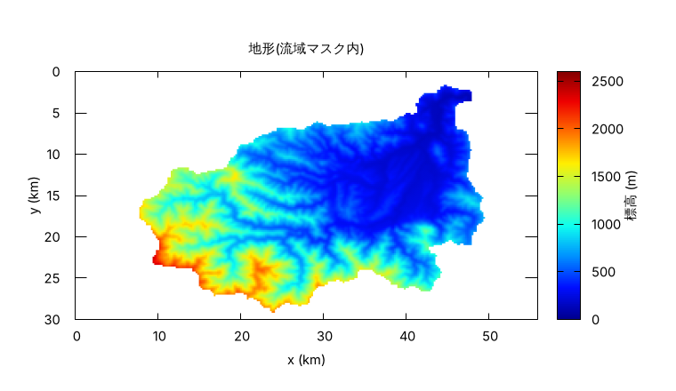

北東の隅(標高 100 m 台)が流域の出口で、南西の主稜線には 2,500 m 級の
山々が並びます。流域の大部分は急峻な山地です。

## Step 1: 実地形データでの最小構成

### 実行

wave と同じように、`make` で実行ファイルへのリンクを作り、
`param_step1.txt` を実行します。

```bash
make
./encflow param_step1.txt
```

```
reading list_sysparam in param_step1.txt
reading list_geoinfo in param_step1.txt
 reading data_chichibu/Chichibu_200m_basin.txt
 reading data_chichibu/Chichibu_200m_filled.txt
reading list_precip in param_step1.txt
main: number of processes: 1
main: number of threads: 4
main: real precision: 64 bit
main: number of valid cells: 17885
time, progress, S(m), Runge, ex_flux, Cn_max, h_max(m), V_max(m/s)
  0:00:00.00   0.0%    0.0000   0.0%      0    0.0000    0.0000    0.0000
  0:30:00.00   8.3%    0.0487  97.7%      0    0.1910    1.2871    4.0483
  1:00:00.00  16.7%    0.1000   6.2%      0    0.3464    4.7535    8.4467
  1:30:00.00  25.0%    0.1000   3.4%      0    0.4357    6.9561    9.5765
  2:00:00.00  33.3%    0.1000   0.9%      0    0.4130    6.9710    9.4047
  ...
  6:00:00.00 100.0%    0.1000   0.6%      0    0.5155   29.9470    4.1028
main: program terminated normally
```

`param_step1.txt` の中身(先頭の表題コメントを除く全文)は次のとおり
です。構成は wave の Step 1 とほとんど同じで、違いは `&list_geoinfo` が
地形と流域マスクをファイルから読み、粗度係数 `rn0` を与えることと、
`&list_precip` で雨を降らせることだけです(`&list_sysparam` の
`dir_data` は入力データのディレクトリで、以下のファイル名はこの
ディレクトリからの相対パスになります)。

```
!======================================================================
! システムパラメータ設定
!======================================================================
&list_sysparam
  dt = 6.0                       ! 時間刻み (s)
  tt_c = "6 hour"                ! 計算終了時刻
  dt_disp_c = "30 min"           ! 画面表示時間刻み
  dt_file_c = "30 min"           ! ファイル出力時間刻み

  fn_geoinfo = "-"               ! 地理情報設定ファイル
  fn_precip  = "-"               ! 降水条件設定ファイル

  dir_data   = "data_chichibu"   ! 入力データディレクトリ
/

!======================================================================
! 地理情報設定
!======================================================================
&list_geoinfo
  nx = 280
  ny = 150
  dx = 200.0
  dy = 200.0

  f_ztype = 1          ! 地盤高タイプ (0:デフォルト固定値, 1:ファイル)
  f_masktype = 1       ! 領域マスクの有無 (0:なし, 1:流域マスク)
  rn0 = 0.05           ! 粗度係数固定値(山地斜面の目安。既定 0.015 は水路向け)

  fn_z = "Chichibu_200m_filled.txt"        ! 地盤高ファイル名
  fn_mask = "Chichibu_200m_basin.txt"      ! 領域マスクファイル名
/

!======================================================================
! 降水条件設定
!======================================================================
&list_precip
  ! 降水データのタイプ (1:一様分布の時系列、2:分布 × 倍率、3:分布の時系列。降水なしは fn_precip を書かない)
  prtype = 1
  ! 降水の時系列 (時刻(min) 雨量強度(mm/h))
  prval(:,1) =   0,   0
  prval(:,2) =  30, 200
  prval(:,3) =  60,   0
/
```

画面表示から次のことが読み取れます。

- `number of valid cells: 17885` — 格子全体は 280×150 = 42,000 セル
  ですが、流域マスクにより計算対象は 17,885 セルだけです。マスク外は
  メモリも計算時間も消費しません。
- `rn0 = 0.05` は Manning の粗度係数です。既定値 0.015 は水路向けの
  値で、山地の斜面全体に使うと流れが速くなりすぎます(出口のない
  この器では水が一箇所に集中しすぎて計算が不安定になります)。
  ここでは山地斜面の目安 0.05 を与え、Step 2 で河道だけ別の値に
  します。
- S 列は雨とともに増え、雨が終わる t = 1:00 に **0.1000** m
  (= 総雨量 100 mm。0 → 200 → 0 mm/h と 30 分ずつで変わる雨の流域平均)でぴたりと止まり、
  以後一定です。計算領域の外縁はデフォルトでは不透過の壁なので、
  この流域は**水の出口のない閉じた器**であり、S 列の一定は質量保存の
  確認になります。
- 一方で h_max 列は 7 m → 30 m 近くへと成長し続けます。出ていけない水が
  どこかに溜まり続けているということです。
- ex_flux 列は、運動方程式から求めた流出量がセルの水量を上回りかけたので
  抑えた回数です。質量を保つための安全装置で、ふだんは 0 です。続けて出るのは
  計算が荒れているサインです。

最終時刻の水深分布(`result/H9998.txt`)を見ると、溜まっている場所が
わかります(水深分布図は、水深 0 を白、深いほど暖色となる配色で
示します。流れて出払った場所は白く抜け、溜まった場所だけが
色になります)。同梱の gnuplot スクリプトで、4 時刻の水深分布を 1 画面に
並べて表示できます(要 gnuplot。表示後、ターミナルで Enter を押すと
終了します)。

```bash
gnuplot Plot_step1.plt
```

雨の間に斜面から河道網へ水が集まり(t = 0:30, 1:00)、雨が止むと
河道の水が下流へ抜けて(t = 3:00)、最後は北東の隅の手前に水が
溜まっていく様子が読み取れます。


流域出口(北東の隅)の手前に、深さ 25 m を超える湛水が育っています。
壁で堰き止められた流出水のこの湛水は、Step 5 で境界条件を設定して
解消します。それまでの Step では、出口の湛水は承知の上で計算を
進めます(湛水は時間とともに上流へ伸びます。Step 2 以降の計算では、6 時間後には出口から
本川に沿って 12 km ほど上流まで届き、その範囲の水位と流量に影響します — Step 3〜5 で
具体的に見ます)。

### 窪地除去はなぜ必要か

`&list_geoinfo` の `fn_z` を `Chichibu_200m_raw.tif` に差し替えると、
窪地除去をしていない元の DEM で計算できます(GeoTIFF を読むため、
Step 2 の `param_step2.txt` の `fn_z` を、窪地除去済みの `Chichibu_200m_filled.tif` と
未処理の `Chichibu_200m_raw.tif` に替えて試すのが手軽です)。河道の水が出口の池に
ほぼ集まり切るよう計算時間を 12 時間に延ばし(`tt_c = "12 hour"`)、
12 時間後の水深分布を比べると:

| 窪地除去済み(filled) | 未処理(raw) |
|---|---|
|  |  |

filled では流域がほぼ真っ白です — 降った水が斜面から河道へ、河道から
下流へと正しく流下しきって、(出口が壁のこの段階では)出口の湛水
一点に集まっています。raw では流域のあちこちに色が散在します —
水が途中の窪地に捕まってしまい、出口までたどり着けません。流速の
最大値も末期には 0.8 m/s 程度まで落ち、流域全体で流れが死んでいる
ことがわかります。

一般に、地形の勾配が大きくセルサイズも大きい場合、DEM の階段状の
段差が大きくなります。段差が水深のオーダーを超えると水の流れは
著しく阻害されるため、**流出計算には事前の窪地除去が必須**です。

窪地は計算の安定性の面でも危険です。流出先のない窪地では水深が
増え続け、浅水方程式の波速(≒ √(gh))が水深とともに大きくなる
ため、クーラン数 Cn(= 波速 × dt / セルサイズ)が増加して安定条件
(Cn ≲ 1)が破綻しやすくなります
([時間刻みの章](../../docs/users_guide/time.md)。流速に波速を足した
クーラン数の意味は[クーラン数と時間刻みの決め方](../../docs/users_guide/courant.md#wave-speed))。
この連鎖は窪地に限らないトラブルシューティングの定石でもあります:
**計算が破綻(発散)したときは、まず「どこかで水深が増える →
波速が増す → 安定条件の破綻」を疑ってください**。画面の Cn_max 列で
増加傾向を確かめ、最大水深 H9999 の分布で水が異常に溜まる場所を
探すのが第一歩です。

なお、格子に対して斜め方向に水が移動できない通常の構造格子モデルでは、
一般的な GIS ソフトの D8 法(8 方向流下)で窪地除去した DEM でも
斜め方向の流路で水が引っ掛かるため、追加の窪地処理や解像度の引き上げが
必要になることがあります。ENC 格子は 8 方向に水をやり取りできるため
D8 と相性が良く、**D8 で窪地除去した DEM がそのまま使えます**。

このことは実験で確かめられます。`fn_enc = "-"` と `&list_enc` の
`p_diagratio = 0.0` を指定すると、ENC 格子の対角方向の交換を閉じた
「4 近傍」の計算になります。同じ窪地除去済み DEM でも、水は斜め方向の
流路で引っ掛かり、12 時間後の水深は raw のときと同じように流域中で
寸断されて出口に届きません(末期の最大流速も 0.3 m/s 程度まで落ち、
流れが死にます)。

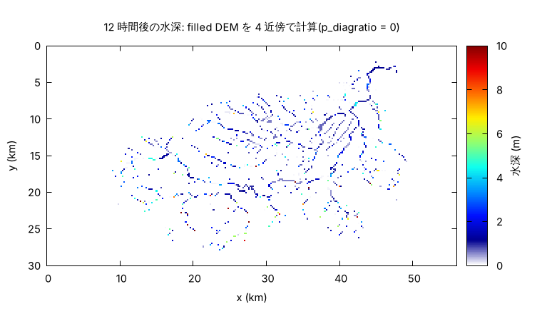

ただし、窪地除去が保証するのは「水が出口まで流れ下れること」だけで、河道の形までは
整えません。窪地を埋めた跡は、同じ高さのセルが続く**平坦な区間**と、その下流端の段差として
残ります(この 200 m 格子の標高では、河道セルの 3 割が、流下先のセルと同じ高さです)。
平坦な区間には深さ数 m の水が溜まって流れが遅くなり、段差では急に速くなるので、
洪水波が遅れたり、ハイドログラフに不自然な揺れが出たりすることがあります。
Step 2 では、河道の高さを整えた標高に替えます。

## Step 2: GeoTIFF 入出力と河道の表現

`param_step2.txt` では、入出力を GeoTIFF に切り替え、河道を表す 3 つのデータ —
河道マスク・河道の粗度・河床の高さ — を追加します。

```
&list_sysparam
  ...
  f_input_mode = 4           ! matrix入力形式(1:text, 2:bil, 4:geotiff)
  f_output_mode = 5          ! matrix出力形式(1:text, 2:bil, 4:geotiff)
/

&list_geoinfo
  ...
  f_rntype = 0         ! 粗度係数タイプ (0:デフォルト固定値, 1:ファイル)
  rn0 = 0.05           ! 粗度係数固定値
  rn0_rw = 0.04        ! 河道マスク部の固定粗度係数

  fn_z = "Chichibu_200m_cond.tif"            ! 地盤高ファイル名(河床を整えた標高)
  fn_mask = "Chichibu_200m_basin.tif"        ! 領域マスクファイル名
  fn_rw = "Chichibu_200m_river_flowline.tif" ! 河道マスクファイル名
/
```

- `f_input_mode = 4` / `f_output_mode = 5` で、分布データの読み書きが
  GeoTIFF になります(出力モード 5 はテキストと GeoTIFF の両方を出力)。
  出力された `.tif` は座標参照情報を引き継ぐので、**QGIS などの GIS に
  ドラッグするだけで地図に重なります**。
- 粗度は「基本 `rn0 = 0.05`(山地・原野相当)、河道セルだけ
  `rn0_rw = 0.04`(山地の河道相当)で上書き」という 2 段構えです。
  `rn0_rw` は粗度の与え方(固定値・ファイル)によらず河道セルを
  上書きします。0.04 は、ユーザーガイドの河道の章の
  [パターン別の推奨値](../../docs/users_guide/channel.md#パターン別の推奨値)で、山地渓流の
  目安(0.04〜0.06)の下限に当たる値です。
- 河床の高さは、地盤高のデータ(`fn_z`)の側で整えてあります(下の「河床の高さを整える」)。
- 河道マスク `fn_rw` はこの段階では粗度の差し替えにだけ使っています。
  地形からの掘り込み(`depth_rw`)やサブグリッド河道(`fn_channel`)
  へは、ここから段階的に精緻化できます([ユーザーガイド](../../docs/users_guide.md))。

2 つのマスクを図にすると次のようになります(値 1 のセルだけを塗って
います)。

| 流域マスク `Chichibu_200m_basin` | 河道マスク `Chichibu_200m_river_flowline` |
|---|---|
|  |  |

流域マスクで塗られたセルが計算対象で、Step 1 の画面に出た
`number of valid cells: 17885` はこのセルの数です。河道マスクは
河道網を**幅 1 セルの線**として与えていて、このセルだけ粗度が
`rn0_rw` に置き換わります。どちらも「1 か 0 か」だけのラスタで、
GIS で作ったものです(河道マスクは、前処理で標高の谷線に載せ直して
あります — 「データを眺める」の説明)。河道の幅は持たせていません。
200 m 格子では河道はセル幅より細いのですが、ここでは
「どのセルが河道か」と、その粗度・河床の高さだけを与えます
(幅まで与えるのが、サブグリッド河道です)。

### 河床の高さを整える

Step 1 の標高(`Chichibu_200m_filled`)の値は、セルの中の平均的な高さです。山地の川は
200 m のセルよりずっと細い谷底を流れているので、河道セルの標高は、実際の河床より高く
なります。加えて、Step 1 の終わりに触れたとおり、窪地除去の跡が、河道に沿った平坦な区間と
段差になって残ります。

`Chichibu_200m_cond` は、河道セル(1,473 セル)の標高だけを作り直したものです。
同じ範囲の 10 m 格子の標高から、200 m のセルごとに谷底の高さ(セルの中の最小値)を読み取って
河道セルの高さにし、下流へ向かって必ず同じか低くなるように整えてあります。河道セル以外は
`Chichibu_200m_filled` と同じです。本川に沿って 2 つの標高を比べると、次のようになります。

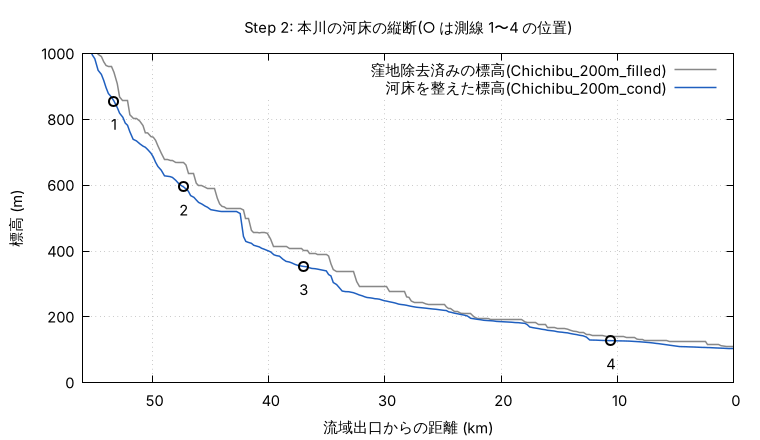

- 灰色が窪地除去済みの標高です。同じ高さが続く平坦な区間と段差が、階段のように並んで
  います(河道セルどうしのつながり 1,472 本のうち 446 本が、流下先と同じ高さです)。
- 青が整えた河床です。河道セルは全て下がり(下げた量の中央値 37 m、最大 135 m)、平坦な
  区間は、貯水池などの水面とみられる 2 か所(図の 43〜44 km の区間がその 1 つ)を残して
  なくなります(流下先と同じ高さのつながりは 25 本)。
- 河床が、セルの平均の高さではなく谷底の高さになるので、河道セルは両脇のセルより深く
  切れ込みます(両脇の低い方のセルと河床の差の中央値 48 m)。

この前処理の手順と統計は、[データの README](../../test/chichibu/data_chichibu/README.md) の
「河床を整えた標高」にまとめてあります(10 m 格子の標高と、前処理の道具は同梱していません)。
自分の流域では、細かい標高データから谷底の高さを読み取るか、縦断測量などの河床高から、
同じように河道セルの高さを与えます。河床を整える前後でハイドログラフがどう変わるかは、
Step 3 で計測を置いてから比べます。

実行すると、画面の数値は Step 1 から変わります(河道が低く滑らかになって、水が速く
集まるためです。V_max は 8〜10 m/s から 14〜15 m/s に上がり、6 時間後の h_max は
30 m から 34.5 m に増えます)。結果ディレクトリには `H0001.tif` などが並びます。

## Step 3: 計測と分布出力

流量や水深の時系列がほしい場所は、あらかじめ**プローブ**(点)と
**フラックス測線**(線)で指定しておきます。`param_step3.txt` では
本川に沿って 4 点・4 本を置きました。

```
&list_sysparam
  ...
  dt_recrd_c = "1 min"       ! プローブ出力時間刻み

  f_out_h = 1                ! ファイル出力(水深H0001)
  f_out_vv = 1               ! ファイル出力(流速絶対値V0001)
  f_out_qq = 1               ! ファイル出力(流量絶対値Q0001)
  f_out_cn = 1               ! ファイル出力(クーラン数Cn0001)
  f_out_hmax = 1             ! ファイル出力(最大水深H9999)
  f_out_vvmax = 1            ! ファイル出力(最大流速V9999)
/

&list_record
  ! プローブの位置のタイプ (0:セル番号, 1:実座標(m))
  ! プローブの位置 (x座標, y座標)
  pbxytype = 0
  pbxy(:,1) =  82, 105
  pbxy(:,2) = 107, 102
  pbxy(:,3) = 147, 104
  pbxy(:,4) = 216,  39

  ! フラックス測線の座標のタイプ (0:セル番号, 1:実座標(m))
  ! フラックス測線の始点終点 (右岸x, 右岸y, 左岸x, 左岸y)
  flxytype = 0
  flxy(:,1) =  82, 107,   82, 103
  flxy(:,2) = 107, 103,  107, 100
  flxy(:,3) = 147, 105,  147, 102
  flxy(:,4) = 216,  43,  216,  37
/
```

セル番号は Fortran の流儀で **1 スタート**です(QGIS のラスタの
行列番号は 0 スタートなので、GIS で調べたセル番号を使うときは
1 を足してください)。測線は「始点から終点に向かって右側が正」
なので、右岸 → 左岸の向きに書くと下流向きの流量が正になります。
実座標(m)での指定(`pbxytype = 1` / `flxytype = 1`)もできます
([ユーザーガイドの計測の章](../../docs/users_guide/record.md))。

測線とプローブを Step 2 の河道マスクに重ねると、次の図になります
(上: 全体、下: 各測線のまわりの拡大。拡大図の軸は**セル番号**で、
上の `flxy` / `pbxy` の数値と直接対応します)。

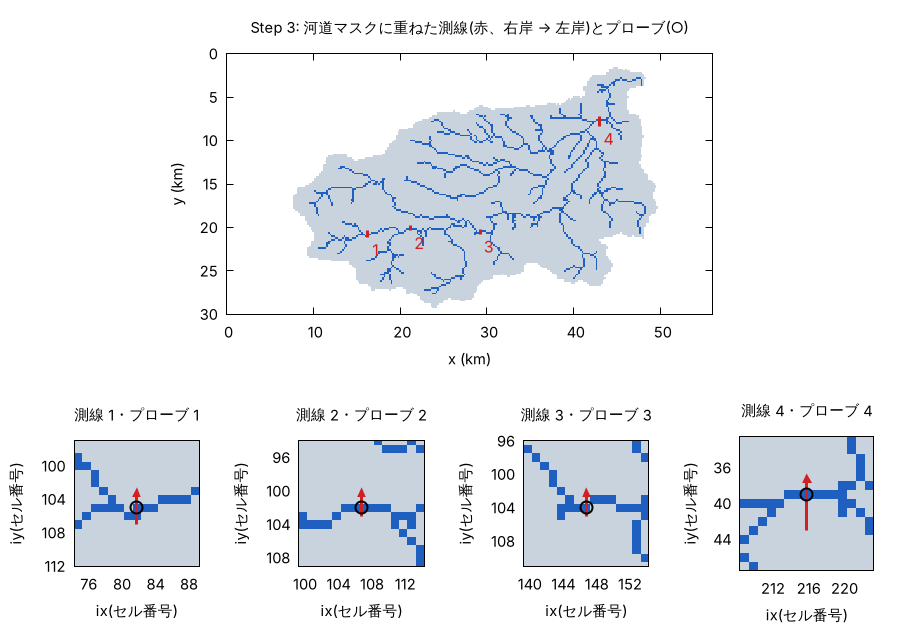

- 測線(赤)は本川を**またぐように**、河道セルの両側の斜面セルまで
  含めて 4〜7 セルの長さにしてあります。河道マスクは幅 1 セルですが、
  洪水時の水は隣のセルにもあふれるので、測線を河道セルだけに
  限ると流量を取りこぼします。矢印の向きが「右岸 → 左岸」で、
  4 本とも南から北へ引いてあります(本川はおおむね西から東へ
  流れるので、下流を向いて右手にあたる南側が右岸です)。
- プローブ(○)は、各測線が河道マスクを横切るセルに置いてあります
  (拡大図で○が青いセルの上に乗っていることを確かめてください)。
  プローブはセル単位の点計測なので、1 セルずれて斜面側に乗ると
  河道の水深・流速はほとんど記録されません(試しに `pbxy(:,3)` を
  `147, 103` にして実行すると、`probes/probe0003.csv` の水深は
  最大でも 1〜2 cm になります)。**設定した位置をこのようにマスクに
  重ねて目で確かめる**のが、計測を置くときの基本動作です。

実行すると、画面の数値は Step 2 と**完全に一致**します(計測と
ファイル出力は計算そのものには一切影響しません)。結果には
`fluxes/flux0001.csv`(測線の流量時系列)と
`probes/probe0001.csv`(プローブの水深・流速時系列)が加わります。

```bash
gnuplot -p -c Plot_flux.plt result
```

で 4 本の測線のハイドログラフを順に表示できます(同梱の
`Plot_flux.plt` / `Plot_map.plt` は結果の目視用スクリプトです)。


上流の測線 1 から下流の測線 4 へ、洪水波が遅れながら成長していく
流域スケールの洪水追跡が 1 分刻みで得られました。ピークは、測線 1 から順に
1,255 m³/s(47 分)、3,047 m³/s(54 分)、6,420 m³/s(81 分)、8,559 m³/s(136 分)です。

- 測線 4 の立ち上がりの 110〜120 分ごろに見える肩は、測線の約 2 km 上流で合流する
  支川(流域面積 約 200 km²)のピーク(108 分・約 3,400 m³/s)が、本川(同 約 450 km²)の
  ピーク(132 分・約 6,500 m³/s)より先に届くために出るものです。
- 測線 4 の逓減部のうち 2 時間半以降は、出口の湛水の影響を受けています。湛水が上流へ
  伸びて測線 4 まで届き(6 時間後のプローブ 4 の水深は 10 m)、流量を抑えるためです
  (最大で 2 割ほど。ピークまでは影響しません)。Step 5 で出口を開けて確かめます。
- 実地形の計算の 1 分値には、このほかに細かい揺れが乗ることがあります。その見方は、補足
  [ハイドログラフの細かい振動について](#補足-ハイドログラフの細かい振動について)にまとめてあります。

### 河床を整えた効果

Step 2 で河床を整えた効果を、ここで確かめておきます。`param_step3.txt` の `fn_z` を
`Chichibu_200m_filled.tif`(窪地除去済みの標高)に戻して計算し、同じ測線で比べると、
次のようになります(実線が Step 3、破線が標高を戻した計算。河道の粗度はどちらも 0.04)。

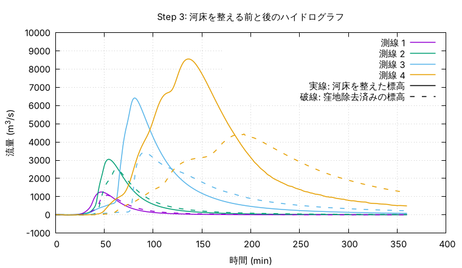

| 測線 | 窪地除去済みの標高 | 河床を整えた標高 |
|---|---|---|
| 1 | 1,077 m³/s(52 分) | 1,255 m³/s(47 分) |
| 2 | 2,500 m³/s(62 分) | 3,047 m³/s(54 分) |
| 3 | 3,430 m³/s(91 分) | 6,420 m³/s(81 分) |
| 4 | 4,456 m³/s(190 分) | 8,559 m³/s(136 分) |

窪地除去済みの標高では、河道の平坦な区間に水が溜まって波が遅れ、低く長くなります。
たとえば、波の立ち上がりが測線 2 から測線 3(約 10 km 下流)まで進むのに、河床を整えた
標高では約 20 分、窪地除去済みの標高では約 30 分かかります。下流ほど違いが大きく、
測線 3・4 のピークは、河床を整えると 1.9 倍になり、測線 4 では 54 分早まります。

**河道の高さの与え方だけで、下流のピークは 2 倍近く変わります。** どちらが実際の川に近いかは、
このチュートリアルでは確かめていません(観測流量との照合はしていません)。河床を整えた標高は、
窪地除去の跡という、実際の川にはない形を除いたものですが、河道の幅と断面は「幅 200 m の
矩形」のままで、粗度も目安の値です。実際の計算では、河道の高さ・幅・粗度が結果を大きく
左右することを踏まえて、観測と照合してください。

分布出力の方は、最終時刻と期間最大の 6 枚を 1 画面に並べる
`Plot_step3.plt` で一望できます。

```bash
gnuplot Plot_step3.plt
```

上段が最終時刻の水深・流速・流量、下段が最大水深・最大流速と
最終時刻のクーラン数です。また、Step 1 で使った `Plot_step1.plt` は
第 1 引数で変数を切り替えられるので、`gnuplot -c Plot_step1.plt V`
(または `Q`)とすれば、流速・流量の時間変化も同じ 4 時刻表示で
見られます。

## Step 4: 降雨遮断と地下浸透

ここまでの計算は「降った雨が全部流れる」ものでした。実流域では
樹冠による遮断と地中への浸透が流出を減らします。`param_step4.txt`
では、最も簡単な 2 つの損失モデルを重ねます。

```
&list_sysparam
  ...
  fn_intercept = "-"         ! 降雨遮断条件設定ファイル
  fn_gwflow = "-"            ! 地下水条件設定ファイル
/

&list_intercept
  f_icmodel = 1              ! 1:固定遮断率モデル
/
&list_intercept_fixed
  ic_alpha = 0.2             ! 遮断率(有効雨量 = (1-α)P)
/

&list_gwflow
  f_gwvertical = 1           ! 1:バケツモデル
/
&list_gwflow_bucket
  gw_infil_mmh = 5.0         ! 浸透能 (mm/h)
  gw_capacity = 0.2          ! 地下貯留容量(柱状換算水深) (m)
/
```

機能の有効化は ENCflow 共通の流儀で、`fn_*` を書けば有効・書かなければ
完全に無効(メモリも計算時間も追加ゼロ)です。実行すると、画面の
水量表示が 1 列から **3 列**に変わります。

```
time, progress, S_surf(m), S_grnd(m), S_total(m), Runge, ex_flux, Cn_max, h_max(m), V_max(m/s)
  0:00:00.00   0.0%    0.0000     0.0000     0.0000    0.0%      0    0.0000    0.0000    0.0000
  0:30:00.00   8.3%    0.0365     0.0024     0.0389   98.4%      0    0.1979    0.7556    4.5477
  1:00:00.00  16.7%    0.0751     0.0049     0.0800    5.9%      0    0.3935    4.3328   10.1322
  1:30:00.00  25.0%    0.0728     0.0072     0.0800    3.0%      0    0.4913    5.6149   12.7808
  ...
  6:00:00.00 100.0%    0.0696     0.0104     0.0800    0.0%      0    0.5118   29.6269    3.2158
```

- `S_surf` は地表水、`S_grnd` は地下貯留、`S_total` はその合計です。
  雨が終わった後の S_total は **0.0800** m で一定 — 総雨量 100 mm の
  8 割、つまり遮断率 α = 0.2 を除いた有効雨量と一致し、地表と地下の
  間で水が移っても合計は保存されていることが確かめられます。
- 時間とともに S_surf が減り S_grnd が増える — 浸透の進行がそのまま
  読めます。

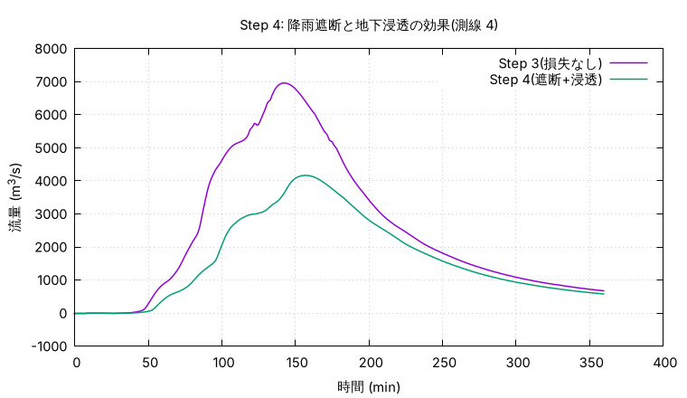

ハイドログラフではピーク流量が 36 % 減り(8,559 → 5,482 m³/s)、ピークは 17 分遅れました。
遮断は総量を 2 割削り、浸透は薄く広がる斜面の水を吸い続けるため、
立ち上がりが大きく下がります(2 時間目までは半分前後)。6 時間の間に測線 4 を通る水の量は
3 割減ります。逓減部の 3 時間半〜4 時間半に 2 本が重なって入れ替わるのは、出口の湛水の
影響です(損失のない Step 3 の方が湛水が大きく、測線 4 の流量が余計に抑えられます。
Step 5 のように出口を開けて比べると、逓減部も Step 4 の方が小さくなります)。

## Step 5: 流域出口の境界条件

Step 1 から見て見ぬふりをしてきた出口の湛水(h_max ≈ 30 m)を
解消します。流域出口は計算領域の外縁(4 辺)ではなく領域内部に
あるため、辺の境界条件ではなく**水位規定セル群**を使います。
`param_step5.txt` では、出口の河道セルと、その隣のセルの水位を低い値に固定して
「排水口」にします。

```
&list_sysparam
  ...
  fn_boundary = "-"          ! 境界条件設定ファイル
/

&list_bound_stage
  ! 群1: 流域出口(河床より低い水位で完全排水)
  stage_cell(:,1,1) = 239, 19
  stage_cell(:,2,1) = 240, 19
  stage_eta(1) = 100.0
/
```

出口セルの番号は、河道マスクと DEM を GIS で重ねて「流域マスク内で
最も下流の河道セル」(240, 19) を読み取り、その西隣のセル (239, 19) を加えて
決めました(前述のとおり 1 スタートに直すのを忘れずに)。`stage_eta` は標高値で
指定します。水位を河床より低くしたセルは常に空の「完全排水口」になります
(ここでは 100 m。2 つのセルの地盤高 103.4 m・113.1 m より低いため、届いた水は
ただちに系外へ除去されます)。実行すると:

```
time, progress, S_surf(m), S_grnd(m), S_total(m), Runge, ex_flux, Cn_max, h_max(m), V_max(m/s)
  ...
  3:00:00.00  50.0%    0.0524     0.0092     0.0616    0.1%      0    0.4613    8.9775    6.9729
  6:00:00.00 100.0%    0.0144     0.0104     0.0248    0.0%      0    0.2447    3.1213    3.2487
```

- S_total が減少に転じました — 出口から系外へ出た水の分です。
- h_max は 30 m から 3.1 m へ。湛水が消えたことは水深分布でも
  確かめられます。

| Step 4(出口なし) | Step 5(完全排水口) |
|---|---|
| 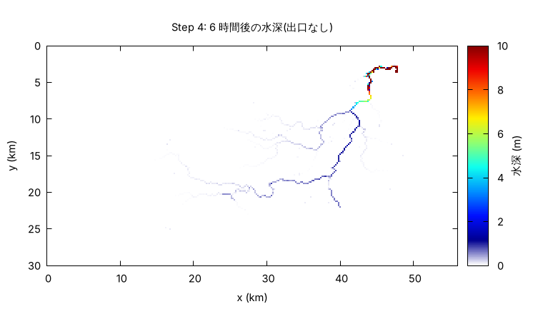 |  |

測線 1〜3 のハイドログラフは Step 4 と同じです。測線 4 は、ピーク(5,482 m³/s・153 分)までは
同じで、逓減部の 3 時間 20 分以降が変わります。Step 4 では、出口の湛水が上流へ伸びて
測線 4 まで届いていたためです。プローブ 4 の水深で比べると、よく分かります。


Step 4 の水深は、4 時間半ごろから増えに転じます。上流から来る流量は減り続けているので、
これは下流の湛水の水面が上がってきたもの(背水)です。Step 5 では水深は下がり続け、
流量は Step 4 より最大で 130 m³/s(5 時間目。Step 4 の 17 %)大きくなります。
**出口に近い場所の水位と流量は、出口の境界条件で変わります。** 計測を置く場所が
境界条件の影響を受けていないかは、このように境界を変えて確かめるのが確実です。

なお、時系列で水位を規定すれば(`stage_val`)、下流河川の水位や
潮位を与える開境界にもなります。辺境界(自由流出・長波放射)、
流入境界などの使い分けは[ユーザーガイドの境界条件の章](../../docs/users_guide/boundary.md)を
参照してください。

## Step 6: ParaView での 3D 可視化

最後に、分布出力を 3D アニメーションとして眺めます。使うのは
無料の可視化ソフト [ParaView](https://www.paraview.org/)
(Windows / macOS / Linux。インストールは
[インストールガイドの 2 章](../../docs/install.md)を参照)と、
同梱の変換ユーティリティ utils/out2vtk です。

`param_step6.txt` は Step 3 の設定をアニメーション向けに変えた
ものです: 計算時間を 4 時間に短縮し(`tt_c`)、分布出力を 2 分毎に
細かくし(`dt_file_c`)、出力形式を GeoTIFF のみ(`f_output_mode = 4`)
にしています。動きの滑らかさは出力間隔で決まるので、可視化目的の
計算では出力を細かめにします。

### アニメーション用データの作成

まず、このパラメータファイルで計算を実行し、2 分毎の分布出力
(GeoTIFF)を作ります。これがアニメーションの元データです。

```bash
./encflow param_step6.txt
```

`result/` に水深 `H0000.tif` 〜 `H0120.tif`(t = 0 から 2 分毎 × 4 時間
= 121 枚)などの GeoTIFF が並べば準備完了です。

### VTK 形式への変換

ParaView は GeoTIFF の時系列をそのままアニメーションとして扱えない
ので、同梱の変換ユーティリティ out2vtk で VTK 形式に変換します。

```bash
make -C ../../utils/out2vtk install   # 初回のみ: 変換ツールをビルド
../../bin/out2vtk param_step6.txt
```

out2vtk には計算に使ったパラメータファイルをそのまま渡します
(結果ディレクトリと格子情報を引き継ぎます)。`result/vtk/` に
次のファイルができます。

| ファイル | 内容 |
|---|---|
| `flood.pvd` + `flood_0000.vts` 〜 | 水面の時系列(2 分毎の 121 時刻)。pvd がアニメーションの入口 |
| `terrain.vts` | 地形面(3D) |
| `summary.vts` | 最大水深などの統計量 |

流域の外は自動で非表示になります(encflow が常時出力する領域マスク
`X0000` を out2vtk が読み、既定で陸域だけを残すためです)。

### まずは最小の手順で

ParaView を起動して、次の 4 操作だけでアニメーションになります。

1. **File → Open** で `result/vtk/flood.pvd` を開き、**Apply** を押す
2. ツールバーの Coloring を **H**(水深)にする
3. **Edit Color Map**(虹色のアイコン)で **NaN 色を灰色**に変える
   (乾いたセルは水深が NaN で、既定では黄色に塗られるため)
4. **▶(再生)**を押す


これだけで「立体地形に水深の色が張り付いた」画になります。
このファイルの面は水面標高(地盤高+水深)の曲面なので、乾いた
場所は地形の起伏そのもの、濡れた場所だけがわずかに持ち上がります。
マウスのドラッグで回転、ホイールで拡大縮小、タイムラインの時刻は
計算の実時刻(秒)です。前半 30 分で斜面に雨水が広がり、その後
河道網に集まって洪水波が下っていく様子が見えます。

### 見栄えを良くする

上の最小手順に、それぞれ独立に足せる改善です。

- **水を水らしく**: `terrain.vts` も開いて Apply し、Coloring を
  `Solid Color`(灰色系)にする。`flood.pvd` 側は Edit Color Map の
  **NaN の不透明度(Opacity)を 0** にすると乾いた場所が消えて、
  地形の上に水だけが残ります。カラーマップを青系のプリセット
  (Blues など)にするとより水らしくなります。
  (NaN 不透明度の代わりに **Filters → Threshold** で H ≥ 0.01 を
  残す方法もあります。幅 1 セルの河道まで表示したいときは
  Threshold の「All Scalars」のチェックを外してください)
- **起伏の強調**: 両方のオブジェクトに **Filters → Transform** を
  掛け、Scale を `(1, 1, 3)` にする(鉛直 3 倍)。フィルタ適用後は
  元のオブジェクトを目玉アイコンで非表示に。
- **時刻の表示**: **Filters → Annotate Time**。
- **動画ファイルへ**: **File → Save Animation**(連番 PNG や AVI)。


### さらに: 地図・衛星写真の重ね合わせ

`terrain.vts` にはテクスチャ座標が入っており、QGIS で書き出した
同範囲の地図・衛星画像を地形に貼れます(ドレープ)。その手順と、
水膜閾値 `hmin`・変数の絞り込み・海域の扱いなどの設定は
[utils/out2vtk/README.md](../../utils/out2vtk/README.md) を参照して
ください。

## おわりに

このチュートリアルでは、実地形データを使う流域計算の型 —
データ準備(窪地除去、河道の高さの調整)→ 最小構成 → 計測 → 物理過程の追加 →
境界条件 → 3D 可視化 — を一巡しました。
ここから先は:

- 地下水モデルの精緻化(Green-Ampt、側方流動)、粗度の分布指定、
  サブグリッド河道など —
  [ユーザーガイド](../../docs/users_guide.md)
- 各機能の namelist の書き方 —
  [examples/List_samples/](../../examples/List_samples/)
- 大きな計算を MPI で並列実行するには `mpirun -np 4 ./encflow_mpi
  param_step5.txt`(結果は逐次実行とビット単位で一致します)

この文書の図(`figs/`)は `./Fig_chichibu.sh` で一括再生成できます
(gnuplot が必要です。本文の手順と同じ計算を順に実行して描画します。
Step 6 の 3D 図のみ対象外で、`Fig_step6.py` で再生成できます —
ParaView と同じ VTK ライブラリによる描画です。この後の補足の図は
`./Fig_supp.sh` で別に再生成します)。

## 補足: ハイドログラフの細かい振動について

**ここから先は補足です。** チュートリアルの手順はここまでで完結していて、
以下は興味のある人が読めばよい内容です。この補足では実地形の計算の 1 分値の
ハイドログラフに乗る細かい振動の見方と対処を、次の補足では解像度の影響と
ENC 格子の特性を扱います。

実地形の計算の 1 分値のハイドログラフには、細かい振動(短い上下)や、凹み・段が
乗ることがあります。気づいたら、次の順に考えます。

1. **小さな振動は、そのままでも差し支えないことが多いです。**
   計算の水収支を損なわず、流出解析で意味を持つ時間スケール(数十分〜)に
   影響しないなら、図にするときに移動平均を重ねて見れば十分です。

2. **地形が原因のものには、地形データの改良が本質的な対策です。**
   窪地除去(fill)後の DEM の河道沿いには「完全に平坦な区間」と、その端の段差が
   随所にできます(元 DEM が河川水面・峡谷・貯水池を平坦に記録していた場所や、
   窪地を埋めた跡)。計算では、平坦な区間に深さ数 m の「池」が湛まり、段差では
   流れが急に速くなって、池の水面の揺れや越流の変動が、振動の種になります。

   河道の縦断勾配が単調になるように前処理する(平坦区間と段差の解消。Step 2 の
   河床を整えた標高が、その例です)、
   あるいは河道をサブグリッド河道(`fn_channel`)へ移行して河床縦断を
   独立に与えることで、池と段差そのものをなくせます。地形の直し方によっては、
   急な区間への変わり目が測線に近づいて、別の振動が出ることもあります。地形を
   直したら計算し直して、測線での振動が減ったことを確かめてください(測線の
   置き方は 4)。

3. **計算の規則と格子から来るものがあります。** 実際の川の流量の変化として読むものではありません。

   河床を整えた標高でも、流れが浅く速い状態と深く遅い状態の間で切り替わる所や、河道の水が
   両脇のセルへあふれ始める所では、その区間に水が貯まる・放たれる分だけ、すぐ下流の流量が
   上下することがあります。下図は、次の補足(解像度の影響)の計算のうち、上下がはっきり出る
   2 つの例です(下段は 1 分ごとの流量の変化)。

   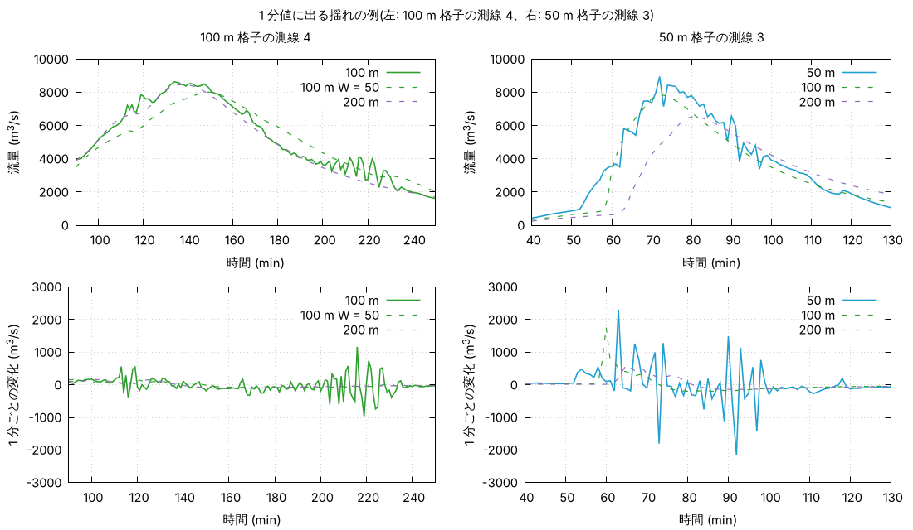

   - **100 m 格子の測線 4(左)。** 立ち上がりの 113〜119 分と、逓減部の 204〜231 分に、1 分で
     300〜1,200 m³/s の上下が出ます。測線の 0.4〜0.8 km 上流の屈曲で、河道の水深(約 9 m)が、
     河床と、両脇の低い方のセルの高さの差(8.5〜9.1 m)と同じくらいになる頃です。水が河岸の
     セルへあふれ始める・引く水位で、流れの状態が行き来します。同じ格子に幅 50 m のサブグリッド
     河道を与えた計算(水深がずっと深く、両脇のセルに水が乗ったままになる)と、200 m 格子には
     出ません(どちらも破線)。
   - **50 m 格子の測線 3(右)。** ピークの前後の 63〜98 分に、1 分で最大 2,300 m³/s の上下が
     出ます(1 分値の最大は 8,954 m³/s。11 分の移動平均では 8,026 m³/s)。測線の 0.5〜1 km 下流の
     急な屈曲の手前に、流れが堰き上げられて深くなる区間ができ、その上流端で、浅く速い流れが
     深い流れに入る境目(跳水)が、上流・下流へ行き来するためです。100 m・200 m 格子(破線)には
     出ません。この上下は、50 m 格子の計算の、いまの限界です(次の補足の結果 1)。

   どちらも、貯まった水が後から出るだけなので、流出の総量は変えません。読むときは
   移動平均を重ねてください。浅く速い流れと深い流れの切り替わりや、跳水が動くことは、実際の川でも
   起きますが、切り替わる流量と速さ、揺れの大きさは、数セルの区間の貯留と、移流項のセル境界の値の
   取り方で決まるものです。流れの状態の切り替わりで流量が揺れることは、既定の規則の限界として、
   ユーザーガイドの[移流項のスキーム](../../docs/users_guide/advection.md) §4.4 の
   `f_advection_lateral` の項に書いてあります。同じ章の選択肢(`f_advection_lateral`・`f_advection_bend`)や、
   エッジ水深の頭打ち(`f_dry_head_cap`。[解説](../../docs/users_guide/dry_head_cap.md))を変えると、揺れの出る時刻と大きさが変わります。

4. 計測位置の選び方でも軽減できます。水深数 m の平坦区間(池)に
   置いた測線は池の水面の揺れを直接拾うので、**縦断勾配のある通常の
   河道区間に測線を置く**のが安全です。

## 補足: 解像度の影響と ENC 格子の特性

この補足は「格子を細かくすると結果はどう変わるのか」「ENC 格子の
8 方向交換は何をもたらしているのか」「移流項は何をしているのか」に
興味のある人向けです。計算の再現には 50 m 格子のケースを
含むため数時間かかります(所要時間は下記)。結論だけ知りたい人は、各小節の
太字と「ENC 格子の特性として理解してほしいこと」を読んでください。

このチュートリアルは 200 m 格子で通してきました。格子を細かくすると
結果はどう変わるのかを、Step 3 の設定(損失なし)に Step 5 の流域出口を足したものを、
100 m・50 m 格子に移して比べます(出口を開けるのは、出口の手前の湛水が測線 4 に
届かないようにするためです — Step 5)。**比べる中心は 200 m と 100 m で、50 m 格子は参考です**
(50 m 格子には、流量の大きいときに測線 3 の流量が大きく上下する、という限界があります —
結果 1)。地形データは `test/chichibu/` にある同じ範囲の 100 m・50 m 版(テキスト形式。
河床を整えた標高 `Chichibu_100m_cond.txt`・`Chichibu_50m_cond.txt` は、200 m 版と同じ
10 m 格子の標高から、同じ手順で作ったものです)を使い、パラメータは
`param_supp_200m.txt` / `param_supp_100m.txt` / `param_supp_50m.txt`
です(200 m 版は、Step 3 の計算に Step 5 の流域出口を足して、入力をテキスト形式に
替えたものです)。
あわせて、Step 1 の最後に触れた **4 近傍**(`p_diagratio = 0.0`、
斜め方向の交換を閉じた計算)を同じ 3 解像度で実行し、ENC 格子の
8 方向交換が何をもたらしているかを見ます。これら 6 ケース(と後述の、
河道幅を揃えた 3 ケース、標高を窪地除去済みのものに戻した 4 ケース、移流項の扱いを変えた
12 ケース、河道の粗度を替えた 4 ケース)の実行と作図は `./Fig_supp.sh` で一括して
再現できます(50 m 格子を 7 本含むため、4 コアのノート PC で 5〜6 時間かかります。
200 m → 100 m → 50 m の順に実行するので、200 m・100 m 格子の結果は、始めの 1 時間あまりで
出そろいます)。

### 測線の対応づけ

4 本の測線とプローブは、Step 3 と**同じ場所**を各格子のセル番号で
指定し直しています(200 m の測線 1 = ix 82 なら、100 m では ix 164、
50 m では ix 327。長さも 1.0〜1.4 km で揃えています)。解像度が
変わると河道マスクの線も引き直されるので、測線が河道を跨いで
いるかを必ず確かめます。下図がその確認で、どの解像度でも測線(赤)は
河道(青)を 1 回だけ横切り、プローブ(○)は河道セルに乗っています。

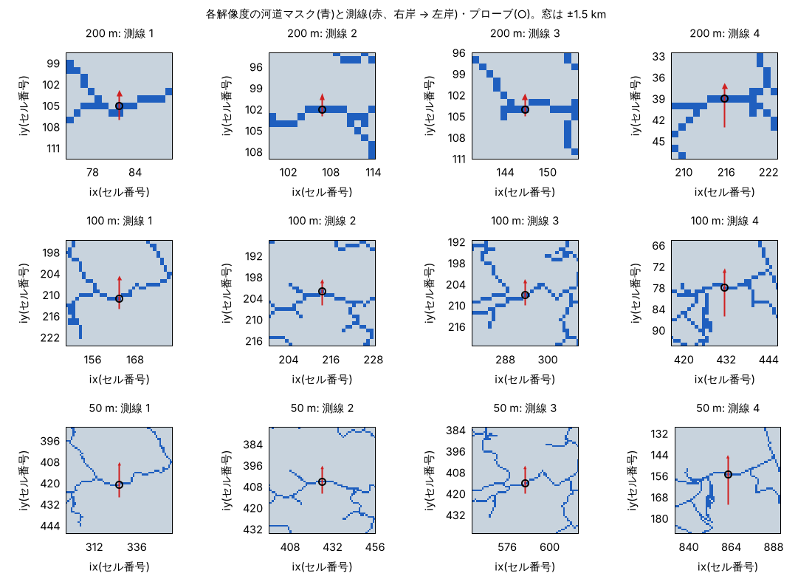

### 時間刻みと計算量

時間刻みは 200 m の 6 s に対し、100 m で 1.5 s、50 m で 0.75 s に
しました。格子比どおり(3 s・1.5 s)に縮めただけでは、Courant 数(画面の Cn_max)が、
100 m で 0.84 と余裕がなく、50 m では 1 を超えて停止する見込みです(1.5 s で 0.42、
0.75 s で 0.56 だったので、比例で 0.84・1.1)。格子を細かくすると、河道が狭く深くなり、
急な支川の谷筋も解像されて、最大流速が増える(200 m で 15 m/s、100 m で
23 m/s、50 m で 30 m/s)ためで、**細かい格子ほど計算量が
「セル数 × ステップ数」の比以上に増える**ことは、解像度を選ぶときに
覚えておく価値があります。格子幅と、見積もった最大流速・水深から `dt` を
決める手順は[クーラン数と時間刻みの決め方](../../docs/users_guide/courant.md#choose-dt)、
ENCflow が刻みを固定している設計上の理由は
[時間刻みの設計方針](../../docs/users_guide/timestep_policy.md#fixed-time-step)を
参照してください。

| 格子 | 計算対象セル数 | dt | ステップ数 | 計算時間の目安(ENC、4 スレッド) |
|---|---|---|---|---|
| 200 m | 17,885 | 6 s | 3,600 | 約 32 s |
| 100 m | 71,486 | 1.5 s | 14,400 | 約 370 s |
| 50 m | 285,843 | 0.75 s | 28,800 | 約 2,300 s |

### 結果 1: 解像度を変えると(ENC)

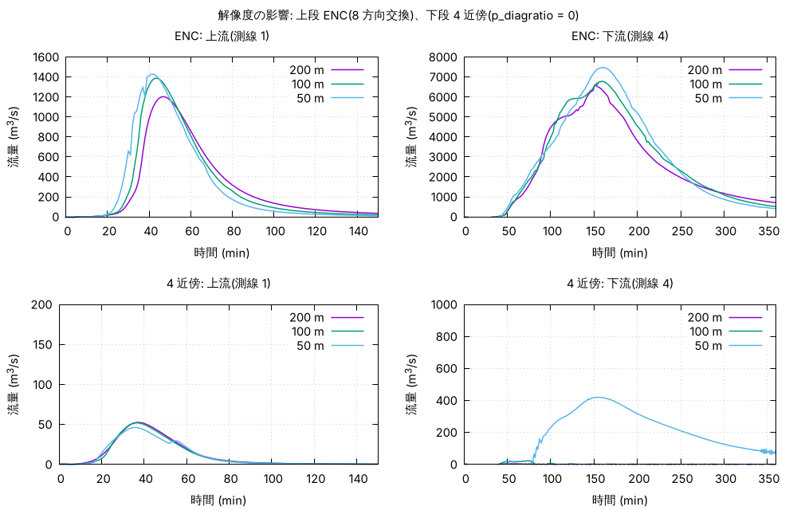

上段が ENC です。測線 1〜4 のピーク流量(m³/s)と、その時刻を表にします
(括弧は 1 段粗い格子からのピーク流量の変化率。集水面積は概数です)。

| 測線(上流 → 下流) | 集水面積 | 200 m | 100 m | 50 m |
|---|---|---|---|---|
| 1 | 約 30 km² | 1,254・47 分 | 1,391・43 分 (+11%) | 1,440・41 分 (+4%) |
| 2 | 約 80 km² | 3,043・55 分 | 3,542・49 分 (+16%) | 3,661・48 分 (+3%) |
| 3 | 約 240 km² | 6,530・81 分 | 7,831・73 分 (+20%) | 8,026・76 分 (+7%) ※ |
| 4(流域出口近く) | 約 670 km² | 8,477・138 分 | 8,639・134 分 (+2%) | 8,688・145 分 (+1%) |

※ 50 m 格子の測線 3 は、ピークの前後に 1 分値が大きく上下するので(下の「50 m 格子の限界」)、
11 分の移動平均のピークを載せています(1 分値の最大は 8,954 m³/s・72 分。同じ移動平均の
ピークは、200 m が 6,321 m³/s、100 m が 7,533 m³/s で、変化率はこの値との比です)。

- **上流(測線 1・2)**: 格子が粗いほどピークが小さく遅く、200 → 100 m で
  11〜16% 変わりますが、100 → 50 m では 3〜4% で、100 m
  以下でほぼ収束しています。河道幅を揃えても(下の比較)、200 m 格子の測線 1・2 のピークは
  4〜5% しか増えないので、主な原因は、河道幅ではなく、斜面と支川の解像度の側にあると
  みています(200 m セルでは谷底と斜面が 1 つのセルに混在して、斜面から河道へ水が集まる
  過程が鈍り、短い支川は 1〜2 セルに潰れます)。
- **流域出口近くの測線 4**: 3 つの格子のピークが、8,477〜8,688 m³/s(差は 2.5%)に
  そろいます。時刻は 134〜145 分です。
- **測線 3**: 200 → 100 m でピークが 20% 増えて、8 分早まります。ラスタでは
  河道幅 = セル幅なので、粗い格子ほど河道が広く浅くなります(測線 3 のプローブの最大水深は、
  200 m で 6.9 m、100 m で 10.4 m)。この違いが河道幅から来ているかを確かめるため、
  サブグリッド河道(`fn_channel`、
  [ユーザーガイドの河道の章](../../docs/users_guide/channel.md))で
  200 m・100 m 格子の河道幅を 50 m 格子と同じ 50 m に揃えて計算して
  みました(`./Fig_supp.sh` が `result_supp_*_w50` として実行します。200 m は
  流れが幅 50 m の河道に集まって速くなり、dt 6 s では Courant 数が 1 に近づく
  ので(dt = 4 s で 0.63)、dt = 4 s にしました。幅なしの 200 m を dt = 4 s で回しても、
  測線 4 のピークの違いは 0.1% 未満です)。

  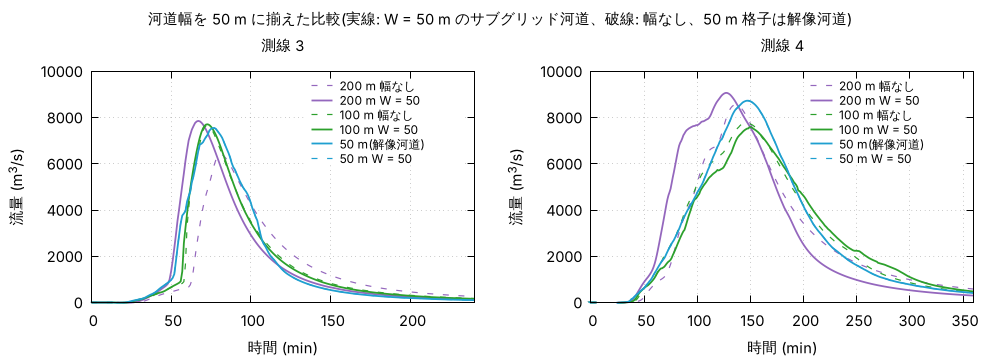

  | 測線 | 200 m(W = 50) | 100 m(W = 50) | 50 m(解像河道) |
  |---|---|---|---|
  | 3 | 8,189・67 分 | 7,916・72 分 | 8,026・76 分(11 分の移動平均) |
  | 4 | 8,929・130 分 | 8,018・149 分 | 8,688・145 分 |

  - **測線 3 は、河道幅を揃えるとそろいます。** 200 m のピークは 25% 増えて 14 分早まり
    (6,530 → 8,189 m³/s)、ほとんど変わらない 100 m(+1%)との差が 3% になります。
    同じ 11 分の移動平均で比べると、200 m が 7,950、100 m が 7,703、50 m 格子が 8,026 m³/s で、
    3 つの格子が 4% 以内にそろいます。測線 3 までの本川は峡谷で、10 m 格子の
    標高から見積もった谷底の幅は 30〜70 m です(見積もりの方法は developer.md §111.13)。
    200 m のセル幅の河道は、この峡谷には広すぎて、流れが浅く遅くなっていた、ということです。
  - **測線 4 は、逆に、河道幅を揃えるとばらつきます**(200 m が 8,929 m³/s・130 分、100 m が
    8,018 m³/s・149 分。幅なしは 8,477・138 分と 8,639・134 分)。測線 3 より下流の谷底の
    幅は 110〜170 m(同じ見積もり)で、幅 50 m の河道は狭すぎます。河道セルの両脇のセルは、
    測線 4 の前後 1 km の中央値で、200 m 格子では河床より約 18 m、100 m 格子では約 9 m
    高い所にあります。200 m 格子では、幅 50 m の河道の水(測線 4 のプローブの最大水深
    20.8 m)が、ほぼ溝の中を速く流れ、100 m 格子では、同じ水(17.7 m)が両脇のセルへ
    あふれて遅くなる、とみています。
  - つまり、**河道幅 = セル幅も、一様な 50 m も、流域の全体には合いません**。セル幅の河道は、
    下流の谷底の幅には近いものの、峡谷には広すぎ、一様な 50 m は、峡谷には合うものの、
    下流には狭すぎます。水位とともに広がる谷の断面を、1 つの幅で表すことの限界です
    (河道幅は、`fn_width` でセルごとに与えられます。区間ごとに幅を変えた比較は、
    ここではしていません)。上流の測線 1・2 では、幅の影響は 5% 以内です。
  - なお、50 m 格子に W = 50 m(= セル幅)を与えた計算(図の水色の破線)は、解像河道の 50 m 格子と
    ほぼ重なります。ピークの差は、測線 1・2 で 0.1% 未満、測線 4 で 0.3%(1 分遅い)です。測線 3 は、
    流量が上下する 60〜100 分の間だけ、1 分値が最大 1,700 m³/s 違い(上下の出方が変わります)、
    11 分の移動平均のピークの差は 0.3% です。幅がセル幅に等しいとき、サブグリッド河道は設計どおり
    解像表現に退化します(桁までの一致ではなく、斜めエッジの扱いなどの小さな差が残ります)。
- **50 m 格子の限界**: 50 m 格子の測線 3 の 1 分値は、ピークの前後の 63〜98 分に、
  1 分で最大 2,300 m³/s 上下します(前の補足の 3 の例。実際の川の流量の変化として
  読むものではありません)。測線の 0.5〜1 km 下流の屈曲の手前で、流れが、浅く速い状態と、
  堰き上げられた深い状態の間を行き来するためで、河道と、浸水した両脇のセルの間の
  運動量のやり取りの規則(`f_advection_lateral`)の、いまの限界です
  ([移流項のスキーム](../../docs/users_guide/advection.md) §4.4)。このため、50 m 格子の
  測線 3 のピークは、1 分値(8,954 m³/s)でなく、移動平均で読んでください。
  50 m 格子の測線 1・2・4 の 1 分値には、こうした上下は出ません。100 m 格子にも、測線 4 の
  立ち上がりと逓減部に、1 分で最大 1,200 m³/s の上下が出ます(同じく、前の補足の 3)。
- どの解像度でも、6 時間の計算の終わりに流域に残っている水は、降った雨 0.1 m のうち
  0.010〜0.017 m です(S 列。200 m で 0.0174 m、100 m で 0.0122 m、50 m で 0.0103 m)。
  雨の 83〜90% が、6 時間のうちに流域出口から出ていて、細かい格子ほど逓減が早く進みます。

#### 河床を整えた効果は、格子を変えても同じか

Step 3 で見た「河床を整えた効果」を、100 m 格子でも確かめます(`./Fig_supp.sh` が、地盤高だけを
窪地除去済みの標高に戻した計算を `result_supp_*_filled` として実行します。200 m 格子の
ピークは、出口を閉じた Step 3 の比較と同じです)。

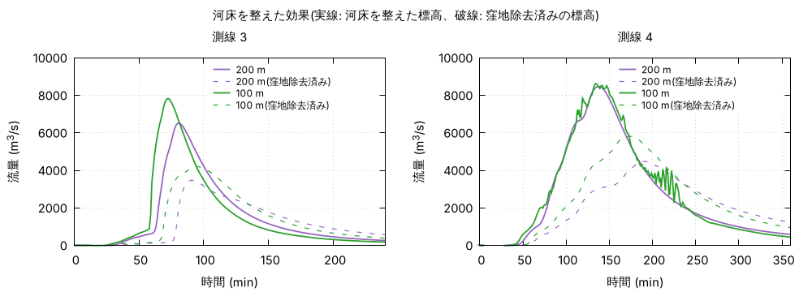

| 測線 | 200 m: 窪地除去済み → 整えた河床 | 100 m: 窪地除去済み → 整えた河床 |
|---|---|---|
| 3 | 3,475 m³/s(91 分)→ 6,530 m³/s(81 分) | 4,207 m³/s(95 分)→ 7,831 m³/s(73 分) |
| 4 | 4,488 m³/s(190 分)→ 8,477 m³/s(138 分) | 5,823 m³/s(173 分)→ 8,639 m³/s(134 分) |

100 m 格子でも、河床を整えると、測線 3・4 のピークは 1.5〜1.9 倍になり、22〜39 分早まります。
200 m と 100 m の違いを見ると、測線 4 のピークの差は、窪地除去済みの標高の 30% から、整えた河床の
2% に縮みます(時刻の差は 17 分から 4 分に。測線 3 のピークの差は、どちらの標高でも約 20% です)。
整えた河床は、どの格子でも、同じ 10 m 格子の標高の谷底をたどります。**河床の高さの与え方を
格子の間でそろえた分、格子による違いが小さくなった**とみています。

### 結果 2: 4 近傍で同じ計算をすると

下段が 4 近傍で(縦軸の範囲は、上段 ENC の 1/16(上流)と 1/100(下流)に縮めてあります)、
ピーク流量(m³/s)は次のとおりです。

| 測線 | 200 m | 100 m | 50 m |
|---|---|---|---|
| 1 | 49 | 9 | 6 |
| 2 | 53 | 0 | 15 |
| 3 | 0 | 3 | 61 |
| 4 | 33 | 2 | 78 |

流域出口近くの測線 4 に届くのは、200 m で 33 m³/s、100 m で 2 m³/s、50 m でも 78 m³/s で、
どの格子でも ENC(8,477〜8,688 m³/s)の 1% に届きません。6 時間たっても、降った雨のほぼ全量
(S 列で 0.0999〜0.1000 m)が流域に残っています。**格子を 4 倍細かくしても、4 近傍では
河道網は寸断されたまま**です。軸に揃った区間は水を通し、斜めの区間で止まる — 流量が出るか
どうかが、**解像度ではなく河道の向き**で決まります。

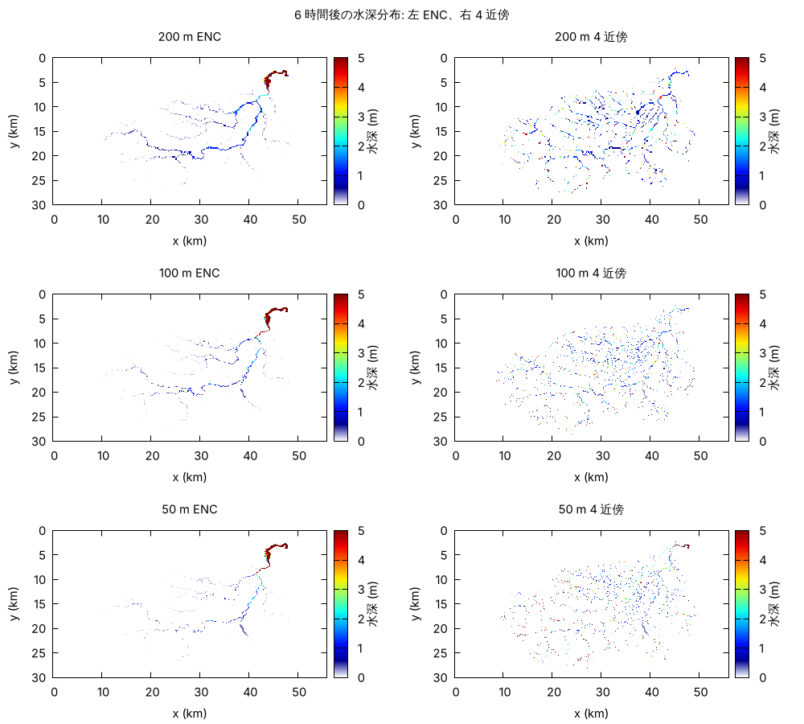

6 時間後の水深分布を見ると、ENC(左)では、どの解像度でも、水が残っているのは逓減中の
本流と主な支川の河道だけで、流域は白く抜けています。4 近傍(右)では、河道網の至る所に
点状の湛水が残り、斜めに走る区間ごとに水が止まっています。

### 結果 3: 移流項と解像度依存

ここまでの計算は既定の運動量保存形の移流スキーム(`f_advection_scheme = 3`)
でした。同じ 3 解像度を、**移流項を省いた拡散波(局所慣性方程式。
`f_govequation = 1`)**と、**旧移流スキーム(`f_advection_scheme = 1`。
非保存形・風上重み。風上化指数 `p_adv_upwind_index` は、test/chichibu と同じ 0.1、
既定の 0.5、上限の 1.0 = 完全風上の 3 通り)**でも実行し、移流項の
扱いで結果と解像度依存がどう変わるかを見ます(`./Fig_supp.sh` が `result_supp_*_noadv` /
`result_supp_*_s1` / `result_supp_*_s1u` / `result_supp_*_s1f` として実行します)。

> **用語について。** 移流項だけを省いたこの設定は、流速の時間変化の項
> (局所項)が残るので、厳密には拡散波ではなく局所慣性方程式です。以下では
> 従来の呼び方のまま「拡散波」と書きます。運動方程式の各項の意味と、
> 力学波・局所慣性・拡散波・運動波(キネマティックウェーブ)の違いは、
> ユーザーガイドの入門ページ
> [浅水方程式と力学波・拡散波・運動波](../../docs/users_guide/shallow_water.md)
> にあります。

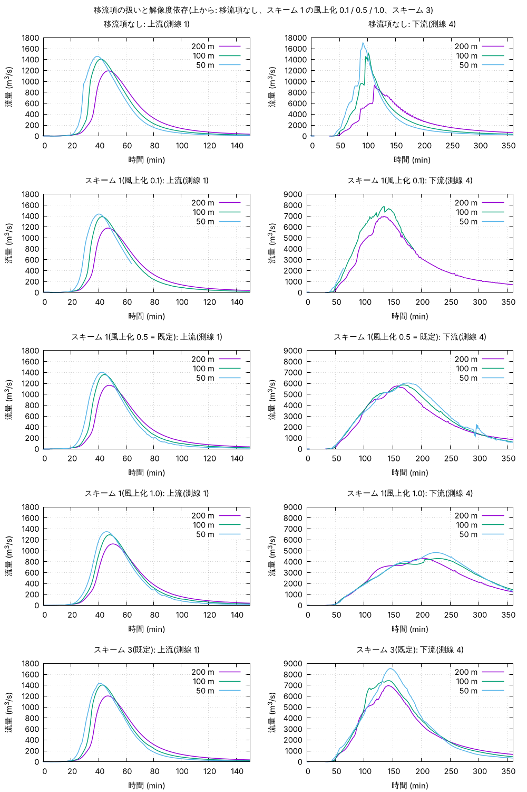

上から移流項なし、スキーム 1(風上化指数 0.1)、スキーム 1(風上化
指数 0.5 = 既定)、スキーム 1(風上化指数 1.0)、スキーム 3(既定)で、左が上流の測線 1、
右が下流の測線 4 です(右の列の縦軸の範囲は、ほかの図より広げてあります)。
測線 4 のピーク流量(m³/s)とその時刻(min)を表にします(括弧は、同じ格子のスキーム 3 の
ピーク流量との比)。

| 移流項 | 200 m | 100 m | 50 m |
|---|---|---|---|
| なし(拡散波) | 9,821 @126(1.16) | 10,716 @119(1.24) | 12,855 @108(1.48) |
| スキーム 1(旧、風上化 0.1) | 9,006 @132(1.06) | 8,407 @125(0.97) | 振動する(移動平均 8,431 @136) |
| スキーム 1(風上化 0.5 = 既定) | 7,633 @150(0.90) | 6,415 @163(0.74) | 6,612 @175(0.76) |
| スキーム 1(風上化 1.0) | 5,792 @180(0.68) | 4,766 @218(0.55) | 5,192 @225(0.60) |
| スキーム 3(既定) | 8,477 @138 | 8,639 @134 | 8,688 @145 |

上流の測線 1 のピークは、どの扱いでも、同じ格子のスキーム 3 との差が 4% 以内です。
各計算の最大流速(Log の V_max)は、100 m 格子で、移流項なしが 27 m/s、スキーム 1 が
風上化 0.1・0.5・1.0 の順に 24・22・19 m/s、スキーム 3 が 23 m/s でした
(50 m 格子では、移流項なしが 35 m/s、スキーム 1 が 81・55・20 m/s、スキーム 3 が 30 m/s)。
`Fig_supp.sh` は、スキーム 1 の計算が途中で止まっても続けるようにしてあります。風上化 0.1 の
50 m 格子は、dt = 0.75 s では、1 時間 31 分で Courant 数が 1 を超えて止まるので、dt = 0.5 s に
しています。移流項なしの 50 m 格子も、余裕を見て dt = 0.5 s です(Courant 数の最大は 0.42)。

#### 移流項を省くと、下流のピークが大きく早くなる

移流項なしの拡散波(局所慣性方程式)では、測線 4 のピークが、200 m で 9,821 m³/s
(スキーム 3 の 1.16 倍で、12 分早い)、100 m で 10,716 m³/s(1.24 倍で、15 分早い)、
50 m で 12,855 m³/s(1.48 倍で、37 分早い)になります。一方、上流の測線 1・2 のピークは、
移流項の有無で、200 m・100 m 格子では 1% 以内、50 m 格子でも 3% 以内しか変わりません
(測線 3 は、200 m で +5%、100 m で +17%、50 m で +21%。50 m は 11 分の移動平均どうし)。
**移流項が効くのは、流量の大きい下流です。**
理由を順に追います。

1. **拡散波の流速はその場の勾配だけで決まる。** 拡散波(局所慣性方程式)
   の流速は、その場の水面勾配と摩擦の釣り合い(Manning 則)で決まり、
   慣性(加速に時間がかかること、速い水が遅い水と混ざって減速すること)が
   ありません。
2. **急で一様な流れでは、慣性の出番がありません。** 移流項は、流速が場所によって
   変わる所で働く項です。上流の急な河道では、流れは河床勾配と摩擦の釣り合いに近く、
   流速が流下方向にあまり変わらないので、流れが速くても(測線 1・2 のプローブでは、
   ピークの頃のフルード数が 1.2〜2.1 の射流です)、移流項は小さいままです。
   測線 1・2 でほとんど差が出ないのは、このためとみています。
3. **差が出るのは、流れが短い距離で変わる所です。** 河床の勾配の変わり目や段差、屈曲、
   支川の合流、河道の水が両脇のセルへ広がる所では、流速が数セルの間に変わります。
   移流項があれば、加速には距離が要り、速い水が遅い水に入る所(跳水)や、横から入る水と
   混ざる所で、流れはエネルギーを失います。移流項がないと、流速は水面勾配の変化に
   瞬時に追随し、この損失もないので、洪水波は速く進み、前面が切り立って、ピークが
   大きくなります。1 セル幅の水路の階段状の河床(test/bendloss の stair3。踏面 100 m・
   落差 3 m、粗度 0.03)では、移流項なしのピークが、スキーム 3 の 2.4 倍になります
   (粗度を 0.15 にすると、差は 1% になります)。
4. **差の大きさは、河道の粗度で大きく変わります。** 河道の粗度を 0.04 から 0.02 に替えて、
   同じ比較をしました(`./Fig_supp.sh` が `result_supp_*_n02` / `result_supp_*_n02_noadv` として
   実行します。200 m・100 m 格子だけです。流れが速くなるので、dt は 4 s・1 s に
   しています)。測線 4 のピーク流量(m³/s)と時刻(min)は、次のとおりです(括弧は、同じ粗度の
   スキーム 3 との比)。

   | 河道の粗度 | 移流項 | 200 m | 100 m |
   |---|---|---|---|
   | 0.04 | スキーム 3 | 8,477 @138 | 8,639 @134 |
   | 0.04 | なし | 9,821 @126(1.16) | 10,716 @119(1.24) |
   | 0.02 | スキーム 3 | 11,072 @112 | 10,270 @116 |
   | 0.02 | なし | 27,169 @88(2.5) | 21,530 @84(2.1) |

   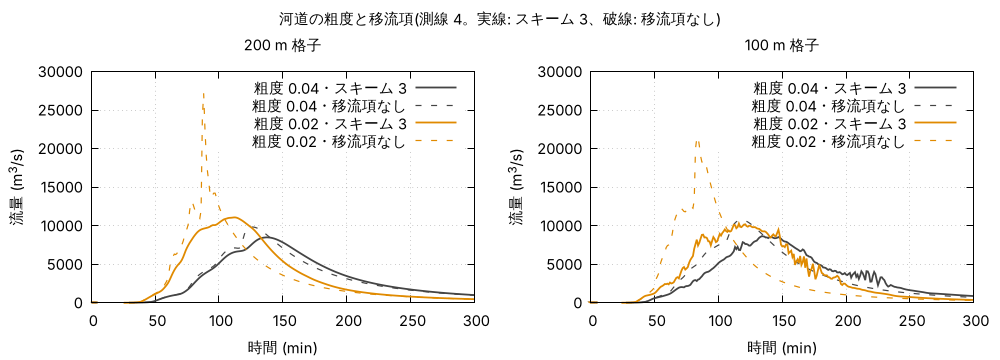

   粗度 0.02 では、移流項なしの洪水波が、測線 4 に届くまでに段波になります(200 m 格子の
   測線 4 の流量は、86 分から 87 分の 1 分の間に、約 12,000 から約 24,000 m³/s へ跳ね上がります。
   100 m 格子では、上流の測線 3 でも、46 分から 47 分の間に、約 1,300 から約 12,900 m³/s へ
   跳ね上がります。この図だけ、縦軸の範囲を広げてあります)。深い水ほど速く進むので、
   波の前面は下流へ行くほど切り立ち、切り立った前面は水面勾配が大きいので、さらに流速が
   上がる、という自己強化です。現実には、跳水や乱れがこの加速を散逸させますが、
   移流項のない方程式には、それを表す項がありません。
   粗度 0.04 では、測線 4 の波形は段波にならず、スキーム 3 との差は 1.16〜1.48 倍
   (200〜50 m)にとどまります。スキーム 3 は、粗度 0.02 でも段波にならず、ピークは粗度 0.04 の
   1.2〜1.3 倍です。段波のピークの値は、時間刻みや格子でも変わり、
   収束した値ではありません(200 m 格子で dt を 6 s にすると、29,517 m³/s になります)。100 m 格子の
   スキーム 3 の測線 4 には、粗度 0.04 のときと同じ種類の上下が、より大きく出ます(1 分で最大
   1,500 m³/s。11 分の移動平均のピークは 9,986 m³/s)。

   地盤高を窪地除去済みの標高(河道に平坦区間と段差が残る)に戻しても、粗度が 0.04 のままなら、
   移流項なしとスキーム 3 の比は 1.04(200 m)・1.31(100 m)で、大きくは変わりません
   (`result_supp_*_filled_noadv`)。
5. **格子を細かくすると、差が広がります**(粗度 0.04 で、1.16 → 1.24 → 1.48 倍)。
   河道セルが狭く深くなって、同じ流量での流速が上がること(矩形断面の Manning 則で
   u ∝ (Q/W)^0.4。幅が半分なら流速は 1.3 倍)と、離散化の数値拡散(Δx に比例)が減って、
   波の前面がより鋭く表されることによるとみています(移流項なしの測線 3 の流量が 1 分の間に
   増える量の最大は、200 m で 700、100 m で 3,500、50 m で 4,900 m³/s)。段波になる粗度 0.02 では、
   200 m の 2.5 倍に対して 100 m は 2.1 倍で、段波のピークの値は、格子と時間刻みに敏感です。

つまり、移流項を省いた計算の結果は、河道の粗度と、「流れの急な変化と、切り立つ波の前面を、
どこまで解像したか」に強く左右されます。既往の拡散波・キネマティック
ウェーブの流域モデルは、この分を**解像度ごとに校正した粗度係数**に
吸収させて使うのが普通です。移流項があれば、流れの急な変化での加速は、跳水相当の
散逸と、横流入・谷底との運動量交換(次節)で抑えられ、粗度や格子を変えたときの変化が
小さくなります(測線 4 のピークは、粗度を半分にしたとき、スキーム 3 が 1.2〜1.3 倍、
移流項なしが 2.0〜2.8 倍)。

#### 移流項は何を減速させているのか

このケースで移流項が波を遅く小さくしている中身として、次の 3 つが考えられます
(どれがどれだけ効いているかは、切り分けていません)。

1. **流れの急な変化での散逸**: 1 セル幅の水路の階段状の河床(test/bendloss の stair3)で、
   移流項なしは段差ごとに過大な流速を出し、洪水波が段波に成長するのに
   対し、移流項(運動量保存形)は跳水相当の散逸を与えて波を抑えます
   (ピークで 2.4 倍の差)。河床を整えた標高にも、勾配の変わり目と、格子スケールの
   段差は残ります。
2. **横流入による減速**: 降雨流出では河道の流量の大半が斜面や支川から
   横に入り、流下方向の運動量を持ちません。運動量保存形はこの水を
   混ぜて河道の水を減速させる項(−u·q_L/h)を自然に含みます(空間変化流
   の解析解に 1〜2% で一致)。
3. **浸水した谷底との運動量交換**: 洪水時の本流の断面は、河道マスクの 1 セルを超えて
   両脇の谷底のセルに広がり(100 m 格子の測線 4 の前後では、最大水深 15 m に対して、
   両脇のセルは河床より約 9 m 高いだけです)、その遅い水が、屈曲・合流で
   風上側の供給元になって運動量を奪います。ほとんど水を運ばない河岸の薄い
   水膜が供給元になって本流を減速させる人工的な分は、既定の扱いで除いて
   あります(仕組みと、窪地除去済みの標高・河道の粗度 0.02 の設定での影響の大きさは、
   ユーザーガイドの[1 セル幅の河道と移流項の風上供給元](../../docs/users_guide/advection_donor.md)
   を参照)。

#### 「山地の流出では移流項の効果は小さい」と言われる理由

急勾配の河道では、運動方程式の中で河床勾配 S₀ が水面勾配の変化や
速度水頭の変化より圧倒的に大きいため、河床勾配と摩擦の釣り合い
(キネマティックウェーブ)、あるいは水面勾配まで入れた拡散波で、
**区間スケールの波の伝播**が十分に再現できる、というのが根拠です。
数値的な目安としては、Woolhiser & Liggett (1967) の kinematic flow
number k = S₀L/(h Fr²) が 20 を超えればキネマティック近似でよい、
Ponce ら (1978) の T·S₀·√(g/h) ≥ 30 なら拡散波でよい、といった判定が
知られていて(判定式の読み方は入門ページの
[使い分けの目安](../../docs/users_guide/shallow_water.md#phenomena))、勾配が急で波の時間スケール T(数時間)が水深の時間
スケールより十分長い山地流出はこれを満たします。この補足の計算でも、急な上流の
測線 1・2 では、移流項の有無で結果はほとんど変わりませんでした。
ただしこれらは、河床と流れを**区間スケールで滑らかに**見たときの話です。
格子スケールでは、河床の段差や勾配の変わり目・屈曲・合流で、流れは局所的に
急変流になり、慣性項が無視できないことがあります(この補足では、流量の大きい下流と、
河道の粗度を小さくした計算)。「移流項の
効果は小さい」は波の運動学の話であって、局所のエネルギー
収支の話ではない、と区別するのがよいと思います。既往モデルではこの
局所の散逸を粗度係数に含めて扱っており、それは工学的に妥当なやり方
です(本書に既往のモデルを低く見る意図はありません)。

#### 1 次元河道モデルとの関係

1 次元河道モデルでも移流項を省いた解析はよく行われます。側方流入
の運動量項(−u·q_L/h)を加えれば、上の 2 の分は取り込めますが、1 の散逸と 3 の谷底との交換は、断面を与えた
1 次元モデルでは別の形(粗度、局所損失係数、複断面の運動量交換)で
与えることになります。したがって側方流入の運動量を入れた 1 次元
モデルは ENCflow の移流項つきの結果に**近づくが同じにはならない**、と
予想しています(未検証)。

#### 解像度依存が小さければ現実に近いと言えるか

言えません。格子を細かくしても答えが大きく動かないことは、物理に
基づくと称するモデルが満たしてほしい性質(収束)ではありますが、
収束先が観測に合う保証はありません。この補足の計算でも、測線 4 のピークは、
河道の粗度を 0.04 から 0.02 に替えるだけで 1.3 倍になって 26 分早まり
(200 m 格子のスキーム 3)、河床の高さの与え方を替えると 1.9 倍になります(結果 1 の
「河床を整えた効果」)。粗度も河床も、観測に合わせて校正したものではありません。
スキーム 3 の結果も、測線 4 のピークは 3 つの格子でそろう一方、測線 3 は 200 m と
100 m で 20% 違い、50 m 格子には流量が上下する限界があって(結果 1)、収束したとは
言えません。このチュートリアルの流域には観測との
照合がなく、**現実に近いかどうかは未検証**です。一方、拡散波でも解像度
ごとに粗度係数を校正すれば観測に合わせることはできるでしょう。それでも、
解像度を変えるたびに校正し直さなくてよいモデルは、粗い格子で全体を
掴んでから必要な場所だけ細かくする、という使い方ができる点で
**「便利」**です。「便利」であって「正しい」ではない、という区別は
残しておいてください。

#### スキーム 1 の解像度依存と風上化指数

旧スキーム 1 は非保存形で、横流入や谷底との運動量交換を一貫して表せず(developer.md §68.17)、
風上重み(`p_adv_upwind_index`)による数値粘性を持ちます。この風上化指数で、結果が大きく変わります
(以下は測線 4 のピーク。括弧は、同じ格子のスキーム 3 との違い)。

- **風上化 0.1**: 200 m で 9,006 m³/s(+6%、6 分早い)、100 m で 8,407 m³/s(−3%、9 分早い)と、
  スキーム 3 に近い値です。50 m 格子(dt = 0.5 s)は、最後まで計算できますが、
  最大流速が 81 m/s に達し、測線 4 の流量が、113〜259 分に、1 分ごとに最大 13,000 m³/s 上下します
  (1 分値の最大は 14,465 m³/s、11 分の移動平均のピークは 8,431 m³/s・136 分)。風上化の弱い
  非保存形のスキームが、細かい格子の速い流れで不安定になるものとみています。
- **風上化 0.5(既定)**: 7,633 → 6,415 → 6,612 m³/s で、スキーム 3 より 10%・26%・24%
  小さく、12・29・30 分遅くなります。50 m 格子では、1.5〜2 時間目に最大流速が 55 m/s になります
  (スキーム 3 は最大 30 m/s)。
- **風上化 1.0(完全風上)**: 5,792 → 4,766 → 5,192 m³/s で、スキーム 3 より 32%・45%・40%
  小さく、42・84・80 分遅くなります。上流の測線 2 でも、3〜13% 小さくなります。

同じ格子で風上重みの両端(0.1 と 1.0)を比べると、測線 4 のピークは、200 m で 9,006 と 5,792、
100 m で 8,407 と 4,766 と、1.6〜1.8 倍違います。風上重みによる数値粘性は Δx·u に比例するので、
格子を細かくすれば差は縮まるはずですが、縮まりません(風上化 0.5・1.0 のピークは、200 m より
100 m の方が小さくなります。原因は調べていません)。

つまり、スキーム 1 の結果は、風上重みの選び方で大きく動きます。校正パラメータを 1 つ余計に
抱えたスキームだと言えます。ENCflow が既定にしているのは、校正パラメータを増やさない
運動量保存形スキーム(と動的開口補正)の方です。

#### このケースの特殊性

このケースは 1 時間に 100 mm の雨を損失なしで流し、流域出口近くで
約 8,500 m³/s(比流量 約 13 m³/s/km²)という極端な流量です。
流れの急な変化での散逸も横流入も流量とともに効くので、一般的な出水より移流項の
影響が大きく出ていると思われます。穏やかな出水では、移流項の扱いによる差は
もっと小さいはずで、その確認は読者への宿題にします(`param_supp_*.txt`
の降雨を変えて `./Fig_supp.sh` を再実行するだけです)。

### ENC 格子の特性として理解してほしいこと

- **格子を変えても、流域出口近くの洪水波はほとんど変わらないが、上流と峡谷のピークは変わる**:
  200 → 100 m(セル数 4 倍、計算時間 約 11 倍)で、流域出口近くの測線 4 のピークの違いは
  2%・4 分でした。上流の測線 1・2 のピークは 11〜16% 増え(100 m 以下でほぼ収束)、
  峡谷を流れる測線 3 は 20% 増えます(セル幅の河道が、峡谷には広すぎる分。河道幅を与えると
  そろいます)。50 m 格子は、測線 4 のピークは同じ(+1%)ですが、測線 3 の流量が大きく上下する
  限界があり、参考にとどめています。
  洪水波の到達時刻と、流域全体の流れのつながりを掴むなら 200 m 格子で用が足り、上流や
  峡谷のピーク流量の値まで欲しいときは、細かい格子や、河道幅を与えた計算と比べて確かめる、
  という使い分けになります。
  別の現象での実例として、斜面崩壊から谷を下って扇状地へ
  広がる土石流を計算した [examples/debris_fan](../../examples/debris_fan/README.md)
  では、扇状地に届く土砂・堆積の範囲と到達距離・到達時刻・横への広がりが、
  格子間隔 20〜2.5 m と格子に対する谷の向き 3 通りで基準の ±10 % に
  そろいます(谷底の幅 30 m より粗い 40 m の格子でも、扇状地に届く土砂は
  基準の 0.92〜1.10 倍)。4 近傍との比較もあり、ENC 格子の 8 方向交換の
  効果が分かります。
- **格子よりも、入力の与え方の方が結果を大きく変える**: 測線 4 のピークは、河床の高さの
  与え方(窪地除去済みの標高 → 河床を整えた標高)で 1.5〜1.9 倍、河道の粗度(0.04 → 0.02)で
  1.2〜1.3 倍変わります。格子による違い(2%)より、ずっと大きい変化です。河床と粗度は、
  観測と照合して決めてください(このチュートリアルの値は、照合していません)。
- **粗い解像度でも流れが阻害されない**: 多くの構造格子モデルは
  軸方向(4 近傍)の交換が基本で、幅 1 セルの河道を斜めに通せない
  ため、河道網を**別途 1 次元河道モデルとして結合**する必要があります。
  ENC 格子は 8 方向の交換で河道網をラスタのまま流せるので、
  200 m 格子でも**1 次元河道モデルや流下方向(D8)データの導入が
  不要**です。D8 で窪地除去した DEM と河道マスクだけで流域計算が
  成り立つのは、この性質によります。1 セル幅の河道を正しい通水能で流すために
  8 方向の通過幅をどう調整しているかは、ユーザーガイドの
  [通過幅の調整](../../docs/users_guide/passage_width.md)にまとめてあります。
- **解像度の代償は計算量**: 格子を 1/2 にするとセル数は 4 倍、
  ステップ数は流速の増加に合わせて dt を縮めるため 2〜4 倍になり、
  計算時間は 6〜11 倍 になります。まず 200 m 程度で全体の挙動を掴み、必要な場所・目的に
  応じて細かくしていくのが実務的です。
