> English mirror of tutorials/chichibu/README.md. The Japanese file is the master copy.

[日本語](../README.md)

# Tutorial 2: chichibu -- rain on a real-terrain catchment

We cover the Chichibu catchment in the upper Arakawa River basin
(about 715 km^2) with a 200 m grid, apply a heavy rainstorm
(100 mm in one hour, peak 200 mm/h), and compute rainfall runoff and flood wave
propagation. You will learn the standard workflow of a practical
computation with real terrain data, in the following order.

- **Step 1**: Minimal configuration with real terrain data; why
  depression filling is necessary
- **Step 2**: GeoTIFF input/output, channel mask and roughness
- **Step 3**: Measurement (probes and flux transects) and distributed
  output
- **Step 4**: Rainfall interception and subsurface infiltration (bucket
  model), the three water-storage columns
- **Step 5**: Boundary condition at the catchment outlet
- **Step 6**: 3D visualization (animation) with ParaView
- **Supplements**: reading and dealing with fine oscillations in the
  hydrograph; the effect of resolution and the character of the ENC grid

We assume you have completed the [wave tutorial](../../wave/en/README.md)
first (it explains how to run the model, the meaning of each screen
column, and the structure of parameter files). All work below is done
in the case directory (`tutorials/chichibu`); run the English parameter
files from there as `./encflow en/param_step1.txt` etc.

## A look at the data

`data_chichibu/` (relative to the case directory `tutorials/chichibu`) contains the following raster data.

| Data | Contents |
|---|---|
| `Chichibu_200m_filled.*` | Ground elevation (m), with D8 depression filling applied in GIS software |
| `Chichibu_200m_raw.tif` | Ground elevation (m), original data without depression filling (for a comparison experiment) |
| `Chichibu_200m_basin.*` | Catchment mask (1: inside the catchment, 0: outside) |
| `Chichibu_200m_river_flowline.*` | Channel mask (1: channel cell). The computations use this one |
| `Chichibu_200m_river.*` | Original data of the channel mask (the river lines rasterized) |

All of them sit on the same grid of **280 x 150 cells (dx = dy =
200 m)** (a 56 km x 30 km domain). Each dataset is provided with the
same contents in three formats -- text (`.txt`), bil (`.bil` + `.hdr`),
and GeoTIFF (`.tif`) -- for practicing the input/output formats.

Data sources: the elevation data were derived from the Digital
Elevation Model of the Fundamental Geospatial Data by the Geospatial
Information Authority of Japan (GSI); the channel mask was derived from
stream-order data
([DOI:10.3178/jjshwr.36.1812](https://doi.org/10.3178/jjshwr.36.1812))
built from the river data of Kokudo Suuchi Jouhou (National Land
Numerical Information). The channel mask rasterized from the river lines
(`Chichibu_200m_river`) is in places one cell off the valley line of the
elevation data (903 of its 2,327 cells lie on the valley-wall side), so the
computations use the mask moved onto the flow lines of the elevation (the
drainage paths given by the steepest descent among the 8 neighbours) with the
bundled [utils/river_flowline](../../../utils/river_flowline/en/README.md)
(`Chichibu_200m_river_flowline`; 1,473 cells).

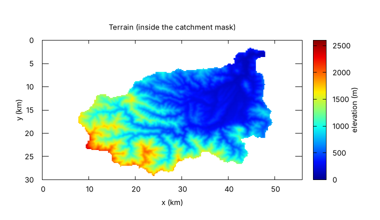

The northeast corner (elevation around 100 m) is the outlet of the
catchment, and peaks of the 2,500 m class line up along the main ridge
in the southwest. Most of the catchment is steep mountainous terrain.

## Step 1: Minimal configuration with real terrain data

### Running

As in wave, create the link to the executable with `make`, then run
`en/param_step1.txt` from the case directory (`tutorials/chichibu`).

```bash
make
./encflow en/param_step1.txt
```

```
reading list_sysparam in en/param_step1.txt
reading list_geoinfo in en/param_step1.txt
 reading data_chichibu/Chichibu_200m_basin.txt
 reading data_chichibu/Chichibu_200m_filled.txt
reading list_precip in en/param_step1.txt
main: number of processes: 1
main: number of threads: 4
main: real precision: 64 bit
main: number of valid cells: 17885
time, progress, S(m), Runge, ex_flux, Cn_max, h_max(m), V_max(m/s)
  0:00:00.00   0.0%    0.0000   0.0%      0    0.0000    0.0000    0.0000
  0:30:00.00   8.3%    0.0487  97.7%      0    0.1907    1.2869    4.0483
  1:00:00.00  16.7%    0.1000   6.2%      0    0.3446    4.9054    8.4385
  1:30:00.00  25.0%    0.1000   3.4%      0    0.4433    7.0997    9.2601
  2:00:00.00  33.3%    0.1000   0.9%      0    0.4253    6.9377    9.1145
  ...
  6:00:00.00 100.0%    0.1000   0.6%      0    0.5151   29.8812    4.1601
main: program terminated normally
```

The contents of `en/param_step1.txt` (the full file, apart from the
title comment at the top) are shown below. It is structured almost
identically to Step 1 of wave; the only differences are that
`&list_geoinfo` reads the terrain and the catchment mask from files and
sets the roughness `rn0`, and that `&list_precip` makes it rain
(`dir_data` in `&list_sysparam` is the input data directory, and the
file names below are relative to it).

```
!======================================================================
! System parameter settings
!======================================================================
&list_sysparam
  dt = 6.0                       ! time step (s)
  tt_c = "6 hour"                ! end time of the computation
  dt_disp_c = "30 min"           ! screen display interval
  dt_file_c = "30 min"           ! file output interval

  fn_geoinfo = "-"               ! geographic information settings file
  fn_precip  = "-"               ! precipitation settings file

  dir_data   = "data_chichibu"   ! input data directory
/

!======================================================================
! Geographic information settings
!======================================================================
&list_geoinfo
  nx = 280
  ny = 150
  dx = 200.0
  dy = 200.0

  f_ztype = 1          ! ground elevation type (0: default constant, 1: file)
  f_masktype = 1       ! domain mask (0: none, 1: catchment mask)
  rn0 = 0.05           ! fixed roughness (typical of mountain slopes; the default 0.015 is for channels)

  fn_z = "Chichibu_200m_filled.txt"        ! ground elevation file name
  fn_mask = "Chichibu_200m_basin.txt"      ! domain mask file name
/

!======================================================================
! Precipitation settings
!======================================================================
&list_precip
  ! precipitation data type (0: no precipitation, 1: uniform, time series)
  prtype = 1
  ! precipitation time series (time (min), intensity (mm/h))
  prval(:,1) =   0,   0
  prval(:,2) =  30, 200
  prval(:,3) =  60,   0
/
```

The screen output tells us the following.

- `number of valid cells: 17885` -- the full grid has 280 x 150 =
  42,000 cells, but thanks to the catchment mask only 17,885 cells are
  actually computed. Cells outside the mask consume neither memory nor
  computation time.
- `rn0 = 0.05` is Manning's roughness coefficient. The default 0.015
  is a channel value; applied to whole mountain hillslopes it makes the
  flow too fast (in this closed vessel with no outlet the water then
  concentrates so much that the computation becomes unstable). Here we
  give 0.05, typical of mountain slopes, and in Step 2 override it for
  the channel cells only.
- The S column grows with the rain and, at t = 1:00 when the rain ends,
  stops exactly at **0.1000** m (= the total rainfall of 100 mm, from rain that
  goes 0 -> 200 -> 0 mm/h over 30 minutes each, averaged over the catchment), remaining constant
  afterwards. By default the outer rim of the computational domain is
  an impermeable wall, so this catchment is a **closed vessel with no
  water outlet**; the constant S column confirms mass conservation.
- Meanwhile the h_max column keeps growing from 7 m to nearly 30 m: the water
  that cannot get out keeps accumulating somewhere.
- The ex_flux column counts how often an outflow computed from the momentum
  equation was about to exceed the water in the cell and was limited. It is a
  safety device that keeps mass conserved and is normally 0; continuous
  occurrence is the sign of a rough computation.

The depth distribution at the final time (`result/H9998.txt`) shows
where it accumulates (the depth maps use a palette in which zero depth
is white and deeper water is warmer: places the water has drained from
fade to white, and only the places it accumulates take on color). The bundled gnuplot script displays the depth
distributions at four times side by side on one screen (gnuplot is
required; after the plot appears, press Enter in the terminal to
quit; the bundled scripts sit in the case directory, so run this from
there):

```bash
gnuplot Plot_step1.plt
```

You can read how the water gathers from the hillslopes into the
channel network while it rains (t = 0:30, 1:00), drains downstream
after the rain stops (t = 3:00), and finally piles up just short of
the northeast corner.

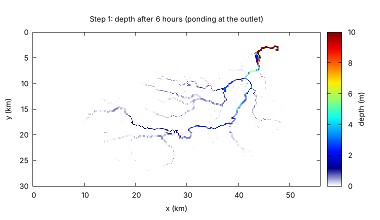

Just upstream of the catchment outlet (the northeast corner), ponded
water over 25 m deep has grown. This ponding of runoff dammed by the
wall will be resolved in Step 5 by setting a boundary condition. Until
then we proceed with the outlet ponding as a known artifact (it hardly
affects the measurements further upstream).

### Why depression filling is necessary

If you replace `fn_z` in `&list_geoinfo` with `Chichibu_200m_raw.tif`,
you can run on the original DEM without depression filling (since this
reads a GeoTIFF, the easiest way is to try it in Step 2's
`en/param_step2.txt`). Extending the computation to 12 hours
(`tt_c = "12 hour"`) so that the channel water has almost all gathered
in the outlet pond, and comparing the depth distributions after 12
hours:

| Depression-filled (filled) | Unprocessed (raw) |
|---|---|
| 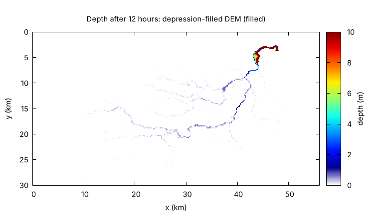 | 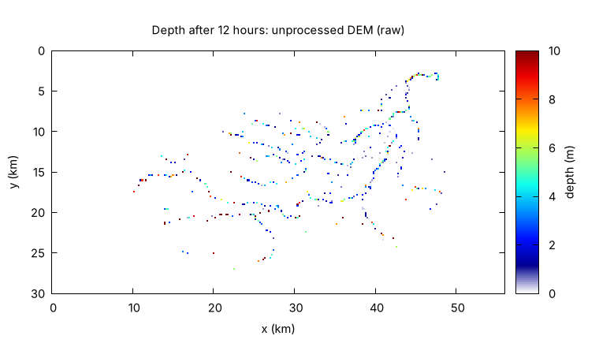 |

With the filled DEM the catchment is almost entirely white: the rain
has drained properly from the hillslopes into the channels and on
downstream, gathering at the single ponded spot at the outlet (which is
still a wall at this stage). With the raw DEM, color is scattered all
over the catchment: the water gets trapped in depressions along the way
and never reaches the outlet. The maximum velocity also drops to
about 0.9 m/s toward the end, showing that the flow has died across the
whole catchment.

In general, when the terrain slope is steep and the cell size is large,
the step-like jumps of the DEM become large. Once the jumps exceed the
order of the water depth, the flow is severely obstructed, so **prior
depression filling is essential for runoff computations**.

Depressions are also dangerous for numerical stability. In a
depression with no outlet the water depth keeps growing, and the wave
speed of the shallow water equations (≈ √(gh)) grows with it, so the
Courant number Cn (= wave speed × dt / cell size) increases and the
stability condition (Cn ≲ 1) becomes easy to violate
(see [the time-step chapter](../../../docs/en/users_guide/time.md); the
meaning of a Courant number that adds the wave speed to the velocity is in
[Courant number and how to choose the time step](../../../docs/en/users_guide/courant.md#wave-speed)).
This chain is a general troubleshooting rule beyond depressions:
**when a computation blows up (diverges), first suspect "water depth
grows somewhere → wave speed grows → stability condition breaks"**.
Check the Cn_max column on screen for a rising trend, and look for
places where water piles up abnormally in the maximum-depth
distribution H9999 — that is the first step.

Note that in ordinary structured-grid models, where water cannot move
diagonally across the grid, a DEM filled with the common D8
(eight-direction flow) method of GIS software can still leave water
stuck on diagonal flow paths, requiring extra depression processing or
higher resolution. The ENC grid exchanges water in eight directions, so
it is a natural match for D8: **a D8-filled DEM can be used as is**.

You can confirm this by experiment. Specifying `fn_enc = "-"` and
`p_diagratio = 0.0` in `&list_enc` closes the diagonal exchange of the
ENC grid, giving a "4-neighbor" computation. Even on the same
depression-filled DEM, the water now gets stuck on diagonal flow paths:
the depth distribution after 12 hours is chopped up all over the
catchment just like with the raw DEM, and the water never reaches the
outlet (the maximum velocity also drops to about 0.5 m/s toward the end — the flow
dies).

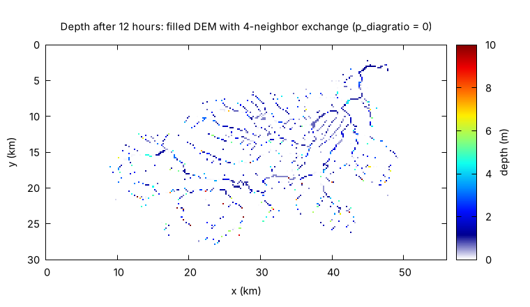

## Step 2: GeoTIFF input/output and representing the channel

`en/param_step2.txt` switches the input/output to GeoTIFF and adds the
channel mask and roughness.

```
&list_sysparam
  ...
  f_input_mode = 4           ! matrix input format (1: text, 2: bil, 4: geotiff)
  f_output_mode = 5          ! matrix output format (1: text, 2: bil, 4: geotiff)
/

&list_geoinfo
  ...
  f_rntype = 0         ! roughness type (0: default constant, 1: file)
  rn0 = 0.05           ! constant roughness value
  rn0_rw = 0.02        ! constant roughness for channel-mask cells

  fn_z = "Chichibu_200m_filled.tif"          ! ground elevation file name
  fn_mask = "Chichibu_200m_basin.tif"        ! domain mask file name
  fn_rw = "Chichibu_200m_river_flowline.tif" ! channel mask file name
/
```

- With `f_input_mode = 4` / `f_output_mode = 5`, distributed data are
  read and written as GeoTIFF (output mode 5 writes both text and
  GeoTIFF). The output `.tif` files carry over the coordinate reference
  information, so **you can simply drag them into a GIS such as QGIS
  and they overlay on the map**.
- Roughness is a two-tier setup: the base value `rn0 = 0.05`
  (mountain/wildland-like) is overridden on channel cells by
  `rn0_rw = 0.02` (channel-like). `rn0_rw` overrides channel cells
  regardless of how roughness is given (constant or file).
- At this stage the channel mask `fn_rw` is used only to swap the
  roughness. From here you can refine step by step toward incision
  below the terrain (`depth_rw`) or subgrid channels (`fn_channel`)
  ([users guide](../../../docs/en/users_guide.md)).

Drawn as figures, the two masks look like this (only cells with value
1 are colored).

| catchment mask `Chichibu_200m_basin` | channel mask `Chichibu_200m_river_flowline` |
|---|---|
| 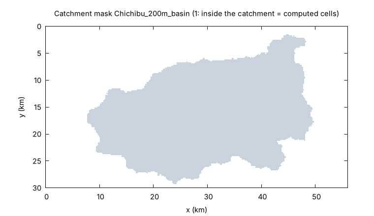 | 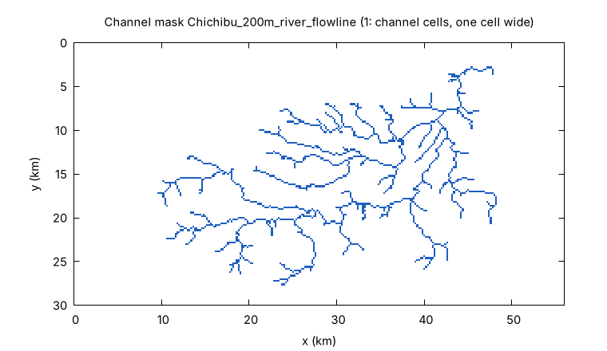 |

The colored cells of the catchment mask are the computed cells; the
`number of valid cells: 17885` printed in Step 1 is the number of these
cells. The channel mask gives the channel network as **lines one cell
wide**, and only these cells get the roughness `rn0_rw`. Both are
plain 1-or-0 rasters made in a GIS (the channel mask has been moved onto
the valley lines of the elevation in preprocessing; see "A look at the
data". They carry
no channel width or bed elevation: on a 200 m grid the channels are
narrower than a cell, so we only say *which* cells are channel and
express the channel through its roughness).

When you run it, the numbers on screen change slightly from Step 1
(because the channel roughness changed). The result directory now contains
`H0001.tif` and friends.

## Step 3: Measurement and distributed output

Places where you want time series of discharge or depth are specified
in advance with **probes** (points) and **flux transects** (lines).
`en/param_step3.txt` places four of each along the main stem.

```
&list_sysparam
  ...
  dt_recrd_c = "1 min"       ! probe output interval

  f_out_h = 1                ! file output (depth H0001)
  f_out_vv = 1               ! file output (velocity magnitude V0001)
  f_out_qq = 1               ! file output (discharge magnitude Q0001)
  f_out_cn = 1               ! file output (Courant number Cn0001)
  f_out_hmax = 1             ! file output (maximum depth H9999)
  f_out_vvmax = 1            ! file output (maximum velocity V9999)
/

&list_record
  ! probe position type (0: cell indices, 1: real coordinates (m))
  ! probe positions (x, y)
  pbxytype = 0
  pbxy(:,1) =  82, 105
  pbxy(:,2) = 107, 102
  pbxy(:,3) = 147, 104
  pbxy(:,4) = 216,  39

  ! flux transect coordinate type (0: cell indices, 1: real coordinates (m))
  ! flux transect endpoints (right-bank x, right-bank y, left-bank x, left-bank y)
  flxytype = 0
  flxy(:,1) =  82, 107,   82, 103
  flxy(:,2) = 107, 103,  107, 100
  flxy(:,3) = 147, 105,  147, 102
  flxy(:,4) = 216,  43,  216,  37
/
```

Cell indices are **1-based**, Fortran style (raster row/column numbers
in QGIS are 0-based, so add 1 when using cell indices looked up in a
GIS). For a transect, "the right side looking from the start point
toward the end point is positive", so writing it in the right-bank to
left-bank direction makes downstream discharge positive. Specification
in real coordinates (m) (`pbxytype = 1` / `flxytype = 1`) is also
available ([the record chapter of the users
guide](../../../docs/en/users_guide/record.md)).

Overlaying the transects and probes on the channel mask of Step 2
gives the following figure (top: whole catchment; bottom: close-ups
around each transect. The axes of the close-ups are **cell numbers**,
corresponding directly to the `flxy` / `pbxy` values above).

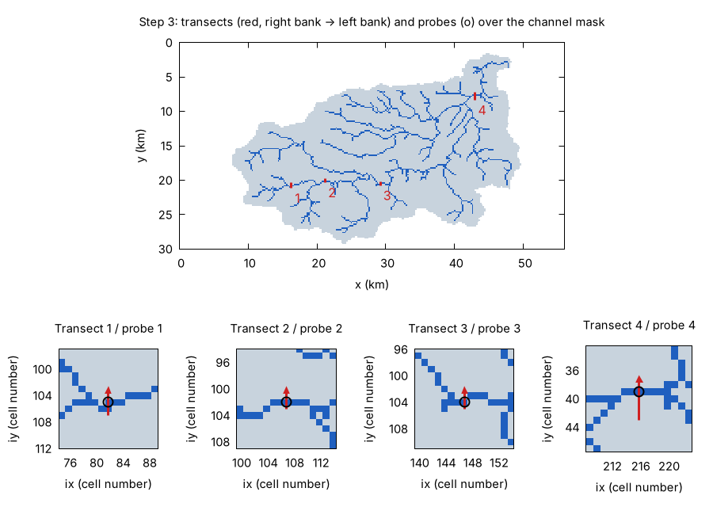

- The transects (red) are 4 to 7 cells long so that they **straddle**
  the main river, including the slope cells on both sides of the
  channel cells. The channel mask is one cell wide, but flood water
  spills into the neighboring cells too, so a transect restricted to
  the channel cells alone would miss part of the discharge. The arrow
  points from the right bank to the left bank; all four are drawn from
  south to north (the main river flows roughly from west to east, so
  the right bank, on your right when facing downstream, is the south
  side).
- The probes (circles) are placed on the cell where each transect
  crosses the channel mask (check in the close-ups that the circles sit
  on blue cells). A probe is a point measurement on a single cell, so
  if it lands one cell off, on the slope side, it records almost none of
  the channel depth and velocity (try setting `pbxy(:,3)` to `147, 103`
  and running: the depth in `probes/probe0003.csv` then stays within
  1 to 2 cm). **Checking the configured positions against the mask by
  eye, as done here,** is the basic routine when placing measurements.

When you run it, the numbers on screen match Step 2 **exactly**
(measurement and file output have no effect whatsoever on the computation
itself). The results now include `fluxes/flux0001.csv`
(transect discharge time series) and `probes/probe0001.csv` (probe
depth and velocity time series).

```bash
gnuplot -p -c Plot_flux.plt result
```

displays the hydrographs of the four transects in turn (the bundled
`Plot_flux.plt` / `Plot_map.plt` in the case directory are scripts for
visual inspection of results; run them from there).

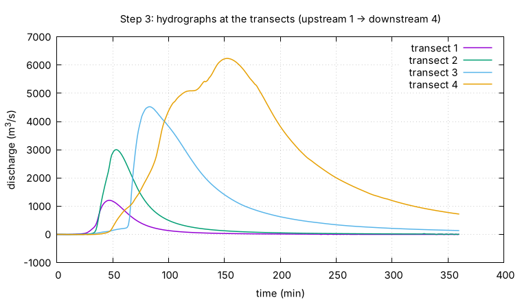

We obtained catchment-scale flood routing at 1-minute resolution, with
the flood wave growing and lagging from upstream transect 1 to
downstream transect 4.

The distributed outputs can be surveyed with `Plot_step3.plt`, which
arranges six maps of the final-time and maximum fields on one screen:

```bash
gnuplot Plot_step3.plt
```

The top row shows the final-time depth, velocity and discharge; the
bottom row shows the maximum depth, the maximum velocity and the
final-time Courant number. `Plot_step1.plt` from Step 1 also takes
the variable as its first argument, so `gnuplot -c Plot_step1.plt V`
(or `Q`) shows the time evolution of the velocity or the discharge
with the same four-time layout.

## Step 4: Rainfall interception and subsurface infiltration

So far, all the rain that fell has run off. In a real catchment,
interception by the canopy and infiltration into the ground reduce the
runoff. `en/param_step4.txt` stacks the two simplest loss models.

```
&list_sysparam
  ...
  fn_intercept = "-"         ! rainfall interception settings file
  fn_gwflow = "-"            ! groundwater settings file
/

&list_intercept
  f_icmodel = 1              ! 1: fixed interception rate model
/
&list_intercept_fixed
  ic_alpha = 0.2             ! interception rate (effective rainfall = (1-alpha)P)
/

&list_gwflow
  f_gwvertical = 1           ! 1: bucket model
/
&list_gwflow_bucket
  gw_infil_mmh = 5.0         ! infiltration capacity (mm/h)
  gw_capacity = 0.2          ! subsurface storage capacity (water-column equivalent depth) (m)
/
```

Enabling features follows the common ENCflow convention: write `fn_*`
to enable, omit it to disable completely (zero additional memory and
computation time). When you run it, the water storage display on screen
changes from one column to **three columns**.

```
time, progress, S_surf(m), S_grnd(m), S_total(m), Runge, ex_flux, Cn_max, h_max(m), V_max(m/s)
  0:00:00.00   0.0%    0.0000     0.0000     0.0000    0.0%      0    0.0000    0.0000    0.0000
  0:30:00.00   8.3%    0.0365     0.0024     0.0389   97.7%      0    0.2519    0.9217    6.3966
  1:00:00.00  16.7%    0.0751     0.0049     0.0800    6.2%      0    0.4812    5.3251   12.9868
  1:30:00.00  25.0%    0.0728     0.0072     0.0800    3.0%      0    0.5916    5.9769   16.9196
  ...
  6:00:00.00 100.0%    0.0693     0.0107     0.0800    0.0%      0    0.5056   28.7971    5.1019
```

- `S_surf` is surface water, `S_grnd` is subsurface storage, and
  `S_total` is their sum. After the rain ends, S_total stays constant
  at **0.0800** m -- 80% of the 100 mm total rainfall, i.e. it matches
  the effective rainfall after removing the interception rate
  alpha = 0.2, confirming that the total is conserved even as water
  moves between the surface and the subsurface.
- S_surf decreases and S_grnd increases over time -- you can read the
  progress of infiltration directly.

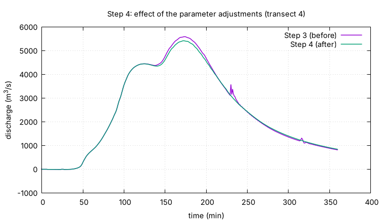

In the hydrograph the peak discharge drops by about a third (6,208
to 4,048 m^3/s). Interception cuts the total by 20%, and infiltration keeps
sucking up the thinly spread hillslope water, so both the rising limb
and the recession drop.

## Step 5: Boundary condition at the catchment outlet

We now resolve the outlet ponding (h_max of about 30 m) that we have
been turning a blind eye to since Step 1. The catchment outlet is not
on the outer rim (the four edges) of the computational domain but in
its interior, so instead of an edge boundary condition we use
**prescribed-stage cell groups**. `en/param_step5.txt` fixes the water
level of the two outlet channel cells at a low value, turning them into
a "drain".

```
&list_sysparam
  ...
  fn_boundary = "-"          ! boundary condition settings file
/

&list_bound_stage
  ! group 1: catchment outlet (level below the bed for perfect drainage)
  stage_cell(:,1,1) = 239, 19
  stage_cell(:,2,1) = 240, 19
  stage_eta(1) = 111.0
/
```

The outlet cell indices were determined by overlaying the channel mask
and the DEM in a GIS and reading off "the most downstream channel cells
inside the catchment mask" (remember to convert to 1-based indices as
noted above). `stage_eta` is specified as an elevation. Cells whose
prescribed level is below the bed are always empty, acting as a
"perfect drain" (here 111 m, lower than the 113 m bed of the upstream
neighbor cell, so arriving water is removed from the system
immediately). Running it gives:

```
time, progress, S_surf(m), S_grnd(m), S_total(m), Runge, ex_flux, Cn_max, h_max(m), V_max(m/s)
  ...
  3:00:00.00  50.0%    0.0584     0.0093     0.0677    0.1%      0    0.4773    6.8809   11.9815
  6:00:00.00 100.0%    0.0221     0.0107     0.0328    0.0%      0    0.3121    3.6595    6.7336
```

- S_total now decreases -- that is the water that left the system
  through the outlet.
- h_max drops from 30 m to 3.7 m. The disappearance of the ponding can
  also be confirmed in the depth distribution.

| Step 4 (no outlet) | Step 5 (perfect drain) |
|---|---|
| 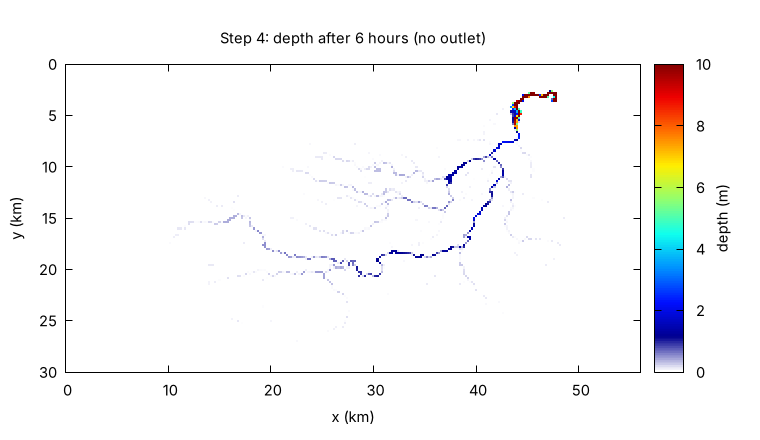 | 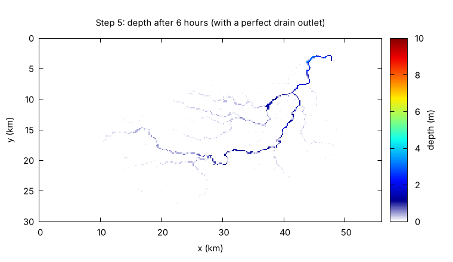 |

The hydrographs at the upstream transects 1-4 barely change from Step 4
(the outlet ponding affects only a very small area at the far
downstream end).

Note that if you prescribe the water level as a time series
(`stage_val`), this also serves as an open boundary supplying a
downstream river stage or a tide level. For the use of edge boundaries
(free outflow, long-wave radiation), inflow boundaries, and so on, see
[the boundary condition chapter of the users
guide](../../../docs/en/users_guide/boundary.md).

## Step 6: 3D visualization with ParaView

Finally, let us look at the distributed outputs as a 3D animation. We
use the free visualization software
[ParaView](https://www.paraview.org/) (Windows / macOS / Linux; see
section 2 of the [installation guide](../../../docs/en/install.md)
for installing it) and the bundled converter utility utils/out2vtk.

`en/param_step6.txt` is the Step 3 configuration adapted for
animation: the run is shortened to 4 hours (`tt_c`), distributed
output is written every 2 minutes (`dt_file_c`), and the output format
is GeoTIFF only (`f_output_mode = 4`). The smoothness of the animation
is set by the output interval, so runs made for visualization use a
finer one.

### Creating the data for the animation

First, run the computation with this parameter file to produce the
distributed output (GeoTIFF) every 2 minutes. This is the raw material
of the animation.

```bash
./encflow en/param_step6.txt
```

Once `result/` holds the depth files `H0000.tif` to `H0120.tif` (121
files: from t = 0, every 2 minutes for 4 hours) and the other GeoTIFFs,
the data are ready.

### Converting to VTK format

ParaView cannot animate a GeoTIFF time series directly, so we convert
it to VTK format with the bundled converter utility out2vtk.

```bash
make -C ../../utils/out2vtk install   # first time only: build the converter
../../bin/out2vtk en/param_step6.txt
```

out2vtk takes the parameter file used for the computation as it is
(it inherits the result directory and the grid information). The
following files appear in `result/vtk/`.

| file | contents |
|---|---|
| `flood.pvd` + `flood_0000.vts` ... | water surface time series (121 times, every 2 min); the pvd is the entry point of the animation |
| `terrain.vts` | terrain surface (3D) |
| `summary.vts` | statistics such as the maximum depth |

The outside of the catchment is hidden automatically (out2vtk reads
the domain mask `X0000` that encflow always writes, and by default
keeps the land area only).

### Start with the minimal procedure

Launch ParaView; the following four operations already give you the
animation.

1. **File → Open** `result/vtk/flood.pvd` and press **Apply**
2. Set Coloring in the toolbar to **H** (water depth)
3. In **Edit Color Map** (the rainbow icon), change the **NaN color to
   gray** (dry cells carry NaN depth and are painted yellow by default)
4. Press **▶ (play)**

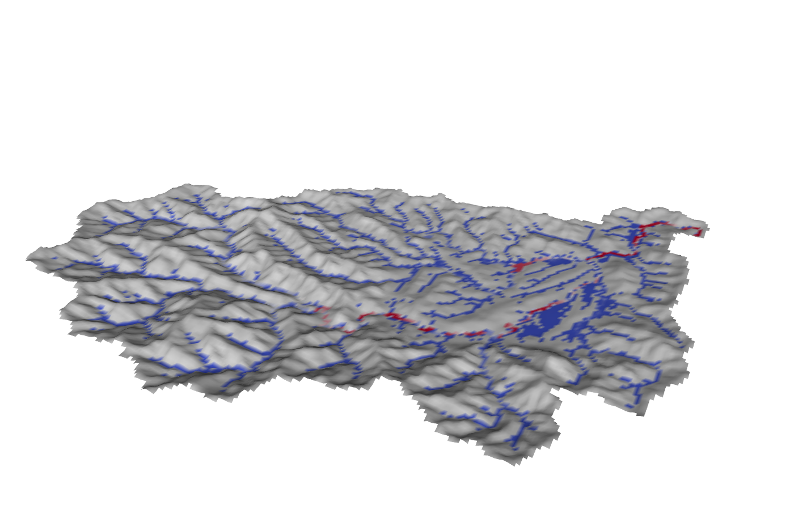

This alone gives a picture of "depth colors draped on the 3D
terrain". The surface in this file is the water surface elevation
(ground elevation + depth), so dry places show the terrain relief
itself and wet places rise slightly above it. Drag to rotate, use the
wheel to zoom; the timeline shows the real time of the computation in
seconds. You can watch the rain spread over the hillslopes in the
first 30 minutes and then gather into the channel network as the flood
wave travels down.

### Making it look better

Independent refinements you can add to the minimal procedure.

- **Water that looks like water**: open `terrain.vts` too, press
  Apply, and set its Coloring to `Solid Color` (grayish). On the
  `flood.pvd` side, set the **NaN opacity to 0** in Edit Color Map so
  that dry places disappear and only the water remains on the terrain.
  A bluish colormap preset (e.g. Blues) makes it more water-like.
  (Instead of the NaN opacity you can use **Filters → Threshold**
  keeping H ≥ 0.01; when channels one cell wide disappear, uncheck
  "All Scalars" in the Threshold panel.)
- **Emphasizing the relief**: apply **Filters → Transform** to both
  objects with Scale = `(1, 1, 3)` (3x vertical exaggeration). Hide
  the original objects with the eye icons after applying the filter.
- **Showing the time**: **Filters → Annotate Time**.
- **To a movie file**: **File → Save Animation** (PNG sequence or AVI).

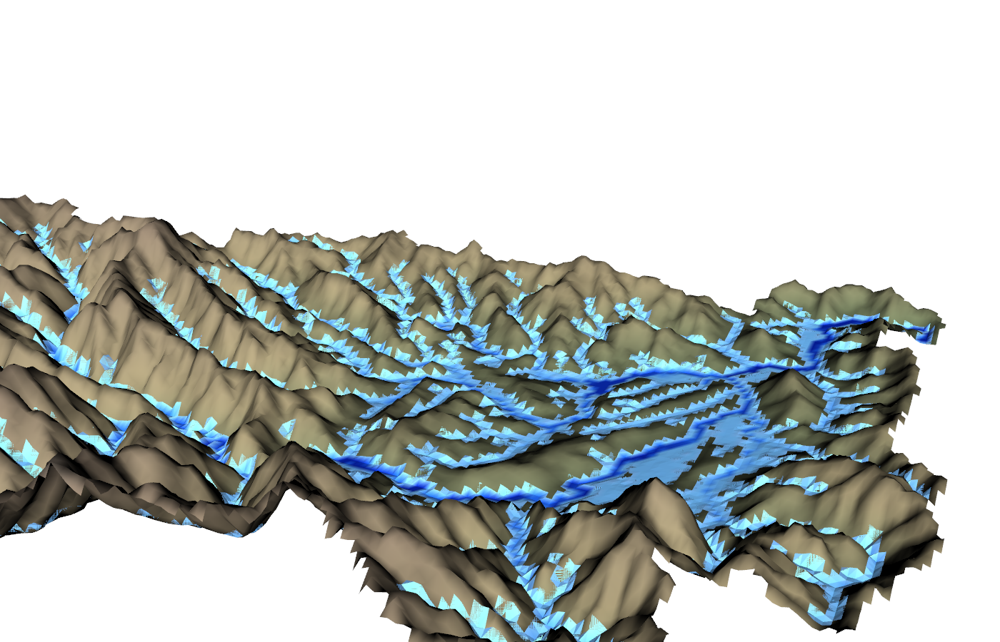

### Further: overlaying maps and satellite imagery

`terrain.vts` carries texture coordinates, so a map or satellite image
of the same extent exported from QGIS can be draped on the terrain.
For that procedure and for settings such as the water-film threshold
`hmin`, variable selection and the handling of sea areas, see
[utils/out2vtk/README.en.md](../../../utils/out2vtk/README.en.md).

## Closing remarks

In this tutorial we went once around the standard workflow of a
catchment computation with real terrain data: data preparation
(depression filling) -> minimal configuration -> measurement -> adding
physical processes -> boundary conditions -> 3D visualization. From here:

- Refining the groundwater model (Green-Ampt, lateral flow),
  distributed roughness, subgrid channels, and more --
  [users guide](../../../docs/en/users_guide.md)
- How to write the namelists of each feature --
  [examples/List_samples/en/](../../../examples/List_samples/en/)
- To run a large computation in parallel with MPI:
  `mpirun -np 4 ./encflow_mpi en/param_step5.txt` (the results match
  the serial run bit for bit)

The figures of this document (`figs/`, i.e. `en/figs/`) can be
regenerated in one go with `./Fig_chichibu.sh` run from the case
directory (gnuplot is required; it runs the same computations as in
the text, in order, and draws both the Japanese and the English
figures). Only the 3D figures of Step 6 are outside its scope; they
are regenerated with `Fig_step6.py`, which draws with the same VTK
library that ParaView uses. The figures of the supplement are
regenerated separately with `./Fig_supp.sh`.

## Supplement: fine oscillations in the hydrograph

**Everything from here on is supplementary.** The tutorial procedure is
complete at this point; the following is for curious readers. This
supplement covers how to read and deal with fine oscillations on the
1-minute hydrographs of real-terrain computations, and the next one covers
the effect of resolution and the character of the ENC grid.

The 1-minute hydrographs of real-terrain computations can carry fine
oscillations (short ups and downs) as well as dips, bumps and steps. When
you notice them, consider them in this order.

1. **Small oscillations can often be left as they are.** If
   they do not harm the water balance of the computation and do not affect
   the time scales that matter in runoff analysis (tens of minutes and
   longer), overlaying a moving average when you plot is enough.

2. **For those caused by the terrain, the fundamental remedy is
   improving the terrain data.** Along the channels of a
   depression-filled DEM, "perfectly flat reaches" and the steps at their
   ends appear here and there (places where the original DEM recorded a
   river water surface, a gorge, or a reservoir as flat, or where a
   depression was filled in). In the computation, a "pond" several meters
   deep forms on a flat reach and the flow suddenly speeds up at a step;
   the motion of the pond surface, fluctuating overtopping and switching
   of the flow state can seed oscillations, dips and bumps. The figure
   below shows an example at transect 3 on the 50 m grid computed in the
   next supplement (effect of resolution) (the lower panel is the change
   of the discharge per minute).

   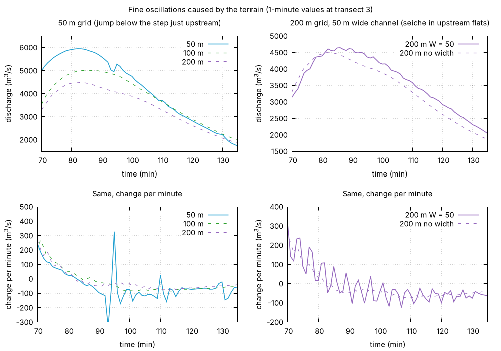

   A deep dip appears at 69 minutes on the rising limb (the discharge
   falls by 920 m^3/s in one minute and rises by 1,210 m^3/s in the next),
   and a bump at 122 minutes on the recession (it rises by 890 m^3/s and
   falls by 1,190 m^3/s). Just upstream of the transect is a stepped gorge
   in which the bed drops 14 m over 400 m (flat reaches and steps of 1 to
   7 m; the valley walls on both sides are more than 10 m above the bed).
   At first the flow passes through it in a shallow, fast state (depth 3
   to 4 m, velocity about 20 m/s). At 69 minutes, when the discharge has
   grown, the flat reach above the step (200 m long) and the reach
   upstream of it switch to a deep, slow state (depth 11 to 15 m, velocity
   5 to 10 m/s) within one or two minutes, and the discharge downstream
   dips by the water stored in the reach (about 100,000 m^3). At
   122 minutes on the recession the opposite switch occurs and the stored
   water comes out as a bump. The 100 m and 200 m grids (dashed) smooth
   these steps over 2 to 4 cells, and their curves are smooth.

   Preprocessing the channels so that the longitudinal profile is
   monotone (eliminating the flat reaches and the steps), or moving the
   channels to subgrid channels (`fn_channel`) with an independently
   specified bed profile, removes the ponds and steps themselves.
   Depending on how the terrain is changed, a transition to a steep reach
   can move closer to the transect and produce another oscillation. After
   changing the terrain, rerun the computation and check that the
   oscillation at the transect has decreased (for placing transects, see
   item 4).

3. **When water starts to spill onto a bank, the discharge can change
   like a step.** This comes not from the terrain but from a rule of the
   computation. The figure below shows transect 4 of the run in which a
   50 m wide channel is given inside the cells of the 200 m grid in the
   next supplement (a subgrid channel; see
   [the channel chapter of the users guide](../../../docs/en/users_guide/channel.md)).

   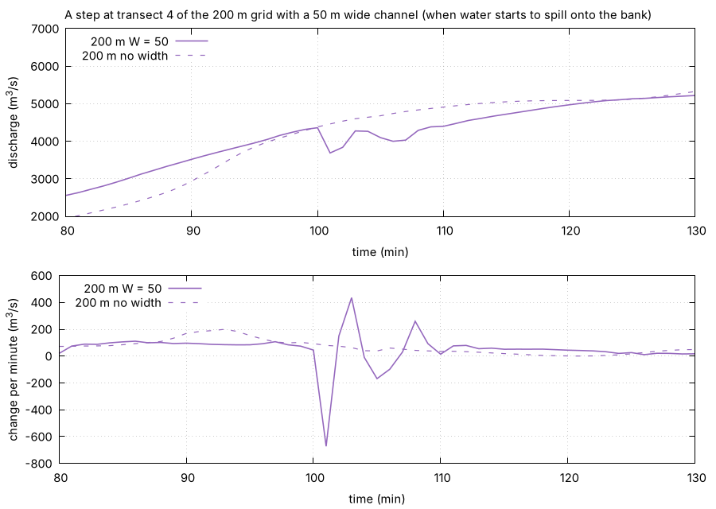

   At 101 minutes the discharge drops by 670 m^3/s (15%) in one minute
   and recovers over a few minutes. This is the moment when, 200 m
   upstream of the transect, the channel water starts to enter a
   neighbouring bank cell (12 m above the bed). ENCflow stops water from
   climbing onto wet cells above its level with a cap on the edge depth
   (`f_dry_head_cap = 2`). Around the threshold where the cap is released
   the amount of water entering the bank cell rises suddenly, and the
   discharge downstream drops by that amount. The time of the step
   depends on the time step (101 minutes with dt = 4 s as in this run,
   111 minutes with 2 s and 114 minutes with 1 s; the peaks agree within
   1%; the runs with other time steps are not part of `Fig_supp.sh`).
   When such a step affects how you read the results, halve the time step
   and check whether the results change (for the mechanism and its
   limits, see the item on `f_dry_head_cap` in §5 of
   [Advection schemes](../../../docs/en/users_guide/advection.md) in the
   users guide). It does not appear without the width (dashed).

4. The choice of measurement locations also mitigates it. A transect
   placed on a flat reach (pond) several meters deep picks up the
   motion of the pond surface directly, so **place transects on ordinary
   channel reaches with a longitudinal slope**.

## Supplement: effect of resolution and the character of the ENC grid

This supplement is for readers who are curious about how the results change
with a finer grid, what the 8-direction exchange of the ENC grid buys, and
what the advection term does. Reproducing the computations takes a few hours
because they include 50 m grid cases (see below).
If you only want the conclusions, read the bold sentences at the end of each
subsection and "What to take away about the ENC grid".

This tutorial has used a 200 m grid throughout. To see how the results
change with a finer grid, we move the Step 3 configuration (no losses,
no outlet) to 100 m and 50 m grids. The terrain
data are the 100 m and
50 m versions of the same area kept in `test/chichibu/` (text format),
and the parameter files are `en/param_supp_200m.txt` /
`en/param_supp_100m.txt` / `en/param_supp_50m.txt` (the 200 m one is
the Step 3 configuration with text input only). We also run the
**4-neighbor** computation mentioned at the end of Step 1
(`p_diagratio = 0.0`, diagonal exchange closed) at the same three
resolutions, to see what the 8-direction exchange of the ENC grid
brings. These six runs (plus the three width-equalized runs and the twelve
runs with a different treatment of advection described below) and the
figures are reproduced in one go with `./Fig_supp.sh` from the case
directory (it includes seven 50 m grid runs, so it takes 3 to 4 hours
on a 4-core laptop).

### Mapping the transects

The four transects and probes are placed at the **same places** as in
Step 3, re-specified as cell numbers of each grid (transect 1 at
ix 82 on the 200 m grid becomes ix 164 on the 100 m grid and ix 327 on
the 50 m grid; the lengths are kept at 1.0 to 1.4 km too). Since the
channel mask is redrawn when the resolution changes, we always check
that the transects straddle the channel. The figure below is that
check: at every resolution each transect (red) crosses the channel
(blue) exactly once and the probe (circle) sits on a channel cell.

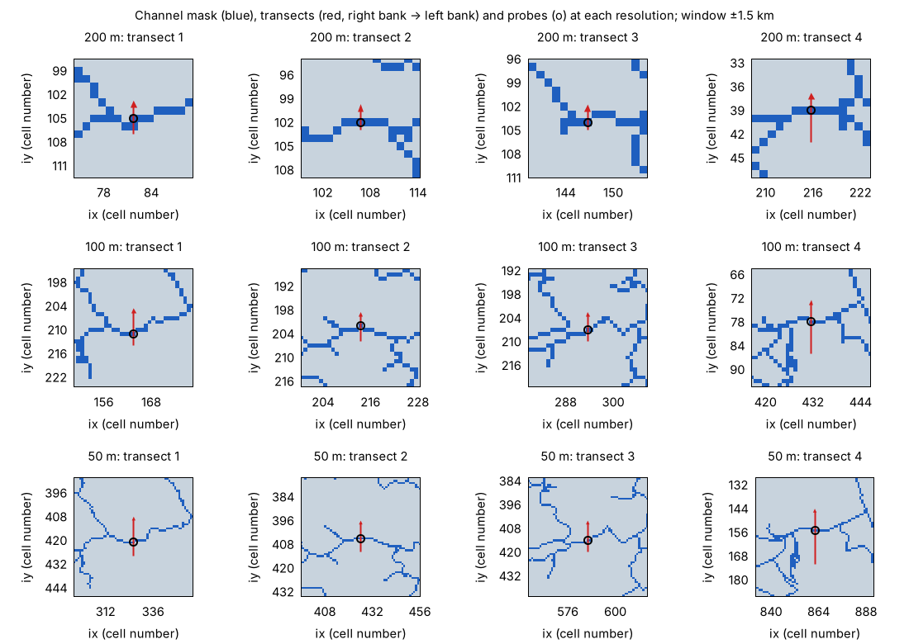

### Time step and computational cost

The time step is 6 s at 200 m, 1.5 s at 100 m and 0.75 s at 50 m.
Shrinking it only in proportion to the grid (3 s and 1.5 s) leaves no
margin at 100 m, where the Courant number (Cn_max on the screen) rises to
0.98, and at 50 m it would exceed 1 and stop the run (it is 0.62 with
0.75 s). A
finer grid resolves the valleys of steep tributaries and the maximum
velocity grows (18 m/s at 200 m, 27 m/s at 100 m, 35 m/s at 50 m), so
**the cost of a finer grid grows faster than "cells x steps"**, which
is worth remembering when choosing a resolution. The procedure for choosing
`dt` from the cell width and the estimated maximum velocity and depth is in
[Courant number and how to choose the time step](../../../docs/en/users_guide/courant.md#choose-dt);
the design reasons for ENCflow's fixed step are in the
[time-step design policy](../../../docs/en/users_guide/timestep_policy.md#fixed-time-step).

| grid | computed cells | dt | steps | run time (ENC, 4 threads) |
|---|---|---|---|---|
| 200 m | 17,885 | 6 s | 3,600 | 17 s |
| 100 m | 71,486 | 1.5 s | 14,400 | 219 s |
| 50 m | 285,843 | 0.75 s | 28,800 | 1,337 s |

### Result 1: changing the resolution (ENC)

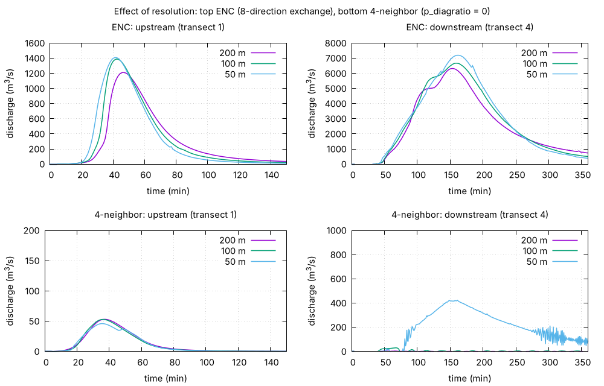

The top row is ENC. The peak discharges (m³/s) at transects 1 to 4 are
tabulated below (in parentheses: change from the next coarser grid).

| transect (upstream to downstream) | 200 m | 100 m | 50 m |
|---|---|---|---|
| 1 (small catchment area) | 1,209 | 1,385 (+15%) | 1,421 (+3%) |
| 2 | 3,005 | 3,455 (+15%) | 3,624 (+5%) |
| 3 | 4,526 | 4,917 (+9%) | 5,964 (+21%) |
| 4 (near the catchment outlet) | 6,208 | 6,827 (+10%) | 7,536 (+10%) |

- **Upstream (transects 1 and 2)**: the coarser the grid, the smaller
  the peak. It changes by 15% from 200 to 100 m but only by
  3 to 5% from 100 to 50 m, i.e. it has almost converged at 100 m and below. We
  attribute the smaller runoff on the coarse grid to two things: in a
  200 m cell the valley floor and the hillslopes are mixed in one cell,
  which blunts the concentration of water from the slopes into the
  channel (the steps become larger and short tributaries collapse into
  one or two cells); and the channel width becomes the cell width,
  which increases channel storage and damps the short hydrographs of
  small catchments the most.
- **Downstream (transects 3 and 4)**: the peaks grow by 9 to 10% from
  200 to 100 m and by another 10 to 21% from 100 to 50 m, so they have not
  converged the way the upstream ones have. The peak times do not change
  much across the three resolutions (152 to 159 min at transect 4). On a raster
  the channel width equals the cell width, so a finer grid makes the
  channel narrower and deeper (the maximum depth at probe 4 is 7.4,
  10.9 and 16.7 m). To check whether narrowing the channel on the coarse
  grids brings them closer to the 50 m grid, we used subgrid channels
  (`fn_channel`,
  [the channel chapter of the users guide](../../../docs/en/users_guide/channel.md))
  to give the 200 m and 100 m grids the same 50 m channel width as the
  50 m grid (`./Fig_supp.sh` runs these as `result_supp_*_w50`. At 200 m the flow gathers in the 50 m wide
  channel and becomes faster, so the Courant number exceeds 1 with dt = 6 s
  and dt = 4 s is used; running the 200 m grid without the width at dt = 4 s changes the
  peak at transect 4 by only 0.03%).
  The peaks at transects 3 and 4 become 5,255 / 5,835 at 200 m and
  4,442 / 5,975 at 100 m: **equalizing the channel width does not bring
  them closer to the 50 m grid (5,964 / 7,536)**. The peak at transect 4
  near the catchment outlet falls by 6% at 200 m and by 12% at 100 m
  relative to the runs without the width, and arrives 15 to 18 minutes
  later (21 to 23% smaller and 15 to 19 minutes later than on the 50 m
  grid). At transect 3 the peak rises by 16% at 200 m but falls by 10% at
  100 m. With the widths equalized, the difference between 200 m and
  100 m at transect 4 shrinks from 10% to 2%, but at transect 3 it grows
  (100 m is 9% larger without the width; 200 m is 18% larger with W = 50).

  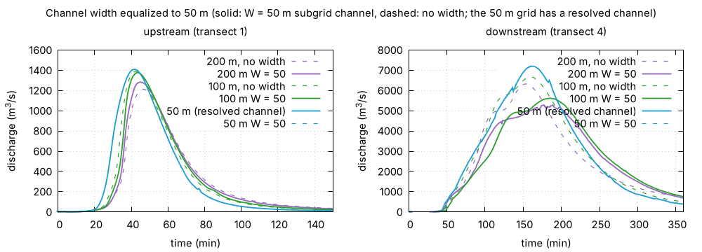

  In the figure, the 200 m and 100 m runs with W = 50 (solid) take
  similar shapes at the downstream transect 4, yet are lower and later than the 50 m
  grid (light blue) and also later than the runs without the width
  (dashed) (at the upstream transect 1 the effect of the width is within
  7%). Incidentally, the run that gives the 50 m grid W = 50 m (= the cell
  width; the light blue dashed line in the figure) overlaps the 50 m grid
  with a resolved channel, with peaks agreeing within 0.05%. The
  difference in discharge is 34 to 45 m^3/s at the moments when the flow
  state switches (68 and 147 minutes at transect 3) and within 10 m^3/s
  otherwise at every transect. When the width
  equals the cell width, the subgrid channel degenerates into the
  resolved representation as designed (not to the last digit; small
  differences such as the treatment of diagonal edges remain).
  A 50 m wide subgrid channel squeezes the flow into 1/4 to 1/2 of the
  cell width. Downstream, where the discharge is large, the channel
  becomes deep (more than 10 m just upstream of transect 4 in the 200 m
  run) and spills onto the bank cells, and the spilled water moves slowly
  over the valley floor; we think this is why the wave becomes lower and
  later even though the channel storage is smaller. On the 50 m grid the
  valley-floor cells on both sides of the channel cells take part in the
  flow from the start. Even with the same channel representation, **the
  difference in how the valley floor and the hillslopes are resolved**
  remains.
- The 1-minute values at transect 3 on the 50 m grid show a dip at
  69 minutes on the rising limb and a bump at 122 minutes on the recession
  (−920 and +1,210 m^3/s, and +890 and −1,190 m^3/s per minute). In the
  stepped gorge just upstream of the transect, water is stored and
  released when the flow state switches; this is the example of item 2 of
  the previous supplement. The 1-minute values at transect 3 on the 100 m
  and 200 m grids are smooth.
- Transect 4 of the 200 m run with W = 50 shows a step at 101 minutes, in
  which the discharge drops by 670 m^3/s in one minute (the moment the
  channel water starts to spill onto a bank cell; the example of item 3 of
  the previous supplement). Transect 4 of the 100 m run without the width
  also has small steps of +410 m^3/s at 106 minutes and −220 m^3/s at
  209 minutes. They occur at the threshold of the same cap
  (`f_dry_head_cap = 2`) and do not appear in a run with
  `f_dry_head_cap = 1`.
- At every resolution the S column stays at 0.1000 m after the rain.
  The total volume is the same; only **the distribution and the speed
  of the water** differ. Check this yourself.

### Result 2: the same computation with 4 neighbors

The bottom row is the 4-neighbor case (its vertical axes are 1/8 of those
of the ENC panels above), with the following peaks.

| transect | 200 m | 100 m | 50 m |
|---|---|---|---|
| 1 | 52 | 52 | 46 |
| 2 | 40 | 46 | 57 |
| 3 | 0 | 666 | 250 |
| 4 | 4 | 23 | 430 |

At 200 m only 4 m³/s (0.1% of ENC) reaches transect 4 near the
catchment outlet; at 100 m it is 23 m³/s, and on the 50 m grid, where
the channel cells are 50 m wide, it finally reaches 430 m³/s (6% of
ENC). **Even with a grid four times finer, the channel network stays
essentially cut into pieces with 4 neighbors.** The 666 m³/s at
transect 3 on the 100 m grid seems to appear because, over about 1 km
upstream of this transect, the channel follows grid rows in runs of 3
to 5 cells: reaches aligned with the axes pass water, diagonal reaches
stop it. Whether discharge appears is decided **by the orientation of
the channel, not by the resolution**, which is the anisotropy of the
4-neighbor scheme.

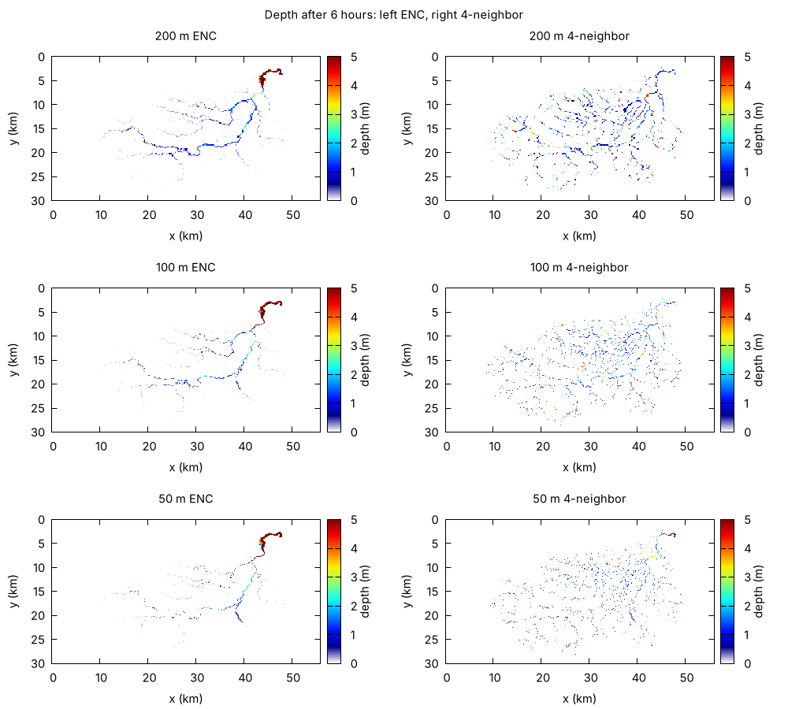

In the depth distributions after 6 hours, ENC (left) has gathered the
channel water at the outlet at every resolution and the catchment is
blank, whereas with 4 neighbors (right) spots of ponded water remain
all over the channel network, stopped at every diagonal reach. These
fragmented "ponds" can also seed the motion of the water surface noted in
item 4 of the previous supplement, and the 4-neighbor hydrograph on the
50 m grid (transect 4) shows an oscillation that goes up and down every
minute (±15 to 20 m³/s) after 330 minutes.

### Result 3: the advection term and resolution dependence

The computations so far used the default momentum-conserving advection
scheme (`f_advection_scheme = 3`). We now run the same three resolutions
with **the advection term dropped (diffusion wave, i.e. the local inertia
equation, `f_govequation = 1`)** and with **the old advection scheme
(`f_advection_scheme = 1`, non-conservative with upwind weighting; the upwind
index `p_adv_upwind_index` is tried at the default 0.5, at 0.1, the value
used in test/chichibu, and at the upper limit 1.0 = full upwind)** to see how
the treatment of advection changes the resolution dependence (`./Fig_supp.sh`
runs them as `result_supp_*_noadv` / `result_supp_*_s1` / `result_supp_*_s1u` /
`result_supp_*_s1f`).

> **A note on terms.** This setting drops only the advection term and keeps
> the term for the time change of the velocity (the local term), so strictly
> it is not the diffusion wave but the local inertia equation. Below it is
> still written "diffusion wave", following the earlier usage. The meaning
> of each term of the momentum equation and the differences between the
> dynamic wave, local inertia, the diffusion wave and the kinematic wave are
> in the primer of the user's guide,
> [The shallow water equations and the dynamic, diffusion and kinematic waves](../../../docs/en/users_guide/shallow_water.md).

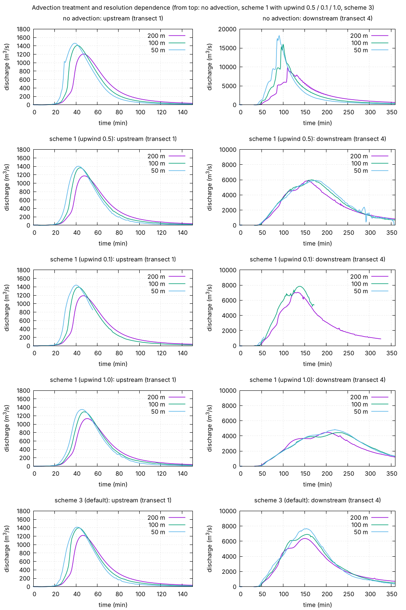

From top: no advection; scheme 1 (upwind index 0.5 = default); scheme 1
(upwind index 0.1); scheme 1 (upwind index 1.0); scheme 3 (default). Left: upstream transect 1; right:
downstream transect 4. **Note that the vertical axis of the top-right panel
spans twice the others.** Peak discharge
(m³/s) and its time (min) at transect 4 (near the basin outlet):

| advection | 200 m | 100 m | 50 m |
|---|---|---|---|
| none (diffusion wave) | 9,326 @113 | 15,123 @102 | 17,079 @92 |
| scheme 1 (old, upwind 0.5 = default) | 5,780 @158 | 5,863 @167 | 5,906 @182 |
| scheme 1 (upwind 0.1) | 6,982 @136 | 8,152 @135 | diverged (63 min, before the peak) |
| scheme 1 (upwind 1.0) | 4,351 @199 | 4,312 @228 | 4,832 @224 |
| scheme 3 (default) | 6,208 @152 | 6,827 @159 | 7,536 @155 |

For reference, the maximum velocity of each computation (V_max in the Log)
on the 100 m grid was 42 m/s without advection, 26 m/s with scheme 1
(upwind 0.5), 18 m/s with scheme 1 (upwind 1.0) and 27 m/s with scheme 3. The 50 m run without
advection completes at dt = 0.75 s, but at the end of the rainfall (first
hour) the velocity reaches 59 m/s at bed steps and the Courant number 0.98,
leaving no margin, so that one run uses dt = 0.4 s (the peak at transect 4
differs by 0.1%). The 50 m run with scheme 1 (upwind 0.5) is at the limit of
stability in the third hour (when the ponded water at the outlet is 25 to
27 m deep): the velocity reaches 64 m/s and the Courant number 1.00. A run
with dt reduced to 0.5 s diverged at about the same time, with the velocity
reaching 93 m/s, and stopped (an instability of the scheme, not a time-step
issue). `Fig_supp.sh` continues even if this run stops on the way. Scheme 1
with upwind 0.1 stops on the 100 m grid during the recession (3.9 hours, when the ponded
water at the outlet is 33 m deep) and on the 50 m grid during the rising limb
(63 minutes), with the velocity diverging (it completes on the 200 m grid). On
the 100 m grid, reducing dt from 1.5 to 1.0 s hardly changes the time it stops
(4.1 → 3.9 h), so this is not a time-step issue; we take it as an instability
of the non-conservative, weakly upwinded scheme in deep still water and at
steep steps. The 100 m peak (135 minutes) comes before the stop, so it is
listed in the table, and the curve ends early in the figure.

#### Dropping the advection term makes the peak larger and earlier on finer grids

Without the advection term (diffusion wave, local inertia equation), the peak
at transect 4 goes 9,326 → 15,123 → 17,079 m³/s and 113 → 102 → 92 min from 200 m to 100 m to 50 m: **the finer the grid,
the larger and earlier the peak**. The resolution dependence is far
stronger than with the default scheme 3 (6,208 → 6,827 → 7,536 at
152 → 159 → 155 min), and the values themselves are 1.5 to 2.3
times larger. Let us follow the reasons step by step.

1. **The velocity of a diffusion wave is set by the local slope alone.** In
   the diffusion wave (local inertia equation) the velocity follows from
   the local balance of water-surface slope and friction (Manning), with no
   inertia (no time needed to accelerate, no deceleration when fast water
   mixes with slow water). On a uniform slope, therefore, refining the grid
   changes neither the slope of any cell nor the velocity or the speed of
   the wave (a straight channel shows no resolution dependence).
2. **Resolving real terrain more finely widens the distribution of slopes
   into "steep steps" and "gentle treads".** The bed of a real DEM is a
   succession of grid-scale steps (on the 100 m grid the median drop
   between adjacent channel cells is a slope of 0.12; developer.md §68.20).
   A coarse grid averages the steps into a gentle slope close to the mean;
   a finer grid resolves the large real steps. The mean slope is the same,
   but the local slopes spread out.
3. **"More steps, hence faster" is not an explanation by itself, however.**
   The Manning velocity scales with the square root of the slope, so what is
   gained at the steps is lost on the treads, and for the same mean slope a
   wider distribution lowers the mean velocity if anything (the travel time
   over the treads grows). Indeed, in a one-cell channel with a stepped bed
   (stair3 in test/bendloss: 100 m treads with 3 m drops) the travel time
   without advection was only 14% shorter than with scheme 3.
4. **The main reason the wave becomes faster and larger is that the
   acceleration at the steps, unrestrained by inertia, grows into a bore.**
   In the same stair3 case the peak without advection was 2.3 times that
   of scheme 3. The difference in peak (130%) is far larger than the
   difference in travel time (14%): the main effect is the **sharpening of
   the wave form**, not the mean speed. Without the advection term
   (inertia) the velocity follows changes of the water-surface slope
   instantly, and at a step, where the surface slope is large, the velocity
   shoots up (V_max 42 m/s on the 100 m grid against 27 m/s with scheme 3).
   In reality hydraulic jumps and turbulence dissipate this acceleration;
   the equations have no term for it. Deeper water travels faster (wave
   speed ≈ 5/3 u), so the front steepens into a bore, and a steeper front
   means a larger surface slope and a still larger velocity, a
   self-reinforcing loop.
5. **Refining the grid adds three changes that feed this growth.** (a) The
   large real steps are resolved, seeding more acceleration. (b) The
   channel cells become narrower and deeper, raising the velocity for the
   same discharge (Manning for a rectangular section gives u ∝ (Q/W)^0.4;
   halving the width raises the velocity by 1.3). (c) The numerical
   diffusion of the discretization (proportional to Δx) decreases, so the
   bore stands sharper. On a coarse grid the steps are averaged and the
   numerical diffusion is large, so the bore is blunted and the wave comes
   out slower and smaller.

In other words, the resolution dependence of the diffusion wave comes from
how much of the bed steps is resolved and how sharply the bore can be
represented being passed straight into the result, and it does not converge
with refinement. Existing diffusion-wave and kinematic-wave catchment models
normally absorb this into a **roughness coefficient calibrated for each
resolution**. With the advection term, the acceleration at the steps is
cancelled by a hydraulic-jump-like dissipation and by the momentum exchange
with lateral inflow and the valley floor (next subsection), so resolving the
steps more finely moves the result little. That is the explanation of the
weak resolution dependence of scheme 3.

#### What is the advection term decelerating?

What the advection term does to slow and flatten the wave in this case
splits into three parts.

1. **Dissipation at bed steps**: in a one-cell channel with a stepped bed
   (stair3 in test/bendloss), the run without advection produces excessive
   velocities at every step and the flood wave grows into a bore, whereas
   the momentum-conserving advection term supplies a hydraulic-jump-like
   dissipation that holds the wave down (a factor 2.3 in peak). Since
   the bed of a real DEM is such a succession of steps, we believe this
   accounts for most of the difference from the run without advection.
2. **Deceleration by lateral inflow**: in rainfall runoff most of the channel
   discharge enters from the side, from hillslopes and tributaries, carrying
   no streamwise momentum. The conservative form naturally contains the term
   that mixes this water in and slows the channel flow (−u·q_L/h; it matches
   the analytic solution of spatially varied flow within 1 to 2%).
3. **Momentum exchange with the inundated valley floor**: on the 100 m grid
   the flood cross-section of the main river spreads beyond the single
   channel-mask cell onto valley-floor cells, and at bends and confluences
   that slow water becomes the upwind donor and drains momentum. The
   artificial part, in which a thin film on a bank that carries almost no
   water becomes the donor and slows the main flow, is removed by the default
   treatment (for how it works, and for the fact that this treatment alone
   moves the transect 4 peak by about 13%, see
   [one-cell-wide channels and the upwind donors of the advection term](../../../docs/en/users_guide/advection_donor.md)
   in the users guide). On a finer grid the
   main river fits within the channel cells and this exchange shrinks, consistent with
   the gentle increase of the scheme 3 peak with resolution.

#### Why it is said that advection matters little in mountain runoff

In steep channels the bed slope S₀ dominates the momentum equation over the
changes of water-surface slope and velocity head, so the balance of bed slope
and friction (kinematic wave), or the diffusion wave that adds the surface
slope, reproduces **the propagation of the wave at the reach scale** well.
Known quantitative criteria are the kinematic flow number of Woolhiser &
Liggett (1967), k = S₀L/(h Fr²) > 20 for the kinematic approximation, and the
condition of Ponce et al. (1978), T·S₀·√(g/h) ≥ 30 for the diffusion wave
(how to read the criteria:
[Rules of thumb for choosing](../../../docs/en/users_guide/shallow_water.md#phenomena)
in the primer);
mountain runoff, with steep slopes and a wave time scale T of hours much
longer than the time scale of the flow depth, satisfies them.
These statements, however, treat the bed and the flow as **smooth at the
reach scale**. At the grid scale of a raster DEM the bed is a succession of
steps, the flow is locally rapidly varied, and the inertia terms are not
negligible. It helps to keep apart "advection matters little" as a statement
about wave kinematics from the local energy balance at each step. Existing
models fold this local dissipation into the roughness coefficient, which is a
sound engineering practice (nothing here is meant to disparage them).

#### Relation to one-dimensional channel models

One-dimensional channel models are also often run without the advection
term. Adding the lateral-inflow momentum term (−u·q_L/h) captures part 2
above, but the step dissipation of part 1
and the valley-floor exchange of part 3 would have to enter a 1-D model with
prescribed cross-sections in other forms (roughness, local loss
coefficients, compound-channel momentum exchange). We therefore expect a 1-D
model with lateral-inflow momentum to **move toward, but not coincide with**,
the ENCflow result with advection (untested).

#### Does weak resolution dependence mean closeness to reality?

No. A result that moves little under grid refinement is a property one
wants from a model that claims to be physically based (convergence), but
there is no guarantee that the converged value matches observations (a
detail of the advection discretization alone
([the treatment of the upwind donors](../../../docs/en/users_guide/advection_donor.md))
moves the 200 m peak by about 13%, for instance). This
tutorial catchment has no comparison with observations, and **closeness to
reality is unverified**. Conversely, a diffusion wave calibrated with a
roughness coefficient per resolution can surely be made to match
observations. Still, a model that need not be recalibrated each time the
resolution changes is **"convenient"**, because one can grasp the whole on a
coarse grid and refine only where needed. Keep the distinction between
"convenient" and "correct".

#### Resolution dependence of scheme 1 and the upwind index

The old scheme 1 is non-conservative; it cannot represent the momentum
exchange with lateral inflow and the valley floor consistently (§68.17), and
the numerical viscosity of its upwind weighting (`p_adv_upwind_index`) scales
with Δx and therefore with resolution. The upwind index changed the result a
great deal.

- **Upwind 0.5 (default)**: the transect 4 peak goes 5,780 → 5,863 → 5,906
  m³/s, within 2.2% across the three resolutions, but 7%, 14% and 22%
  smaller than scheme 3 and 6, 8 and 27 minutes later. On the 50 m grid the
  maximum velocity reaches 64 m/s (35 m/s with scheme 3) and an oscillation
  appears on the recession at transect 4 (290 to 310 min), visible in the
  figure.
- **Upwind 0.1**: 6,982 → 8,152 m³/s (200 m → 100 m), 12% and 19% larger
  than scheme 3 and 16 and 24 minutes earlier. The 50 m grid diverged during
  the rising limb at 63 minutes, with velocities above 90 m/s, before
  reaching the peak (the transect 1 peak of 1,442 m³/s comes before that and
  is 1.5% above the 1,421 of scheme 3). **The finer the grid, the further it
  moves away from scheme 3 toward the run without advection.**
- **Upwind 1.0 (full upwind)**: 4,351 → 4,312 → 4,832 m³/s, 30%, 37% and 36%
  smaller than scheme 3 and 47, 69 and 69 minutes later; even the upstream
  transect 1 is 5 to 7% smaller. On the same grid the two ends of the upwind
  weight (0.1 and 1.0) give peaks of 6,982 vs 4,351 at 200 m and 8,152 vs
  4,312 at 100 m, a factor of 1.6 to 1.9. The gap does not close with
  refinement (100 m is the lowest), presumably because the velocity resolved
  on the finer grid offsets part of the smaller Δx, so the numerical
  viscosity Δx·u decreases less than the grid spacing.

The difference is explained by the amount of numerical viscosity. A larger
upwind weight means a numerical viscosity proportional to Δx·u that smooths
velocity extremes and the accelerations at steps, which incidentally acts
like the step dissipation (item 1 above). A smaller weight removes this
"accidental dissipation", leaving the momentum losses that the
non-conservative form cannot represent (items 2 and 3) missing, so the wave
becomes faster and larger. Since the numerical viscosity itself shrinks with
Δx, with upwind 0.1 the result approaches the diffusion wave as the grid is
refined. The resolution dependence of scheme 1 thus comes both from the
physical approximation (non-conservative form) and from the numerical
viscosity (upwind weight × Δx), and the result moves with the choice of the
upwind weight: a scheme that carries one extra calibration parameter.
Whether scheme 1 can be said to have weak resolution dependence therefore
hinges on the choice of the upwind weight. What ENCflow makes the default is
the momentum-conserving scheme (with the dynamic opening correction), which
adds no calibration parameter.

#### What is special about this case

This case routes 100 mm of rain in one hour with no losses and produces
6,000 to 8,000 m³/s near the basin outlet (a specific discharge around
10 m³/s/km²), an extreme flow. Both the step dissipation and the lateral
inflow scale with discharge, so the influence of the advection term is
probably larger here than in an ordinary flood. For a milder event the three
computations should differ much less; checking this is left to the reader
(change the rainfall in `param_supp_*.txt` and rerun `./Fig_supp.sh`).

### What to take away about the ENC grid

- **Weak grid dependence**: from 200 to 50 m (16 times the cells, 80
  times the run time) the peaks changed by +18 to 21% upstream and +21 to 32%
  downstream, with the peak times within 5 minutes. For an
  estimate of the flood wave over the whole catchment a 200 m grid is
  enough; go to 100 m and below when the absolute values in small
  upstream catchments matter. For an example with another phenomenon,
  [examples/debris_fan](../../../examples/debris_fan/en/README.md) computes a
  debris flow that runs from a slope failure down a valley and spreads on
  an alluvial fan: the sediment reaching the fan, the extent and runout of
  the deposit, the arrival time and the lateral spreading agree within
  ±10% of the reference over grid spacings of 20 to 2.5 m and three valley
  orientations relative to the grid (even on a 40 m grid, coarser than the
  30 m wide valley floor, 0.92 to 1.10 times the reference sediment reaches
  the fan). It also compares four neighbors, which shows what the
  8-direction exchange of the ENC grid brings.
- **Flow is not obstructed even at coarse resolution**: most
  structured-grid models exchange water along the axes only (4
  neighbors) and cannot carry a one-cell-wide channel diagonally, so
  the channel network has to be **coupled separately as a 1D channel
  model**. The ENC grid carries the channel network as a raster through
  its 8-direction exchange, so **no 1D channel model or flow-direction
  (D8) data are needed** even on a 200 m grid. That a catchment
  computation works with nothing but a D8-filled DEM and a channel
  mask rests on this property. How the eight-direction passage widths
  are adjusted so that one-cell-wide channels carry the correct
  conveyance is summarized in
  [Passage-width adjustment](../../../docs/en/users_guide/passage_width.md)
  in the user's guide.
- **The price of resolution is computation**: halving the grid
  multiplies the cells by 4 and, because dt must shrink with the
  growing velocities, the steps by 2 to 4, so the run time grows 6 to
  13 times. In
  practice, first grasp the overall behavior at about 200 m, then
  refine where the location and purpose require it.
