> English mirror of tutorials/chichibu/README.md. The Japanese file is the master copy.

[日本語](../README.md)

# Tutorial 2: chichibu -- rain on a real-terrain catchment

We cover the Chichibu catchment in the upper Arakawa River basin
(about 715 km^2) with a 200 m grid, apply a heavy rainstorm
(100 mm in one hour, peak 200 mm/h), and compute rainfall runoff and flood wave
propagation. You will learn the standard workflow of a practical
computation with real terrain data, in the following order.

- **Step 1**: Minimal configuration with real terrain data; why
  depression filling is necessary
- **Step 2**: GeoTIFF input/output, representing the channel (channel
  mask, roughness, bed elevation)
- **Step 3**: Measurement (probes and flux transects) and distributed
  output
- **Step 4**: Rainfall interception and subsurface infiltration (bucket
  model), the three water-storage columns
- **Step 5**: Boundary condition at the catchment outlet
- **Step 6**: 3D visualization (animation) with ParaView
- **Supplements**: reading and dealing with fine oscillations in the
  hydrograph; the effect of resolution and the character of the ENC grid

We assume you have completed the [wave tutorial](../../wave/en/README.md)
first (it explains how to run the model, the meaning of each screen
column, and the structure of parameter files). All work below is done
in the case directory (`tutorials/chichibu`); run the English parameter
files from there as `./encflow en/param_step1.txt` etc.

## A look at the data

`data_chichibu/` (relative to the case directory `tutorials/chichibu`) contains the following raster data.

| Data | Contents |
|---|---|
| `Chichibu_200m_filled.*` | Ground elevation (m), with D8 depression filling applied in GIS software |
| `Chichibu_200m_cond.*` | Ground elevation (m): the depression-filled elevation with the height of the channel cells (the bed) conditioned. Used from Step 2 on |
| `Chichibu_200m_raw.tif` | Ground elevation (m), original data without depression filling (for a comparison experiment) |
| `Chichibu_200m_basin.*` | Catchment mask (1: inside the catchment, 0: outside) |
| `Chichibu_200m_river_flowline.*` | Channel mask (1: channel cell). The computations use this one |
| `Chichibu_200m_river.*` | Original data of the channel mask (the river lines rasterized) |

All of them sit on the same grid of **280 x 150 cells (dx = dy =
200 m)** (a 56 km x 30 km domain). Each dataset is provided with the
same contents in three formats -- text (`.txt`), bil (`.bil` + `.hdr`),
and GeoTIFF (`.tif`) -- for practicing the input/output formats.

Data sources: the elevation data were derived from the Digital
Elevation Model of the Fundamental Geospatial Data by the Geospatial
Information Authority of Japan (GSI); the channel mask was derived from
stream-order data
([DOI:10.3178/jjshwr.36.1812](https://doi.org/10.3178/jjshwr.36.1812))
built from the river data of Kokudo Suuchi Jouhou (National Land
Numerical Information). The channel mask rasterized from the river lines
(`Chichibu_200m_river`) is in places one cell off the valley line of the
elevation data (903 of its 2,327 cells lie on the valley-wall side), so the
computations use the mask moved onto the flow lines of the elevation (the
drainage paths given by the steepest descent among the 8 neighbours) with the
bundled [utils/river_flowline](../../../utils/river_flowline/en/README.md)
(`Chichibu_200m_river_flowline`; 1,473 cells). The elevation with a conditioned
channel bed (`Chichibu_200m_cond`) is the depression-filled elevation with
only its channel cells (these 1,473 cells) rebuilt to match the valley-floor
height read from a 10 m grid elevation of the same area (also derived from
the GSI Digital Elevation Model); Step 2 explains it.

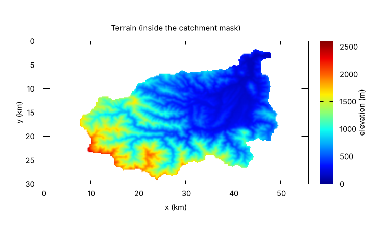

The northeast corner (elevation around 100 m) is the outlet of the
catchment, and peaks of the 2,500 m class line up along the main ridge
in the southwest. Most of the catchment is steep mountainous terrain.

## Step 1: Minimal configuration with real terrain data

### Running

As in wave, create the link to the executable with `make`, then run
`en/param_step1.txt` from the case directory (`tutorials/chichibu`).

```bash
make
./encflow en/param_step1.txt
```

```
reading list_sysparam in en/param_step1.txt
reading list_geoinfo in en/param_step1.txt
 reading data_chichibu/Chichibu_200m_basin.txt
 reading data_chichibu/Chichibu_200m_filled.txt
reading list_precip in en/param_step1.txt
main: number of processes: 1
main: number of threads: 4
main: real precision: 64 bit
main: number of valid cells: 17885
time, progress, S(m), Runge, ex_flux, Cn_max, h_max(m), V_max(m/s)
  0:00:00.00   0.0%    0.0000   0.0%      0    0.0000    0.0000    0.0000
  0:30:00.00   8.3%    0.0487  97.7%      0    0.1908    1.2869    4.0486
  1:00:00.00  16.7%    0.1000   6.2%      0    0.3461    4.7337    8.4505
  1:30:00.00  25.0%    0.1000   3.4%      0    0.4418    6.7150    9.7508
  2:00:00.00  33.3%    0.1000   0.9%      0    0.4156    7.0363    9.5678
  ...
  6:00:00.00 100.0%    0.1000   0.6%      0    0.5159   29.9526    4.0986
main: program terminated normally
```

The contents of `en/param_step1.txt` (the full file, apart from the
title comment at the top) are shown below. It is structured almost
identically to Step 1 of wave; the only differences are that
`&list_geoinfo` reads the terrain and the catchment mask from files and
sets the roughness `rn0`, and that `&list_precip` makes it rain
(`dir_data` in `&list_sysparam` is the input data directory, and the
file names below are relative to it).

```
!======================================================================
! System parameter settings
!======================================================================
&list_sysparam
  dt = 6.0                       ! time step (s)
  tt_c = "6 hour"                ! end time of the computation
  dt_disp_c = "30 min"           ! screen display interval
  dt_file_c = "30 min"           ! file output interval

  fn_geoinfo = "-"               ! geographic information settings file
  fn_precip  = "-"               ! precipitation settings file

  dir_data   = "data_chichibu"   ! input data directory
/

!======================================================================
! Geographic information settings
!======================================================================
&list_geoinfo
  nx = 280
  ny = 150
  dx = 200.0
  dy = 200.0

  f_ztype = 1          ! ground elevation type (0: default constant, 1: file)
  f_masktype = 1       ! domain mask (0: none, 1: catchment mask)
  rn0 = 0.05           ! fixed roughness (typical of mountain slopes; the default 0.015 is for channels)

  fn_z = "Chichibu_200m_filled.txt"        ! ground elevation file name
  fn_mask = "Chichibu_200m_basin.txt"      ! domain mask file name
/

!======================================================================
! Precipitation settings
!======================================================================
&list_precip
  ! precipitation data type (0: no precipitation, 1: uniform, time series)
  prtype = 1
  ! precipitation time series (time (min), intensity (mm/h))
  prval(:,1) =   0,   0
  prval(:,2) =  30, 200
  prval(:,3) =  60,   0
/
```

The screen output tells us the following.

- `number of valid cells: 17885` -- the full grid has 280 x 150 =
  42,000 cells, but thanks to the catchment mask only 17,885 cells are
  actually computed. Cells outside the mask consume neither memory nor
  computation time.
- `rn0 = 0.05` is Manning's roughness coefficient. The default 0.015
  is a channel value; applied to whole mountain hillslopes it makes the
  flow too fast (in this closed vessel with no outlet the water then
  concentrates so much that the computation becomes unstable). Here we
  give 0.05, typical of mountain slopes, and in Step 2 override it for
  the channel cells only.
- The S column grows with the rain and, at t = 1:00 when the rain ends,
  stops exactly at **0.1000** m (= the total rainfall of 100 mm, from rain that
  goes 0 -> 200 -> 0 mm/h over 30 minutes each, averaged over the catchment), remaining constant
  afterwards. By default the outer rim of the computational domain is
  an impermeable wall, so this catchment is a **closed vessel with no
  water outlet**; the constant S column confirms mass conservation.
- Meanwhile the h_max column keeps growing from 7 m to nearly 30 m: the water
  that cannot get out keeps accumulating somewhere.
- The ex_flux column counts how often an outflow computed from the momentum
  equation was about to exceed the water in the cell and was limited. It is a
  safety device that keeps mass conserved and is normally 0; continuous
  occurrence is the sign of a rough computation.

The depth distribution at the final time (`result/H9998.txt`) shows
where it accumulates (the depth maps use a palette in which zero depth
is white and deeper water is warmer: places the water has drained from
fade to white, and only the places it accumulates take on color). The bundled gnuplot script displays the depth
distributions at four times side by side on one screen (gnuplot is
required; after the plot appears, press Enter in the terminal to
quit; the bundled scripts sit in the case directory, so run this from
there):

```bash
gnuplot Plot_step1.plt
```

You can read how the water gathers from the hillslopes into the
channel network while it rains (t = 0:30, 1:00), drains downstream
after the rain stops (t = 3:00), and finally piles up just short of
the northeast corner.

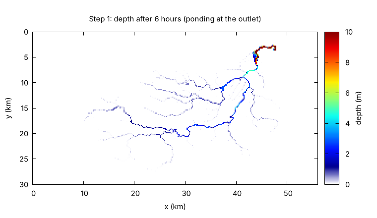

Just upstream of the catchment outlet (the northeast corner), ponded
water over 25 m deep has grown. This ponding of runoff dammed by the
wall will be resolved in Step 5 by setting a boundary condition. Until
then we proceed with the outlet ponding as a known artifact (the pond
grows upstream with time; in the computations from Step 2 on it reaches
about 12 km up the main stem from the outlet after 6 hours and affects
the water levels and discharges within that reach -- Steps 3 to 5 look
at this concretely).

### Why depression filling is necessary

If you replace `fn_z` in `&list_geoinfo` with `Chichibu_200m_raw.tif`,
you can run on the original DEM without depression filling (since this
reads a GeoTIFF, the easiest way is to switch `fn_z` in Step 2's
`en/param_step2.txt` to the depression-filled `Chichibu_200m_filled.tif`
and to the unprocessed `Chichibu_200m_raw.tif`). Extending the computation to 12 hours
(`tt_c = "12 hour"`) so that the channel water has almost all gathered
in the outlet pond, and comparing the depth distributions after 12
hours:

| Depression-filled (filled) | Unprocessed (raw) |
|---|---|
| 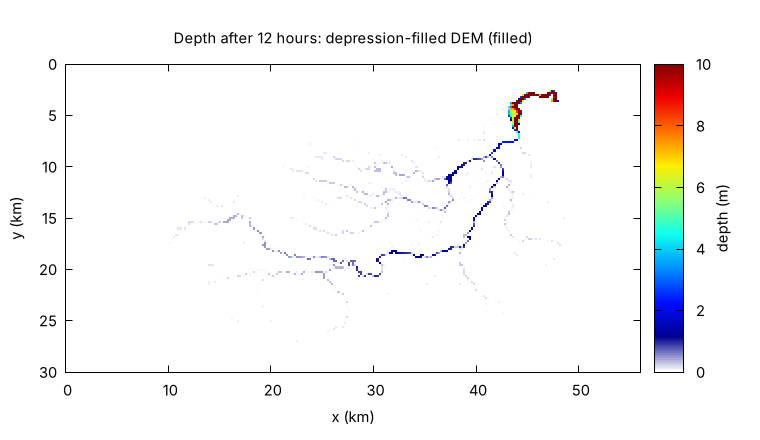 | 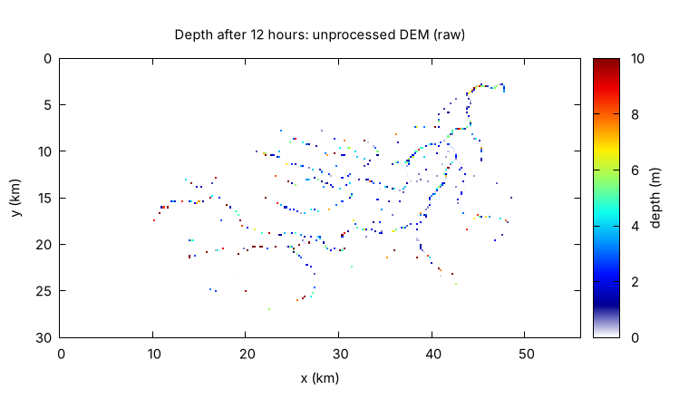 |

With the filled DEM the catchment is almost entirely white: the rain
has drained properly from the hillslopes into the channels and on
downstream, gathering at the single ponded spot at the outlet (which is
still a wall at this stage). With the raw DEM, color is scattered all
over the catchment: the water gets trapped in depressions along the way
and never reaches the outlet. The maximum velocity also drops to
about 0.8 m/s toward the end, showing that the flow has died across the
whole catchment.

In general, when the terrain slope is steep and the cell size is large,
the step-like jumps of the DEM become large. Once the jumps exceed the
order of the water depth, the flow is severely obstructed, so **prior
depression filling is essential for runoff computations**.

Depressions are also dangerous for numerical stability. In a
depression with no outlet the water depth keeps growing, and the wave
speed of the shallow water equations (≈ √(gh)) grows with it, so the
Courant number Cn (= wave speed × dt / cell size) increases and the
stability condition (Cn ≲ 1) becomes easy to violate
(see [the time-step chapter](../../../docs/en/users_guide/time.md); the
meaning of a Courant number that adds the wave speed to the velocity is in
[Courant number and how to choose the time step](../../../docs/en/users_guide/courant.md#wave-speed)).
This chain is a general troubleshooting rule beyond depressions:
**when a computation blows up (diverges), first suspect "water depth
grows somewhere → wave speed grows → stability condition breaks"**.
Check the Cn_max column on screen for a rising trend, and look for
places where water piles up abnormally in the maximum-depth
distribution H9999 — that is the first step.

Note that in ordinary structured-grid models, where water cannot move
diagonally across the grid, a DEM filled with the common D8
(eight-direction flow) method of GIS software can still leave water
stuck on diagonal flow paths, requiring extra depression processing or
higher resolution. The ENC grid exchanges water in eight directions, so
it is a natural match for D8: **a D8-filled DEM can be used as is**.

You can confirm this by experiment. Specifying `fn_enc = "-"` and
`p_diagratio = 0.0` in `&list_enc` closes the diagonal exchange of the
ENC grid, giving a "4-neighbor" computation. Even on the same
depression-filled DEM, the water now gets stuck on diagonal flow paths:
the depth distribution after 12 hours is chopped up all over the
catchment just like with the raw DEM, and the water never reaches the
outlet (the maximum velocity also drops to about 0.3 m/s toward the end — the flow
dies).

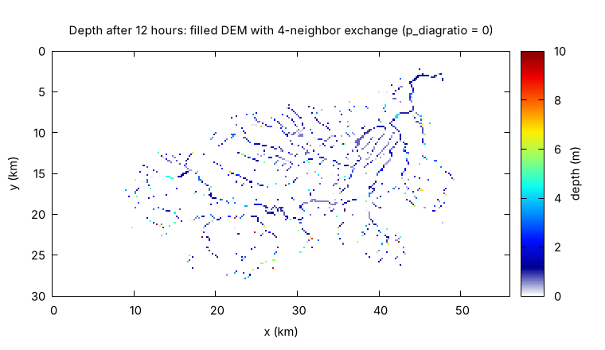

Depression filling, however, only guarantees that water can drain all the
way to the outlet; it does not shape the channels. Where a depression was
filled, a **flat reach** of cells at the same height remains, with a step at
its downstream end (in this 200 m elevation, 30 % of the channel cells are at
the same height as the cell they drain to). Water several meters deep collects
on a flat reach and slows down, then speeds up abruptly at the step, so the
flood wave can be delayed and the hydrograph can carry unnatural wiggles.
Step 2 switches to an elevation whose channel heights have been conditioned.

## Step 2: GeoTIFF input/output and representing the channel

`en/param_step2.txt` switches the input/output to GeoTIFF and adds the
three pieces of data that represent the channel: the channel mask, the
channel roughness, and the bed elevation.

```
&list_sysparam
  ...
  f_input_mode = 4           ! matrix input format (1: text, 2: bil, 4: geotiff)
  f_output_mode = 5          ! matrix output format (1: text, 2: bil, 4: geotiff)
/

&list_geoinfo
  ...
  f_rntype = 0         ! roughness type (0: default constant, 1: file)
  rn0 = 0.05           ! constant roughness value
  rn0_rw = 0.04        ! constant roughness for channel-mask cells

  fn_z = "Chichibu_200m_cond.tif"            ! ground elevation file name (elevation with a conditioned channel bed)
  fn_mask = "Chichibu_200m_basin.tif"        ! domain mask file name
  fn_rw = "Chichibu_200m_river_flowline.tif" ! channel mask file name
/
```

- With `f_input_mode = 4` / `f_output_mode = 5`, distributed data are
  read and written as GeoTIFF (output mode 5 writes both text and
  GeoTIFF). The output `.tif` files carry over the coordinate reference
  information, so **you can simply drag them into a GIS such as QGIS
  and they overlay on the map**.
- Roughness is a two-tier setup: the base value `rn0 = 0.05`
  (mountain/wildland-like) is overridden on channel cells by
  `rn0_rw = 0.04` (mountain-channel-like). `rn0_rw` overrides channel cells
  regardless of how roughness is given (constant or file). The value 0.04
  is the lower end of the guide range for mountain streams (0.04 to 0.06) in
  [Recommended values by pattern](../../../docs/en/users_guide/channel.md#recommended-values-by-pattern)
  of the channel chapter of the users guide.
- The bed elevation is conditioned on the side of the ground elevation data
  (`fn_z`); see "Conditioning the bed elevation" below.
- At this stage the channel mask `fn_rw` is used only to swap the
  roughness. From here you can refine step by step toward incision
  below the terrain (`depth_rw`) or subgrid channels (`fn_channel`)
  ([users guide](../../../docs/en/users_guide.md)).

Drawn as figures, the two masks look like this (only cells with value
1 are colored).

| catchment mask `Chichibu_200m_basin` | channel mask `Chichibu_200m_river_flowline` |
|---|---|
| 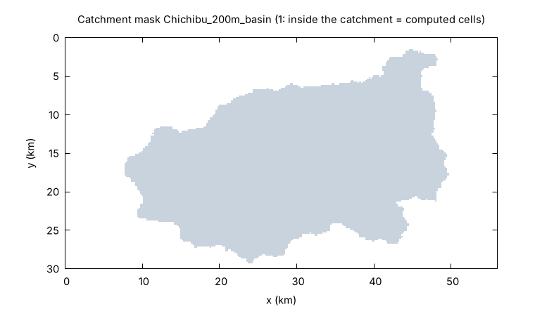 |  |

The colored cells of the catchment mask are the computed cells; the
`number of valid cells: 17885` printed in Step 1 is the number of these
cells. The channel mask gives the channel network as **lines one cell
wide**, and only these cells get the roughness `rn0_rw`. Both are
plain 1-or-0 rasters made in a GIS (the channel mask has been moved onto
the valley lines of the elevation in preprocessing; see "A look at the
data"). They carry no channel width. On a 200 m grid the channels are
narrower than a cell, but here we only say *which* cells are channel and
give their roughness and bed elevation (giving the width as well is what
subgrid channels do).

### Conditioning the bed elevation

The values of the Step 1 elevation (`Chichibu_200m_filled`) are average
heights within each cell. Mountain rivers run along valley floors far
narrower than a 200 m cell, so the elevation of a channel cell is higher
than the real bed. On top of that, as noted at the end of Step 1, the
traces of depression filling remain as flat reaches and steps along the
channels.

`Chichibu_200m_cond` rebuilds the elevation of the channel cells only
(1,473 cells). From a 10 m grid elevation of the same area, the valley-floor
height (the minimum within the cell) is read for each 200 m cell and used as
the height of the channel cell, and the result is conditioned so that the bed
never rises in the downstream direction. All other cells are identical to
`Chichibu_200m_filled`. Comparing the two elevations along the main stem:

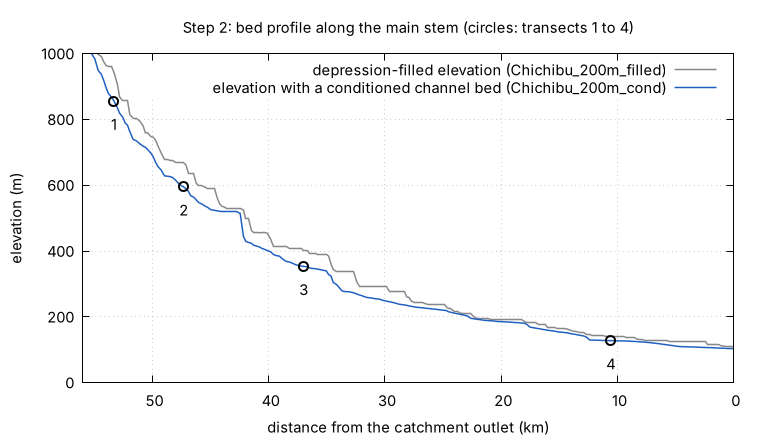

- Gray is the depression-filled elevation. Flat reaches of equal height and
  steps line up like a staircase (of the 1,472 links between channel cells,
  446 lead to a cell at the same height).
- Blue is the conditioned bed. Every channel cell is lowered (median 37 m,
  maximum 135 m), and the flat reaches disappear except at two places that
  appear to be water surfaces such as a reservoir (the reach at 43 to 44 km in
  the figure is one of them); 25 links to a cell at the same height remain.
- Because the bed is now the valley-floor height rather than the cell
  average, the channel cells cut deeper below the cells on both sides (the
  median difference between the bed and the lower of the two side cells is
  48 m).

The procedure and the statistics of this preprocessing are summarized under
"Elevation with a conditioned channel bed" in the
[data README](../../../test/chichibu/en/data_chichibu/README.md) (the 10 m
grid elevation and the preprocessing tool are not bundled). For your own
catchment, give the heights of the channel cells in the same way, from the
valley-floor heights of a fine elevation dataset or from surveyed bed levels
such as a longitudinal profile. How the hydrographs change with and without
the conditioned bed is compared in Step 3, once the measurements are in place.

When you run it, the numbers on screen change from Step 1 (the channels are
now lower and smoother, so the water gathers faster: V_max rises from 8 to
10 m/s to 14 to 15 m/s, and h_max after 6 hours grows from 30 m to 34.5 m).
The result directory now contains `H0001.tif` and friends.

## Step 3: Measurement and distributed output

Places where you want time series of discharge or depth are specified
in advance with **probes** (points) and **flux transects** (lines).
`en/param_step3.txt` places four of each along the main stem.

```
&list_sysparam
  ...
  dt_recrd_c = "1 min"       ! probe output interval

  f_out_h = 1                ! file output (depth H0001)
  f_out_vv = 1               ! file output (velocity magnitude V0001)
  f_out_qq = 1               ! file output (discharge magnitude Q0001)
  f_out_cn = 1               ! file output (Courant number Cn0001)
  f_out_hmax = 1             ! file output (maximum depth H9999)
  f_out_vvmax = 1            ! file output (maximum velocity V9999)
/

&list_record
  ! probe position type (0: cell indices, 1: real coordinates (m))
  ! probe positions (x, y)
  pbxytype = 0
  pbxy(:,1) =  82, 105
  pbxy(:,2) = 107, 102
  pbxy(:,3) = 147, 104
  pbxy(:,4) = 216,  39

  ! flux transect coordinate type (0: cell indices, 1: real coordinates (m))
  ! flux transect endpoints (right-bank x, right-bank y, left-bank x, left-bank y)
  flxytype = 0
  flxy(:,1) =  82, 107,   82, 103
  flxy(:,2) = 107, 103,  107, 100
  flxy(:,3) = 147, 105,  147, 102
  flxy(:,4) = 216,  43,  216,  37
/
```

Cell indices are **1-based**, Fortran style (raster row/column numbers
in QGIS are 0-based, so add 1 when using cell indices looked up in a
GIS). For a transect, "the right side looking from the start point
toward the end point is positive", so writing it in the right-bank to
left-bank direction makes downstream discharge positive. Specification
in real coordinates (m) (`pbxytype = 1` / `flxytype = 1`) is also
available ([the record chapter of the users
guide](../../../docs/en/users_guide/record.md)).

Overlaying the transects and probes on the channel mask of Step 2
gives the following figure (top: whole catchment; bottom: close-ups
around each transect. The axes of the close-ups are **cell numbers**,
corresponding directly to the `flxy` / `pbxy` values above).


- The transects (red) are 4 to 7 cells long so that they **straddle**
  the main river, including the slope cells on both sides of the
  channel cells. The channel mask is one cell wide, but flood water
  spills into the neighboring cells too, so a transect restricted to
  the channel cells alone would miss part of the discharge. The arrow
  points from the right bank to the left bank; all four are drawn from
  south to north (the main river flows roughly from west to east, so
  the right bank, on your right when facing downstream, is the south
  side).
- The probes (circles) are placed on the cell where each transect
  crosses the channel mask (check in the close-ups that the circles sit
  on blue cells). A probe is a point measurement on a single cell, so
  if it lands one cell off, on the slope side, it records almost none of
  the channel depth and velocity (try setting `pbxy(:,3)` to `147, 103`
  and running: the depth in `probes/probe0003.csv` then stays within
  1 to 2 cm). **Checking the configured positions against the mask by
  eye, as done here,** is the basic routine when placing measurements.

When you run it, the numbers on screen match Step 2 **exactly**
(measurement and file output have no effect whatsoever on the computation
itself). The results now include `fluxes/flux0001.csv`
(transect discharge time series) and `probes/probe0001.csv` (probe
depth and velocity time series).

```bash
gnuplot -p -c Plot_flux.plt result
```

displays the hydrographs of the four transects in turn (the bundled
`Plot_flux.plt` / `Plot_map.plt` in the case directory are scripts for
visual inspection of results; run them from there).

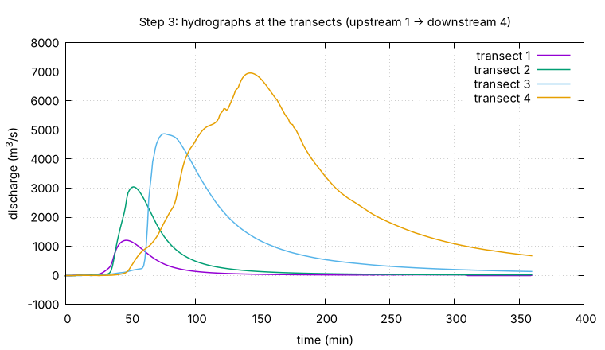

We obtained catchment-scale flood routing at 1-minute resolution, with
the flood wave growing and lagging from upstream transect 1 to
downstream transect 4. The peaks are, from transect 1 on, 1,254 m³/s
(47 min), 3,043 m³/s (55 min), 6,530 m³/s (81 min) and 8,477 m³/s (138 min).

- The shoulder of transect 4 at about 110 to 120 min on the rising limb
  appears because the peak of a tributary that joins about 2 km upstream of
  the transect (catchment area about 200 km²; 107 min, about 3,400 m³/s)
  arrives before the peak of the main stem (about 450 km²; 130 min, about
  6,500 m³/s).
- From two and a half hours on, the recession of transect 4 is affected by
  the outlet ponding. The pond grows upstream until it reaches transect 4
  (the depth at probe 4 is 10 m after 6 hours) and holds the discharge down
  (by up to about 20 %; the part up to the peak is not affected). Step 5
  opens the outlet and checks this.
- The 1-minute values of real-terrain computations can also carry fine
  fluctuations. How to read them is summarized in the supplement
  [Fine oscillations in the hydrograph](#supplement-fine-oscillations-in-the-hydrograph).

### Effect of the conditioned bed

Let us check here what conditioning the bed in Step 2 bought. Setting `fn_z`
in `en/param_step3.txt` back to `Chichibu_200m_filled.tif` (the
depression-filled elevation) and comparing at the same transects gives the
following (solid: Step 3; dashed: the run with the elevation set back; the
channel roughness is 0.04 in both).


| Transect | Depression-filled elevation | Conditioned bed |
|---|---|---|
| 1 | 1,077 m³/s (52 min) | 1,254 m³/s (47 min) |
| 2 | 2,503 m³/s (62 min) | 3,043 m³/s (55 min) |
| 3 | 3,475 m³/s (91 min) | 6,530 m³/s (81 min) |
| 4 | 4,488 m³/s (190 min) | 8,477 m³/s (138 min) |

With the depression-filled elevation, water collects on the flat reaches of
the channel, and the wave is delayed, lower and longer. For example, the
rising front takes about 20 minutes to travel from transect 2 to transect 3
(about 10 km downstream) with the conditioned bed, and about 30 minutes with
the depression-filled elevation. The difference grows downstream: with the
conditioned bed the peaks at transects 3 and 4 are 1.9 times as large, and the
peak at transect 4 arrives 52 minutes earlier.

**The way the channel heights are given alone changes the downstream peak by
almost a factor of two.** Which of the two is closer to the real river is not
established in this tutorial (there is no comparison with observed
discharge). The conditioned bed removes a shape that real rivers do not have
-- the traces of depression filling -- but the channel is still a "200 m wide
rectangle" in width and cross-section, and the roughness is a guide value. In
practical work, keep in mind that the channel height, width and roughness
strongly control the result, and compare with observations.

The distributed outputs can be surveyed with `Plot_step3.plt`, which
arranges six maps of the final-time and maximum fields on one screen:

```bash
gnuplot Plot_step3.plt
```

The top row shows the final-time depth, velocity and discharge; the
bottom row shows the maximum depth, the maximum velocity and the
final-time Courant number. `Plot_step1.plt` from Step 1 also takes
the variable as its first argument, so `gnuplot -c Plot_step1.plt V`
(or `Q`) shows the time evolution of the velocity or the discharge
with the same four-time layout.

## Step 4: Rainfall interception and subsurface infiltration

So far, all the rain that fell has run off. In a real catchment,
interception by the canopy and infiltration into the ground reduce the
runoff. `en/param_step4.txt` stacks the two simplest loss models.

```
&list_sysparam
  ...
  fn_intercept = "-"         ! rainfall interception settings file
  fn_gwflow = "-"            ! groundwater settings file
/

&list_intercept
  f_icmodel = 1              ! 1: fixed interception rate model
/
&list_intercept_fixed
  ic_alpha = 0.2             ! interception rate (effective rainfall = (1-alpha)P)
/

&list_gwflow
  f_gwvertical = 1           ! 1: bucket model
/
&list_gwflow_bucket
  gw_infil_mmh = 5.0         ! infiltration capacity (mm/h)
  gw_capacity = 0.2          ! subsurface storage capacity (water-column equivalent depth) (m)
/
```

Enabling features follows the common ENCflow convention: write `fn_*`
to enable, omit it to disable completely (zero additional memory and
computation time). When you run it, the water storage display on screen
changes from one column to **three columns**.

```
time, progress, S_surf(m), S_grnd(m), S_total(m), Runge, ex_flux, Cn_max, h_max(m), V_max(m/s)
  0:00:00.00   0.0%    0.0000     0.0000     0.0000    0.0%      0    0.0000    0.0000    0.0000
  0:30:00.00   8.3%    0.0365     0.0024     0.0389   98.4%      0    0.1977    0.7555    4.5406
  1:00:00.00  16.7%    0.0751     0.0049     0.0800    5.9%      0    0.3947    4.2828   10.1592
  1:30:00.00  25.0%    0.0728     0.0072     0.0800    3.0%      0    0.4948    6.5865   12.8773
  ...
  6:00:00.00 100.0%    0.0696     0.0104     0.0800    0.0%      0    0.5125   29.6268    3.2128
```

- `S_surf` is surface water, `S_grnd` is subsurface storage, and
  `S_total` is their sum. After the rain ends, S_total stays constant
  at **0.0800** m -- 80% of the 100 mm total rainfall, i.e. it matches
  the effective rainfall after removing the interception rate
  alpha = 0.2, confirming that the total is conserved even as water
  moves between the surface and the subsurface.
- S_surf decreases and S_grnd increases over time -- you can read the
  progress of infiltration directly.


In the hydrograph the peak discharge drops by 35 % (8,477 to 5,487 m³/s)
and the peak arrives 15 minutes later. Interception cuts the total by 20%,
and infiltration keeps sucking up the thinly spread hillslope water, so the
rising limb drops substantially (to about half until the second hour). The
volume of water passing transect 4 within the 6 hours drops by 30 %. The two
curves meet and swap places between three and a half and four and a half
hours on the recession; this is an effect of the outlet ponding (the pond is
larger in Step 3, which has no losses, and holds the discharge at transect 4
down more. Compared with the outlet open, as in Step 5, the recession of
Step 4 is the smaller one as well).

## Step 5: Boundary condition at the catchment outlet

We now resolve the outlet ponding (h_max of about 30 m) that we have
been turning a blind eye to since Step 1. The catchment outlet is not
on the outer rim (the four edges) of the computational domain but in
its interior, so instead of an edge boundary condition we use
**prescribed-stage cell groups**. `en/param_step5.txt` fixes the water
level of the outlet channel cell and the cell next to it at a low value,
turning them into a "drain".

```
&list_sysparam
  ...
  fn_boundary = "-"          ! boundary condition settings file
/

&list_bound_stage
  ! group 1: catchment outlet (level below the bed for perfect drainage)
  stage_cell(:,1,1) = 239, 19
  stage_cell(:,2,1) = 240, 19
  stage_eta(1) = 100.0
/
```

The outlet cell indices were determined by overlaying the channel mask
and the DEM in a GIS, reading off "the most downstream channel cell
inside the catchment mask", (240, 19), and adding the cell to its west,
(239, 19) (remember to convert to 1-based indices as noted above).
`stage_eta` is specified as an elevation. Cells whose prescribed level is
below the bed are always empty, acting as a "perfect drain" (here 100 m,
lower than the ground elevations of the two cells, 103.4 m and 113.1 m, so
arriving water is removed from the system immediately). Running it gives:

```
time, progress, S_surf(m), S_grnd(m), S_total(m), Runge, ex_flux, Cn_max, h_max(m), V_max(m/s)
  ...
  3:00:00.00  50.0%    0.0522     0.0092     0.0615    0.1%      0    0.4618    8.9999    6.9492
  6:00:00.00 100.0%    0.0143     0.0104     0.0247    0.0%      0    0.2439    3.1015    3.2458
```

- S_total now decreases -- that is the water that left the system
  through the outlet.
- h_max drops from 30 m to 3.1 m. The disappearance of the ponding can
  also be confirmed in the depth distribution.

| Step 4 (no outlet) | Step 5 (perfect drain) |
|---|---|
|  | 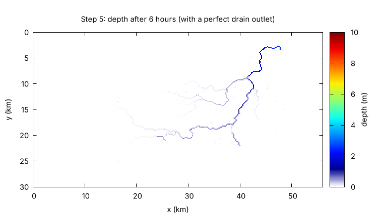 |

The hydrographs at transects 1 to 3 are the same as in Step 4. Transect 4 is
the same up to the peak (5,487 m³/s at 153 min) and changes on the recession
from 3 h 20 min on: in Step 4 the outlet pond had grown upstream and reached
transect 4. The depth at probe 4 shows this well.

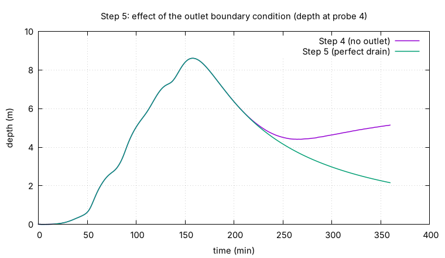

In Step 4 the depth starts to rise at about four and a half hours. The discharge coming
from upstream keeps falling, so this is the surface of the pond downstream
coming up (backwater). In Step 5 the depth keeps falling, and the discharge
is larger than in Step 4 by up to 130 m³/s (in the fifth hour; 17 % of the
Step 4 value).
**Water levels and discharges near the outlet change with the outlet
boundary condition.** The reliable way to find out whether a measurement
location is affected by a boundary condition is to change the boundary and
compare, as done here.

Note that if you prescribe the water level as a time series
(`stage_val`), this also serves as an open boundary supplying a
downstream river stage or a tide level. For the use of edge boundaries
(free outflow, long-wave radiation), inflow boundaries, and so on, see
[the boundary condition chapter of the users
guide](../../../docs/en/users_guide/boundary.md).

## Step 6: 3D visualization with ParaView

Finally, let us look at the distributed outputs as a 3D animation. We
use the free visualization software
[ParaView](https://www.paraview.org/) (Windows / macOS / Linux; see
section 2 of the [installation guide](../../../docs/en/install.md)
for installing it) and the bundled converter utility utils/out2vtk.

`en/param_step6.txt` is the Step 3 configuration adapted for
animation: the run is shortened to 4 hours (`tt_c`), distributed
output is written every 2 minutes (`dt_file_c`), and the output format
is GeoTIFF only (`f_output_mode = 4`). The smoothness of the animation
is set by the output interval, so runs made for visualization use a
finer one.

### Creating the data for the animation

First, run the computation with this parameter file to produce the
distributed output (GeoTIFF) every 2 minutes. This is the raw material
of the animation.

```bash
./encflow en/param_step6.txt
```

Once `result/` holds the depth files `H0000.tif` to `H0120.tif` (121
files: from t = 0, every 2 minutes for 4 hours) and the other GeoTIFFs,
the data are ready.

### Converting to VTK format

ParaView cannot animate a GeoTIFF time series directly, so we convert
it to VTK format with the bundled converter utility out2vtk.

```bash
make -C ../../utils/out2vtk install   # first time only: build the converter
../../bin/out2vtk en/param_step6.txt
```

out2vtk takes the parameter file used for the computation as it is
(it inherits the result directory and the grid information). The
following files appear in `result/vtk/`.

| file | contents |
|---|---|
| `flood.pvd` + `flood_0000.vts` ... | water surface time series (121 times, every 2 min); the pvd is the entry point of the animation |
| `terrain.vts` | terrain surface (3D) |
| `summary.vts` | statistics such as the maximum depth |

The outside of the catchment is hidden automatically (out2vtk reads
the domain mask `X0000` that encflow always writes, and by default
keeps the land area only).

### Start with the minimal procedure

Launch ParaView; the following four operations already give you the
animation.

1. **File → Open** `result/vtk/flood.pvd` and press **Apply**
2. Set Coloring in the toolbar to **H** (water depth)
3. In **Edit Color Map** (the rainbow icon), change the **NaN color to
   gray** (dry cells carry NaN depth and are painted yellow by default)
4. Press **▶ (play)**


This alone gives a picture of "depth colors draped on the 3D
terrain". The surface in this file is the water surface elevation
(ground elevation + depth), so dry places show the terrain relief
itself and wet places rise slightly above it. Drag to rotate, use the
wheel to zoom; the timeline shows the real time of the computation in
seconds. You can watch the rain spread over the hillslopes in the
first 30 minutes and then gather into the channel network as the flood
wave travels down.

### Making it look better

Independent refinements you can add to the minimal procedure.

- **Water that looks like water**: open `terrain.vts` too, press
  Apply, and set its Coloring to `Solid Color` (grayish). On the
  `flood.pvd` side, set the **NaN opacity to 0** in Edit Color Map so
  that dry places disappear and only the water remains on the terrain.
  A bluish colormap preset (e.g. Blues) makes it more water-like.
  (Instead of the NaN opacity you can use **Filters → Threshold**
  keeping H ≥ 0.01; when channels one cell wide disappear, uncheck
  "All Scalars" in the Threshold panel.)
- **Emphasizing the relief**: apply **Filters → Transform** to both
  objects with Scale = `(1, 1, 3)` (3x vertical exaggeration). Hide
  the original objects with the eye icons after applying the filter.
- **Showing the time**: **Filters → Annotate Time**.
- **To a movie file**: **File → Save Animation** (PNG sequence or AVI).


### Further: overlaying maps and satellite imagery

`terrain.vts` carries texture coordinates, so a map or satellite image
of the same extent exported from QGIS can be draped on the terrain.
For that procedure and for settings such as the water-film threshold
`hmin`, variable selection and the handling of sea areas, see
[utils/out2vtk/README.en.md](../../../utils/out2vtk/README.en.md).

## Closing remarks

In this tutorial we went once around the standard workflow of a
catchment computation with real terrain data: data preparation
(depression filling, conditioning the channel heights) -> minimal
configuration -> measurement -> adding
physical processes -> boundary conditions -> 3D visualization. From here:

- Refining the groundwater model (Green-Ampt, lateral flow),
  distributed roughness, subgrid channels, and more --
  [users guide](../../../docs/en/users_guide.md)
- How to write the namelists of each feature --
  [examples/List_samples/en/](../../../examples/List_samples/en/)
- To run a large computation in parallel with MPI:
  `mpirun -np 4 ./encflow_mpi en/param_step5.txt` (the results match
  the serial run bit for bit)

The figures of this document (`figs/`, i.e. `en/figs/`) can be
regenerated in one go with `./Fig_chichibu.sh` run from the case
directory (gnuplot is required; it runs the same computations as in
the text, in order, and draws both the Japanese and the English
figures). Only the 3D figures of Step 6 are outside its scope; they
are regenerated with `Fig_step6.py`, which draws with the same VTK
library that ParaView uses. The figures of the supplement are
regenerated separately with `./Fig_supp.sh`.

## Supplement: fine oscillations in the hydrograph

**Everything from here on is supplementary.** The tutorial procedure is
complete at this point; the following is for curious readers. This
supplement covers how to read and deal with fine oscillations on the
1-minute hydrographs of real-terrain computations, and the next one covers
the effect of resolution and the character of the ENC grid.

The computations and figures of the two supplements use the same
depression-filled elevation as Step 1 (`Chichibu_*_filled`) and a channel
roughness of 0.02 (not the conditioned bed and the roughness 0.04 used from
Step 2 on).

The 1-minute hydrographs of real-terrain computations can carry fine
oscillations (short ups and downs) as well as dips and steps. When
you notice them, consider them in this order.

1. **Small oscillations can often be left as they are.** If
   they do not harm the water balance of the computation and do not affect
   the time scales that matter in runoff analysis (tens of minutes and
   longer), overlaying a moving average when you plot is enough.

2. **For those caused by the terrain, the fundamental remedy is
   improving the terrain data.** Along the channels of a
   depression-filled DEM, "perfectly flat reaches" and the steps at their
   ends appear here and there (places where the original DEM recorded a
   river water surface, a gorge, or a reservoir as flat, or where a
   depression was filled in). In the computation, a "pond" several meters
   deep forms on a flat reach and the flow suddenly speeds up at a step;
   the motion of the pond surface and fluctuating overtopping can seed
   oscillations.

   Preprocessing the channels so that the longitudinal profile is
   monotone (eliminating the flat reaches and the steps; the conditioned
   bed of Step 2 is an example), or moving the
   channels to subgrid channels (`fn_channel`) with an independently
   specified bed profile, removes the ponds and steps themselves.
   Depending on how the terrain is changed, a transition to a steep reach
   can move closer to the transect and produce another oscillation. After
   changing the terrain, rerun the computation and check that the
   oscillation at the transect has decreased (for placing transects, see
   item 4).

3. **Some come from rules of the computation and from the grid.**
   They should not be read as changes of the discharge of the real river.

   At the inlets and outlets of ponds along the channel (flat reaches
   created by depression filling) and at the foot of drops, the flow
   switches between a shallow, fast state and a deep, slow state. During the
   switch, water is stored in or released from that reach, and dips and
   wobbles appear in the discharge just downstream. The figure below shows
   transects 2 and 3 on the 50 m grid computed in the next supplement
   (effect of resolution) (the lower panels are the change of the discharge
   per minute).

   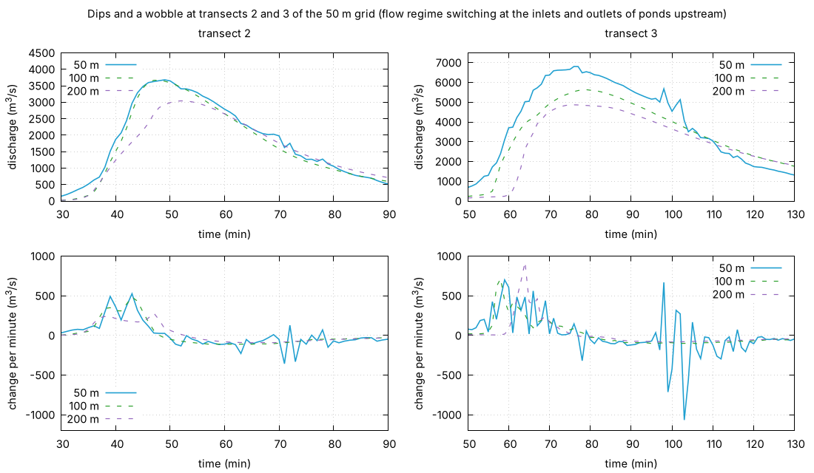

   At transect 3 there is a wobble at 97 to 106 minutes on the recession in
   which the discharge goes up and down by 300 to 1,100 m³/s per minute.
   400 m upstream of the transect, a pond formed on a flat reach (14 to 18 m
   deep around the peak) drains into a stepped gorge (the bed drops 14 m
   over 400 m). The depth of the outlet cell switches from 5.6 m to 11 m at
   63 to 65 minutes, while the discharge is growing, and from 11 m to 5.8 m
   at 99 to 103 minutes, while it is decreasing (both when the discharge at
   transect 3 is 4,100 to 5,100 m³/s). The wobble on the recession is the
   water stored in the pond and the gorge leaving in surges during the few
   minutes in which the outlet returns from the deep, slow state to the
   shallow, fast one (after that the discharge keeps falling in steps every
   one or two minutes until about 118 minutes). The growth of the discharge
   slowing every one or two minutes at 59 to 72 minutes on the rising limb,
   and the discharge falling by 320 m³/s in one minute at 78 minutes just
   after the peak, also coincide with changes of the depth in the reach
   from the pond outlet to the transect.

   At transect 2 there are dips at 71 and 73 minutes on the recession in
   which the discharge falls by 330 to 360 m³/s in one minute. About 900 m
   upstream of the transect there is a flat reach where a tributary joins
   (about 700 m long, 11 to 15 m deep around the peak). Near its upstream
   end a shallow, fast flow (3 to 6 m deep) enters the deep water at a
   hydraulic jump, and from about 51 minutes, after the peak, the jump moves
   back and forth and waves travel through the reach (the discharge inside
   the reach changes by 700 to 2,300 m³/s from one minute to the next, but
   hardly any of this shows in the discharge at its outlet). At 70 and
   72 minutes these waves lower the water level on the outlet side by 1.2 to
   1.6 m in one minute, the discharge at the outlet falls by 340 to
   430 m³/s, and this reaches transect 2 one minute later (the small kink
   at 63 minutes is the same).

   None of these appears on the 100 m and 200 m grids (dashed).

   The dips and wobbles only release stored water later, so they do not
   change the total runoff. Overlay a moving average when you read the
   hydrograph. A switch between shallow, fast flow and deep flow, and a
   moving hydraulic jump, also happen in real rivers, but the discharge and
   the speed of the switch and the size of the wobble are set by the storage
   of a reach of a few cells (grid spacing 50 m) and by how the advection
   term takes its values at the cell edges. The wobble of the discharge when
   a pond outlet switches is described as a limit of the default rule in the
   `f_advection_lateral` item in §4.4 of
   [Advection schemes](../../../docs/en/users_guide/advection.md) in the
   users guide. Changing the options of that chapter (`f_advection_lateral`,
   `f_advection_bend`) or the cap on the edge depth (`f_dry_head_cap`;
   [explanation](../../../docs/en/users_guide/dry_head_cap.md)) changes when
   the wobbles appear and how large they are.

4. The choice of measurement locations also mitigates it. A transect
   placed on a flat reach (pond) several meters deep picks up the
   motion of the pond surface directly, so **place transects on ordinary
   channel reaches with a longitudinal slope**.

## Supplement: effect of resolution and the character of the ENC grid

This supplement is for readers who are curious about how the results change
with a finer grid, what the 8-direction exchange of the ENC grid buys, and
what the advection term does. Reproducing the computations takes a few hours
because they include 50 m grid cases (see below).
If you only want the conclusions, read the bold sentences at the end of each
subsection and "What to take away about the ENC grid".

This tutorial has used a 200 m grid throughout. To see how the results
change with a finer grid, we take the Step 3 configuration (no losses,
no outlet) with the depression-filled elevation and a channel roughness of
0.02, and move it to 100 m and 50 m grids. The terrain
data are the 100 m and
50 m versions of the same area kept in `test/chichibu/` (text format),
and the parameter files are `en/param_supp_200m.txt` /
`en/param_supp_100m.txt` / `en/param_supp_50m.txt` (the 200 m one is
that configuration with text input only). We also run the
**4-neighbor** computation mentioned at the end of Step 1
(`p_diagratio = 0.0`, diagonal exchange closed) at the same three
resolutions, to see what the 8-direction exchange of the ENC grid
brings. These six runs (plus the three width-equalized runs and the twelve
runs with a different treatment of advection described below) and the
figures are reproduced in one go with `./Fig_supp.sh` from the case
directory (it includes seven 50 m grid runs, so it takes 4 to 5 hours
on a 4-core laptop).

### Mapping the transects

The four transects and probes are placed at the **same places** as in
Step 3, re-specified as cell numbers of each grid (transect 1 at
ix 82 on the 200 m grid becomes ix 164 on the 100 m grid and ix 327 on
the 50 m grid; the lengths are kept at 1.0 to 1.4 km too). Since the
channel mask is redrawn when the resolution changes, we always check
that the transects straddle the channel. The figure below is that
check: at every resolution each transect (red) crosses the channel
(blue) exactly once and the probe (circle) sits on a channel cell.

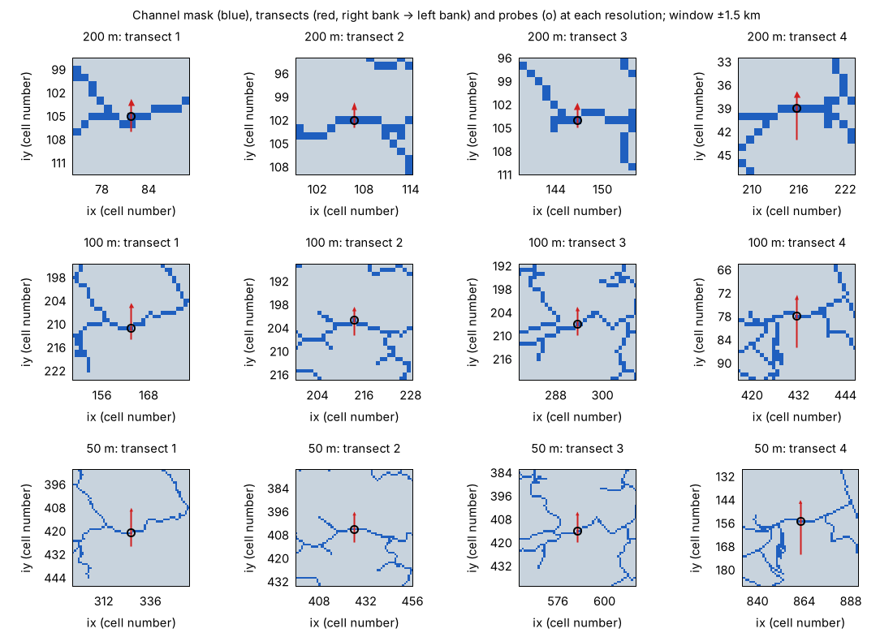

### Time step and computational cost

The time step is 6 s at 200 m, 1.5 s at 100 m and 0.75 s at 50 m.
Shrinking it only in proportion to the grid (3 s and 1.5 s) leaves no
margin at 100 m, where the Courant number (Cn_max on the screen) rises to
0.97, and at 50 m it would exceed 1 and stop the run (it is 0.69 with
0.75 s). A
finer grid resolves the valleys of steep tributaries and the maximum
velocity grows (18 m/s at 200 m, 27 m/s at 100 m, 37 m/s at 50 m), so
**the cost of a finer grid grows faster than "cells x steps"**, which
is worth remembering when choosing a resolution. The procedure for choosing
`dt` from the cell width and the estimated maximum velocity and depth is in
[Courant number and how to choose the time step](../../../docs/en/users_guide/courant.md#choose-dt);
the design reasons for ENCflow's fixed step are in the
[time-step design policy](../../../docs/en/users_guide/timestep_policy.md#fixed-time-step).

| grid | computed cells | dt | steps | approximate run time (ENC, 4 threads) |
|---|---|---|---|---|
| 200 m | 17,885 | 6 s | 3,600 | about 27 s |
| 100 m | 71,486 | 1.5 s | 14,400 | about 300 s |
| 50 m | 285,843 | 0.75 s | 28,800 | about 2,100 s |

### Result 1: changing the resolution (ENC)

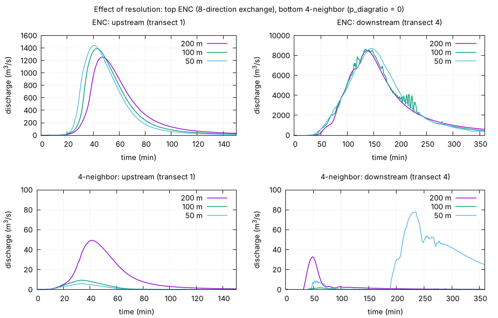

The top row is ENC. The peak discharges (m³/s) at transects 1 to 4 are
tabulated below (in parentheses: change from the next coarser grid).

| transect (upstream to downstream) | 200 m | 100 m | 50 m |
|---|---|---|---|
| 1 (small catchment area) | 1,205 | 1,405 (+17%) | 1,438 (+2%) |
| 2 | 3,042 | 3,670 (+21%) | 3,682 (+0%) |
| 3 | 4,869 | 5,635 (+16%) | 6,812 (+21%) |
| 4 (near the catchment outlet) | 6,960 | 7,427 (+7%) | 8,528 (+15%) |

- **Upstream (transects 1 and 2)**: the coarser the grid, the smaller
  the peak. It changes by 17 to 21% from 200 to 100 m but only by
  0 to 2% from 100 to 50 m, i.e. it has almost converged at 100 m and below. We
  attribute the smaller runoff on the coarse grid to two things: in a
  200 m cell the valley floor and the hillslopes are mixed in one cell,
  which blunts the concentration of water from the slopes into the
  channel (the steps become larger and short tributaries collapse into
  one or two cells); and the channel width becomes the cell width,
  which increases channel storage and damps the short hydrographs of
  small catchments the most.
- **Downstream (transects 3 and 4)**: the peaks grow by 7 to 16% from
  200 to 100 m and by another 15 to 21% from 100 to 50 m, so they have not
  converged the way the upstream ones have. The peak times hardly change
  across the three resolutions (142 to 145 min at transect 4). On a raster
  the channel width equals the cell width, so a finer grid makes the
  channel narrower and deeper (the maximum depth at probe 4 is 7.3,
  11.7 and 17.6 m). To check whether narrowing the channel on the coarse
  grids brings them closer to the 50 m grid, we used subgrid channels
  (`fn_channel`,
  [the channel chapter of the users guide](../../../docs/en/users_guide/channel.md))
  to give the 200 m and 100 m grids the same 50 m channel width as the
  50 m grid (`./Fig_supp.sh` runs these as `result_supp_*_w50`. At 200 m the flow gathers in the 50 m wide
  channel and becomes faster, so the Courant number exceeds 1 with dt = 6 s
  and dt = 4 s is used; running the 200 m grid without the width at dt = 4 s changes the
  peak at transect 4 by less than 0.1%).
  The peaks at transects 3 and 4 become 5,845 / 6,749 at 200 m and
  5,727 / 6,936 at 100 m: **with the channel width equalized, the 200 m and
  100 m results agree within 3%, but they do not reach the 50 m grid
  (6,812 / 8,528)** (14 to 16% smaller at transect 3 and 19 to 21% smaller
  at transect 4, where the peak is 8 to 10 minutes later). Relative to the
  runs without the width, the peak at transect 3 rises by 20% at 200 m and
  by 2% at 100 m, and the peak at transect 4 near the catchment outlet
  falls by 3 to 7% and arrives 11 to 12 minutes later.

  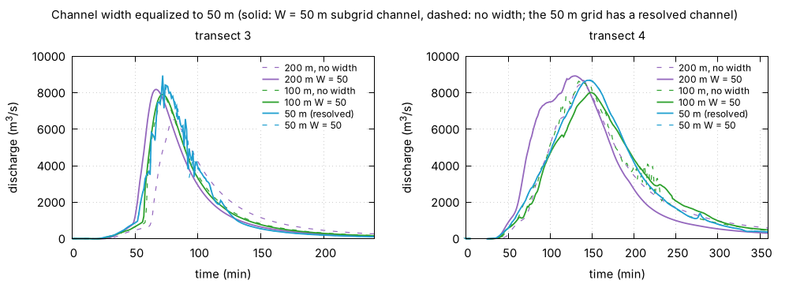

  In the figure, the 200 m and 100 m runs with W = 50 (solid) take
  similar shapes at the downstream transect 4, yet are lower and later than the 50 m
  grid (light blue) and also later than the runs without the width
  (dashed) (at the upstream transect 1 the effect of the width is within
  8%). Incidentally, the run that gives the 50 m grid W = 50 m (= the cell
  width; the light blue dashed line in the figure) overlaps the 50 m grid
  with a resolved channel almost everywhere. The peaks agree within 0.2% at
  transects 1 to 3 and within 0.9% at transect 4 (where the peak is 3 minutes
  later). The discharge differs by at most 10 m³/s at transects 1 and 2, by
  up to 290 m³/s in the 1-minute values during the wobble on the recession
  at transect 3 (97 to 106 minutes), and by up to 120 m³/s at transect 4
  after 120 minutes. When the width
  equals the cell width, the subgrid channel degenerates into the
  resolved representation as designed (not to the last digit; small
  differences such as the treatment of diagonal edges remain). Where the
  flow state switches (item 3 of the previous supplement), these small
  differences change the time of the switch and the way the discharge
  wavers. The difference at transect 4 comes from a flat reach 2 to 4 km
  downstream of transect 3, where the depths of the two runs differ by 0.5
  to 1.8 m in hours 2 to 4 (the flow settles into different states).
  A 50 m wide subgrid channel squeezes the flow into 1/4 to 1/2 of the
  cell width. Downstream, where the discharge is large, the channel
  becomes deep (up to 13.9 m at the probe of transect 4 in the 200 m
  run) and spills onto the bank cells, and the spilled water moves slowly
  over the valley floor; we think this is why the wave becomes lower and
  later even though the channel storage is smaller. On the 50 m grid the
  valley-floor cells on both sides of the channel cells take part in the
  flow from the start. Even with the same channel representation, **the
  difference in how the valley floor and the hillslopes are resolved**
  remains.
- The 1-minute values on the 50 m grid show a wobble at 97 to 106 minutes
  on the recession at transect 3 (300 to 1,100 m³/s per minute) and dips
  at 71 and 73 minutes on the recession at transect 2 (330 to 360 m³/s
  per minute). They come from the flow state switching or wavering at the
  inlets and outlets of ponds upstream of the transects; these are the
  examples of item 3 of the previous supplement (not to be read as changes
  of the discharge of the real river). They do not appear in the 1-minute
  values at transects 2 and 3 on the 100 m and 200 m grids. Transect 3 of
  the 100 m run with W = 50 also falls in steps every few minutes at 88 to
  99 minutes on the recession (for example by 540 m³/s in one minute at
  99 minutes; probably a switch of the same kind, but we have not checked
  it).
- At every resolution the S column stays at 0.1000 m after the rain.
  The total volume is the same; only **the distribution and the speed
  of the water** differ. Check this yourself.

### Result 2: the same computation with 4 neighbors

The bottom row is the 4-neighbor case (its vertical axes are 1/8 of those
of the ENC panels above for the upstream transect and 1/9 for the
downstream one), with the following peaks.

| transect | 200 m | 100 m | 50 m |
|---|---|---|---|
| 1 | 52 | 52 | 46 |
| 2 | 40 | 46 | 58 |
| 3 | 0 | 663 | 196 |
| 4 | 4 | 23 | 473 |

At 200 m only 4 m³/s (0.1% of ENC) reaches transect 4 near the
catchment outlet; at 100 m it is 23 m³/s, and on the 50 m grid, where
the channel cells are 50 m wide, it finally reaches 473 m³/s (6% of
ENC). **Even with a grid four times finer, the channel network stays
essentially cut into pieces with 4 neighbors.** The 663 m³/s at
transect 3 on the 100 m grid seems to appear because, over about 1 km
upstream of this transect, the channel follows grid rows in runs of 3
to 5 cells: reaches aligned with the axes pass water, diagonal reaches
stop it. Whether discharge appears is decided **by the orientation of
the channel, not by the resolution**, which is the anisotropy of the
4-neighbor scheme.

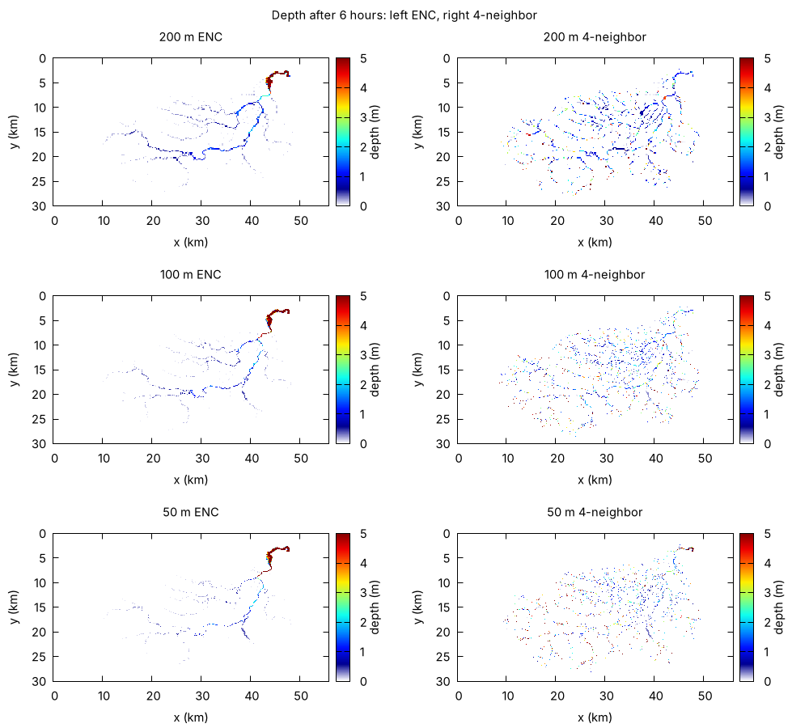

In the depth distributions after 6 hours, ENC (left) has gathered the
channel water at the outlet at every resolution and the catchment is
blank, whereas with 4 neighbors (right) spots of ponded water remain
all over the channel network, stopped at every diagonal reach. These
fragmented "ponds" can also seed the motion of the water surface noted in
item 4 of the previous supplement, and the 4-neighbor hydrograph on the
50 m grid (transect 4) shows an oscillation that goes up and down every
one or two minutes (about ±20 m³/s) from about 300 minutes.

### Result 3: the advection term and resolution dependence

The computations so far used the default momentum-conserving advection
scheme (`f_advection_scheme = 3`). We now run the same three resolutions
with **the advection term dropped (diffusion wave, i.e. the local inertia
equation, `f_govequation = 1`)** and with **the old advection scheme
(`f_advection_scheme = 1`, non-conservative with upwind weighting; the upwind
index `p_adv_upwind_index` is tried at 0.1, the value used in test/chichibu,
at the default 0.5, and at the upper limit 1.0 = full upwind)** to see how
the treatment of advection changes the resolution dependence (`./Fig_supp.sh`
runs them as `result_supp_*_noadv` / `result_supp_*_s1` / `result_supp_*_s1u` /
`result_supp_*_s1f`).

> **A note on terms.** This setting drops only the advection term and keeps
> the term for the time change of the velocity (the local term), so strictly
> it is not the diffusion wave but the local inertia equation. Below it is
> still written "diffusion wave", following the earlier usage. The meaning
> of each term of the momentum equation and the differences between the
> dynamic wave, local inertia, the diffusion wave and the kinematic wave are
> in the primer of the user's guide,
> [The shallow water equations and the dynamic, diffusion and kinematic waves](../../../docs/en/users_guide/shallow_water.md).

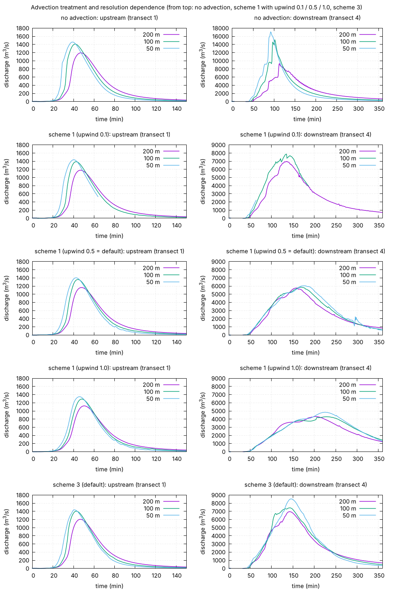

From top: no advection; scheme 1 (upwind index 0.1); scheme 1
(upwind index 0.5 = default); scheme 1 (upwind index 1.0); scheme 3 (default). Left: upstream transect 1; right:
downstream transect 4. **Note that the vertical axis of the top-right panel
spans twice the others.** Peak discharge
(m³/s) and its time (min) at transect 4 (near the basin outlet):

| advection | 200 m | 100 m | 50 m |
|---|---|---|---|
| none (diffusion wave) | 9,307 @113 | 15,104 @102 | 17,079 @92 |
| scheme 1 (old, upwind 0.1) | 6,969 @135 | 7,868 @135 | diverged (64 min, before the peak) |
| scheme 1 (upwind 0.5 = default) | 5,764 @159 | 5,855 @167 | 6,033 @178 |
| scheme 1 (upwind 1.0) | 4,316 @201 | 4,294 @228 | 4,835 @225 |
| scheme 3 (default) | 6,960 @142 | 7,427 @143 | 8,528 @145 |

For reference, the maximum velocity of each computation (V_max in the Log)
on the 100 m grid was 42 m/s without advection, 26 m/s with scheme 1
(upwind 0.5), 18 m/s with scheme 1 (upwind 1.0) and 27 m/s with scheme 3. In the 50 m run without
advection, the velocity reaches 59 m/s at bed steps at the end of the
rainfall (first hour). With dt = 0.75 s the Courant number would come close
to 1 and leave no margin (it is 0.52 with dt = 0.4 s, i.e. 0.97 in
proportion), so that one run uses dt = 0.4 s. In the 50 m run with scheme 1
(upwind 0.5), the maximum velocity in the 30-minute screen output is 45 to
49 m/s in hours 2 to 3.5 (Courant number 0.73 to 0.79; the maximum with
scheme 3 is 37 m/s). Scheme 1
with upwind 0.1 stops on the 100 m grid during the recession (3.1 hours, when the ponded
water at the outlet is 31 m deep) and on the 50 m grid during the rising limb
(64 minutes), with the velocity diverging (it completes on the 200 m grid). On
the 100 m grid, reducing dt from 1.5 to 1.0 s hardly changes the time it stops
(3.3 → 3.1 h), so this is not a time-step issue; we take it as an instability
of the non-conservative, weakly upwinded scheme in deep still water and at
steep steps. `Fig_supp.sh` continues even if a run with scheme 1 stops on
the way. The 100 m peak (135 minutes) comes before the stop, so it is
listed in the table, and the curve ends early in the figure.

#### Dropping the advection term makes the peak larger and earlier on finer grids

Without the advection term (diffusion wave, local inertia equation), the peak
at transect 4 goes 9,307 → 15,104 → 17,079 m³/s and 113 → 102 → 92 min from 200 m to 100 m to 50 m: **the finer the grid,
the larger and earlier the peak**. The resolution dependence is
stronger than with the default scheme 3 (6,960 → 7,427 → 8,528 at
142 → 143 → 145 min; a factor of 1.8 from 200 to 50 m against 1.2), and the
values themselves are 1.3 to 2.0 times larger. Let us follow the reasons step by step.

1. **The velocity of a diffusion wave is set by the local slope alone.** In
   the diffusion wave (local inertia equation) the velocity follows from
   the local balance of water-surface slope and friction (Manning), with no
   inertia (no time needed to accelerate, no deceleration when fast water
   mixes with slow water). On a uniform slope, therefore, refining the grid
   changes neither the slope of any cell nor the velocity or the speed of
   the wave (a straight channel shows no resolution dependence).
2. **Resolving real terrain more finely widens the distribution of slopes
   into "steep steps" and "gentle treads".** The bed of a real DEM is a
   succession of grid-scale steps (on the 100 m grid the median drop
   between adjacent channel cells is a slope of 0.12; developer.md §68.20).
   A coarse grid averages the steps into a gentle slope close to the mean;
   a finer grid resolves the large real steps. The mean slope is the same,
   but the local slopes spread out.
3. **"More steps, hence faster" is not an explanation by itself, however.**
   The Manning velocity scales with the square root of the slope, so what is
   gained at the steps is lost on the treads, and for the same mean slope a
   wider distribution lowers the mean velocity if anything (the travel time
   over the treads grows). Indeed, in a one-cell channel with a stepped bed
   (stair3 in test/bendloss: 100 m treads with 3 m drops) the travel time
   without advection was only 14% shorter than with scheme 3.
4. **The main reason the wave becomes faster and larger is that the
   acceleration at the steps, unrestrained by inertia, grows into a bore.**
   In the same stair3 case the peak without advection was 2.3 times that
   of scheme 3. The difference in peak (130%) is far larger than the
   difference in travel time (14%): the main effect is the **sharpening of
   the wave form**, not the mean speed. Without the advection term
   (inertia) the velocity follows changes of the water-surface slope
   instantly, and at a step, where the surface slope is large, the velocity
   shoots up (V_max 42 m/s on the 100 m grid against 27 m/s with scheme 3).
   In reality hydraulic jumps and turbulence dissipate this acceleration;
   the equations have no term for it. Deeper water travels faster (wave
   speed ≈ 5/3 u), so the front steepens into a bore, and a steeper front
   means a larger surface slope and a still larger velocity, a
   self-reinforcing loop.
5. **Refining the grid adds three changes that feed this growth.** (a) The
   large real steps are resolved, seeding more acceleration. (b) The
   channel cells become narrower and deeper, raising the velocity for the
   same discharge (Manning for a rectangular section gives u ∝ (Q/W)^0.4;
   halving the width raises the velocity by 1.3). (c) The numerical
   diffusion of the discretization (proportional to Δx) decreases, so the
   bore stands sharper. On a coarse grid the steps are averaged and the
   numerical diffusion is large, so the bore is blunted and the wave comes
   out slower and smaller.

In other words, the resolution dependence of the diffusion wave comes from
how much of the bed steps is resolved and how sharply the bore can be
represented being passed straight into the result, and it does not converge
with refinement. Existing diffusion-wave and kinematic-wave catchment models
normally absorb this into a **roughness coefficient calibrated for each
resolution**. With the advection term, the acceleration at the steps is
held down by a hydraulic-jump-like dissipation and by the momentum exchange
with lateral inflow and the valley floor (next subsection), so resolving the
steps more finely changes the result less (from 200 to 50 m the transect 4
peak grows 1.8 times and arrives 21 minutes earlier without the advection
term, against 1.2 times and a 3-minute difference with scheme 3). That is
why the resolution dependence of scheme 3 is weaker than without the
advection term.

#### What is the advection term decelerating?

What the advection term does to slow and flatten the wave in this case
splits into three parts.

1. **Dissipation at bed steps**: in a one-cell channel with a stepped bed
   (stair3 in test/bendloss), the run without advection produces excessive
   velocities at every step and the flood wave grows into a bore, whereas
   the momentum-conserving advection term supplies a hydraulic-jump-like
   dissipation that holds the wave down (a factor 2.3 in peak). Since
   the bed of a real DEM is such a succession of steps, we believe this
   accounts for most of the difference from the run without advection.
2. **Deceleration by lateral inflow**: in rainfall runoff most of the channel
   discharge enters from the side, from hillslopes and tributaries, carrying
   no streamwise momentum. The conservative form naturally contains the term
   that mixes this water in and slows the channel flow (−u·q_L/h; it matches
   the analytic solution of spatially varied flow within 1 to 2%).
3. **Momentum exchange with the inundated valley floor**: on the 100 m grid
   the flood cross-section of the main river spreads beyond the single
   channel-mask cell onto valley-floor cells, and at bends and confluences
   that slow water becomes the upwind donor and drains momentum. The
   artificial part, in which a thin film on a bank that carries almost no
   water becomes the donor and slows the main flow, is removed by the default
   treatment (for how it works, and for the fact that this treatment alone
   moves the transect 4 peak by nearly three tenths, see
   [one-cell-wide channels and the upwind donors of the advection term](../../../docs/en/users_guide/advection_donor.md)
   in the users guide). On a finer grid the
   main river fits within the channel cells and this exchange shrinks, consistent with
   the increase of the scheme 3 peak with resolution.

#### Why it is said that advection matters little in mountain runoff

In steep channels the bed slope S₀ dominates the momentum equation over the
changes of water-surface slope and velocity head, so the balance of bed slope
and friction (kinematic wave), or the diffusion wave that adds the surface
slope, reproduces **the propagation of the wave at the reach scale** well.
Known quantitative criteria are the kinematic flow number of Woolhiser &
Liggett (1967), k = S₀L/(h Fr²) > 20 for the kinematic approximation, and the
condition of Ponce et al. (1978), T·S₀·√(g/h) ≥ 30 for the diffusion wave
(how to read the criteria:
[Rules of thumb for choosing](../../../docs/en/users_guide/shallow_water.md#phenomena)
in the primer);
mountain runoff, with steep slopes and a wave time scale T of hours much
longer than the time scale of the flow depth, satisfies them.
These statements, however, treat the bed and the flow as **smooth at the
reach scale**. At the grid scale of a raster DEM the bed is a succession of
steps, the flow is locally rapidly varied, and the inertia terms are not
negligible. It helps to keep apart "advection matters little" as a statement
about wave kinematics from the local energy balance at each step. Existing
models fold this local dissipation into the roughness coefficient, which is a
sound engineering practice (nothing here is meant to disparage them).

#### Relation to one-dimensional channel models

One-dimensional channel models are also often run without the advection
term. Adding the lateral-inflow momentum term (−u·q_L/h) captures part 2
above, but the step dissipation of part 1
and the valley-floor exchange of part 3 would have to enter a 1-D model with
prescribed cross-sections in other forms (roughness, local loss
coefficients, compound-channel momentum exchange). We therefore expect a 1-D
model with lateral-inflow momentum to **move toward, but not coincide with**,
the ENCflow result with advection (untested).

#### Does weak resolution dependence mean closeness to reality?

No. A result that moves little under grid refinement is a property one
wants from a model that claims to be physically based (convergence), but
there is no guarantee that the converged value matches observations (a
detail of the advection discretization alone
([the treatment of the upwind donors](../../../docs/en/users_guide/advection_donor.md))
moves the 200 m peak by nearly three tenths, for instance). Scheme 3 in
this case has not converged either: the peak times agree across the three
resolutions, but the downstream peak discharge is still growing on the
50 m grid (result 1). This
tutorial catchment has no comparison with observations, and **closeness to
reality is unverified**. Conversely, a diffusion wave calibrated with a
roughness coefficient per resolution can surely be made to match
observations. Still, a model that need not be recalibrated each time the
resolution changes is **"convenient"**, because one can grasp the whole on a
coarse grid and refine only where needed. Keep the distinction between
"convenient" and "correct".

#### Resolution dependence of scheme 1 and the upwind index

The old scheme 1 is non-conservative; it cannot represent the momentum
exchange with lateral inflow and the valley floor consistently (§68.17), and
the numerical viscosity of its upwind weighting (`p_adv_upwind_index`) scales
with Δx and therefore with resolution. The upwind index changed the result a
great deal.

- **Upwind 0.1**: 6,969 → 7,868 m³/s (200 m → 100 m), close to scheme 3
  (+0.1% and +6%) and 7 and 8 minutes earlier. The 50 m grid diverged during
  the rising limb at 64 minutes, with the velocity reaching 89 m/s, before
  reaching the peak (the transect 1 peak of 1,437 m³/s comes before that and
  is almost the same as the 1,438 of scheme 3). **The finer the grid, the
  larger the result relative to scheme 3, moving toward the run without
  advection.**
- **Upwind 0.5 (default)**: the transect 4 peak goes 5,764 → 5,855 → 6,033
  m³/s, within 5% across the three resolutions, but 17%, 21% and 29%
  smaller than scheme 3 and 17, 24 and 33 minutes later. On the 50 m grid the
  maximum velocity reaches 49 m/s (37 m/s with scheme 3) and an oscillation
  appears on the recession at transect 4 (292 to 302 min), visible in the
  figure.
- **Upwind 1.0 (full upwind)**: 4,316 → 4,294 → 4,835 m³/s, 38%, 42% and 43%
  smaller than scheme 3 and 59, 85 and 80 minutes later; even the upstream
  transect 1 is 6 to 8% smaller. On the same grid the two ends of the upwind
  weight (0.1 and 1.0) give peaks of 6,969 vs 4,316 at 200 m and 7,868 vs
  4,294 at 100 m, a factor of 1.6 to 1.8. The gap does not close with
  refinement (100 m is the lowest), presumably because the velocity resolved
  on the finer grid offsets part of the smaller Δx, so the numerical
  viscosity Δx·u decreases less than the grid spacing.

The difference is explained by the amount of numerical viscosity. A larger
upwind weight means a numerical viscosity proportional to Δx·u that smooths
velocity extremes and the accelerations at steps, which incidentally acts
like the step dissipation (item 1 above). A smaller weight removes this
"accidental dissipation", leaving the momentum losses that the
non-conservative form cannot represent (items 2 and 3) missing, so the wave
becomes faster and larger. Since the numerical viscosity itself shrinks with
Δx, with upwind 0.1 the wave comes out larger as the grid is refined (+0.1%
relative to scheme 3 at 200 m, +6% at 100 m) and the run diverges at 50 m.
The resolution dependence of scheme 1 thus comes both from the
physical approximation (non-conservative form) and from the numerical
viscosity (upwind weight × Δx), and the result moves with the choice of the
upwind weight: a scheme that carries one extra calibration parameter.
Whether scheme 1 can be said to have weak resolution dependence therefore
hinges on the choice of the upwind weight. What ENCflow makes the default is
the momentum-conserving scheme (with the dynamic opening correction), which
adds no calibration parameter.

#### What is special about this case

This case routes 100 mm of rain in one hour with no losses and produces
7,000 to 8,500 m³/s near the basin outlet (a specific discharge of 10 to 12
m³/s/km²), an extreme flow. Both the step dissipation and the lateral
inflow scale with discharge, so the influence of the advection term is
probably larger here than in an ordinary flood. For a milder event the three
computations should differ much less; checking this is left to the reader
(change the rainfall in `param_supp_*.txt` and rerun `./Fig_supp.sh`).

### What to take away about the ENC grid

- **The timing of the flood wave holds across grids, but the peak discharge
  changes**: from 200 to 50 m (16 times the cells, about 80 times the run
  time) the peak times stayed within 6 minutes. The peak discharge changed
  by +19 to 21% upstream (almost converged at 100 m and below) and by +23
  to 40% downstream (still growing on the 50 m grid). This is far less than
  without the advection term (over the same 200 to 50 m the transect 4 peak
  grows 1.8 times and arrives 21 minutes earlier), but allow for the
  difference between resolutions when you use the peak discharge itself. A
  200 m grid is enough to grasp the arrival time of the flood wave and how
  the flow connects over the whole catchment; when the value of the peak
  discharge matters, check it against a finer grid.
  For an example with another phenomenon,
  [examples/debris_fan](../../../examples/debris_fan/en/README.md) computes a
  debris flow that runs from a slope failure down a valley and spreads on
  an alluvial fan: the sediment reaching the fan, the extent and runout of
  the deposit, the arrival time and the lateral spreading agree within
  ±10% of the reference over grid spacings of 20 to 2.5 m and three valley
  orientations relative to the grid (even on a 40 m grid, coarser than the
  30 m wide valley floor, 0.92 to 1.10 times the reference sediment reaches
  the fan). It also compares four neighbors, which shows what the
  8-direction exchange of the ENC grid brings.
- **Flow is not obstructed even at coarse resolution**: most
  structured-grid models exchange water along the axes only (4
  neighbors) and cannot carry a one-cell-wide channel diagonally, so
  the channel network has to be **coupled separately as a 1D channel
  model**. The ENC grid carries the channel network as a raster through
  its 8-direction exchange, so **no 1D channel model or flow-direction
  (D8) data are needed** even on a 200 m grid. That a catchment
  computation works with nothing but a D8-filled DEM and a channel
  mask rests on this property. How the eight-direction passage widths
  are adjusted so that one-cell-wide channels carry the correct
  conveyance is summarized in
  [Passage-width adjustment](../../../docs/en/users_guide/passage_width.md)
  in the user's guide.
- **The price of resolution is computation**: halving the grid
  multiplies the cells by 4 and, because dt must shrink with the
  growing velocities, the steps by 2 to 4, so the run time grows 7 to 11
  times. In
  practice, first grasp the overall behavior at about 200 m, then
  refine where the location and purpose require it.
