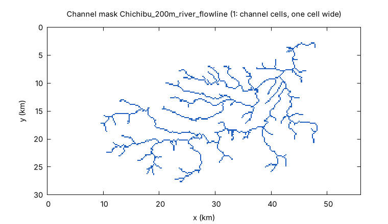
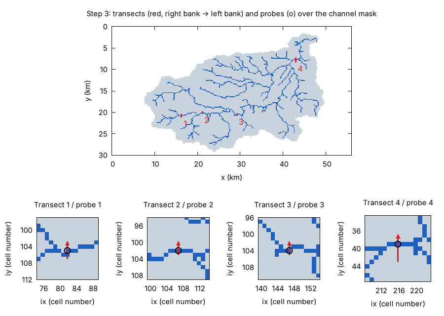
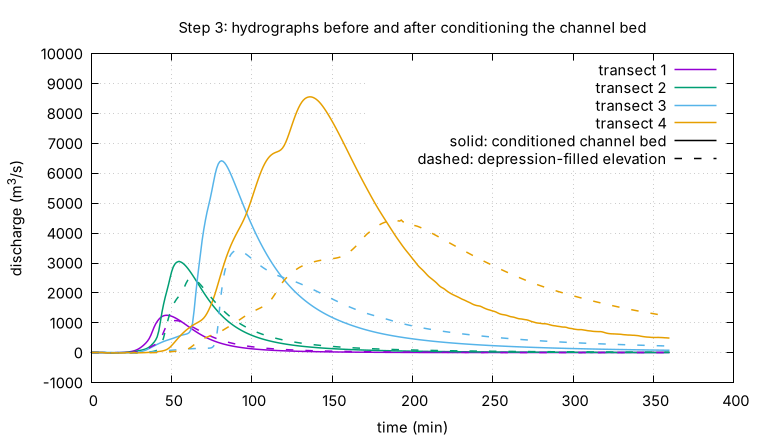
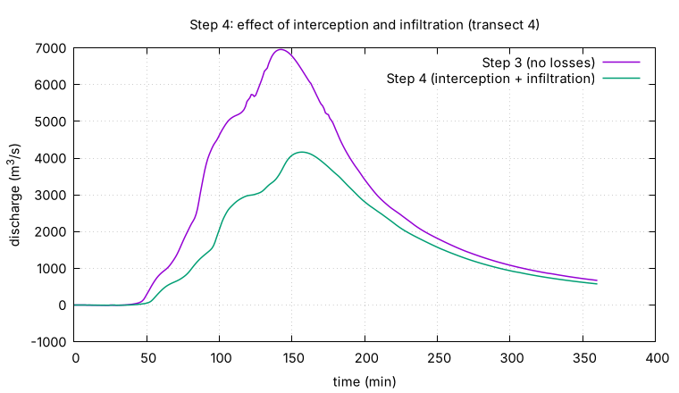
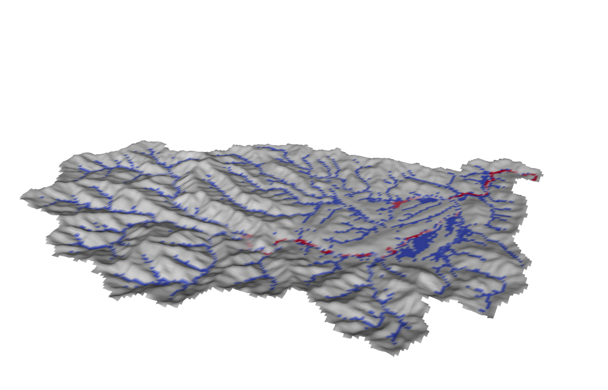
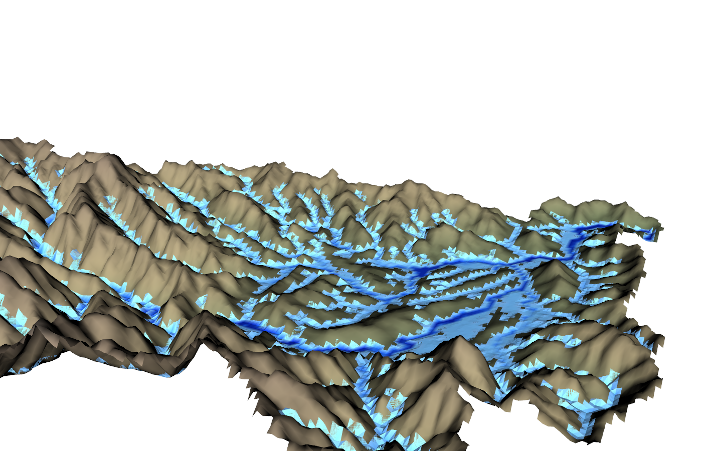

> English mirror of tutorials/chichibu/README.md. The Japanese file is the master copy.

[日本語](../README.md)

# Tutorial 2: chichibu -- rain on a real-terrain catchment

A one-hour heavy rainstorm falls on the Chichibu mountains in the upper Arakawa River basin. While computing how
the rain gathers from the slopes into the rivers and runs down as a flood, you learn the basic workflow of a
computation with real terrain data, in the following order.

- **Step 1**: run the simplest computation with real terrain data, and see why depression filling is necessary
- **Step 2**: switch the input and output to GeoTIFF, and add the rivers to the computation
- **Step 3**: record the discharge and depth of the river, and look at the results
- **Step 4**: think about the rain held by leaves and the rain soaking into the ground
- **Step 5**: let the water flow out of the catchment outlet
- **Step 6**: turn the results into a 3D animation with ParaView

We assume you have completed the [wave tutorial](../../wave/en/README.md) first; it explains how to run the
model, the meaning of each column on the screen, and how parameter files are written. All work below is done in
the case directory `tutorials/chichibu`; run the English parameter files from there as
`./encflow en/param_step1.txt` and so on.

## A look at the data

`data_chichibu/` (relative to the case directory) contains the following data. Each divides the map into small
square cells and gives every cell a value.

| Data | Contents |
|---|---|
| `Chichibu_200m_filled.*` | Ground elevation (m), processed to remove depressions (depression filling) |
| `Chichibu_200m_cond.*` | Ground elevation (m), depression-filled and with the height of the river cells conditioned. Used from Step 2 on |
| `Chichibu_200m_raw.tif` | Ground elevation (m), the original data without depression filling. Used for comparison |
| `Chichibu_200m_basin.*` | Catchment mask: 1 for cells inside the catchment, 0 outside |
| `Chichibu_200m_river_flowline.*` | Channel mask: 1 for river cells |

The catchment mask and the channel mask show the area to compute and the position of the rivers with 1 and 0.
All the data sit on the same grid of 280 cells from west to east and 150 cells from south to north, and each cell
is 200 m square. The same contents are provided in three formats, text (`.txt`), bil (`.bil` and `.hdr`) and
GeoTIFF (`.tif`), for practicing the input and output formats. The elevation is based on the Digital Elevation
Model of the Geospatial Information Authority of Japan (GSI), and the river positions on stream-order data
([DOI:10.3178/jjshwr.36.1812](https://doi.org/10.3178/jjshwr.36.1812)) built from the river data of National Land
Numerical Information.


The north-east corner is the catchment outlet, and peaks of the 2,500 m class line the south-west. Most of the
catchment is steep mountains.

## Step 1: Minimal configuration with real terrain data

### Running

As with wave, create the links to the executables with `make` and run `en/param_step1.txt`.

```bash
make
./encflow en/param_step1.txt
```

```
reading list_sysparam in en/param_step1.txt
reading list_geoinfo in en/param_step1.txt
 reading data_chichibu/Chichibu_200m_basin.txt
 reading data_chichibu/Chichibu_200m_filled.txt
reading list_precip in en/param_step1.txt
main: number of processes: 1
main: number of threads: 4
main: real precision: 64 bit
main: number of valid cells: 17885
time, progress, S(m), Runge, ex_flux, Cn_max, h_max(m), V_max(m/s)
  0:00:00.00   0.0%    0.0000   0.0%      0    0.0000    0.0000    0.0000
  0:30:00.00   8.3%    0.0487  97.7%      0    0.1910    1.2871    4.0483
  1:00:00.00  16.7%    0.1000   6.2%      0    0.3464    4.7535    8.4467
  1:30:00.00  25.0%    0.1000   3.4%      0    0.4357    6.9561    9.5765
  2:00:00.00  33.3%    0.1000   0.9%      0    0.4130    6.9710    9.4047
  ...
  6:00:00.00 100.0%    0.1000   0.6%      0    0.5155   29.9470    4.1028
main: program terminated normally
```

The contents of `en/param_step1.txt` are as follows; the title comment at the top is omitted. The structure is
almost the same as Step 1 of wave. The only differences are that `&list_geoinfo` reads the terrain and the
catchment mask from files and gives the roughness coefficient `rn0`, and that `&list_precip` makes it rain.
`dir_data` in `&list_sysparam` is the directory holding the input data, and the file names are written as seen
from this directory.

```
!======================================================================
! System parameter settings
!======================================================================
&list_sysparam
  dt = 6.0                       ! time step (s)
  tt_c = "6 hour"                ! end time of the computation
  dt_disp_c = "30 min"           ! screen display interval
  dt_file_c = "30 min"           ! file output interval

  fn_geoinfo = "-"               ! geographic information settings file
  fn_precip  = "-"               ! precipitation settings file

  dir_data   = "data_chichibu"   ! input data directory
/

!======================================================================
! Geographic information settings
!======================================================================
&list_geoinfo
  nx = 280
  ny = 150
  dx = 200.0
  dy = 200.0

  f_ztype = 1          ! ground elevation type (0: default constant, 1: file)
  f_masktype = 1       ! domain mask (0: none, 1: catchment mask)
  rn0 = 0.05           ! fixed roughness (typical of mountain slopes; the default 0.015 is for channels)

  fn_z = "Chichibu_200m_filled.txt"        ! ground elevation file name
  fn_mask = "Chichibu_200m_basin.txt"      ! domain mask file name
/

!======================================================================
! Precipitation settings
!======================================================================
&list_precip
  ! precipitation data type (1: uniform time series, 2: map × factor, 3: series of maps; for no precipitation, omit fn_precip)
  prtype = 1
  ! precipitation time series (time (min), intensity (mm/h))
  prval(:,1) =   0,   0
  prval(:,2) =  30, 200
  prval(:,3) =  60,   0
/
```

`prval` in `&list_precip` is how the rain intensity changes with time: 0 at 0 minutes, 200 mm/h at 30 minutes and
0 at 60 minutes, joined by straight lines in between. This makes 100 mm of rain in one hour.

The screen output tells us the following.

- `number of valid cells: 17885` -- the whole grid has 280 × 150 = 42,000 cells, but only the 17,885 cells inside
  the catchment mask are computed. Cells outside the mask use neither memory nor computing time.
- `rn0 = 0.05` is a value called the Manning roughness coefficient, which expresses how hard it is for water to flow
  over the ground. The default 0.015 is a value for a smooth channel; used for whole mountain slopes it makes the
  flow too fast and can make the computation unstable. Here we give 0.05, a typical value for mountain slopes, and
  in Step 2 we give the river cells a different value.
- The S column expresses the amount of water in the catchment as the depth it would have if spread evenly over
  the whole catchment. It grows with the rain, reaches **0.1000** m when the rain stops at t = 1:00, which equals
  the 100 mm of rain that fell, and stays there afterwards. By default the edge of the domain is a wall that lets
  no water through. This catchment is a vessel without an outlet, so an unchanging S confirms that water is neither
  lost nor created.
- The h_max column, the maximum depth, keeps growing from 7 m to nearly 30 m. Water that cannot leave keeps
  accumulating somewhere.
- The ex_flux column counts how many times the water leaving a cell was held back because it was about to exceed
  the water in the cell. It is a safety device that keeps the amount of water right, and it is normally 0. If it
  appears again and again, the computation is getting rough.

The depth distribution at the last time, `result/H9998.txt`, shows where the water accumulates. Depth maps are
drawn with zero depth in white and darker colors for deeper water. Places that the water has left are white, and
only places where water stays are colored. A bundled gnuplot script shows the depth distribution at four times in
one window. It needs gnuplot; after the display, press Enter in the terminal to finish.

```bash
gnuplot Plot_step1.plt
```

In the panels for t = 0:30 and 1:00, water gathers from the slopes into the rivers during the rain. At t = 3:00,
after the rain has stopped, the river water has flowed away downstream, and in the end water accumulates in front
of the north-east corner.


Water stands deep in front of the catchment outlet. The outlet is closed by a wall, so the water that flows down
collects here. We remove this water in Step 5 by setting the outlet to let water out. Until then, we go on knowing
that water collects at the outlet. The collected water spreads up the river with time and also affects the results
at the most downstream measurement point that we set in Step 3.

### Why depression filling is necessary

Replacing `fn_z` of `&list_geoinfo` with `Chichibu_200m_raw.tif` computes with the original data without depression
filling. Reading GeoTIFF also needs the input format to be set, so it is easiest to use `en/param_step2.txt` from
Step 2. Replace its `fn_z` with the depression-filled `Chichibu_200m_filled.tif` and with the original
`Chichibu_200m_raw.tif` and try both. Extending the run to 12 hours with `tt_c = "12 hour"`, so that the river water
almost all reaches the outlet, and comparing the depth distributions after 12 hours gives the following.

| Depression-filled elevation (filled) | Original data (raw) |
|---|---|
|  |  |

With the depression-filled elevation the catchment is almost entirely white. The water that fell has run down from
the slopes into the rivers and from the rivers downstream, and gathers in one place in front of the outlet. With
the original data, colors are scattered all over the catchment. The water is caught in depressions on the way and
cannot reach the outlet. The maximum velocity in the V_max column on the screen also falls below 1 m/s at the end,
showing that the flow over the whole catchment has almost stopped.

The steeper the terrain and the larger the cells, the larger the stair-like steps in the elevation data. When a
step is larger than the water depth, the flow stops. **Depression filling beforehand is indispensable for runoff
computations.**

Depressions are also dangerous for the stability of the computation. In a depression without an outlet the depth
keeps increasing. Waves of the shallow water equations travel faster in deeper water, so the Courant number Cn
grows, and the condition for a stable computation, Cn ≲ 1, is easily broken. The Courant number tells how many
cells a wave travels in one step. For details, see the [time chapter](../../../docs/en/users_guide/time.md) and
[Courant number and how to choose the time step](../../../docs/en/users_guide/courant.md#wave-speed). This chain is
also a standard way of finding the cause when a computation goes wrong, not only for depressions. **When a
computation breaks down, first suspect "the depth grows somewhere → waves become faster → the stability condition
is broken".** The first step is to check whether the Cn_max column on the screen keeps growing, and to look in the
maximum-depth distribution H9999 for places where water accumulates abnormally.

The depression filling of common GIS software is called the D8 method and assumes that water flows in eight
directions: up, down, left, right and diagonally. In grid models that cannot pass water diagonally, water can get
caught in diagonal flow paths even on an elevation filled this way, and extra processing may be needed. The ENC
grid exchanges water in eight directions, so **an elevation filled with the D8 method can be used as it is.**

You can check this with an experiment. Writing `fn_enc = "-"` and setting `p_diagratio = 0.0` in `&list_enc` gives a
"4-neighbour" computation in which the diagonal exchange of the ENC grid is closed. Even on the same
depression-filled elevation, water gets caught in the diagonal flow paths, and the depth after 12 hours is scattered
all over the catchment, as with the original data, without reaching the outlet. The maximum velocity at the end is
also small; the flow has stopped.


Depression filling only guarantees, however, that water can flow down to the outlet; it does not shape the rivers.
The traces of the filled depressions remain as **flat stretches** of cells at the same height, with a step at their
downstream end. Water collects in the flat stretches and slows down, and it suddenly speeds up at the steps, so the
flood wave can be delayed and the discharge graph can show unnatural wiggles. In Step 2 we switch to an elevation
with conditioned river heights.

## Step 2: GeoTIFF input/output and representing the channel

A river in the computation is called a channel. `en/param_step2.txt` switches the input and output to GeoTIFF and
adds three pieces of information that represent the channels -- the channel mask, the channel roughness and the
height of the bed (the river bottom).

```
&list_sysparam
  ...
  f_input_mode = 4           ! matrix input format (1: text, 2: bil, 4: geotiff)
  f_output_mode = 5          ! matrix output format (1: text, 2: bil, 4: geotiff)
/

&list_geoinfo
  ...
  f_rntype = 0         ! roughness type (0: default constant, 1: file)
  rn0 = 0.05           ! constant roughness value
  rn0_rw = 0.04        ! constant roughness for channel-mask cells

  fn_z = "Chichibu_200m_cond.tif"            ! ground elevation file name (elevation with a conditioned channel bed)
  fn_mask = "Chichibu_200m_basin.tif"        ! domain mask file name
  fn_rw = "Chichibu_200m_river_flowline.tif" ! channel mask file name
/
```

- `f_input_mode = 4` and `f_output_mode = 5` make distributed data read and written as GeoTIFF. Output mode 5 writes
  both text and GeoTIFF. The output `.tif` files carry the map coordinates, so **dragging them into GIS software such
  as QGIS places them on the map**.
- The roughness is given in two layers. The whole area gets `rn0 = 0.05`, and only the cells with 1 in the channel
  mask are overwritten with `rn0_rw = 0.04`. 0.04 is the lower end of the usual range of roughness for mountain
  rivers. The usual values are in
  [recommended values by pattern](../../../docs/en/users_guide/channel.md#recommended-values-by-pattern) in the
  channels chapter of the users guide.
- The bed height is conditioned in the ground-elevation data `fn_z`. The next section, "Conditioning the bed
  elevation", explains it.
- Here the channel mask is used only to show where the roughness is overwritten. There are also ways to give the
  width and depth of the river, which you can learn step by step in the
  [users guide](../../../docs/en/users_guide.md).

The two masks look like this as figures; only the cells with the value 1 are painted.

| Catchment mask `Chichibu_200m_basin` | Channel mask `Chichibu_200m_river_flowline` |
|---|---|
|  |  |

The cells painted in the catchment mask are the cells computed; `number of valid cells: 17885` on the screen in
Step 1 is their number. The channel mask gives the paths of the rivers as **lines one cell wide**, and only in these
cells is the roughness replaced by `rn0_rw`. Both are data of only 1 and 0, made with GIS software. Real mountain
rivers are much narrower than a 200 m cell, but here we give only "which cells are river" and their roughness and
bed height.

### Conditioning the bed elevation

The values of the Step 1 elevation `Chichibu_200m_filled` are the average height within each cell. Mountain rivers
flow in valley bottoms much narrower than a 200 m cell, so the elevation of a river cell is higher than the real
bed. In addition, as we saw at the end of Step 1, the traces of depression filling remain as flat stretches and
steps along the rivers.

`Chichibu_200m_cond` rebuilds the elevation of the river cells only. From much finer elevation data of the same
area, the height of the valley bottom is read for each cell and used as the height of the river cell, conditioned
so that it always stays level or descends downstream. The other cells are the same as in `Chichibu_200m_filled`.
Comparing the two elevations along the main river gives the following.


- Gray is the depression-filled elevation. Flat stretches at the same height and steps follow one another like a
  staircase.
- Blue is the conditioned bed. All the river cells become lower, and the flat stretches disappear, except where
  they appear to be the water surface of reservoirs and the like.
- Because the bed is at the height of the valley bottom rather than at the average height of the cell, the river
  cells are cut deeper than the cells on either side.

When you compute your own catchment, give the river-cell heights in the same way, by reading the height of the
valley bottom from fine elevation data or by using surveyed bed heights. Details of how it was made are in
"Elevation with a conditioned channel bed" of the
[data README](../../../test/chichibu/en/data_chichibu/README.md). How the flood changes before and after the bed
conditioning is compared in Step 3, once the measurements are in place.

When you run it, the numbers on the screen change from Step 1. The channel has become lower and smoother, so water
gathers faster. For example, the maximum velocity V_max rises from 8-10 m/s to 14-15 m/s. GeoTIFF files such as
`H0001.tif` appear in the result directory.

## Step 3: Measurement and distributed output

The places to record are specified in advance. **Probes** record the depth and velocity at a point, and **flux
transects** record the amount of water flowing across a line (the discharge). `en/param_step3.txt` places 4 probes
and 4 transects along the main river.

```
&list_sysparam
  ...
  dt_recrd_c = "1 min"       ! probe output interval

  f_out_h = 1                ! file output (depth H0001)
  f_out_vv = 1               ! file output (velocity magnitude V0001)
  f_out_qq = 1               ! file output (discharge magnitude Q0001)
  f_out_cn = 1               ! file output (Courant number Cn0001)
  f_out_hmax = 1             ! file output (maximum depth H9999)
  f_out_vvmax = 1            ! file output (maximum velocity V9999)
/

&list_record
  ! probe position type (0: cell indices, 1: real coordinates (m))
  ! probe positions (x, y)
  pbxytype = 0
  pbxy(:,1) =  82, 105
  pbxy(:,2) = 107, 102
  pbxy(:,3) = 147, 104
  pbxy(:,4) = 216,  39

  ! flux transect coordinate type (0: cell indices, 1: real coordinates (m))
  ! flux transect endpoints (right-bank x, right-bank y, left-bank x, left-bank y)
  flxytype = 0
  flxy(:,1) =  82, 107,   82, 103
  flxy(:,2) = 107, 103,  107, 100
  flxy(:,3) = 147, 105,  147, 102
  flxy(:,4) = 216,  43,  216,  37
/
```

Cell numbers start from 1. The row and column numbers of a raster in QGIS start from 0, so add 1 when you use cell
numbers looked up in GIS. For a transect, flow toward the right of the direction from the start point to the end
point counts as positive. Writing it from the right bank to the left bank makes the downstream discharge positive;
the right bank is the bank on your right when you face downstream. Instead of cell numbers, coordinates (m) can also
be used. For details, see the [measurement chapter](../../../docs/en/users_guide/record.md) of the users guide.

Overlaying the transects and probes on the channel mask of Step 2 gives the following figure. The top shows the
whole area and the bottom the surroundings of each transect enlarged. The axes of the enlargements are **cell
numbers** and correspond directly to the numbers of `flxy` and `pbxy` above.



- The transects, the red arrows, **straddle** the main river and are long enough to include the slope cells on
  both sides of the river cell. The channel mask is one cell wide, but in a flood the water spills into the
  neighbouring cells, so a transect limited to the river cell would miss part of the discharge. The arrows point
  from the right bank to the left bank. The main river flows roughly from west to east, so the right bank is on the
  south side, and all four transects are drawn from south to north.
- The probes, the circles, are placed in the cells where each transect crosses the channel mask. Check in the
  enlargements that each circle sits on a blue cell. A probe records the value of a single cell, so if it is one
  cell off and sits on a slope cell, it records almost none of the river's depth and velocity. As a test, change
  `pbxy(:,3)` to `147, 103` and run: the depth in `probes/probe0003.csv` then reaches only 1-2 cm at most.
  **Overlaying the positions you set on the mask like this and checking them by eye** is the basic habit when
  placing measurements.

When you run it, the numbers on the screen are exactly the same as in Step 2, because measurement and file output do
not affect the computation itself. The results gain files such as `fluxes/flux0001.csv`, the time series of the
transect discharge, and `probes/probe0001.csv`, the time series of the probe depth and velocity.

```bash
gnuplot -p -c Plot_flux.plt result
```

shows the discharge graphs of the four transects one after another. Such a graph of discharge over time is called a
**hydrograph**. The bundled `Plot_flux.plt` and `Plot_map.plt` are scripts for looking at the results.


We have recorded, minute by minute, the flood wave growing while it is delayed from the upstream transect 1 to the
downstream transect 4. The peaks come at about 45, 55, 80 and 135 minutes from transect 1 in order, and the peak
discharges are about 1,200, 3,000, 6,500 and 8,500 m³/s. Farther downstream the discharge grows as tributaries add
their water, and the peak comes later because it waits for water gathered from farther away.

- The shoulder partway up the rising limb at transect 4 appears because the flood of a large tributary that joins a
  little upstream of the transect arrives before the flood of the main river.
- At transect 4, from partway through the falling limb after the peak, the results are affected by the water
  collected at the outlet. The collected water spreads up the river to transect 4 and holds back the flow. It has no
  effect up to the peak. We check this in Step 5 by opening the outlet.

### Effect of the conditioned bed

Let us check here the effect of the bed conditioning of Step 2. Change `fn_z` in `en/param_step3.txt` back to the
only depression-filled `Chichibu_200m_filled.tif`, compute, and compare at the same transects; this gives the
following. Solid lines are Step 3 and dashed lines the computation with the elevation changed back.



With the only depression-filled elevation, water collects in the flat stretches of the rivers, so the flood wave is
delayed, lower and drawn out. The difference grows downstream: at transects 3 and 4, conditioning the bed about
doubles the peak discharge, and at transect 4 the peak comes nearly an hour earlier.

**The way the river heights are given alone changes the downstream peak discharge by nearly a factor of two.** Which
one is closer to the real river is unknown, since neither has been compared with observed discharge. The width and
cross-section shape of the river and the roughness are also given only as typical values. In real computations,
keep in mind that the river heights, widths and roughness strongly affect the results, and check against
observations.

The distributed outputs can be viewed at once with `Plot_step3.plt`, which places six maps of the last time and of
the maximum over the period in one window.

```bash
gnuplot Plot_step3.plt
```

The top row shows the depth, velocity and discharge at the last time, and the bottom row the maximum depth, the
maximum velocity and the Courant number at the last time. `Plot_step1.plt`, used in Step 1, switches the quantity to
show with its first argument: `gnuplot -c Plot_step1.plt V`, or `Q`, shows the time change of the velocity or
discharge in the same four-time layout.

## Step 4: Rainfall interception and subsurface infiltration

So far all the rain that fell has flowed. In a real catchment, leaves and branches hold part of the rain and some
water soaks into the ground, so less water comes out in the rivers. Holding is called rainfall interception and
soaking in is called infiltration. `en/param_step4.txt` adds these two losses with the two simplest models.

```
&list_sysparam
  ...
  fn_intercept = "-"         ! rainfall interception settings file
  fn_gwflow = "-"            ! groundwater settings file
/

&list_intercept
  f_icmodel = 1              ! 1: fixed interception rate model
/
&list_intercept_fixed
  ic_alpha = 0.2             ! interception rate (effective rainfall = (1-alpha)P)
/

&list_gwflow
  f_gwvertical = 1           ! 1: bucket model
/
&list_gwflow_bucket
  gw_infil_mmh = 5.0         ! infiltration capacity (mm/h)
  gw_capacity = 0.2          ! subsurface storage capacity (water-column equivalent depth) (m)
/
```

Whether a feature is used follows the common ENCflow rule: writing `fn_*` turns it on, and leaving it out turns it
off. A feature that is not used adds no memory and no computing time at all. Here the interception ratio
`ic_alpha = 0.2` removes 20 % of the rain, and the infiltration capacity `gw_infil_mmh = 5.0` moves surface water
into the ground at a rate of 5 mm per hour. The subsurface is a model that only stores water, like a bucket, and the
amount it can store, `gw_capacity`, is 0.2 m as a depth of water.

When you run it, the water-volume display on the screen changes from one column to **three columns**.

```
time, progress, S_surf(m), S_grnd(m), S_total(m), Runge, ex_flux, Cn_max, h_max(m), V_max(m/s)
  0:00:00.00   0.0%    0.0000     0.0000     0.0000    0.0%      0    0.0000    0.0000    0.0000
  0:30:00.00   8.3%    0.0365     0.0024     0.0389   98.4%      0    0.1979    0.7556    4.5477
  1:00:00.00  16.7%    0.0751     0.0049     0.0800    5.9%      0    0.3935    4.3328   10.1322
  1:30:00.00  25.0%    0.0728     0.0072     0.0800    3.0%      0    0.4913    5.6149   12.7808
  ...
  6:00:00.00 100.0%    0.0696     0.0104     0.0800    0.0%      0    0.5118   29.6269    3.2158
```

- `S_surf` is the surface water, `S_grnd` the water stored in the ground, and `S_total` their sum. After the rain
  stops, S_total stays at **0.0800** m. This is 80 % of the 100 mm that fell, matching the amount after removing the
  part of the interception ratio 0.2. It confirms that the total is kept even while water moves between the surface
  and the ground.
- With time S_surf decreases and S_grnd increases; you can read the progress of infiltration directly.



With the losses added, the peak discharge at transect 4 becomes about a third smaller and the peak comes a little
later. The rising part in particular drops a lot, because interception reduces the total rain and infiltration keeps
absorbing the water spread thinly over the slopes. The volume passing transect 4 in the 6 hours decreases by about
30 %. The two lines overlapping and crossing after the peak is an effect of the water collected at the outlet: more
water collects in Step 3, which has no losses, so the flow at transect 4 is held back more strongly.

## Step 5: Boundary condition at the catchment outlet

We now remove the water collecting at the outlet, which we have left alone since Step 1. The catchment outlet is not
on the edge of the domain but inside it. So instead of a boundary condition on the edges of the domain we use
**stage cells**, which fix the water level of specified cells. `en/param_step5.txt` fixes the water level of the
river cell at the outlet and of its neighbour at a low value, making them a "drain".

```
&list_sysparam
  ...
  fn_boundary = "-"          ! boundary condition settings file
/

&list_bound_stage
  ! group 1: catchment outlet (level below the bed for perfect drainage)
  stage_cell(:,1,1) = 239, 19
  stage_cell(:,2,1) = 240, 19
  stage_eta(1) = 100.0
/
```

The outlet cell numbers were found by overlaying the channel mask and the elevation in GIS, reading the most
downstream river cell inside the catchment mask, (240, 19), and adding its western neighbour, (239, 19). Cell numbers
start from 1, so do not forget to add 1 to the numbers read in GIS. `stage_eta` gives the water level as an
elevation. Here it is 100 m, lower than the ground heights of the two cells, 103.4 m and 113.1 m, so water that
arrives is removed from the computation at once. A cell whose water level is set below the ground is always empty
and works as a "perfect drain". Running it gives:

```
time, progress, S_surf(m), S_grnd(m), S_total(m), Runge, ex_flux, Cn_max, h_max(m), V_max(m/s)
  ...
  3:00:00.00  50.0%    0.0524     0.0092     0.0616    0.1%      0    0.4613    8.9775    6.9729
  6:00:00.00 100.0%    0.0144     0.0104     0.0248    0.0%      0    0.2447    3.1213    3.2487
```

- S_total has started to decrease: this is the water that left the computation through the outlet.
- h_max has dropped from 30 m to 3.1 m. The depth distribution also confirms that the collected water is gone.

| Step 4 (no outlet) | Step 5 (perfect drain) |
|---|---|
|  |  |

The discharge at transects 1-3 is the same as in Step 4. At transect 4 it is also the same up to the peak, and it
starts to differ partway through the decrease after that. In Step 4, the water collected at the outlet had spread up
the river to transect 4. Comparing the depth at probe 4 shows this clearly.


The depth of Step 4 starts to increase again partway through. The discharge coming from upstream keeps decreasing,
so this is the water surface of the water collected downstream rising toward the probe. This phenomenon, in which
the downstream water level holds back the flow upstream, is called **backwater**. In Step 5 the depth keeps falling,
and the discharge stays larger than in Step 4. **The water level and discharge near the outlet change with the
boundary condition at the outlet.** Whether a measurement location is affected by the boundary condition is best
checked by changing the boundary condition like this.

Giving a water level that changes with time with `stage_val` also makes a boundary that gives the water level of a
downstream river or the tide. For the kinds of boundary conditions and how to choose among them, see the
[boundary conditions chapter of the users guide](../../../docs/en/users_guide/boundary.md).

## Step 6: 3D visualization with ParaView

Finally, let us look at the distributed outputs as a 3D animation. We use the free visualization software
[ParaView](https://www.paraview.org/) and the bundled converter utils/out2vtk. ParaView runs on Windows, macOS and
Linux; how to install it is in section 2 of the [installation guide](../../../docs/en/install.md).

`en/param_step6.txt` is the Step 3 configuration adapted for animation. It shortens the run time `tt_c` to 4 hours,
makes the interval of the distributed output `dt_file_c` as fine as 2 minutes, and sets the output format to GeoTIFF
only with `f_output_mode = 4`. The smoothness of the motion is set by the output interval, so runs made for
visualization use a finer one.

### Creating the data for the animation

First, run the computation with this parameter file to produce the distributed output every 2 minutes as GeoTIFF.
This is the raw material of the animation.

```bash
./encflow en/param_step6.txt
```

Once `result/` holds the depth files `H0000.tif` to `H0120.tif` and the other GeoTIFFs, the data are ready. From
t = 0, every 2 minutes for 4 hours, there are 121 files.

### Converting to VTK format

ParaView cannot animate a GeoTIFF time series directly. So we convert it to VTK format with the bundled converter
out2vtk.

```bash
make -C ../../utils/out2vtk install   # first time only: build the converter
../../bin/out2vtk en/param_step6.txt
```

out2vtk takes the parameter file used for the computation as it is and reads the result directory and the grid
information from it. The following files appear in `result/vtk/`.

| file | contents |
|---|---|
| `flood.pvd` + `flood_0000.vts` ... | water surface time series (121 times, every 2 min); the pvd is the entry point of the animation |
| `terrain.vts` | terrain surface (3D) |
| `summary.vts` | statistics such as the maximum depth |

The outside of the catchment is hidden automatically, because out2vtk reads the domain mask `X0000` that encflow
always writes and keeps only the inside of the catchment.

### Start with the minimal procedure

Launch ParaView; the following four operations already give you the animation.

1. **File → Open** `result/vtk/flood.pvd` and press **Apply**
2. Set Coloring in the toolbar to **H** (water depth)
3. In **Edit Color Map** (the rainbow icon), change the **NaN color to gray**, because dry cells carry NaN depth and
   are painted yellow by default
4. Press **▶ (play)**



This alone gives a picture of depth colors draped on the 3D terrain. The surface is the water surface elevation,
that is, the ground elevation plus the depth, so dry places show the terrain relief itself and only wet places rise
slightly above it. Drag to rotate and use the wheel to zoom. The timeline shows the time inside the computation, in
seconds. You can watch the rain spread over the slopes in the first 30 minutes and then gather into the rivers as
the flood wave travels down.

### Making it look better

Refinements that you can each add separately to the minimal procedure.

- **Water that looks like water**: open `terrain.vts` too, press Apply, and set its Coloring to `Solid Color`
  (grayish). For `flood.pvd`, setting the **NaN opacity to 0** in Edit Color Map makes dry places disappear, so only
  the water remains on the terrain. A bluish colormap preset such as Blues makes it more water-like. Instead of the
  NaN opacity you can also use **Filters → Threshold** to keep H ≥ 0.01. When you want to show rivers one cell wide,
  uncheck "All Scalars" in the Threshold panel.
- **Emphasizing the relief**: apply **Filters → Transform** to both objects with Scale = `(1, 1, 3)`. The vertical
  direction becomes 3 times larger. After applying the filter, hide the original objects with the eye icons.
- **Showing the time**: **Filters → Annotate Time**.
- **To a movie file**: **File → Save Animation**, which saves a PNG sequence or AVI.



### Further: overlaying maps and satellite imagery

`terrain.vts` carries texture coordinates, so a map or satellite image of the same extent exported from QGIS can be
pasted onto the terrain. For that procedure and for settings such as the threshold `hmin` that hides thin water
films, variable selection and the handling of sea areas, see
[utils/out2vtk/README.en.md](../../../utils/out2vtk/README.en.md).

## Closing remarks

In this tutorial we went once around the workflow of a catchment computation with real terrain data. We prepared
the data with depression filling and conditioned bed heights, started from the simplest computation, and moved on
to measurement, adding physical processes, boundary conditions and 3D visualization. From here, the following will
help.

- How the flood changes on the same catchment when the way the terrain is given, the rainfall losses, the outlet
  condition, the grid resolution and the computational method are changed -- the example
  [examples/chichibu_flood](../../../examples/chichibu_flood/en/README.md). Starting from the computations of this
  tutorial, it reads the differences in the results and their reasons.
- Refining the groundwater model, distributed roughness, channels with a width, and more --
  [users guide](../../../docs/en/users_guide.md)
- How to write the namelists of each feature -- [examples/List_samples/en/](../../../examples/List_samples/en/)
- To run a large computation in parallel with MPI, use `mpirun -np 4 ./encflow_mpi en/param_step5.txt`. The results
  match the serial run bit for bit.

The figures of this document, `figs/` (that is, `en/figs/`), can be redrawn in one go with `./Fig_chichibu.sh` run
from the case directory. It needs gnuplot, runs the same computations as in the text in order, and draws both the
Japanese and the English figures. Only the 3D figures of Step 6 are outside its scope; they are redrawn with
`Fig_step6.py`, which draws with the same VTK library that ParaView uses.
