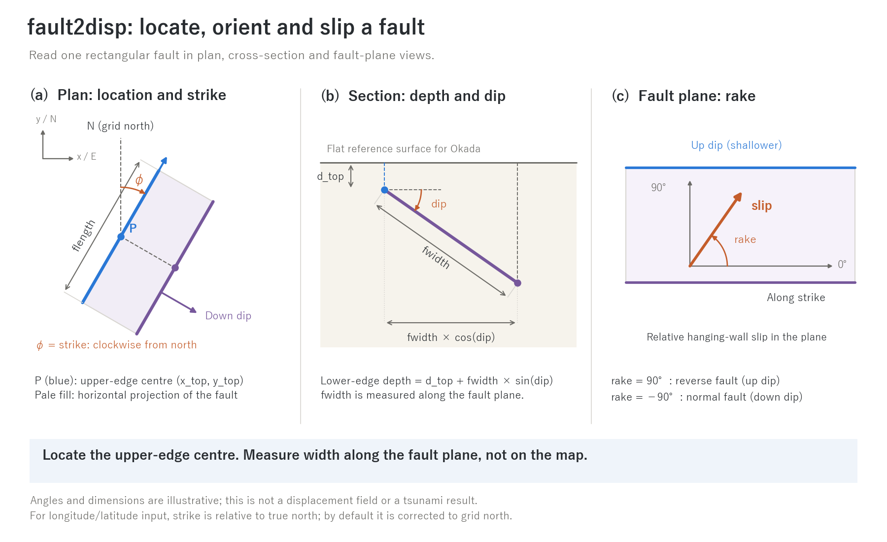

# fault2disp — Create ground-displacement time histories from fault parameters

> English mirror of utils/fault2disp/README.md. The Japanese file is the master copy.

[日本語](README.md)

This preprocessing utility creates the snapshot table and cumulative-displacement
rasters used by [fn_bedmotion](../../docs/en/users_guide/bedmotion.md) (prescribed
bed motion). It evaluates surface displacement from rectangular faults in an
elastic half-space using Okada (1985), with Poisson's ratio 0.25. It supports
multiple segments, separate rupture start times and rise functions, the horizontal
displacement contribution (Tanioka & Satake 1996), longitude/latitude input, and
automatic grid setup from georeferenced files. The design is in
docs/bedmotion_plan.md §6; the implementation record is in developer.md §70.

```
cd utils/fault2disp
make                        # links libencflow.a; build src first if needed
make check                  # checks Okada (1985) Table 2 and transverse Mercator
./fault2disp fault2disp.txt  # reads settings and writes to dir_out/
```

Outputs are `dir_out/disp_NNNN.txt` (cumulative displacement at each time, in
the same text-matrix format as ENCflow's z, with rows from north to south) and
`dir_out/bmlist.txt` (a table of time and filename). On the ENCflow side, set
`fn_bmlist = 'bm/bmlist.txt'` in `&list_bedmotion`. A complete example is in
[examples/tsunami_fault](../../examples/tsunami_fault/en/README.md).

## 1. Minimal setup

An idealised experiment without georeferencing: one reverse fault on a
200 km × 150 km domain with a 1 km grid.

```
&list_fault2disp
  nx = 200                  ! same grid as ENCflow's list_geoinfo
  ny = 150
  dx = 1000.0
  dy = 1000.0
  dir_out = 'bm'            ! output; prefix_list = 'bm/' prefixes table entries
  nout = 10                 ! time divisions: nout + 1 snapshots
  nseg = 1
  x_top(1) = 120000.0       ! upper-edge centre, 120 km east of the grid origin
  y_top(1) = 75000.0        ! 75 km north of the lower-left grid corner
  d_top(1) = 5000.0         ! upper-edge depth: 5 km
  strike(1) = 0.0           ! north; the fault dips to the right (east)
  dip(1) = 15.0
  rake(1) = 90.0            ! reverse fault
  flength(1) = 60000.0      ! 60 km along strike
  fwidth(1) = 30000.0       ! 30 km along dip
  slip(1) = 5.0             ! 5 m slip
  t_r(1) = 0.0              ! rupture start (s)
  t_rise(1) = 30.0          ! 30 s half-cosine rise
/
```

## 2. Fault parameter conventions

Read the inputs in three steps: **place the upper-edge centre → orient the
plane with strike and dip → specify slip within the plane**.



**(a)** Blue point P is `x_top, y_top`. Half of `flength` extends in each strike
direction; the plane dips to the right of the directed strike. **(b)** `dip`
is measured from horizontal, and `fwidth` along the plane. **(c)** Face-on view
of the fault plane, with along-strike to the right and up-dip upward. Positive
`rake` turns from along-strike towards up-dip. Angles and dimensions are illustrative.
[SVG](../../docs/figs/fault_geometry_en.svg) · [Generator](../../docs/figs/guide/fig_fault.py)

Specify the following for each segment k. Up to 50 segments are superposed.

| Input | Meaning |
|---|---|
| x_top(k), y_top(k) | Position of the **upper-edge centre** (m); coordinate options are in §3. With f_lonlat=1, use lon_top(k), lat_top(k) in degrees instead |
| d_top(k) | Upper-edge depth (m, ≥ 0), measured downward from the flat reference surface of the Okada calculation |
| strike(k) | Strike in degrees, clockwise from grid north. **The plane dips to the right of the directed strike**. With longitude/latitude input, supply true-north strike; it is corrected to grid north by default (§3) |
| dip(k) | Dip in degrees, 0 < dip ≤ 90 |
| rake(k) | Slip angle in degrees, counterclockwise from along-strike within the fault plane. 90 = reverse (hanging wall moves up), −90 = normal, 0 = left-lateral, 180 = right-lateral |
| flength(k) | Length along strike (m) |
| fwidth(k) | Width along dip (m) |
| slip(k) | Slip magnitude (m) |
| t_r(k) | Rupture start (s, relative to the simulation start) |
| t_rise(k) | Rise time (s); 0 means instantaneous |
| f_rise(k) | Rise function: 1 = linear; 2 = half-cosine (1 − cos(πs))/2 (default) |

The lower-edge centre lies `fwidth × cos(dip)` to the right of the upper-edge
centre, at depth `d_top + fwidth × sin(dip)`. `d_top` is used directly: the
terrain elevation in `fn_z` is not subtracted to adjust its depth automatically.
Lengths, widths and positions are in metres; angles are in degrees. Fault length
and width are not multiplied by a projection scale factor. See
[examples/tsunami_fault](../../examples/tsunami_fault/en/README.md) for a computed displacement field.

## 3. Three ways to specify coordinates

fault2disp uses the same projected coordinates as the ENCflow grid: x increases
eastward and y northward, in metres. `x_ll, y_ll` give the outer lower-left corner
of the grid (default 0). The centre of cell (i, j) is
x = x_ll + (i − 1/2) dx, y = y_ll + (ny − j + 1/2) dy; row j = 1 is the northern edge.

### Pattern A: an idealised experiment without georeferencing

Leave x_ll = y_ll = 0 and give x_top, y_top as **distances from the lower-left
grid corner** (§1). Supply nx, ny, dx and dy.

### Pattern B: a georeferenced projected grid

If terrain is in bil + hdr or GeoTIFF (ENCflow f_input_mode = 2 / 4), supply it
as fn_z. The grid (nx, ny, dx, dy) and origin (x_ll, y_ll) are read from the file,
so x_top and y_top are **absolute coordinates in that projected CRS**.

```
&list_fault2disp
  fn_z = 'dem.tif'          ! supplies grid and origin; also adds u_h·∇z
  f_input_mode = 4          ! 2: bil+hdr; 4: GeoTIFF
  nseg = 1
  x_top(1) = 452300.0       ! easting in this projected CRS (m)
  y_top(1) = 3987600.0      ! northing (m)
  ...(d_top and the remaining inputs are in §2)
/
```

For Japan's **plane rectangular coordinate system**, where X is northing and
Y is easting, set `f_jpr = 1`. Then enter X (northing) as x_top(k) and Y (easting)
as y_top(k), in that order. The same order applies to manually supplied x_ll, y_ll.

```
  f_jpr = 1
  x_top(1) = -35367.2       ! X (northing)
  y_top(1) = -5995.2        ! Y (easting)
```

Text terrain has no georeference: supply the lower-left coordinates as x_ll,
y_ll yourself, then use absolute fault coordinates. If nx, ny, dx, dy, x_ll,
y_ll are explicitly supplied alongside georeferenced fn_z, their consistency
is checked; a mismatch stops the utility.

### Pattern C: longitude and latitude

With `f_lonlat = 1`, enter the upper-edge centre as lon_top(k), lat_top(k) in
degrees. Transverse Mercator (Gauss–Krüger) projects it onto the grid, and grid
convergence corrects the strike to grid north. Supply the grid's projection:

| Grid projection | proj_lon0 | proj_lat0 | proj_k0 | proj_fe | proj_fn |
|---|---|---|---|---|---|
| UTM north, e.g. zone 54 | 141.0 (central meridian) | 0 | 0.9996 | 500000 | 0 |
| Japan plane rectangular, e.g. system IX | 139.8333 (139°50′) | 36.0 | 0.9999 | 0 | 0 |

```
&list_fault2disp
  fn_z = 'dem.tif'          ! grid/origin from the file, or nx, ny, dx, dy, lon_ll, lat_ll
  f_input_mode = 4
  f_lonlat = 1
  proj_lon0 = 141.0         ! UTM zone 54
  proj_lat0 = 0.0
  proj_k0 = 0.9996
  proj_fe = 500000.0
  proj_fn = 0.0
  nseg = 1
  lon_top(1) = 142.80
  lat_top(1) = 38.10
  strike(1) = 195.0         ! true north; corrected to grid north
  ...
/
```

For a grid without georeferencing, lon_ll, lat_ll can also specify the origin;
the same projection gives x_ll, y_ll. GRS80 is the default ellipsoid (for WGS84,
use ell_rf = 298.257223563). For other projections such as Lambert, convert
coordinates externally and use Pattern B.

## 4. Time and output

- The interval from t_start to t_end is split into nout divisions, producing
  nout + 1 times. Negative bounds select the earliest rupture start and latest
  rupture end automatically. Each file contains **cumulative** displacement
  relative to the initial terrain. ENCflow interpolates linearly between
  snapshots. Increase nout for a smoother rise, especially with nonhydrostatic
  `f_nh_bottom`.
- For instantaneous displacement, equivalent to an initial-water-level setup,
  use a table containing only the previously generated final snapshot at time 0.
  When generating with `t_rise=0`, include an output time after `t_r`;
  displacement is zero exactly at `t_r`.
- `f_window = 1` writes the bounding rectangle of |u_z| > d_min across all
  segments and appends `i1 j1 ni nj` to the table. This reduces file size on a
  large domain. The threshold applies to each segment, not to the superposed
  displacement. Okada far-field
  displacements extend widely at millimetre scale, so a few centimetres is a
  practical threshold.
- Supplying fn_z adds the horizontal contribution u_h·∇z (Tanioka & Satake
  1996) to vertical displacement, relevant on steep seafloor slopes.

## 5. Parameter reference

| Input | Default | Meaning |
|---|---|---|
| nx, ny, dx, dy | 0 | Grid dimensions and cell sizes (m); optional with georeferenced fn_z |
| x_ll, y_ll | 0 | Outer lower-left grid coordinates (m); zero gives relative coordinates (Pattern A) |
| fn_z | '' | Terrain file; adds u_h·∇z and can supply georeferencing |
| f_input_mode | 1 | fn_z format: 1 = text, 2 = bil+hdr, 4 = GeoTIFF (same as ENCflow) |
| f_georef | 1 | Read grid and origin from bil+hdr / GeoTIFF fn_z |
| f_jpr | 0 | 1: enter x_top/y_top and x_ll/y_ll in Japan's X-northing, Y-easting order |
| f_lonlat | 0 | 1: fault position from lon_top, lat_top in degrees (Pattern C) |
| lon_top(k), lat_top(k) | 0 | Upper-edge longitude/latitude when f_lonlat=1 |
| lon_ll, lat_ll | unset | Optional longitude/latitude of the lower-left grid corner |
| proj_lon0, proj_lat0 | 0, 0 | Projection origin (degrees) |
| proj_k0 | 0.9996 | Central-meridian scale factor |
| proj_fe, proj_fn | 500000, 0 | False easting and northing (m) |
| ell_a, ell_rf | 6378137, 298.257222101 | Ellipsoid semi-major axis and inverse flattening (GRS80) |
| f_strike_conv | 1 | Correct strike for grid convergence when f_lonlat=1 |
| dir_out | 'bm' | Output directory |
| prefix_list | 'bm/' | Prefix for filenames in the table, relative to ENCflow's dir_data |
| nout | 20 | Number of time divisions |
| t_start, t_end | −1 | Output time bounds (s); negative selects automatically |
| f_window | 0 | Write only the bounding rectangle of nonzero displacement |
| d_min | 0.001 | Window threshold (m) |
| nseg | 0 | Number of segments, at most 50 |
| x_top(k) through f_rise(k) | — | Fault parameters (§2) |

## 6. Checks and examples

`fault2disp -check` reproduces the strike-slip and dip-slip displacements of
the finite rectangular fault in Okada (1985) Table 2 (x=2, y=3, d=4, dip 70°,
L=3, W=2) to four digits. It compares transverse Mercator coordinates against
the Snyder (1987) series within 1 mm at points in UTM zone 54 and Japan's
plane rectangular system IX.

[examples/tsunami_fault](../../examples/tsunami_fault/en/README.md) provides
[fault2disp.txt](../../examples/tsunami_fault/fault2disp.txt) (Pattern A),
[fault2disp_bil.txt](../../examples/tsunami_fault/fault2disp_bil.txt) /
[fault2disp_gtif.txt](../../examples/tsunami_fault/fault2disp_gtif.txt) (Pattern B),
[fault2disp_jpr.txt](../../examples/tsunami_fault/fault2disp_jpr.txt) (Japan's
coordinate order), and [fault2disp_ll.txt](../../examples/tsunami_fault/fault2disp_ll.txt)
(Pattern C).
