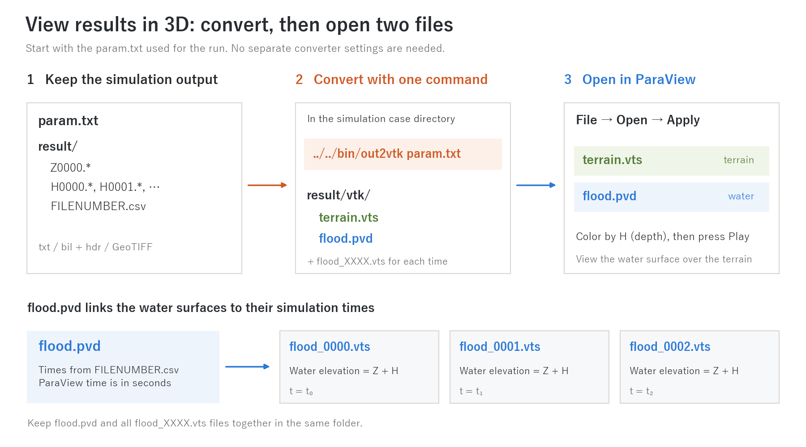

# out2vtk — View simulation results in 3D with ParaView

> English mirror of utils/out2vtk/README.md. The Japanese file is the master copy.

[日本語](README.md)

This post-processing utility converts ENCflow raster outputs in `result/`
(txt, bil + hdr, or GeoTIFF) into VTK files for [ParaView](https://www.paraview.org/).
Use it to view terrain in 3D, animate the water surface, and drape maps or
satellite images exported from QGIS over the terrain.

## Start in three steps

[Build out2vtk](#build) once before starting.

1. Run `../../bin/out2vtk param.txt` in the simulation case directory.
   Use the `param.txt` from the run. No separate converter settings are needed.
2. In ParaView, use **File → Open** to open `result/vtk/terrain.vts` and
   `result/vtk/flood.pvd`, then click **Apply**.
3. Color the water surface by **H** (depth), then press **Play**.



*View the water surface over the terrain. `flood.pvd` groups the water-surface
files by time, so you do not need to open them one by one. The figure uses
the default output directory and no filename suffix.*
[SVG](../../docs/figs/visualization_workflow_en.svg) · [Generator](../../docs/figs/guide/fig_visualization.py)

For hiding dry areas and adjusting colors, see the [ParaView quick start](#paraview-quick-start)
below. Results from [test/wave](../../test/wave/en/README.md) make a useful practice case.
For depth or discharge line plots, use the CSV files in `probes/` and `fluxes/`
from [measurement output](../../docs/en/users_guide/record.md) in Python or a spreadsheet.

The original simulation outputs are left unchanged, so you can convert them
again with different display settings.

## Generated files

The default destination is `result/vtk/` (configurable).

| File | Contents |
|---|---|
| `terrain.vts` | Terrain surface at the elevations in Z0000, with texture coordinates |
| `flood_XXXX.vts` | Water surface at each output time (terrain elevation + depth), with depth and other point data |
| `flood.pvd` | Time collection; ParaView uses the simulation time t in seconds |
| `summary.vts` | Statistics such as maximum depth, when `H9999` exists and number 9999 is in the time table |

The repeated final state (number 9998) is omitted from the conversion.

## Build

```bash
cd utils/out2vtk
make install        # copies the executable into bin/ at the repository root
```

Running `make install` at the repository root also builds and installs this
utility along with ENCflow and the other tools.

## Usage

From the simulation case directory (the one containing `result/`):

```bash
../../bin/out2vtk param.txt    # use the simulation parameter file (recommended)
../../bin/out2vtk              # use defaults for all settings
../../bin/out2vtk out2vtk.nml  # use a converter settings file
```

Passing the simulation parameter file supplies `dir_result`, `outfn_suffix`
and the grid settings (`nx`, `ny`, `dx`, `dy` from `&list_geoinfo`). This is
usually enough, following the same convention as rerecord and lu2mask.

To change thresholds or other options, pass a namelist file. Every entry
below is optional:

```fortran
&out2vtk
  fn_param = "param.txt"   ! simulation parameters to inherit
  dir_result = ""          ! empty: use param value, or result
  dir_vtk = ""             ! empty: dir_result/vtk
  outfn_suffix = ""        ! empty: use param value
  hmin = 0.01              ! thin-water threshold (m)
  vars = "H", "V", "Pr"    ! empty: all detected variables
  f_mask = 1               ! domain masking
  nx = 0                   ! usually detected automatically
  ny = 0
  csx = 0.0                ! cell size (m) for non-georeferenced txt output
  csy = 0.0
/
```

- **Thin-water threshold `hmin`**: where depth is below this value, water-surface
  variables (H, WSE, velocity, etc.) become NaN. This hides thin numerical films
  or shallow channel water when focusing on inundation. Start with the default
  1 cm; try 5–10 cm if the view is cluttered. `hmin=0.0` disables this filter.
- **Variables `vars`**: all detected output variables are included by default.
  To reduce file size, select their output prefixes, such as H, E, u, v, V, Q,
  Pr, Hg or Sw.
- **Domain mask `f_mask`**: when the results include `X0000` (the domain
  mask: 0 = outside the domain, 1 = land, 2 = sea; always written by encflow),
  the default (`f_mask = 1`) generates vtk files for **land only**. Cells
  outside the domain and sea cells are hidden by VTK blanking
  (`vtkGhostType`), so no action is needed in ParaView. `f_mask = 2` includes
  the sea (when you also want the sea-side water surface, as for storm surge
  or tsunami); `f_mask = 0` disables masking (whole domain). In every case the
  mask values are also included as point data named `mask`, so you can switch
  with a Threshold filter as well. Results without `X0000` (output of older
  versions) and cases where the whole domain is computed give the same output
  as before. The unit of hiding is a surface cell (the quadrilateral joining
  grid-cell centres), and only cells whose four corners are all in the hidden
  region are hidden, so the visible surface extends half a grid cell beyond
  the boundary.
- **Grid information**: grid dimensions and coordinates are taken from the
  Z0000 hdr or GeoTIFF. For txt, dimensions are counted from the file. Without
  georeferencing, coordinates are local metres from the southwest corner.
  Cell size comes from the parameter file (`fn_param` or the argument) or
  `csx`, `csy`; it defaults to 1 m if neither is supplied, so pass the
  parameter file for txt output. Only for bil output without an hdr (a case
  without georeferencing and `f_output_mode = 2`) must `nx` and `ny` be
  specified.

### Included point data

- `H` (depth) and `WSE` (terrain elevation + depth) are always included.
- If both `u` and `v` are available, a `velocity` vector is added (positive
  east and north); use Glyph to display arrows.
- Land and subsurface quantities such as precipitation Pr, subsurface storage
  Hg and snow Sw are not masked by `hmin`: they remain meaningful on dry land.
- Direction flags Ddd and Dda are excluded because they are unsuitable for
  surface coloring.

## ParaView quick start

1. Use **File → Open** for `flood.pvd` and `terrain.vts`; click **Apply** for both.
2. Set Coloring for `terrain.vts` to **Solid Color**, for example gray.
3. Color `flood.pvd` by **H** or **WSE**. Dry points have NaN values: set
   **NaN Opacity** to **0** in the color-map editor to hide them. Alternatively,
   use a **Threshold** filter on H with a lower bound equal to `hmin`.
4. Press **Play** to animate. Time is in simulation seconds. **View → Time
   Inspector** shows the times; **Filters → Annotate Time** adds a time label.
5. If the terrain looks too flat, apply **Filters → Transform** to both objects
   and set Scale to, for example, `(1, 1, 5)` for vertical exaggeration.
6. Use **File → Save Animation** to export a movie or numbered PNG frames.

The camera does not follow the water surface. Set the view with just the
terrain visible before starting playback.

See the official ParaView guides for
[loading data and handling time](https://docs.paraview.org/en/latest/UsersGuide/dataIngestion.html#dealing-with-time)
and [colors and NaN display](https://docs.paraview.org/en/latest/ReferenceManual/colorMapping.html#color-mapping-parameters).

## Draping maps or satellite images (with QGIS)

ParaView cannot read web maps directly, but by **exporting an image of the
same extent as the model domain from QGIS and draping it over the terrain**
you can make 3D animations of water flowing over satellite imagery or maps.
`terrain.vts` includes texture coordinates normalized to 0–1 across the grid
extent, so applying the image is just a matter of selecting it.

### Export a background image from QGIS

1. Load a georeferenced model raster, such as `Z0000.tif` or bil + hdr.
   Set the project CRS to the model's projected CRS, rather than Web Mercator.
2. Add the background layers you want, such as map tiles, aerial photography
   or orthophotos.
3. Use **Project → Import/Export → Export Map to Image**. Set the extent from
   the model raster so the image edges match the grid's outer edges. Export
   a PNG, roughly 2000–8000 pixels across, showing only the background layers.

### Apply the image in ParaView

1. Select `terrain.vts`, then choose the PNG under **Display → Texture** in
   Properties. Enable advanced properties with the gear icon if necessary.
2. Set Coloring to **Solid Color** and the color to white.
3. Overlay `flood.pvd` and play the animation. A water opacity around 0.7 can
   make the underlying map easier to see.

Geographic grids are converted to approximate local metres in ParaView.
Texture coordinates remain normalized to the grid extent, so draping still works.

## Notes and limits

- Projected coordinates are in metres and stored in double precision to
  preserve large coordinate values. Non-georeferenced and geographic grids
  use local metre coordinates from the southwest corner.
- Only numbers listed in `FILENUMBER.csv` are converted. Results from an
  interrupted run can also be used.
- When a landform-change (geomorph) run writes Z at each output time, the
  water-surface height is computed on the terrain of that time. `terrain.vts`,
  however, is fixed to Z0000 (animating the terrain itself is future work).
- VTK files assume little-endian byte order (as does the existing bil output;
  all supported platforms, x86 / arm / NEC VE, qualify).
- Size is roughly `(32 + 4 × number of variables)` bytes per grid cell per
  time step. Use `vars` to reduce it.
